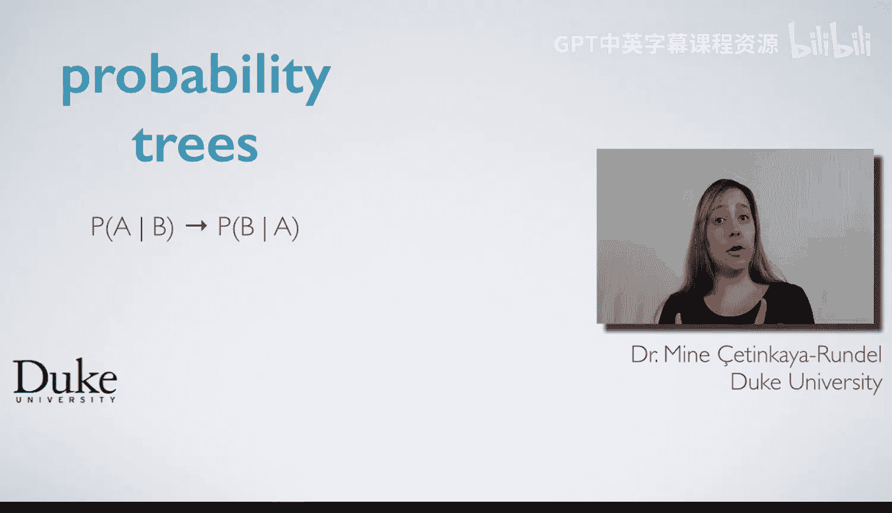
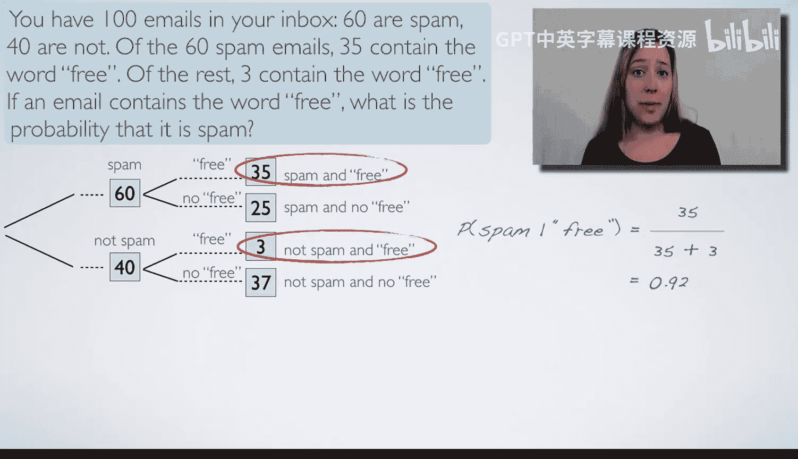
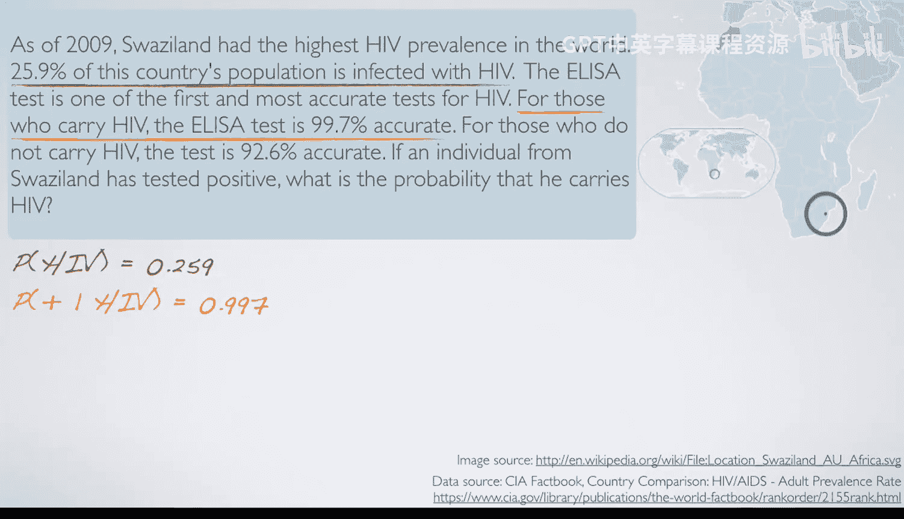
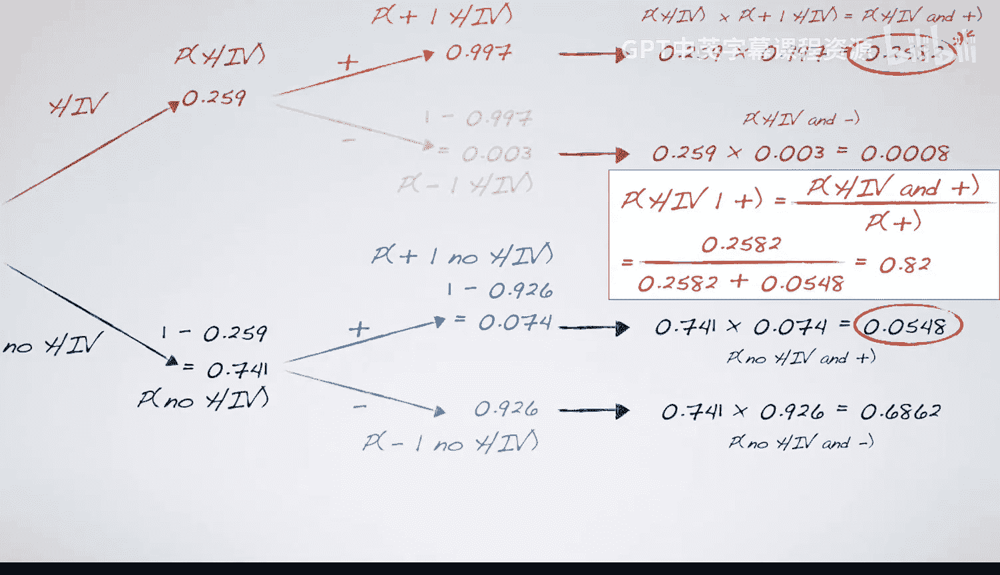
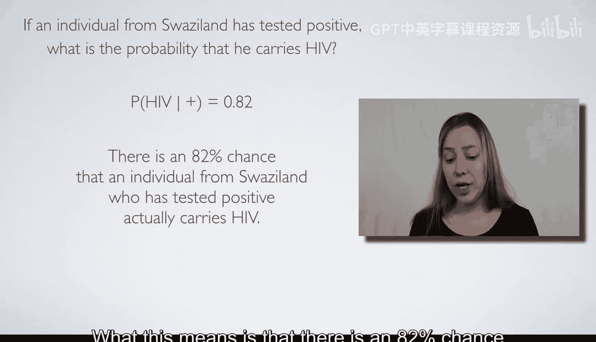
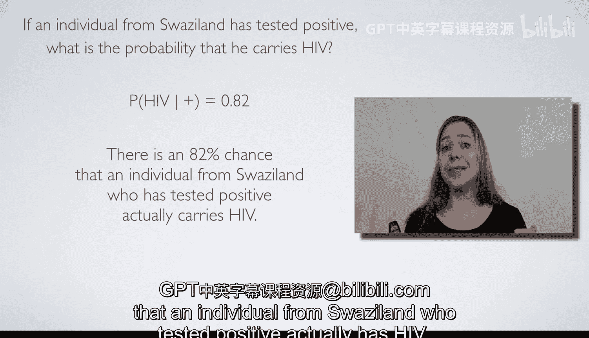

#  021：概率树 🌳

在本节课中，我们将学习如何使用概率树来求解条件概率。概率树在所求概率与已知概率条件相反时尤其有用。

## 从简单例子开始

上一节我们介绍了概率树的基本概念，本节中我们通过一个简单例子来具体了解其应用。

你收件箱里有100封邮件。其中60封是垃圾邮件，40封不是。在60封垃圾邮件中，35封包含“免费”一词，其余则不包含。在非垃圾邮件中，只有3封包含“免费”一词。

如果一封邮件包含“免费”一词，那么它是垃圾邮件的概率是多少？

首先，我们需要将已知信息整理成概率树。我们从将总体（本例中是收件箱）根据邮件是否为垃圾邮件进行划分开始。

以下是构建概率树的步骤：

1.  第一层分支：根据邮件是否为垃圾邮件划分。
    *   垃圾邮件：60封
    *   非垃圾邮件：40封
2.  第二层分支：在每一类下，根据是否包含“免费”一词进一步划分。
    *   在垃圾邮件中：
        *   包含“免费”：35封
        *   不包含“免费”：25封
    *   在非垃圾邮件中：
        *   包含“免费”：3封
        *   不包含“免费”：37封

## 求解条件概率

现在我们已经将信息整理成概率树，接下来回到问题本身。问题是：已知一封邮件包含“免费”一词，求它是垃圾邮件的概率。

这可以表示为：`P(垃圾邮件 | 包含“免费”)`。

由于我们已知邮件包含“免费”，因此可以忽略不包含此词的邮件。首先，计算包含“免费”一词的邮件总数：35（来自垃圾邮件） + 3（来自非垃圾邮件） = 38封。

在这些邮件中，我们感兴趣的是垃圾邮件，共35封。因此，概率为 35 / 38 ≈ 0.92 或 92%。

在此过程中，我们隐含地使用了贝叶斯定理。分子是联合概率 `P(垃圾邮件 且 包含“免费”)`，分母是我们所条件化的边际概率 `P(包含“免费”)`。为了简化，我们直接使用了计数而非概率。

## 处理概率情景

接下来，我们看一个更复杂的情景，其中我们直接处理概率，而不知道总体大小。

斯威士兰的HIV感染率全球最高。该国25.9%的人口感染了HIV。ELISA测试是最早且最准确的HIV检测方法之一。对于携带HIV的人，该测试的准确率为99.7%。对于不携带HIV的人，测试准确率为92.6%。请注意，这些概率是估计值。

如果一名来自斯威士兰的个体检测结果为阳性，那么他携带HIV的概率是多少？

已知信息：
*   `P(HIV) = 0.259`
*   对于携带HIV者：`P(阳性 | HIV) = 0.997` （准确率）
*   对于不携带HIV者：`P(阴性 | 非HIV) = 0.926` （准确率）

所求概率为：`P(HIV | 阳性)`。

这是一个条件被“反转”的情况，概率树是解决此类问题最有效的方法之一。

## 构建概率树求解

首先，根据是否感染HIV进行第一层分支划分（边际概率）：
*   `P(HIV) = 0.259`
*   `P(非HIV) = 1 - 0.259 = 0.741`

接下来，在每一分支下，根据检测结果进行第二层划分（条件概率）：
*   在“感染HIV”分支下：
    *   `P(阳性 | HIV) = 0.997`
    *   `P(阴性 | HIV) = 1 - 0.997 = 0.003` （假阴性）
*   在“未感染HIV”分支下：
    *   `P(阴性 | 非HIV) = 0.926`
    *   `P(阳性 | 非HIV) = 1 - 0.926 = 0.074` （假阳性）

我们的目标是计算 `P(HIV | 阳性)`。根据贝叶斯定理，这等于 `P(HIV 且 阳性) / P(阳性)`。

使用概率树，要得到联合概率（如分子），只需将路径上的概率相乘。

以下是各路径的概率计算：

1.  `P(HIV 且 阳性) = P(HIV) * P(阳性 | HIV) = 0.259 * 0.997 ≈ 0.2582`
2.  `P(HIV 且 阴性) = 0.259 * 0.003 ≈ 0.0008`
3.  `P(非HIV 且 阳性) = P(非HIV) * P(阳性 | 非HIV) = 0.741 * 0.074 ≈ 0.0548`
4.  `P(非HIV 且 阴性) = 0.741 * 0.926 ≈ 0.6862`

现在，回到我们的计算：
*   分子：`P(HIV 且 阳性) ≈ 0.2582`
*   分母：`P(阳性)`。检测为阳性的人可能来自两个互斥的群体：真正感染HIV的人和未感染但出现假阳性的人。因此，`P(阳性) = P(HIV 且 阳性) + P(非HIV 且 阳性) ≈ 0.2582 + 0.0548 = 0.313`

最终，`P(HIV | 阳性) = 0.2582 / 0.313 ≈ 0.82`。

## 总结

本节课中我们一起学习了如何使用概率树求解条件概率，特别是在所求条件与已知条件相反时。

我们通过两个例子进行了实践：
1.  在邮件分类例子中，我们通过计数直接计算，得出包含“免费”一词的邮件是垃圾邮件的概率约为92%。
2.  在医学检测例子中，我们使用概率树和乘法规则计算联合概率，并应用贝叶斯定理，得出在斯威士兰，检测结果为阳性的人实际感染HIV的概率约为82%。

概率树是一种强大的工具，它能清晰地组织信息，引导我们逐步计算出所需的概率。