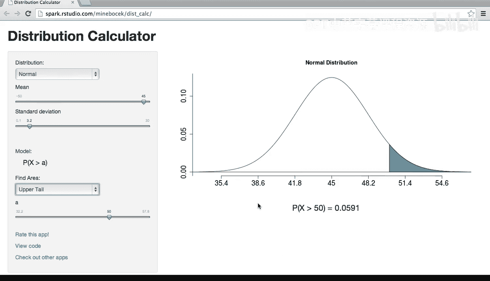

#  026：正态分布应用


在本节课中，我们将学习如何应用正态分布模型来解决实际问题。我们将通过两个具体的例子，演示如何使用不同的工具和方法来计算概率和百分位数。

## 概述

正态分布是数据分析中一个非常重要的模型。许多自然现象和测量数据都近似服从正态分布。我们将通过两个案例来学习如何利用正态分布的特性进行计算：第一个案例是计算行李超重的概率，第二个案例是找出特定百分位数对应的温度值。

## 案例一：计算行李超重概率

假设某航空公司乘客托运行李的重量近似服从正态分布，其均值为45磅，标准差为3.2磅。大多数航空公司对超过50磅的行李收取额外费用。我们需要计算有多少比例的乘客需要支付这笔费用。

行李重量服从正态分布，均值为45，标准差为3.2，我们可以将其表示为：`N(μ=45, σ=3.2)`。我们的目标是计算重量超过50磅的概率，即 `P(X > 50)`。

以下是几种不同的计算方法。

### 方法一：使用在线模拟工具



我们可以访问一个正态分布模拟工具来完成计算。在工具中，我们将分布类型设置为“正态”，均值设置为45，标准差设置为3.2。然后，我们将关注的分界值（cutoff value）滑动到50。工具会显示，大约有5.91%的乘客的行李重量会超过50磅。

### 方法二：使用R语言的 `pnorm` 函数

在R语言中，我们可以直接使用 `pnorm` 函数。该函数计算给定值左侧（小于该值）的概率。

```r
pnorm(50, mean=45, sd=3.2)
```
运行上述代码会得到结果 `0.9409`。这表示重量低于50磅的概率是94.09%。然而，我们关心的是超过50磅的概率，即右侧的概率。因此，我们需要计算其补集：
```r
1 - pnorm(50, mean=45, sd=3.2)
```
计算结果是 `0.0591`，即大约5.91%的乘客需要支付超重费用。

### 方法三：手动计算Z分数并使用概率表

我们也可以手动计算Z分数，然后查标准正态分布表。

首先，计算观测值50对应的Z分数：
```
Z = (观测值 - 均值) / 标准差 = (50 - 45) / 3.2 ≈ 1.56
```
然后，在标准正态分布表中查找Z=1.56对应的概率值。在表中，Z=1.56对应的概率约为0.9406。这同样是重量低于50磅的概率。因此，重量超过50磅的概率为：
```
1 - 0.9406 = 0.0594 ≈ 5.9%
```
三种方法得出的结论一致：大约有5.9%的乘客的行李会超重。

## 案例二：计算特定百分位数对应的温度

现在，我们来看第二个问题。洛杉矶六月份的平均日最高气温为77华氏度，标准差为5华氏度。假设气温近似服从正态分布。我们需要找出六月份洛杉矶最冷的20%的日子，其气温低于多少度。

这里，我们已知分布 `N(μ=77, σ=5)` 和一个概率（20%），需要反推出对应的观测值（温度）。这涉及到计算百分位数。

### 方法一：使用R语言的 `qnorm` 函数

在R语言中，我们可以使用 `qnorm` 函数，它根据给定的概率（百分位）返回对应的分位数。

```r
qnorm(0.20, mean=77, sd=5)
```
运行代码得到结果 `72.79`。这意味着，六月份洛杉矶最冷的20%的日子，其最高气温低于72.79华氏度。

### 方法二：手动计算Z分数并使用概率表

我们也可以手动完成这个过程。首先，我们需要找到概率0.20对应的标准Z分数。

在标准正态分布表中查找最接近0.20的概率值。我们发现，概率值0.2005对应的Z分数是-0.84（因为我们在分布的低端，所以Z分数为负）。

接下来，我们利用Z分数的公式反推观测值X：
```
Z = (X - μ) / σ
-0.84 = (X - 77) / 5
```
解这个方程：
```
X - 77 = -0.84 * 5
X - 77 = -4.2
X = 77 - 4.2 = 72.8
```
因此，最冷的20%的日子的气温低于大约72.8华氏度。这与R计算的结果非常接近。

## 总结

在本节课中，我们一起学习了正态分布的两个核心应用。

首先，我们学习了如何计算某个特定值以上的概率（右尾概率）。我们使用了三种工具：在线模拟工具、R语言的 `pnorm` 函数，以及手动计算Z分数查表法。核心公式是 `Z = (X - μ) / σ`。

其次，我们学习了如何根据已知的概率（百分位）来反推对应的观测值。我们使用了R语言的 `qnorm` 函数，以及手动查表并利用Z分数公式反推的方法。

掌握这些方法，你就能灵活运用正态分布模型来解决各种实际问题，无论是预测概率还是确定关键阈值。