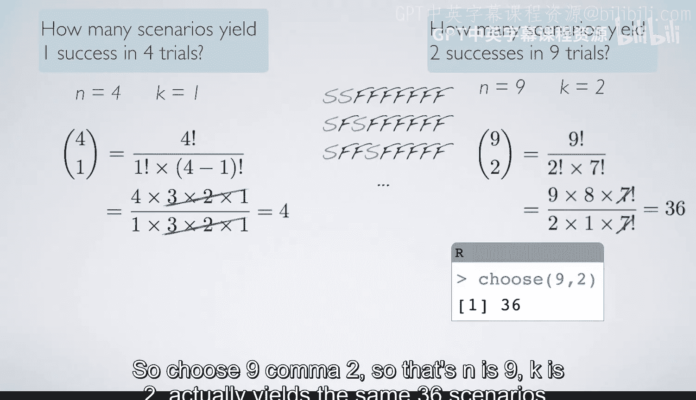
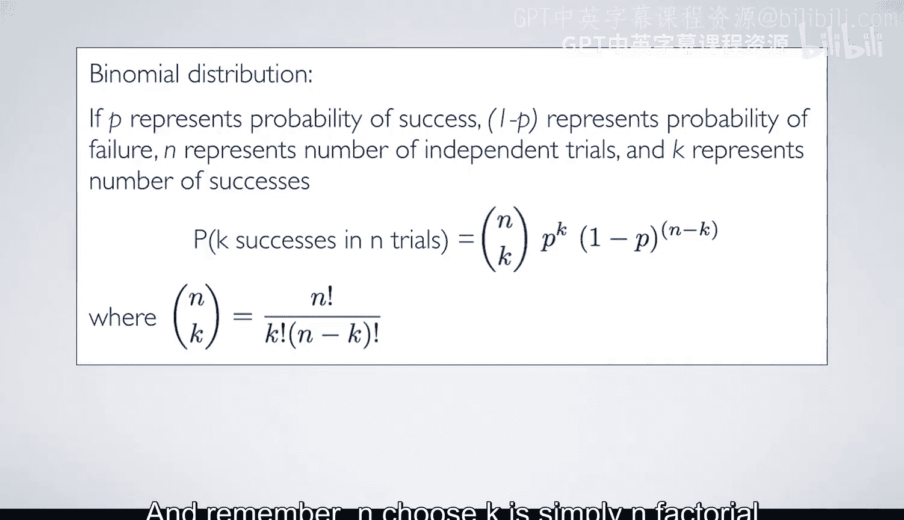
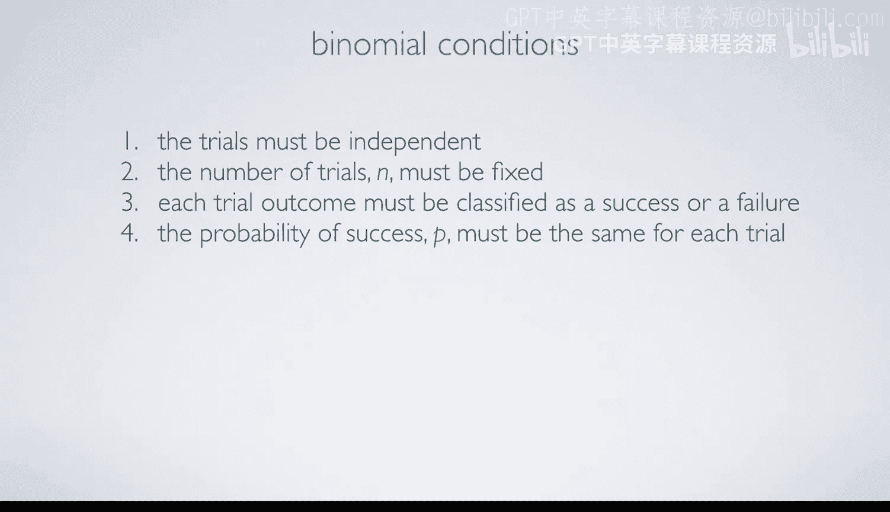
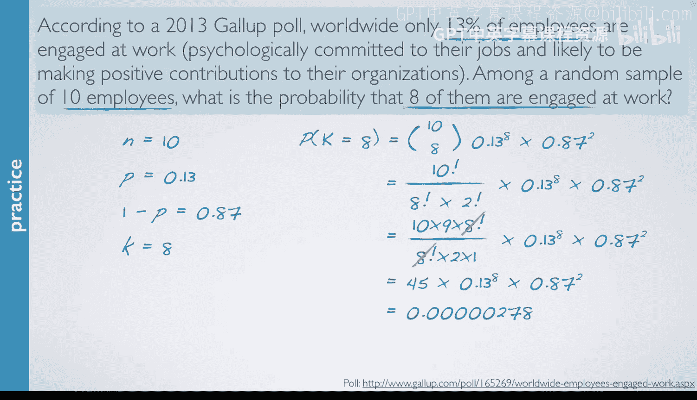
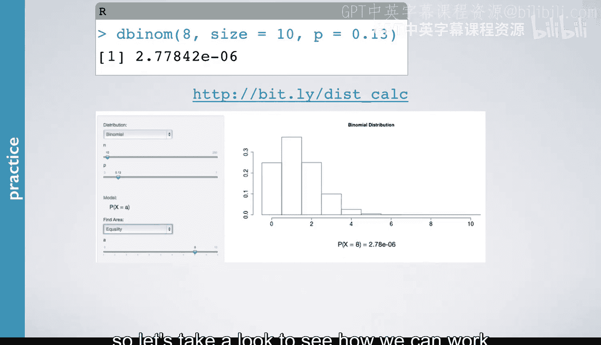
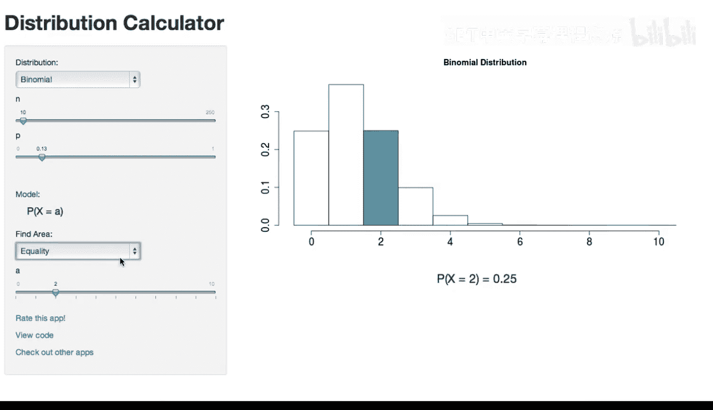
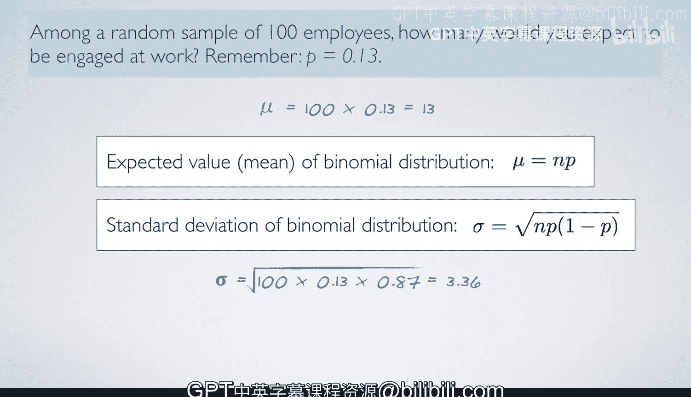

#  027：二项分布 📊

在本节课中，我们将要学习二项分布。我们将定义二项分布，讨论其性质，并列出随机变量服从二项分布所需的条件。我们还将学习如何使用网络计算器、R语言以及手动计算来求解二项分布下的概率。最后，我们将评估二项分布的特征，例如其均值和标准差。

---

## 二项分布的定义与性质

上一节我们介绍了课程概述，本节中我们来看看二项分布的具体定义。我们将通过一个经典的心理学实验来展开讨论。

这个实验由耶鲁大学心理学家斯坦利·米尔格拉姆在20世纪60年代开始进行。实验测量了参与者在权威人士的指令下，执行与自己个人良知相冲突的行为的意愿。

实验设置如下：实验者命令“教师”在“学习者”每次答错问题时给予其强烈的电击。“教师”是研究的对象，而“学习者”实际上只是一名演员。电击并非真实，每次“教师”实施电击时，会播放预先录制的声音，因此“教师”认为自己真的在电击他人。

米尔格拉姆发现，大约65%的人会服从权威并给予此类电击。多年来，后续研究表明这个数字在不同社区和时代大致保持一致。

在米尔格拉姆的实验中，每个人可以被视为一次试验。如果一个人拒绝实施强烈电击，则被标记为“成功”；如果她实施了此类电击，则被标记为“失败”。由于只有35%的人拒绝实施此类电击，因此成功的概率 **P = 0.35**。请注意，我们在此处可以按需定义“成功”和“失败”，因为在后续分析中，我们将重点关注那些拒绝实施电击的人。

当一个单独的试验只有两种可能结果时，它被称为**伯努利随机变量**。

---

## 计算概率：一个具体例子

假设我们随机选择四个人参与这个实验。**恰好有一个人**拒绝实施电击的概率是多少？

我们将这四个人命名为安东尼、布列塔尼、克拉拉和多里安，分别用A、B、C、D表示。我们感兴趣的是四人中有一人拒绝实施电击的情况，这有多种可能发生的场景。

以下是所有可能的场景：

*   **场景一**：第一个人拒绝，其余三人不拒绝。
    概率为：`0.35 * 0.65 * 0.65 * 0.65 = 0.0961`
*   **场景二**：第一个人不拒绝，第二个人拒绝，其余两人不拒绝。
    概率为：`0.65 * 0.35 * 0.65 * 0.65 = 0.0961`
*   **场景三**：前两人不拒绝，第三个人拒绝，最后一人不拒绝。
    概率为：`0.65 * 0.65 * 0.35 * 0.65 = 0.0961`
*   **场景四**：前三人不拒绝，最后一个人拒绝。
    概率为：`0.65 * 0.65 * 0.65 * 0.35 = 0.0961`

这些是互斥的场景，它们不可能同时发生。因此，当我们说“场景一**或**场景二**或**场景三**或**场景四”时，我们将各个概率相加。所以，**恰好一人**拒绝的总概率是 `0.0961 + 0.0961 + 0.0961 + 0.0961 = 0.3844`。

我们也可以这样得到答案：将**单个场景的概率**乘以**场景的总数**。在第一个计算完成后，我们可以快速找出有多少种场景，然后简单地将一个场景的概率乘以场景数，即可得到相同答案。

---

## 二项分布公式

这种情况是应用**二项分布**的完美场景。该分布描述了在n次独立的伯努利试验中，恰好获得k次成功的概率，其中每次试验的成功概率为p。

我们证明了该概率可以计算为**场景数**乘以**单个场景的概率**。

*   **单个场景的概率** 是 `p^k * (1-p)^(n-k)`。这意味着：成功概率的（成功次数）次方，乘以失败概率的（失败次数）次方。
*   **场景数** 是选择k次成功发生在n次试验中的方式数。

为了找到场景数，我们之前枚举了所有可能场景。但这仅在数量较少时可行。如果数量很多，例如在100次试验中寻找4次成功的场景数，这种方法将非常繁琐且容易出错。

因此，我们通常使用另一种方法，即**组合函数**，它用于计算从n次试验中选择k次成功的方式数。

该函数的计算公式为：
`n choose k = n! / (k! * (n-k)!)`

让我们看几个例子：

*   **例子1**：在4次试验中找到1次成功的场景数。
    `n = 4`, `k = 1`。
    `4 choose 1 = 4! / (1! * 3!) = (4*3*2*1) / (1 * 3*2*1) = 4`。我们之前已经知道有4种场景。
*   **例子2**：在9次试验中找到2次成功的场景数。
    `n = 9`, `k = 2`。
    `9 choose 2 = 9! / (2! * 7!) = (9*8*7!) / (2*1 * 7!) = 72 / 2 = 36`。

这些手动计算很好，但为了加快速度，我们也可以在R中使用计算。相关的函数也叫 `choose`，它接受两个参数n和k。例如，`choose(9, 2)` 同样得到36。

---

## 二项分布公式总结

将所有这些放在一起，如果：
*   `p` 代表成功概率
*   `(1-p)` 代表失败概率
*   `n` 代表独立试验的次数
*   `k` 代表成功的次数

那么，在n次试验中获得k次成功的概率可以表示为：

`P(X = k) = (n choose k) * p^k * (1-p)^(n-k)`

其中，`(n choose k) = n! / (k! * (n-k)!)`

---

## 二项分布的条件

现在我们已经知道如何应用这些公式计算二项概率，让我们暂停一下，退一步思考：一个随机变量要服从二项分布需要满足什么条件？

以下是四个条件：
1.  试验必须是独立的。
2.  试验次数 `n` 必须是固定的。
3.  每次试验的结果必须被分类为“成功”或“失败”。
4.  每次试验的成功概率 `p` 必须相同。

第四个条件实际上与第一个条件密切相关，因为如果试验是独立的，那么可以合理地确定每次试验的成功概率是相同的。

---

## 应用实例：员工敬业度

根据2013年盖洛普的一项调查，全球只有13%的员工在工作中是“敬业”的（“敬业”指心理上投入工作，并可能为组织做出积极贡献）。在一个由10名员工组成的随机样本中，**恰好有8人**敬业的概率是多少？

首先，解析我们得到的信息：
*   我们有10名员工，所以 `n = 10`。
*   13%的人敬业，所以成功概率 `p = 0.13`。
*   失败概率是其补集，`1 - p = 0.87`。
*   我们寻找8次成功，所以 `k = 8`。

我们可以使用二项分布来求这个概率，因为我们实际上满足二项分布所需的条件：
*   我们有员工的随机样本，因此满足**独立试验**条件。
*   由于试验独立，每名员工的成功概率为 `p = 0.13`。
*   对每名员工只有两种可能结果：敬业或不敬业。
*   我们有固定的试验次数 `n = 10`。

因此，要找到10次试验中8次成功的概率，我们首先使用 `10 choose 8` 计算场景数，然后乘以一个场景的概率：`p^8 * (1-p)^2`。

计算过程：
`10 choose 8 = 10! / (8! * 2!) = (10*9*8!) / (8! * 2*1) = 90 / 2 = 45` 种场景。
每个场景的概率：`0.13^8 * 0.87^2`。
最终概率非常小：`45 * (0.13^8 * 0.87^2) ≈ 2.78e-07`。

为什么这是一个很低的概率？因为如果成功概率只有13%，那么在10名员工中，我们预计敬业的人数远少于8人。因此，我们在这里寻找的是一个高度不可能的结果。

---

## 使用R和计算器

我们也可以使用R来计算相同的概率。在R中，我们使用 `dbinom` 函数，其中第一个参数是成功次数 `k`，第二个参数是试验次数 `n`，第三个参数是成功概率 `p`。

`dbinom(8, 10, 0.13)` 会得到与我们手动计算相同的微小概率。

另一种方法是使用分布计算器小程序。我们可以选择分布为二项分布，设置 `n=10`，`p=0.13`，然后查找 `k=8` 对应的概率。图表中每个条形代表一个可能的结果，条形的高度代表该结果的概率。

---

## 二项分布的均值与标准差

在一个由100名员工组成的随机样本中，你预计有多少人会敬业？记住 `p = 0.13`。

这很简单，预计的敬业员工人数是 `100 * 0.13 = 13`。
更正式地说，二项分布的**期望值**或**均值**等于 `n * p`。

但这并不意味着在每100名员工的随机样本中，恰好有13人敬业。在某些样本中，敬业员工的数量会较少，而在另一些样本中会较多。

那么我们预计这个值会有多大变化？像往常一样，我们可以用**标准差**来量化均值周围的变异性。

对于二项分布，标准差定义为：
`标准差 = sqrt( n * p * (1-p) )`

代入调查中的值，我们得到：
`sqrt(100 * 0.13 * 0.87) ≈ 3.36`

这意味着，预计100名员工中有13人敬业，上下浮动大约3.36人。请注意，二项分布的均值和标准差可能不总是整数，这没关系，这些值代表了我们平均预期会看到的情况。

---

## 总结

本节课中我们一起学习了二项分布。我们通过米尔格拉姆实验的例子引入了二项分布的概念，学习了其概率计算公式 `P(X=k) = C(n,k) * p^k * (1-p)^(n-k)`，并明确了随机变量服从二项分布的四个条件：试验独立、试验次数固定、结果二分、概率恒定。我们还通过员工敬业度的例子实践了概率计算，并介绍了二项分布的均值 `μ = n*p` 和标准差 `σ = sqrt(n*p*(1-p))` 的计算方法。最后，我们了解了如何使用R语言和计算工具来辅助求解二项分布问题。