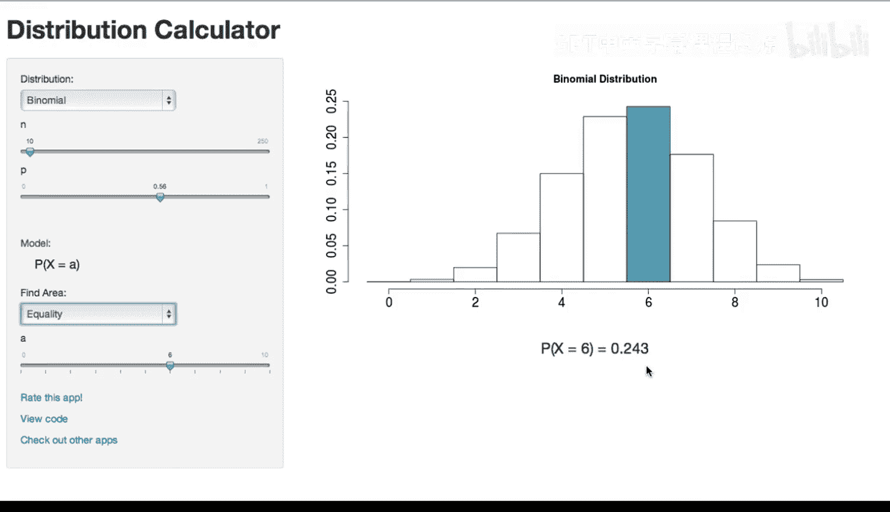
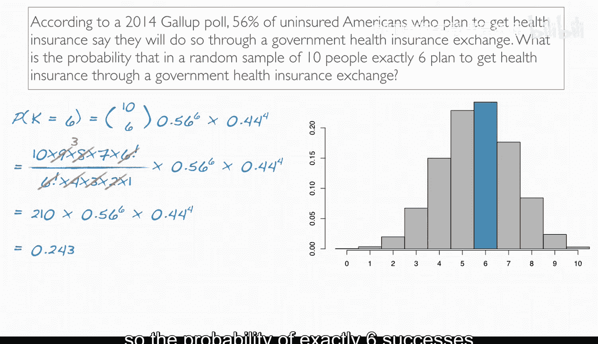
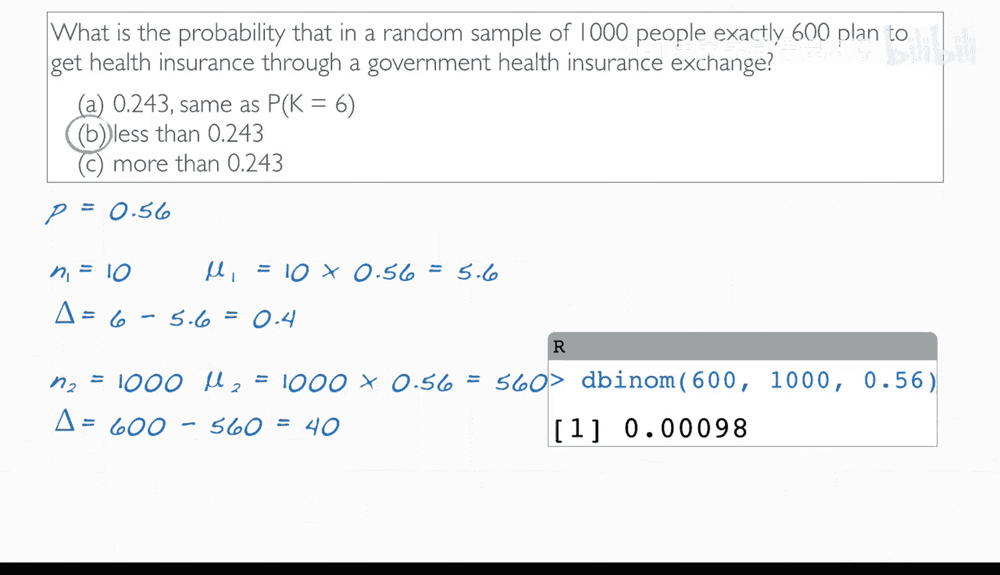
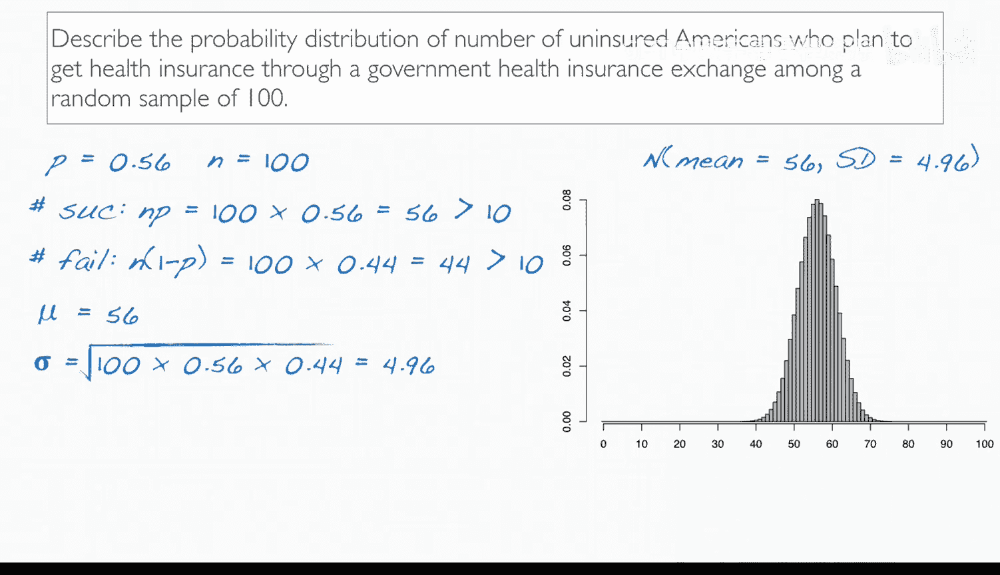
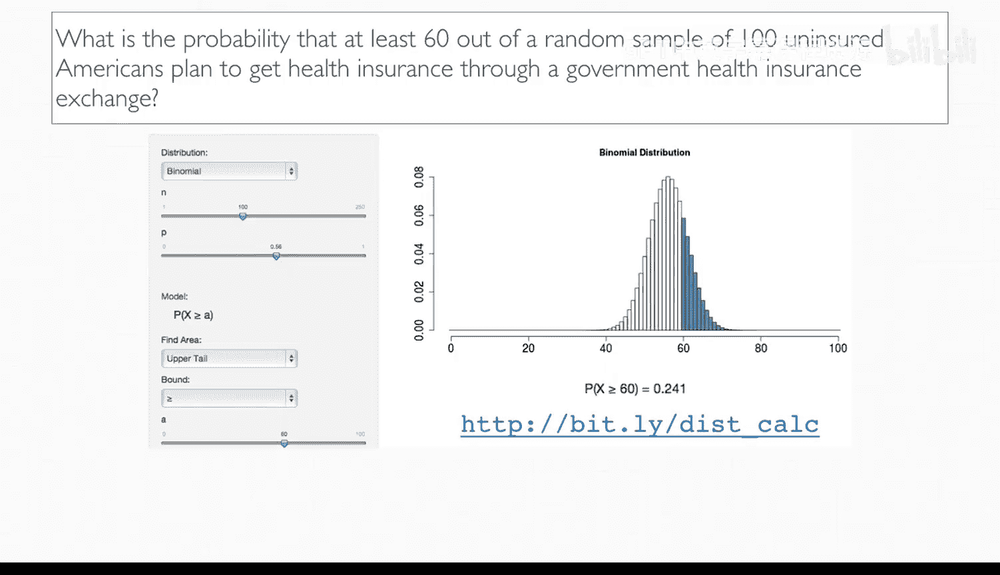
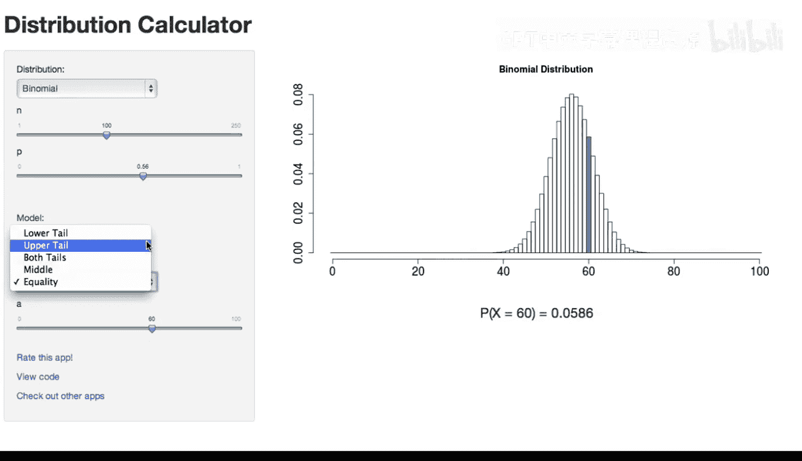
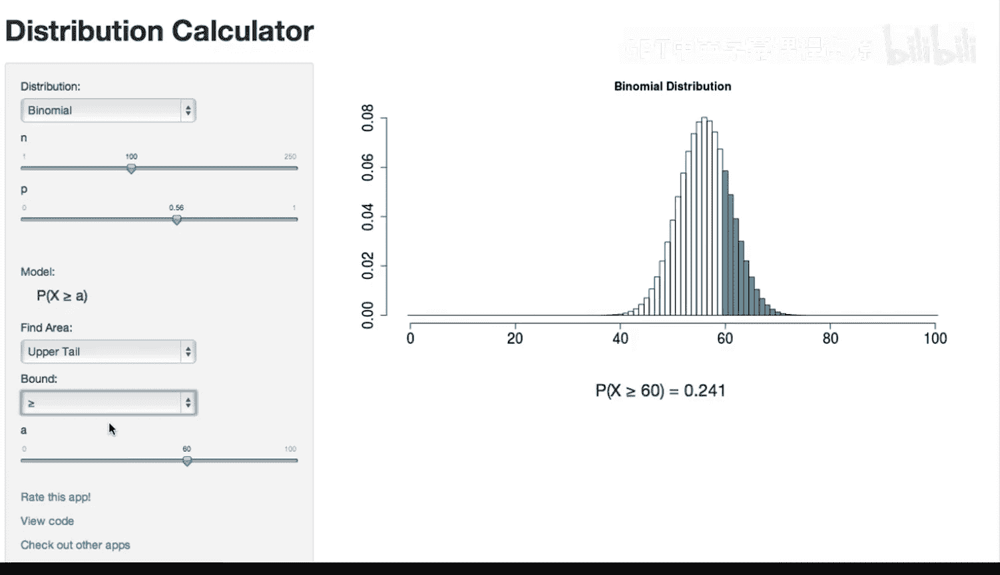
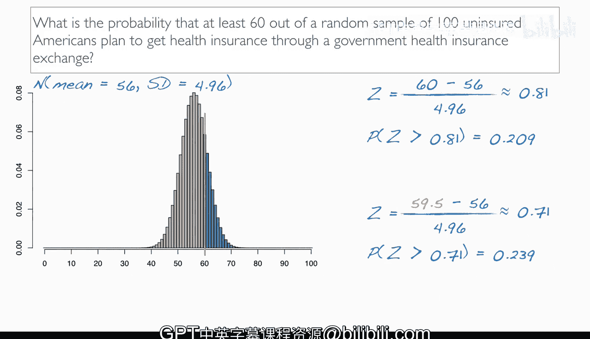

#  029：二项分布应用 🎯


在本节课中，我们将学习如何应用二项分布来解决实际问题。我们将通过一个具体的案例，计算在不同样本量下特定事件发生的概率，并探讨如何使用计算工具（如模拟程序、R语言）以及正态近似法来求解。课程将涵盖概率计算、分布形状的判断以及连续性校正的概念。

---


## 根据民意调查计算概率 📊


根据2014年盖洛普民意调查，在计划购买健康保险的未参保美国人中，有56%的人表示将通过政府医疗保险交易所购买。

**问题**：在一个由10人组成的随机样本中，恰好有6人计划通过政府医疗保险交易所购买健康保险的概率是多少？

上一节我们介绍了二项分布的基本概念，本节中我们来看看如何应用这些概念进行计算。



### 使用模拟程序计算

我们可以使用二项分布模拟程序来简化计算。

以下是具体步骤：
*   选择分布类型为二项分布。
*   设置样本量 `n = 10`。
*   设置成功概率 `p = 0.56`。
*   选择计算“等于”恰好6次成功的概率。

计算结果为 **0.243**，即 **24.3%**。这意味着，在10人的随机样本中，恰好有6人计划通过政府交易所购买保险的概率是24.3%。

### 使用R语言计算

作为替代方法，我们可以使用R语言中的 `dbinom` 函数进行计算。

```r
dbinom(6, size = 10, prob = 0.56)
```
执行此代码将得到相同的答案：**0.243**。

### 手动计算

我们也可以通过手动计算来验证结果。我们要求的是在10次试验中恰好有6次成功的概率。




计算公式为：
`P(X = 6) = C(10, 6) * (0.56)^6 * (0.44)^4`

其中 `C(10, 6)` 是组合数。展开计算后，我们同样会得到结果 **0.243**。在二项分布图中，这个概率对应于成功次数为6的条形图高度。考虑到我们期望的成功次数是 `10 * 0.56 = 5.6`，得到6次成功是一个可能性较高的结果。

---

## 大样本下的概率变化趋势 📈

现在让我们看看另一个问题。

**问题**：在一个由1000人组成的随机样本中，恰好有600人计划通过政府医疗保险交易所购买健康保险的概率是多少？选项是：A) 0.243（与之前n=10时相同）， B) 小于0.243， C) 大于0.243。

这个问题旨在评估推理和概念理解，而非计算能力。

上一节我们计算了小样本下的精确概率，本节中我们来推理大样本下的变化趋势。

**推理过程**：
*   成功概率 `p` 仍为 `0.56`。
*   在之前 `n=10` 的练习中，期望成功次数为 `5.6`，目标值 `6` 与期望值的差距为 `0.4`。
*   在当前 `n=1000` 的练习中，期望成功次数为 `1000 * 0.56 = 560`，目标值 `600` 与期望值的差距为 `40`。

目标结果离期望结果远得多。根据我们之前讨论的大数定律，当期望值为560时获得600次成功，应该比期望值为5.6时获得6次成功的可能性**低得多**。



因此，答案是 **小于0.243**。

我们可以用R快速验证：
```r
dbinom(600, size = 1000, prob = 0.56)
```
计算结果约为 **0.00098**，远低于之前计算的0.243。

---

## 描述二项分布的形态 🔍

接下来，我们被要求描述一个随机样本量为100时，计划通过政府交易所购买保险的人数的概率分布。

已知 `p = 0.56`，`n = 100`。这个样本量足够大吗？我们来看看它是否满足近似正态分布的条件。

判断分布是否近似正态的规则是：至少需要有10次期望成功和10次期望失败。
*   期望成功次数：`100 * 0.56 = 56` （>10）
*   期望失败次数：`100 * 0.44 = 44` （>10）

两个条件都满足，因此该二项分布的形态将是**近似正态**的。



正态分布有两个参数：均值（μ）和标准差（σ）。要完整描述这个分布，我们需要计算它们。
*   **均值（期望成功次数）**：`μ = n * p = 100 * 0.56 = 56`
*   **标准差**：`σ = sqrt(n * p * (1-p)) = sqrt(100 * 0.56 * 0.44) ≈ 4.96`

因此，这个二项分布可以近似看作一个均值为56、标准差为4.96的正态分布。

---



## 计算累积概率：至少60人 📉

最后，我们考虑以下问题：在一个100人的随机样本中，**至少**有60人计划通过政府交易所购买健康保险的概率是多少？

我们将展示多种解决方法，你可以选择其中一种掌握即可。

### 方法一：使用模拟程序





以下是使用模拟程序的步骤：
*   分布类型选择二项分布。
*   试验次数 `n` 设为100。
*   成功概率 `p` 设为0.56。
*   将关注点的值设为60。
*   我们寻找的是“大于或等于”60的概率，因此选择计算上尾面积。

结果显示概率为 **24.1%**。

### 方法二：使用R语言

我们可以再次利用R语言，结合 `dbinom` 和 `sum` 函数。

```r
sum(dbinom(60:100, size = 100, prob = 0.56))
```
这段代码计算了成功次数从60到100的所有个体概率之和，结果同样是 **0.241** 或 **24.1%**。


### 方法三：正态近似法（含连续性校正）

我们已知该分布近似正态，`μ = 56`，`σ ≈ 4.96`。

首先，计算Z分数：`Z = (观察值 - 均值) / 标准差 = (60 - 56) / 4.96 ≈ 0.81`
查标准正态分布表，对应概率约为 **0.209**。

这个结果比用模拟程序和R计算出的精确概率（0.241）要低。差异主要是因为正态分布是连续的，而二项分布是离散的。为了修正这一点，我们应用**连续性校正**：将关注的观察值60减去0.5。

计算校正后的Z分数：`Z_corrected = (59.5 - 56) / 4.96 ≈ 0.71`
查表得校正后的概率约为 **0.239**，这个结果与精确二项分布计算出的概率（0.241）就非常接近了。

---

## 总结 ✨



本节课中我们一起学习了二项分布在数据分析中的实际应用。我们通过一个案例，计算了在不同样本量下特定成功次数的概率，并比较了使用模拟程序、R语言以及手动计算等多种方法。我们了解到，当样本量足够大时，二项分布可以近似用正态分布来描述，但在计算累积概率时需要注意使用连续性校正来提高近似精度。这些技能对于进行统计推断和概率建模至关重要。