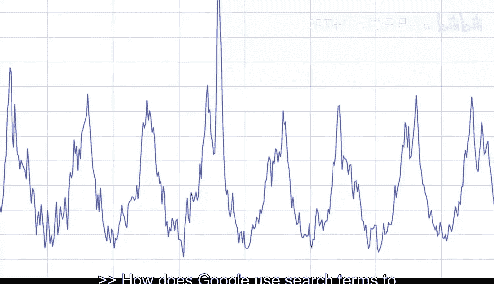
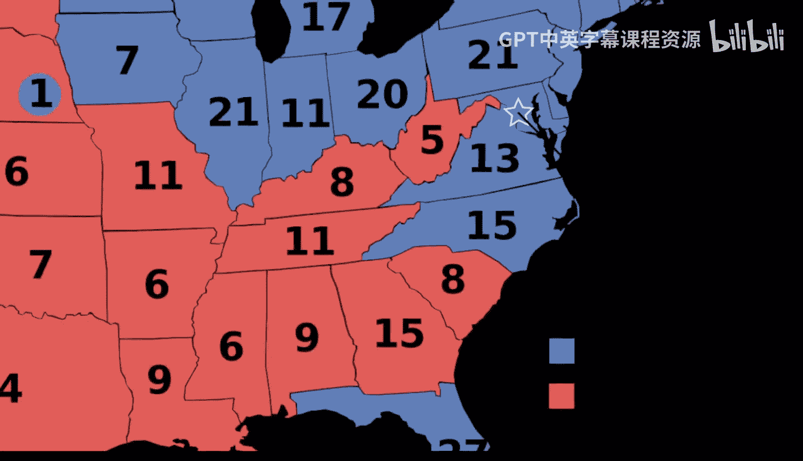

# 杜克大学《R语言数据分析（R语言、概率与数据入门，推断统计，线性回归与建模）｜Data Analysis with R》中英字幕 p01 01_01_01_R语言统计学导论.zh_en -BV1Cf421q7mU_p1-

How does a doctor decide that a new drug is more effective than an existing drug？

 How does Google use search terms to decide that a new flu season is starting。

 How confident should a politician be in their latest poll numbers。

 How does Netflix make personalized movie recommendations。

 These are the types of questions you can answer with statistical data analysis。

 If you'd like to find out more。 you've come to the right place。 My name is Minna Tiinka Runundll。

 My name is David Banks。 I am release Clyde。 And I'm Colin Runundll。

 And we are all faculty members in the Department of Sta Science at Duke University。

 The specialization that we have designed for you。 Staistic with R is comprised of four courses and a capstone project that will introduce you to the discipline of statistics as a science of understanding and analyzing data and making database decisions。

 This specialization is designed to be a starting point for learning to think critically about data。

 as well as an introduction to fundamental concepts in frequententists and Bayesian statistics。😊。

The courses in this specialization are intended for anyone with an interest in data analysis and statistics。

They require no prior background in statistics or computation。By the end of this specialization。

 you have learned how to effectively make use of data in the face of uncertainty。

 how to collect data， how to analyze data and how to use data to make inferences and draw conclusions about real world phenomena。

As well as touching on some of the traditional methods covered in many introductory statistics courses。

 we will also learn about modern and versatile methods such as simulation based inference and Bayesian inference。

 Another critical aspect of modern statistical is computation in this specialization。

 you will engage with real data sets using R and open source statistical programming language。

 The weekly labs will teach you modern art packages。

 as well as how to conduct data analysis reproducibly。😊，In these labs。

 we'll delve into questions like whether the hot hand phenomena really exists in basketball。

 whether students ratings of professors are based in some part on the professor's attractiveness。

 and how your Google search results are like a slot machine。

Within each course and as part of the capstone， you will be working on an open ended data analysis project in which you can showcase your statistical skills as you acquire them。

 Join us as we delve into statistics with our。 We look forward to interacting with you online soon。😊。

