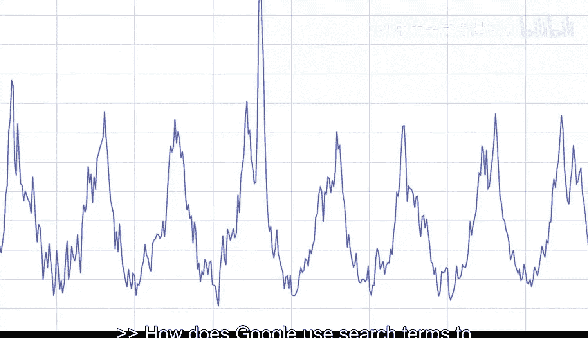

# 杜克大学《R语言数据分析》课程：1：R语言统计学导论 🎯

在本节课中，我们将要学习统计学的基本概念及其在现实世界中的应用，并了解本系列课程的整体结构。

## 概述

医生如何判断新药比现有药物更有效？谷歌如何利用搜索词判断新的流感季节是否开始？政治家对其最新的民意调查数据应抱有多大信心？Netflix如何实现个性化的电影推荐？这些都是你可以通过统计数据分析来解答的问题。如果你想了解更多，那么你来对地方了。

## 课程介绍

上一节我们概述了统计学的应用场景，本节中我们来认识一下本课程的讲师团队。

我的名字是 Minna Tiinka Runundll。我的名字是 David Banks。我是 Merlise Clyde。我是 Colin Runundll。我们都是杜克大学统计科学系的教员。

我们为您设计的专项课程《R语言统计学》由四门课程和一个顶点项目组成。它将向您介绍统计学这门学科，将其作为一门理解、分析数据并做出数据驱动决策的科学。

## 课程目标

本专项课程旨在作为学习批判性思考数据的起点，同时也是频率主义和贝叶斯统计学中基本概念的入门。

以下是本课程的核心目标：
*   向任何人介绍数据分析和统计学。
*   无需任何统计学或计算背景。
*   学习如何在面对不确定性时有效利用数据。

到本专项课程结束时，您将学会如何收集数据、如何分析数据，以及如何使用数据对现实世界现象进行推断并得出结论。

## 课程特色

除了涉及许多入门统计学课程涵盖的传统方法外，我们还将学习现代且通用的方法，例如基于模拟的推断和贝叶斯推断。

现代统计学的另一个关键方面是计算。在本专项课程中，您将使用R（一种开源统计编程语言）处理真实数据集。

以下是本课程的实践环节介绍：
*   每周的实验课将教您现代的R包。
*   学习如何进行可复现的数据分析。

在这些实验中，我们将深入探讨诸如“热手现象”在篮球中是否真的存在、学生对教授的评分是否部分基于教授的吸引力，以及您的谷歌搜索结果如何像老虎机等问题。

## 课程项目

在每个课程中以及作为顶点项目的一部分，您将参与一个开放式的数据分析项目。您可以在其中展示您所掌握的统计技能。

## 总结

本节课中我们一起学习了统计学的广泛应用、本课程的讲师团队、学习目标、特色实践环节以及最终的项目要求。加入我们，一起探索R语言统计学的世界。我们期待很快与您在线互动。😊