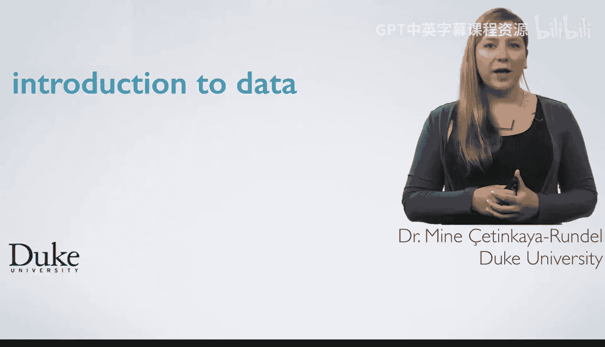
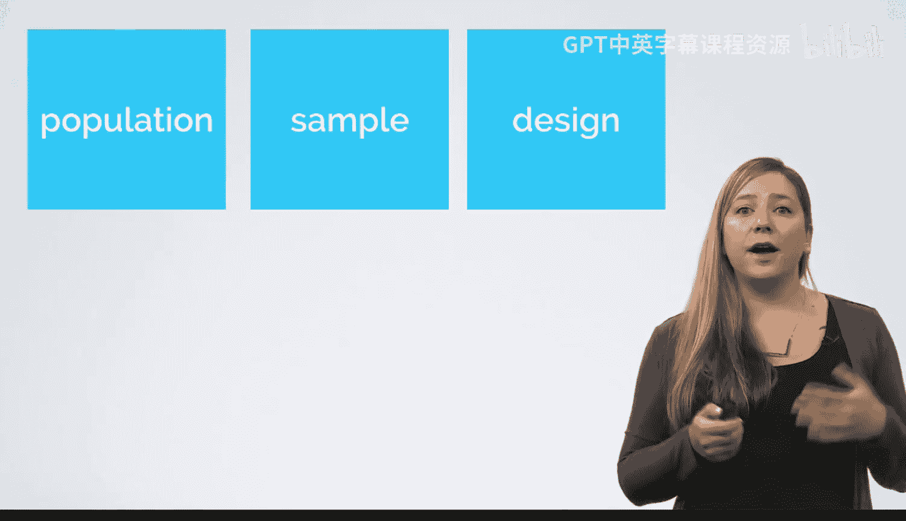
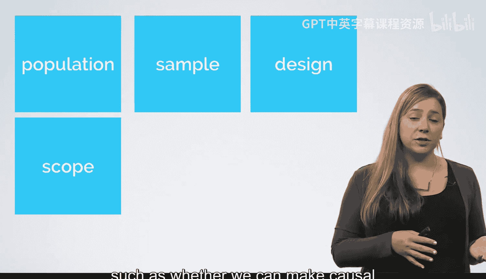
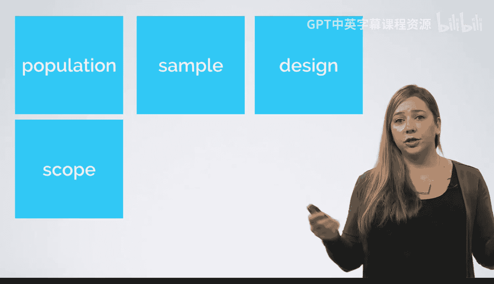
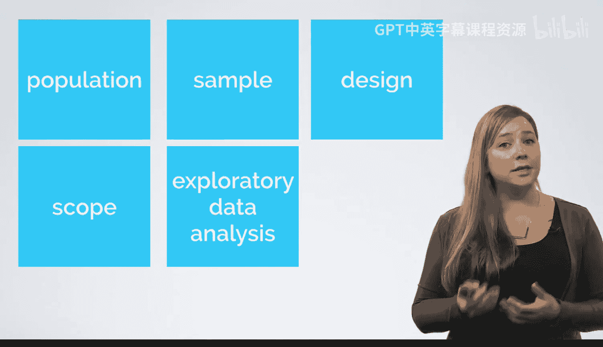
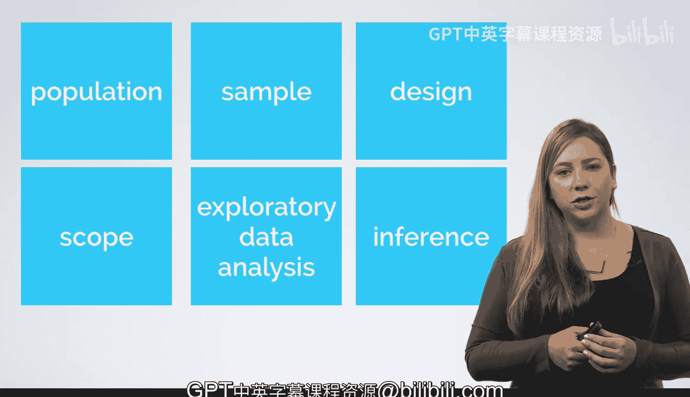

# 杜克大学《R语言数据分析（R语言、概率与数据入门，推断统计，线性回归与建模）｜Data Analysis with R》中英字幕 p02 02_02_02_导论_1.zh_en -BV1Cf421q7mU_p2-

This unit will introduce you to the basics of collecting， analyzing and visualizing data。

 as well as making database decisions。 Let's start with a historical look at data as evidence In the United States。

 anti smokingking research started in the 1930s， when cigarette smoking became increasingly popular。

 While some smokers seem to be sensitive to cigarette smoke。 Others were completely unaffected。

 Antismoking research was faced with resistance based on claims like my uncle smokes 3 packs a day。

 and he's in perfectly good health。 Such evidence， while may be real is based on a limited sample size that might not be representative of the population。

 We call such evidence anecdotal evidence。 At the time。

 it was concluded that smoking is a complex human behavior by its nature difficult to study。

 confounded by human variability。 However， today， our understanding of the health effects of smoking is much different In time。

 researchers were able to examine larger samples of cases。 In other words， more smokers。

And with data collected from a larger sample over time。

 trends showing negative health impacts of smoking became much clearer。

The goal of this course is to teach you to make sense of data using statistical tools in order to be able to explore relationships between variables and make informed decisions throughoutout the course you will be introduced to numerous studies and when faced with a new study or a data。

 the first question you should always ask yourself is what is the population of interest and what is the sample。

For example， let's consider this study titled Alcohol brand use and Injury in the Emergency Department。

 published in 2013。 The study explored the research question。

 are consumers of certain alcohol brands more likely to end up in the emergency room with injuries based on this question alone。

 it appears that the population of interest is everyone。In other words， ideally。

 the researchers would like to find an answer to this question that can result in a recommendation for everyone who consumes alcohol。

 However， a closer look at this study reveals that the sample used in this study was only a group of emergency room patients at the Johns Hopkins Hospital in Baltimore in the US。

 These are patients who visited the hospital with an injury and alcohol brand consumption data were collected from patients who drank within six hours of presentation at the hospital。

 Therefore， the results of this study can really only be generalized to residents of Baltimore。

 since certain brands may be more easily available in this area than others due to national brand market share。

 Similarlyly， there may be transient alcohol consumption habits of people who live in this area versus everywhere else in the world。

 Now that you are a little more familiar with how to approach statistical studies。

 Let's give a brief overview of what's to come in this unit。

 We will start by defining populations of interest。 discuss methods。

Of taking samples from this population， designing studies that can best answer particular research questions。

 we will also learn to identify the scope of inference for a study such as whether we can make causal versus correlational statements。

 and when we can generalize our conclusions to the population at large we will also learn methods of exploratory data analysis such as data visualizations and summary statistics。

 and we will wrap up the unit with a light simulation based introduction to statistical inference。

