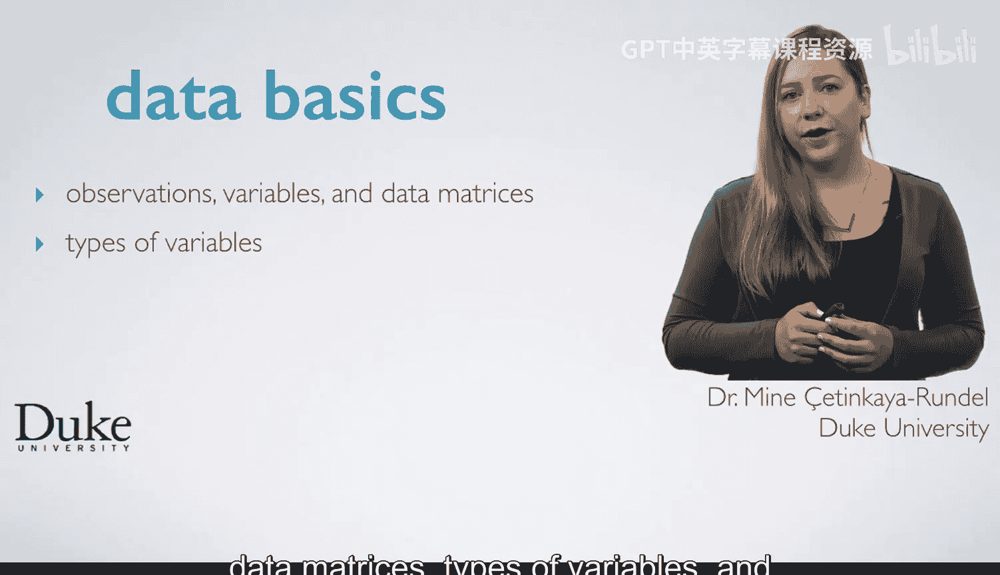
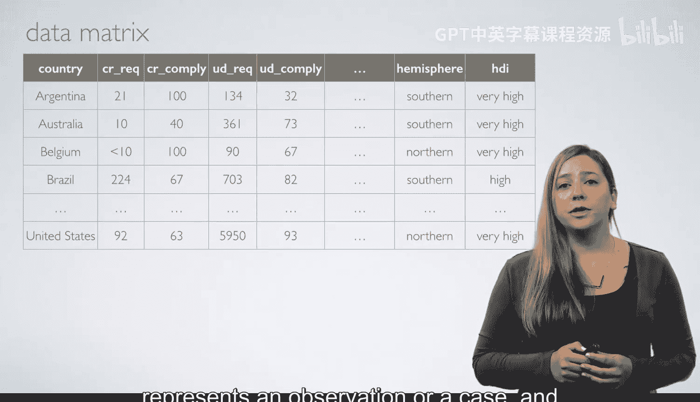
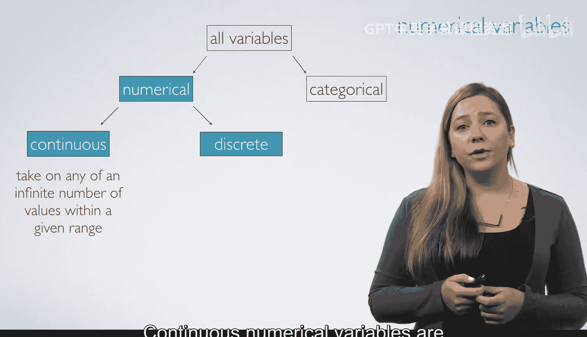
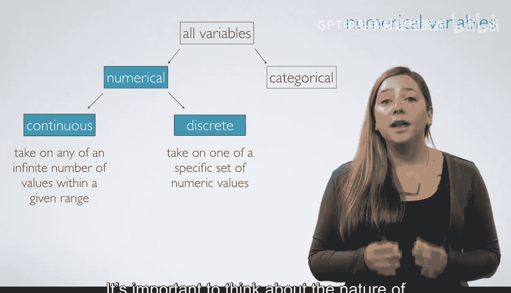
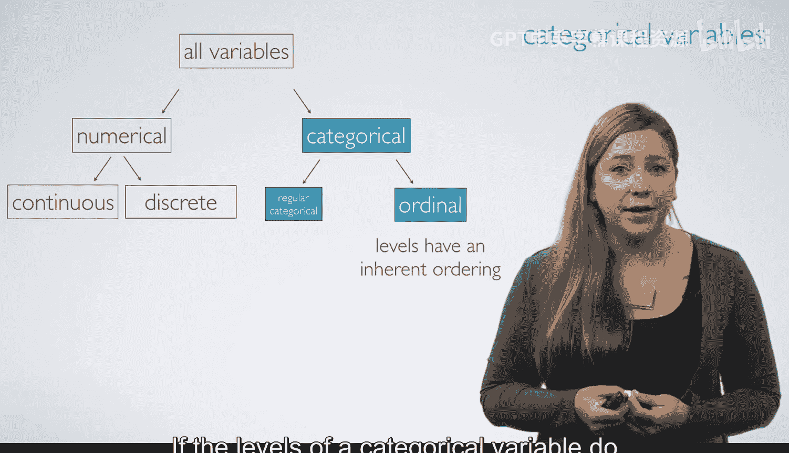
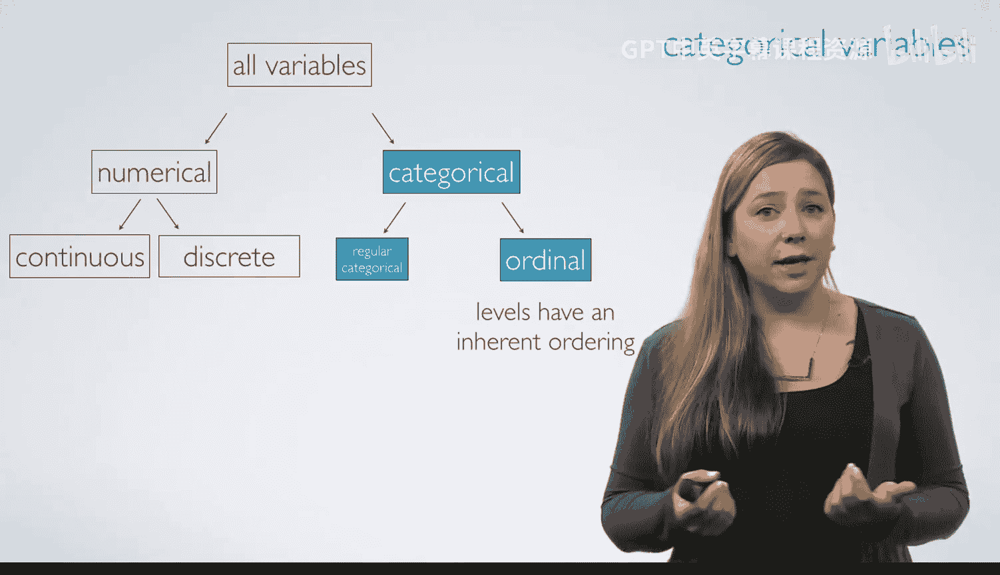
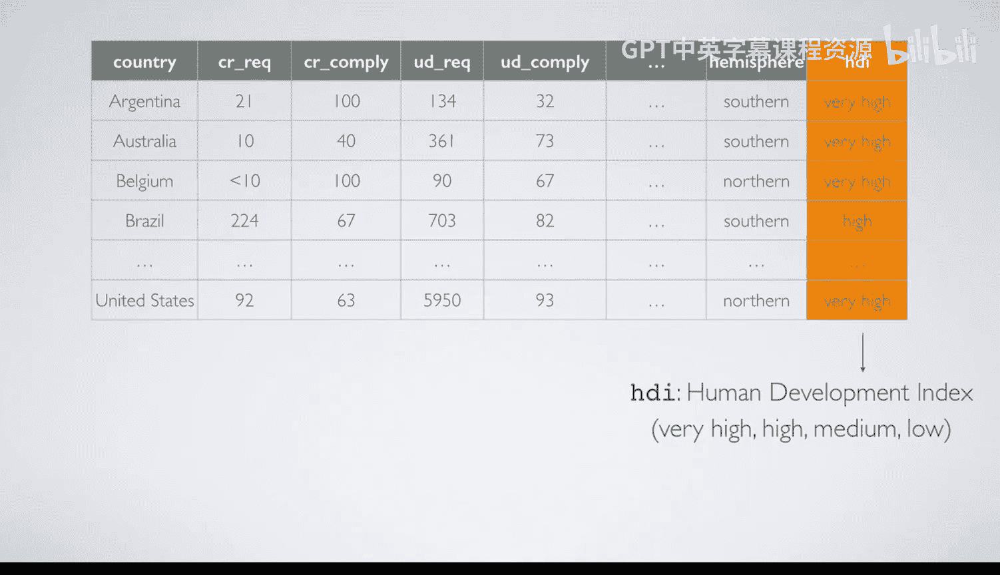
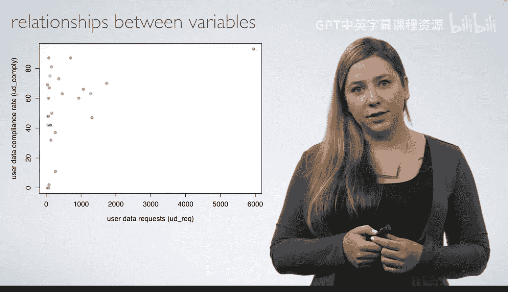
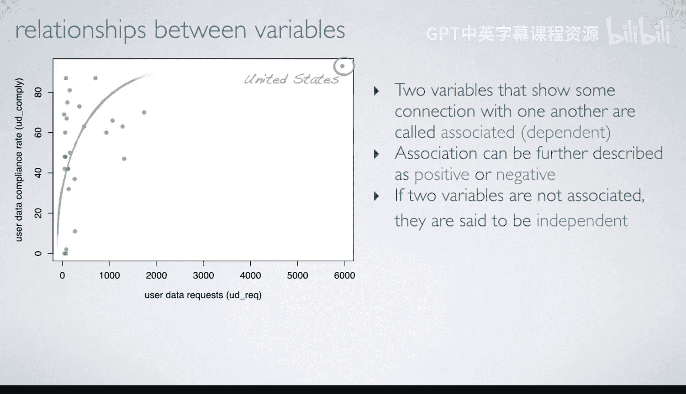

# 杜克大学《R语言数据分析（R语言、概率与数据入门，推断统计，线性回归与建模）｜Data Analysis with R》中英字幕 p03 03_02_03_数据基础.zh_en -BV1Cf421q7mU_p3-

In this video， we will discuss datas， or more specifically， we will touch on three main concepts。

 observations， variables and data matrices， types of variables， and relationships between variables。

Much of the discussion will be around this data set from Google's transparency report released in 2011。

 data are organized in what we call a data matrix where each row represents an observation or a case。

 And each column represents a variable。 If you ever use spreadsheets， for example。

 an Excel spreadsheet， this represents should be familiar to you as well。

 We'll talk in a moment about what each one of these variables represent。 But before we get there。

 let's first discuss various types of variables and how to identify them。

There are two types of variables， numerical and categorical， numerical， In other words。

 quantitative variables take on numerical values。 It is sensible to add， subtract， take averages。

 et cetera。 with these values。 categororical or qualitative variables take on a limited number of distinct categories。

 These categories can be identified with numbers。 For example。

 it is customary to see the gender variable coded as0 for males and one for females。

 but it wouldn't be sensible to do arithmetic operations with these values。

 They are merely placeholders for the levels of the categorical variable。

Nummerical variables can further be categorized as continuous or discrete。

 continuous numerical variables are usually measured， such as height。

 These variables can take on any number of infinite values， given within a given range。

 discretereet numerical variables are those that take on one of a specific set of numeric values。

 where we're able to count or enumerate all of the possibilities。

 One example of a discrete variable is the number of cars a household owns。 In general。

 count data are an example of discrete variables。 It's important to think about the nature of the variable。

 and not just the observed values when determining if it's a numerical。

 if the numerical variable is continuous or discrete。

 as rounding of continuous variables can make them appear to be discrete。 For example。

 height is a continuous variable。 However， we tend to report our height rounded to the nearest unit of measure。

 like inches or centimeters。😊。

Categorical variables that have ordered levels are called ordinal。

 Think about a survey question where you are asked how satisfied you are with the customer service you received and the options are very unsatisfied。

 unsatisfied， neutral， satisfied and very satisfied。 These levels have an inherent ordering。

 hence the variable would be called ordinal。 If the levels of a categorical variable do not have an inherent ordering to them。

 Then the variable is simply called categorical。 For example。

 are you a morning person or an afternoon person。

Let's take a moment to go through the variables in the Google's transparency report dataset set。

 The first variable is country， which is an identifier variable for the name of the country for which the data are gathered。

Next， we have the number of content removal requests made to Google by the given country。

 This is a discrete numerical variable， as it is a counted variable that can only take on whole number of values。

And the percentage of these requests that Google complied with。

 this is a continuous numerical variable as it can take on any value between 0 and 100。

 even though the values shown in the data matrix here are rounded to whole numbers。 Similarlyly。

 we have the number of user data requests made to Google by the given country。

And the percentage of these user data requests that Google complied with as well。

 which is also a continuous numerical variable。From other sources。

 we have also the hemisphere that the country is located in， either southern or northern。

 a categorical variable。As well as the human development index。

 which combines indicators of life expectancy， educational attainment and income and is released by the United Nations。

 This variable takes on the levels very high， high， medium and low human development。

Identifying the type of variable you're working with is always the first step of the data analysis process。

 Next， we start looking for relationships between variables here we have a scatter plot of the user data requests by countries and the compliance rate by Google we can see that on average as the number of requests increases so does the compliance rate and that there is one country that sticks out as a potential outlier with much higher user data requests than the others。

 That's actually the United States。

When two variables show some connection with one another。

 they are called associated or dependent variables。

 The association can be further described as positive or negative。 and for these variables。

 the association appears to be positive。If two variables are not associated。

 they are said to be independent。

In the remainder of the course， we will learn formal approaches for evaluating relationships between variables。

 and we'll always remind ourselves that it's a great idea to first stop and think about what types of variables you're working with in order to easily determine which type of analysis is most appropriate。

😊。

