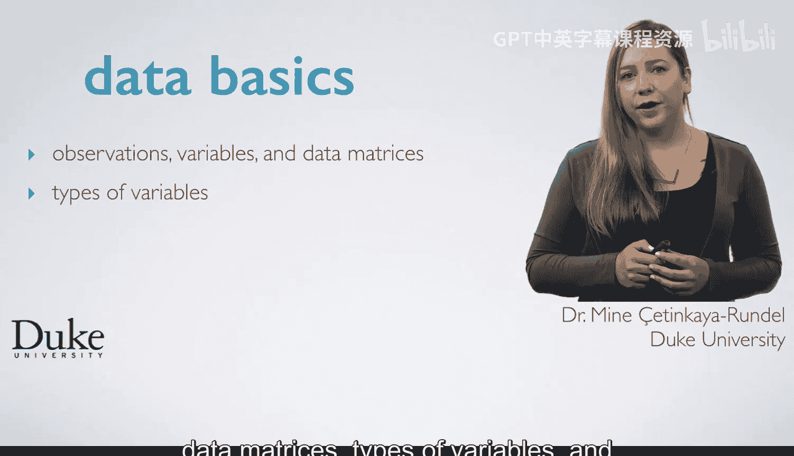
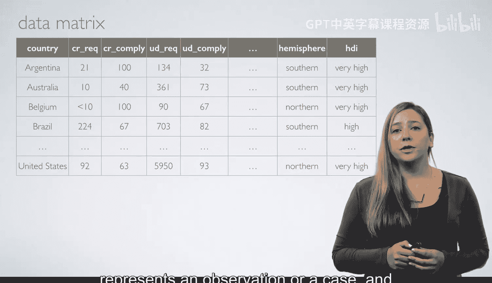
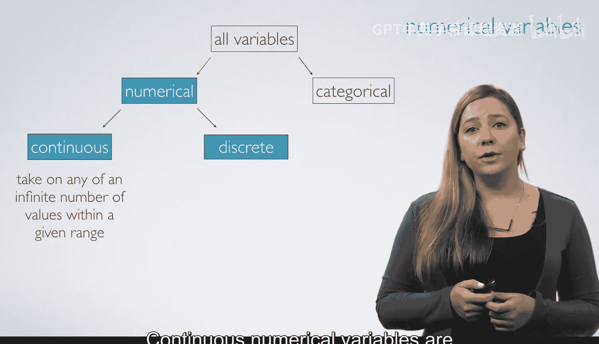
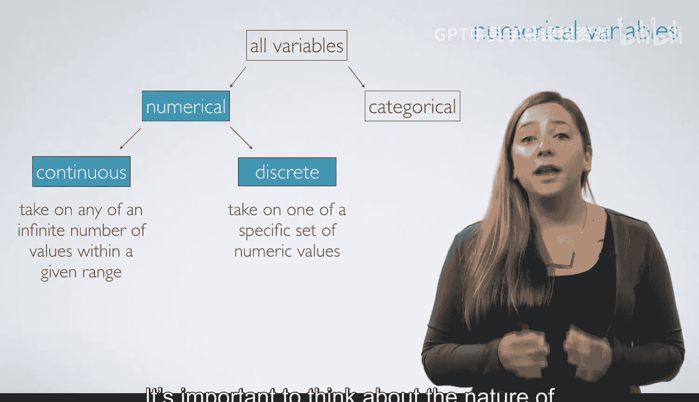
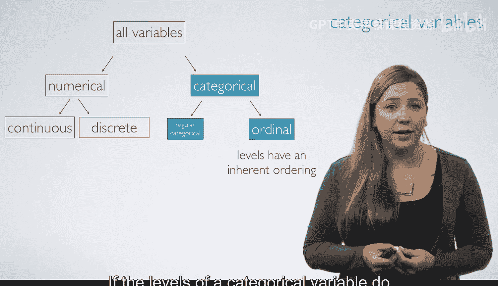
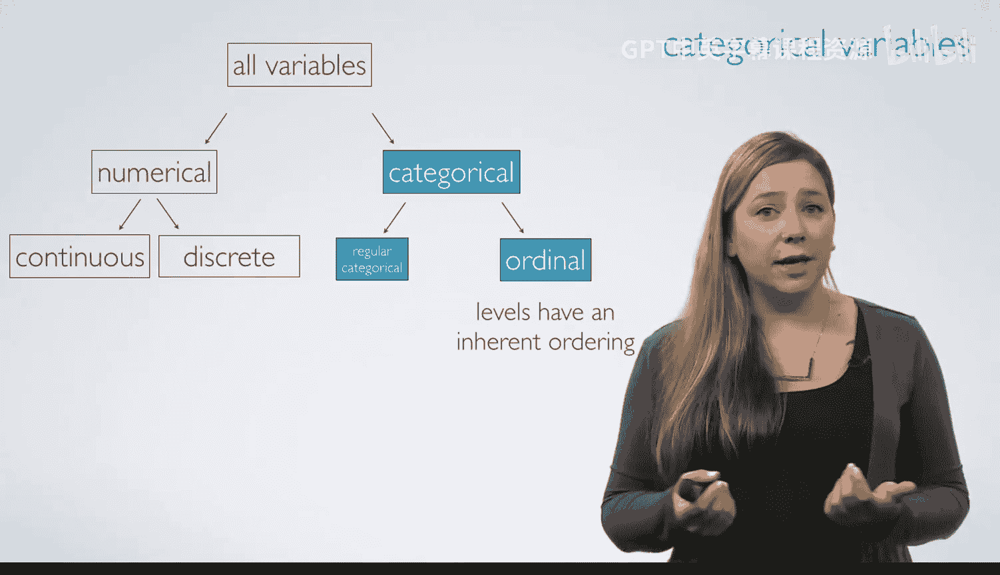
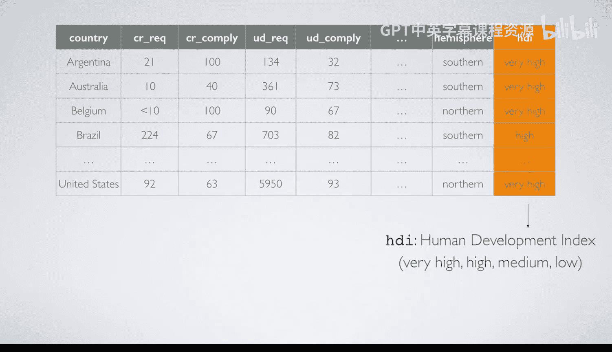
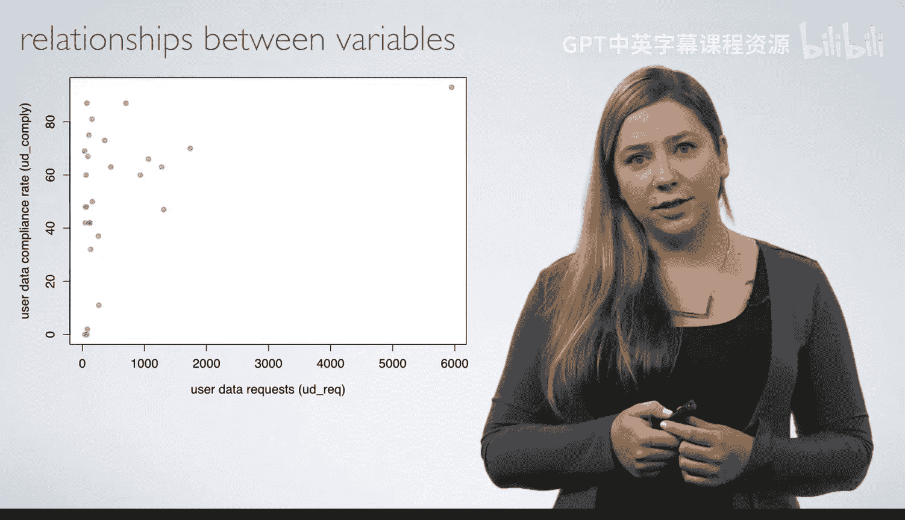
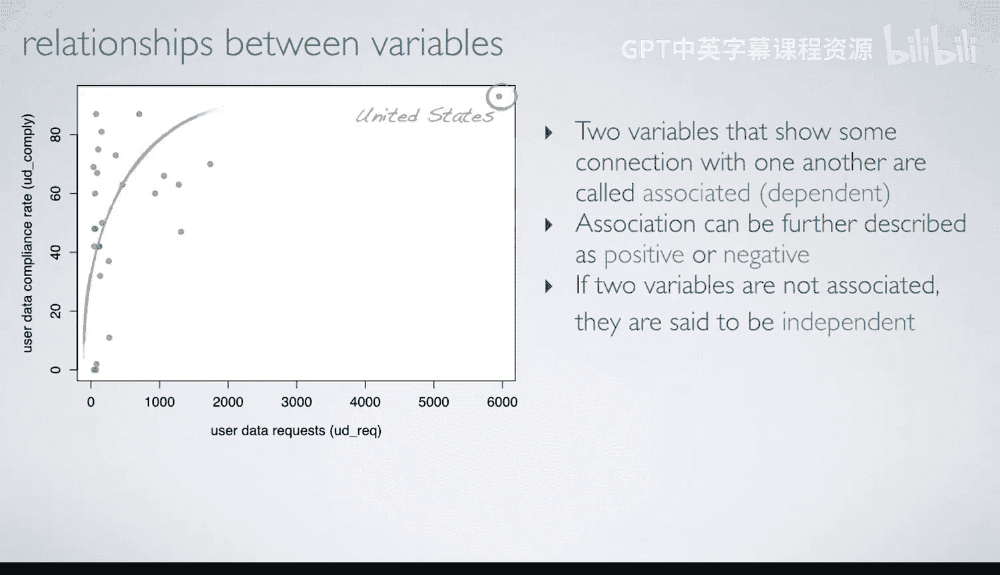

# R语言数据分析：03：数据基础 📊



在本节课中，我们将要学习数据的基础概念。我们将重点讨论观测值、变量和数据矩阵，变量的类型，以及变量之间的关系。

## 数据矩阵：观测值与变量



上一节我们介绍了数据分析的起点。本节中我们来看看数据是如何组织的。

数据通常以**数据矩阵**的形式组织。在数据矩阵中，每一行代表一个**观测值**或一个**案例**，而每一列代表一个**变量**。如果你使用过电子表格（如Excel），这种结构对你来说会很熟悉。

以下是一个数据矩阵的抽象表示：
```
[观测值1, 变量1, 变量2, ...]
[观测值2, 变量1, 变量2, ...]
...
```

## 变量的类型

理解了数据矩阵的结构后，接下来我们需要识别其中变量的类型。这是数据分析的关键第一步。

变量主要分为两大类：**数值型变量**和**分类型变量**。





### 数值型变量
数值型变量，也称为定量变量，其取值为数字。对这些值进行加、减、求平均等数学运算是合理的。数值型变量可进一步细分为：
*   **连续型数值变量**：通常通过测量获得（如身高），可以在给定范围内取无限个值。公式表示为：`值 ∈ [最小值, 最大值]`。
*   **离散型数值变量**：取值为一组特定的、可数的数值（如一个家庭拥有的汽车数量）。通常，计数数据就是离散型变量。

> **注意**：判断一个变量是连续型还是离散型，应基于其本质而非观测值。连续型变量可能因四舍五入而看起来像离散型（例如，身高通常按英寸或厘米的整数报告）。





### 分类型变量
分类型变量，也称为定性变量，其取值是有限数量的不同类别。这些类别可以用数字标识（例如，用0代表男性，1代表女性），但对这些数字进行算术运算是没有意义的。分类型变量可进一步细分为：
*   **有序分类变量**：类别之间存在固有的顺序。例如，对客户服务的满意度等级：“非常不满意”、“不满意”、“一般”、“满意”、“非常满意”。
*   **无序分类变量**：类别之间没有固有顺序。例如，个人偏好类型：“晨型人”或“夜型人”。

## 实例解析：谷歌透明度报告数据集

现在，让我们应用所学知识，分析一个具体的数据集——2011年谷歌透明度报告中的数据。

以下是该数据集中的变量及其类型分析：
*   **国家**：标识变量，代表数据收集的国家名称。
*   **内容移除请求数量**：**离散型数值变量**。这是向谷歌提出的请求计数，只能取整数值。
*   **内容移除请求合规率**：**连续型数值变量**。这是一个百分比，理论上可以在0到100之间取任何值（尽管数据中可能显示为整数）。
*   **用户数据请求数量**：**离散型数值变量**。
*   **用户数据请求合规率**：**连续型数值变量**。
*   **所属半球**：**无序分类变量**，取值为“南半球”或“北半球”。
*   **人类发展指数**：**有序分类变量**，由联合国发布，等级为“极高”、“高”、“中”、“低”。

## 变量之间的关系



识别变量类型后，数据分析的下一步是探索变量之间的关系。

当两个变量表现出某种联系时，我们称它们为**相关变量**或**相依变量**。这种关联可以是**正相关**（一个变量增加，另一个也倾向于增加）或**负相关**（一个变量增加，另一个倾向于减少）。如果两个变量没有关联，则称它们为**独立**。




例如，通过绘制“用户数据请求数量”与“合规率”的散点图，我们可能观察到一种正相关趋势：平均而言，请求数量越多，合规率也倾向于更高。同时，我们可能会发现一个异常点（如美国），其请求数量远高于其他国家。

## 总结



本节课中我们一起学习了数据的基础概念。我们首先了解了数据如何通过**数据矩阵**组织，其中行是**观测值**，列是**变量**。然后，我们深入探讨了**数值型**（连续/离散）和**分类型**（有序/无序）变量的区别与识别方法，并通过谷歌数据集进行了实践。最后，我们引入了变量间**关系**的概念，包括相关与独立、正相关与负相关。


记住，在开始任何分析之前，先停下来思考你正在处理的变量类型，这将帮助你轻松确定最适合的分析方法。在接下来的课程中，我们将学习评估变量之间关系的正式方法。