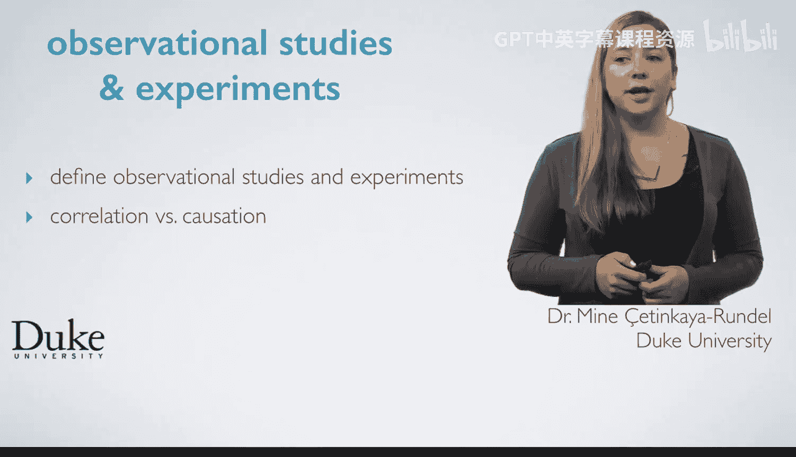
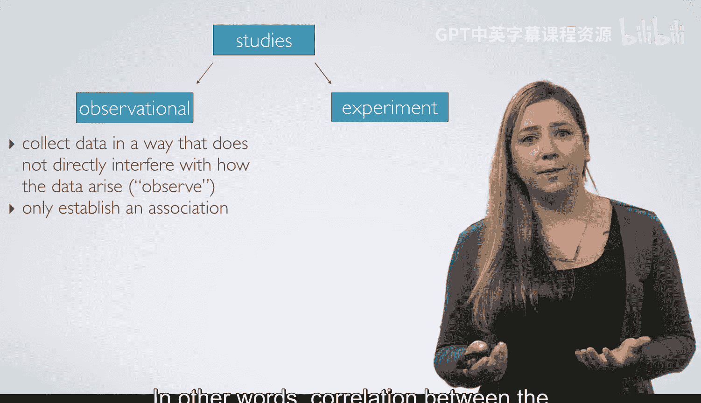
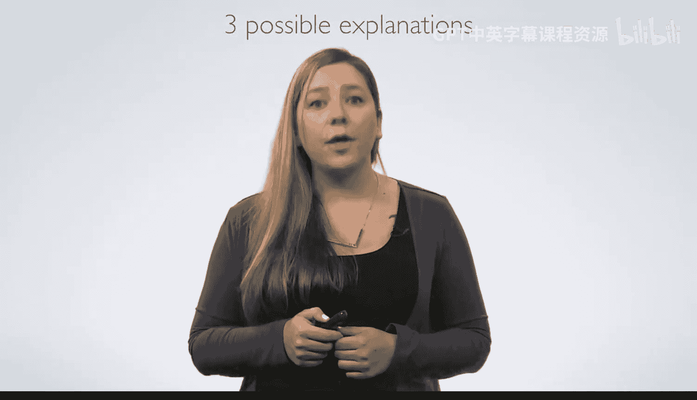
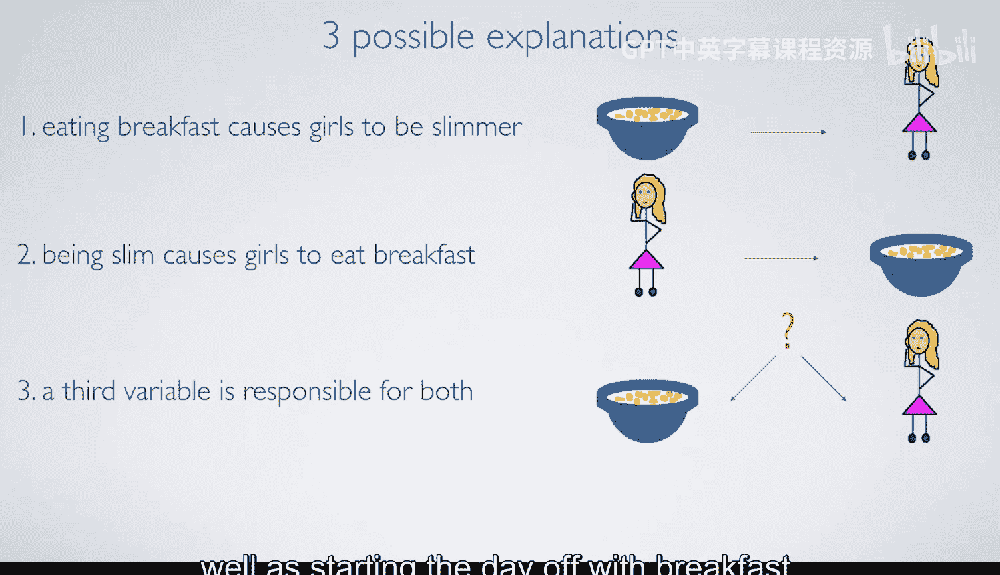

# 杜克大学《R语言数据分析（R语言、概率与数据入门，推断统计，线性回归与建模）｜Data Analysis with R》中英字幕 p04 04_02_04_观察性研究与实验.zh_en -BV1Cf421q7mU_p4-

In this video， we will define observational studies and experiments and discuss correlation and causation。

😊。

In an observational study， researchers collect data in a way that does not directly interfere with how the data arise。

 In other words， they merely observe。 and based on observational studies。

 we can only establish an association。 In other words。

 correlation between the explanatory and the response variables。

 If an observational study uses data from the past， it's called a retrospective study。

 whereasas if data are collected throughout the study， it's called perspective。

In an experiment， on the other hand， researchers randomly assign subjects to various treatments and can therefore establish causal connections between the explanatory and the response variables。

Let's pause for a moment to clarify what we mean by random assignment with an example。

 Suppose we want to evaluate the relationship between regularly working out an energy level。

 We can design the study as an observational study or an experiment。 in an observational study。

 we sample two types of people from the population those who choose to work out and those who don't。

 Then we find the average energy level for the two groups of people and compare On the other hand。

 in an experiment， we sample a group of people from the population。

 Then we randomly assign these people into two groups。

 those who will regularly work out throughout the course of the study and those who will not。

 The difference is that the decision of whether to work out or not is not left up to the subjects as in the observational study。

 but is instead imposed by the researcher At the end。

 we compare the average energy levels of the two groups。 based on the observational study。

 even if we find a difference between the average energy levels of these。To groups of people。

 we can't attribute this difference solely to working out。

 because there may be other variables that we didn't control for in this study that contribute to the observed difference。

For example， people who are in better shape might be more likely to regularly work out and also have higher energy levels。

 However， in the experiment， such variables that might also contribute to the outcome are likely equally represented in the two groups due to the random assignment。

 Therefore， if we find a difference between the two averages。

 we can indeed make a causal statement attributing this difference to working out。 Next。

 we will review media coverage on a public study and try to determine what type of study it is。

 Let's start by reviewing an excerpt from the news article。 studyy。

 breakfastfast cereal keeps girls slim。 Girls who ate breakfast of any type had a lower average body mass index。

 a common obesity gauge than those who said they didn't。

 The index was even lower for girls who said they ate cereal for breakfast。

 According to findings of the study conducted by the Maryland Medical research Institute with funding from the National Institutes of Health and ceal。

Maker General Mills。 The results were gleaned from a larger NIH survey of 2379 girls in California。

 Ohio and Maryland who were tracked between the ages of 9 and 19。As part of the survey。

 the girls were asked once a year what they had eaten during the previous three days。

The title of the article saysBreakfast cereal keeps girls S。

But there are actually three possible explanations here。 One。

 eating breakfast does indeed cause girls to be slimmer。2。

 being slim might cause girls to eat breakfast so their relationship could be reversed 3。

 there may be a third variable that is responsible for both being slim and eating breakfast。

 For example， generally being health conscious might result in being slim。

 as well as starting the day off with breakfast。

Such extraneous variables that affect both the explanatory and the response variable。

 and that make it seem like there is a relationship between them are called confounding variables。

If you're going to walk away with one thing from this class。

 let it be correlation does not imply causation。 and what determines whether we can infer causation or just correlation is the type of study that we're basing our conclusions on observational studies for the most part。

 allow us to make only correlational statements， while experiments allow us to infer causation。

 We said for the most part， because there are actually more advanced methods。

 broadly titled causal inference that allow for making causal inferences from observational studies。

 but those methods are beyond the scope of this course。

