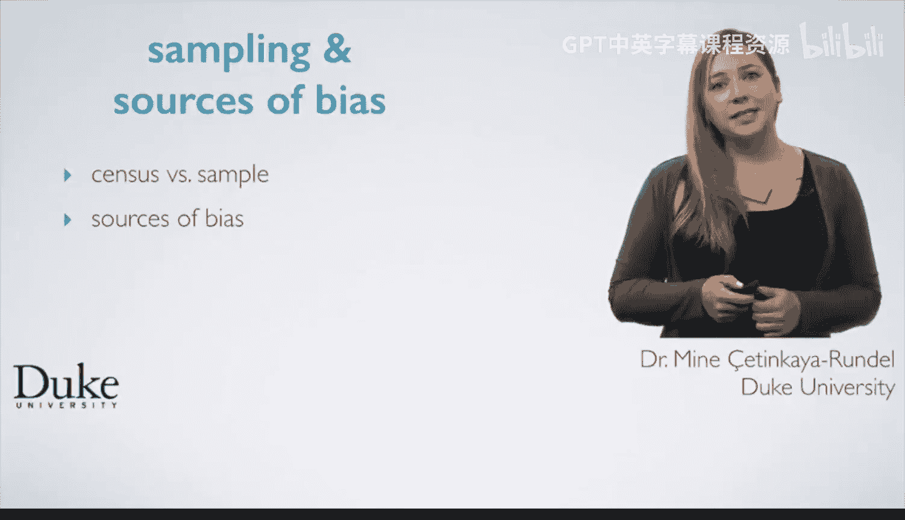
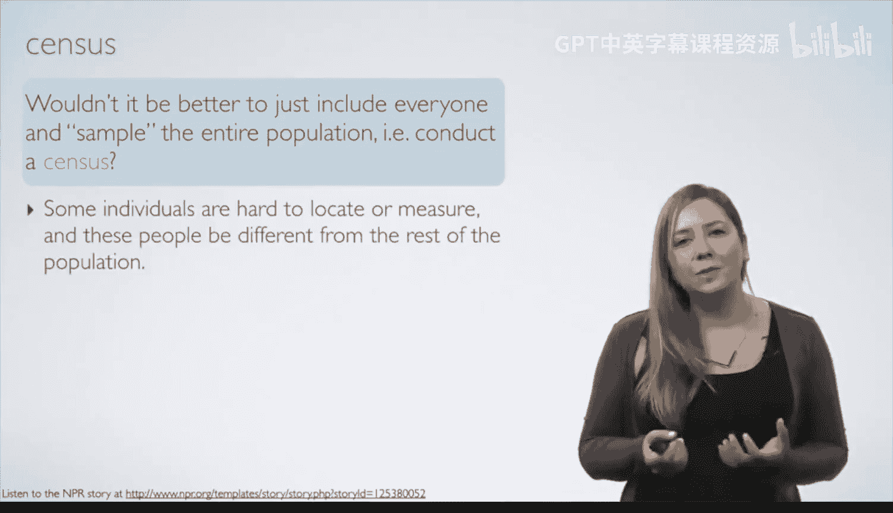
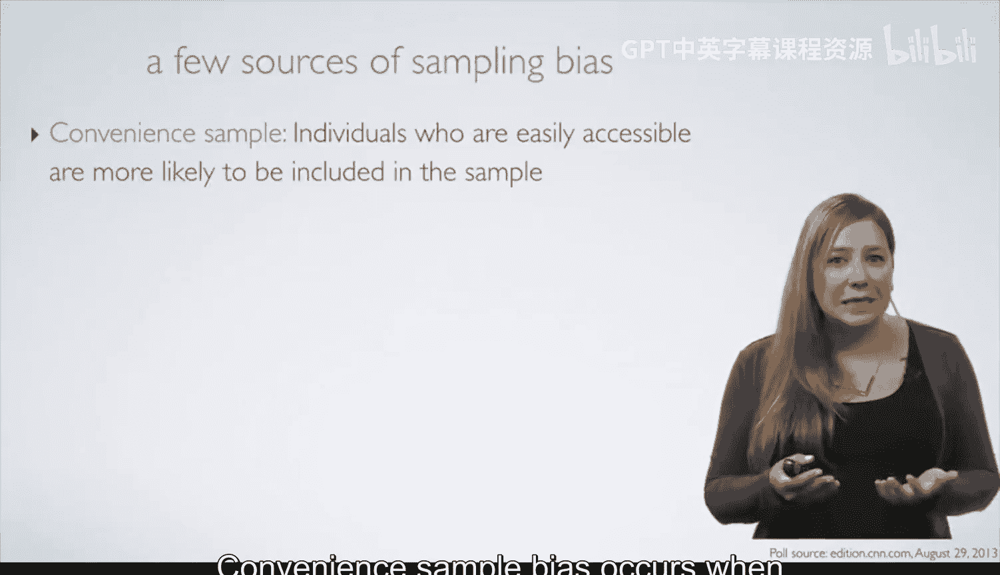
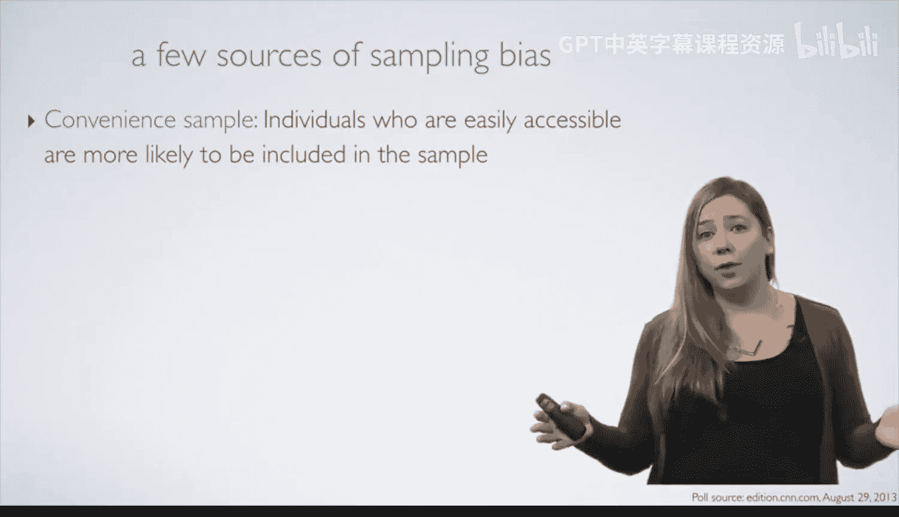
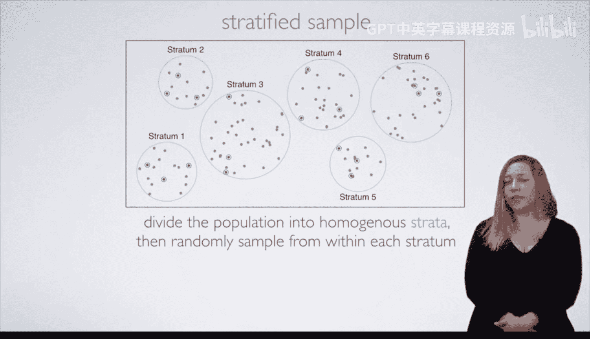

# 杜克大学《R语言数据分析（R语言、概率与数据入门，推断统计，线性回归与建模）｜Data Analysis with R》中英字幕 p05 05_02_05_抽样与偏倚来源.zh_en -BV1Cf421q7mU_p5-

In this video， we will discuss a census versus a sample， sources of bias and studies。

 and a few sampling methods。

Previously， we mentioned taking a sample from the population。 but one might ask。

 wouldn't it be better to just include everyone and sample the entire population， In other words。

 conduct a census， As you can imagine， conducting a census takes lots of resources。

 But there are other reasons why this might not be a good idea。 First。

 some individuals may be hard to locate or hard to measure。

 And these people may be different from the rest of the population。 For example， in the US census。

 illegal immigrants are often not recorded properly。

 since they tend to be reluctant to fill out census forms with the concern that this information could be shared with immigration。

 However， these individuals might possess characteristics different than the rest of the population。

 And hence not getting information from them might result in very unreliable data from geographical regions with high concentrations of illegal immigrants。

 Another reason why censuses aren't always a good idea， is that populations rarely stand still。

 Even if you could take。

ens the population changes constantly， so it's never really possible to get a perfect measure。

If you think about it， sampling is actually quite natural。 Think about something you're cooking。

 We taste。 In other words， we examine a small part of what we're cooking to get an idea about the dish as a whole。

 We would never eat a whole pot of soup just to check its taste After all。

 When you taste a spoonful of soup and decide that spoonful you taste it isn't salty enough。

 What you're doing is simply exploratory analysis for the sample at hand。

 If you then generalize and conclude that your entire soup needs salt。 That's making an inference。

 For your inference to be valid， the spoonful you tasted。

 Your sample needs to be representative of your entire pot。 Your population。

 If your spoonful comes only from the surface。 and the salt is collected at the bottom of the pot。

 What you taste it is probably not going to be representative of the whole pot。 On the other hand。

 if you first stir the soup thoroughly before you taste。

 your spoonful will be more likely to be representative of the whole pot。😊。

Let's review a few sources of sampling bias。 Convenience sample bias occurs when individuals who are easily accessible are more likely to be included in the sample。

 For example， say you want to find out how people in your city feel about a recent increase in public transportation costs。

 if you only poll people in your neighborhood as opposed to a representative sample from the whole city。

 your study would suffer from convenience bias。 Another sampling bias is called non-respon。

 This happens if only a non-random fraction of the randomly sampled people respond to a survey。

 such that the sample is no longer representative of the population。 For example。

 say you take a random sample of individuals from your city and attempt to survey them。

 but certain segments of the population say those from a lower socioeconomic status are less likely to respond to the survey。

A similar sampling bias is called voluntary response bias。

 which occurs when the sample consists of only people who volunteer to respond because they have strong opinions on the issue。

 For example， say you place polling machines at all bus stops and metro stations in your city。

 but only those who choose to do so actually take the time to vote and expressed their opinion on the recent increase in public transportation costs。

 Voluntary response bias clearly exist in online polls like this one from CNN from August 2013。

 which asked whether the West should intervene in Syria。

 The people who responded to this poll definitely do not make up a representative sample of the world population since these are people who happened to have visited CNN dot com。

 The day the poll was posted and felt strongly enough to vote。 Indeed。

 the poll results say that this is not a scientific poll。 for this very reason。

To recap the difference between voluntary response bias and nonres bias is that in nonresponse。

 there is a random sample that is surveyed。 But the people who choose to respond are not representative of the sample。

 While involuntary response， there is no initial random sample。

 Let's examine a historical example of a bias sample yielding misleading results。 In 1936。

 Landon sought the Republican presidential nomination opposing the reelection of Franklin Delano Roosevelt commonly referred to as FDR。

 A popular magazine of the Times。 the literary digest poll about 10 million Americans and got responses from about 2。

4 million to put things in perspective， Nowadays， reliable polls in the US routinely poll about 1500 people。

 So this was a huge sample。 The poll showed that Landon would likely be the overwhelming winner and FDR would only get 43% of the votes。

 In reality， FDR。

Won the election with 62% of the vote。 The magazine was completely discredited because of the poll and was soon discontinued。

 So if you have never heard of this magazine， this might be the reason why。 But what went wrong。

 The magazine had surveyed its own readers registered automobile owners and registered telephone users。

 These groups had incomes well above the national average of the day。 Remember。

 this was the great Depression era， which resulted in lists of voters far more likely to support Republicans than a truly typical voter of the time。

In other words， the sample was not representative of the American population at the time。

 While the literary digest election poll was based on a sample size of 2。4 million。

 a huge sample since the sample was biased， it did not yield an accurate prediction。

Going back to the soup analogy， if the soup is not well stirred。

 it doesn't matter how large a spoon you have。 It will still not taste right。

 If the soup is well stirred， a small spoon will suffice to test the soup。

Now that we have a good idea of why we might want to sample and why it's important for our sample to be representative of the population。

 let's discuss some sampling methods， namely， a simple random sampling， stratified sampling。

 cluster sampling， and multi state sampling。In simple random sampling。

 we randomly select cases from the population such that each case is equally likely to be selected。

 this is similar to randomly drawing names from a hat。In stratified sampling。

 we first divide the population into homogeneous groups called strata and then randomly sample from within each stratum。

 for example， if we wanted to make sure both genders are equally represented in a study。

 we might divide the population first into males and females and then randomly sample from within each group。

In cluster sampling， we divide the population into clusters。

 randomly sample a few clusters and then sample all observations within these clusters， the clusters。

 unlike strata and stratified sampling， are heterogeneous within themselves and each cluster is similar to another。

 such that we can get away with just sampling from a few of the clusters。Lastly。

 multistate sampling adds another step to cluster sampling。

 just like in cluster sampling we divide the population into clusters。

 randomly sample a few clusters and then we randomly sample observations from within these clusters usually we use cluster sampling and multistate sampling for economical regions for example。

 one might divide a city into geographic regions that are on average similar to each other and then sample randomly a few of these regions。

 go to these randomly picked regions and then sample a few people from within these regions this avoids the need to travel to all of the regions in the city。

