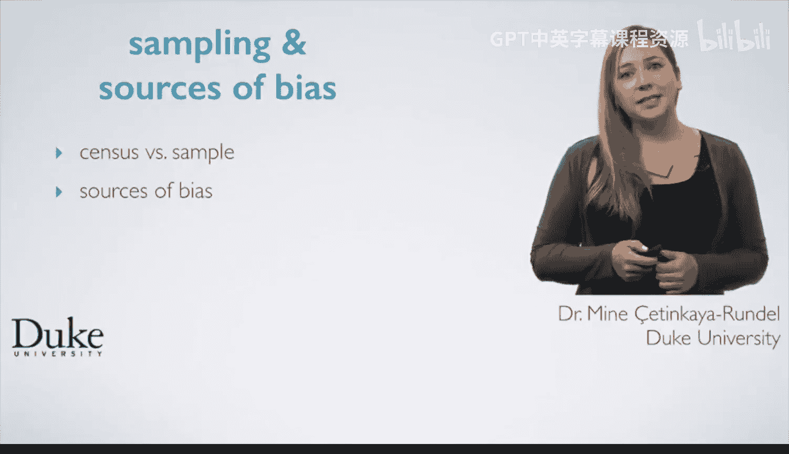
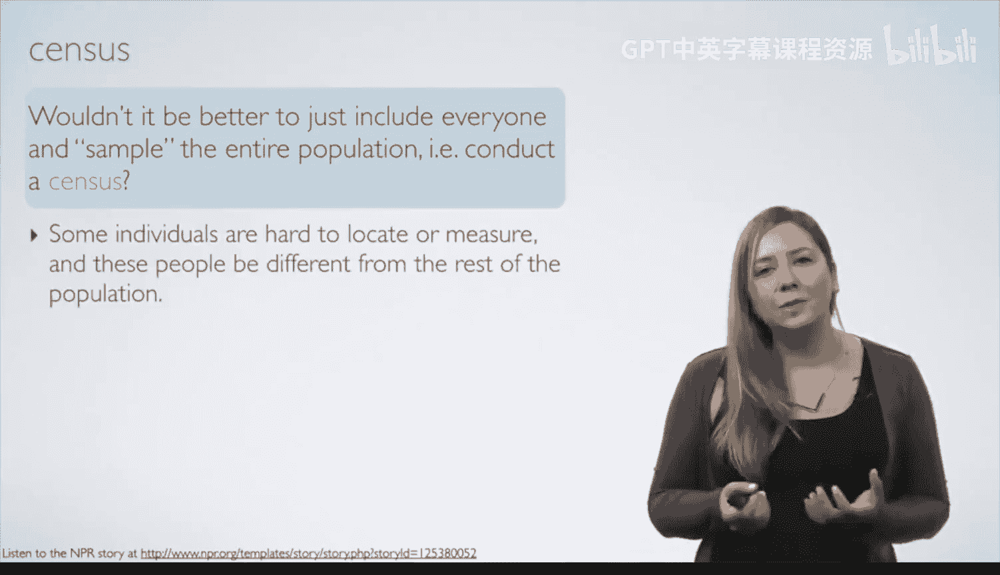
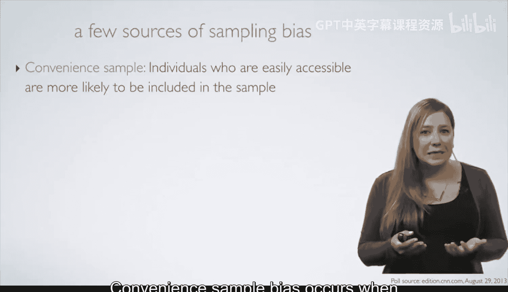
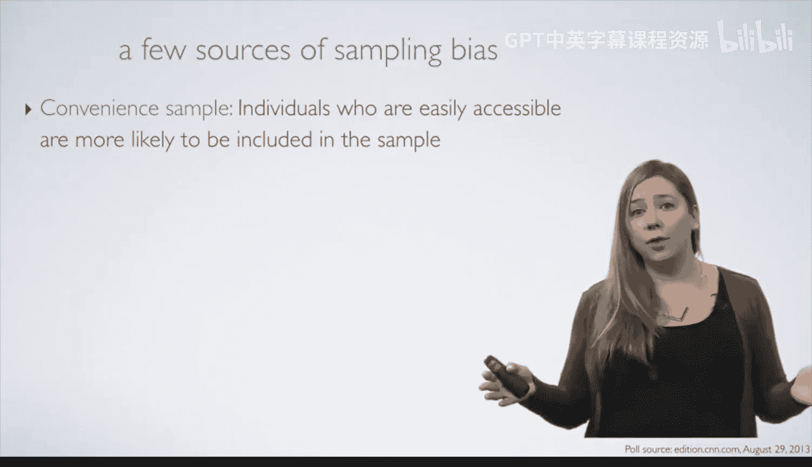
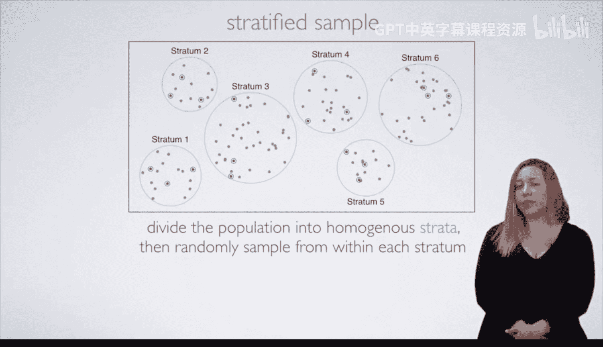

# R语言数据分析：05：抽样与偏倚来源 📊

在本节课中，我们将要学习普查与抽样的区别、研究中偏倚的来源，以及几种常见的抽样方法。理解这些概念对于确保数据分析结果的可靠性和有效性至关重要。

---

## 普查 vs. 抽样

上一节我们介绍了从总体中抽取样本的概念。但有人可能会问，为什么不直接调查总体中的每一个人，即进行普查呢？理论上，普查似乎更全面。

然而，进行普查需要耗费大量资源。此外，还有其他原因使得普查并非总是最佳选择。

首先，某些个体可能难以定位或测量，而这些人与总体中的其他部分可能存在差异。例如，在美国人口普查中，非法移民通常无法被准确记录，因为他们担心信息会被移交给移民局而不愿填写表格。然而，这些个体可能具有与总体其他部分不同的特征，因此无法获取他们的信息可能导致在非法移民高密度地区的统计数据非常不可靠。

其次，总体很少是静止不变的。即使你能够对总体进行精确测量，总体也在不断变化，因此永远不可能获得一个完美的测量结果。

---

## 抽样的自然类比

实际上，抽样是一种非常自然的行为。想象一下你在烹饪时，我们会尝味。也就是说，我们检查烹饪物的一小部分来了解整道菜的情况。我们绝不会为了检查味道而喝掉一整锅汤。

当你尝了一勺汤，并判断这一勺不够咸时，你所做的就是对当前样本进行探索性分析。如果你由此推广并得出结论认为整锅汤都需要加盐，这就是在进行推断。

为了使你的推断有效，你品尝的那一勺（你的样本）需要能代表你的整锅汤（你的总体）。如果你的勺子只从表面舀取，而盐都沉在锅底，那么你尝到的味道很可能无法代表整锅汤。相反，如果你在品尝前先将汤彻底搅拌均匀，那么你舀取的那一勺就更有可能代表整锅汤。

---

## 抽样偏倚的来源

以下是几种常见的抽样偏倚来源：

**便利样本偏倚**：当容易接触到的个体更有可能被纳入样本时，就会发生便利样本偏倚。例如，如果你想了解市民对公共交通费用上涨的看法，但只调查了你所在社区的居民，而不是来自全市的代表性样本，那么你的研究就会受到便利偏倚的影响。

**无应答偏倚**：如果随机抽取的样本中只有一部分非随机的个体回应了调查，导致样本不再能代表总体，就会发生无应答偏倚。例如，假设你从城市中随机抽取了一些个体进行调查，但某些群体（例如社会经济地位较低的人）回应调查的可能性较低。

**自愿回应偏倚**：当样本仅由那些自愿回应的人组成，并且他们通常对议题有强烈看法时，就会发生自愿回应偏倚。例如，假设你在全市所有公交站和地铁站放置了投票机，但只有那些选择这样做的人才会花时间投票，表达他们对公共交通费用上涨的看法。

自愿回应偏倚在在线投票中很明显，例如CNN在2013年8月发布的关于西方是否应干预叙利亚的投票。回应此投票的人绝对不代表世界人口，因为他们只是恰好在投票发布当天访问了CNN网站并有足够强烈的意愿去投票的人。事实上，投票结果说明这不是一个科学的民意调查。

**回顾**：自愿回应偏倚和无应答偏倚的区别在于，在无应答偏倚中，存在一个被调查的随机样本，但选择回应的人不能代表该样本；而在自愿回应偏倚中，则没有初始的随机样本。

---

## 历史案例：偏倚样本的误导

让我们看一个历史例子，说明偏倚样本如何导致误导性结果。1936年，兰登寻求共和党总统提名，反对富兰克林·德拉诺·罗斯福（常称为FDR）的连任。

当时一本流行的杂志《文学文摘》对约1000万美国人进行了民意调查，并收到了约240万份回复。相比之下，如今美国可靠的民意调查通常只调查约1500人，因此这是一个巨大的样本。调查显示，兰登很可能以压倒性优势获胜，而FDR只能获得43%的选票。

然而在现实中，FDR以62%的选票赢得了选举。该杂志因这次民意调查而完全失信，并很快停刊。那么，问题出在哪里？

该杂志调查了其自己的读者、注册汽车车主和注册电话用户。这些群体的收入远高于当时的全国平均水平。请记住，那是在大萧条时期，这导致选民名单更有可能支持共和党，而不是当时真正典型的选民。换句话说，样本不能代表当时的美国人口。

虽然《文学文摘》的选举民意调查基于240万的巨大样本量，但由于样本存在偏倚，它并未产生准确的预测。

回到汤的类比：如果汤没有搅拌均匀，无论你的勺子有多大，尝到的味道仍然不对。如果汤搅拌均匀了，一小勺就足以测试汤的味道。

---

## 抽样方法

既然我们已经很好地理解了为什么要抽样，以及为什么样本代表总体很重要，现在让我们讨论一些抽样方法，即：简单随机抽样、分层抽样、整群抽样和多阶段抽样。

以下是几种主要的抽样方法：

*   **简单随机抽样**：我们从总体中随机选择个案，使得每个个案被选中的概率相等。这类似于从帽子中随机抽取名字。
    *   **公式/代码概念**：`sample(population, size = n, replace = FALSE)`

*   **分层抽样**：我们首先将总体划分为同质的组，称为“层”，然后在每个层内进行随机抽样。例如，如果我们想确保研究中男性和女性得到同等代表，我们可能会先将总体划分为男性和女性，然后在每个组内随机抽样。
    *   **公式/代码概念**：按`stratum`（如性别）分组后，在每个组内执行`sample()`。

*   **整群抽样**：我们将总体划分为“群”，随机抽取几个群，然后对这些被选中的群内的所有观察单位进行调查。与分层抽样中的“层”不同，整群抽样中的“群”内部是异质的，但各个群之间彼此相似，因此我们可以只从少数几个群中抽样。
    *   **公式/代码概念**：先`sample(clusters, size = k)`，然后调查所选`clusters`中的所有个体。

*   **多阶段抽样**：这是在整群抽样基础上增加一个步骤。就像在整群抽样中一样，我们将总体划分为群，随机抽取几个群，然后我们再从这些被选中的群内随机抽取观察单位。我们通常出于经济原因使用整群抽样和多阶段抽样。例如，可以将一个城市划分为平均上彼此相似的地理区域，然后随机抽取其中几个区域，前往这些随机选定的区域，再从这些区域内抽取一些人。这样就避免了需要前往城市所有区域的麻烦。

---

## 总结

本节课中我们一起学习了普查与抽样的核心区别，理解了便利样本、无应答和自愿回应等抽样偏倚的来源及其危害，并通过历史案例看到了偏倚样本如何导致错误结论。最后，我们介绍了简单随机抽样、分层抽样、整群抽样和多阶段抽样这四种基本抽样方法。记住，一个具有代表性、无偏倚的样本，即使规模不大，也比一个庞大但有偏倚的样本更能帮助我们做出有效的推断。