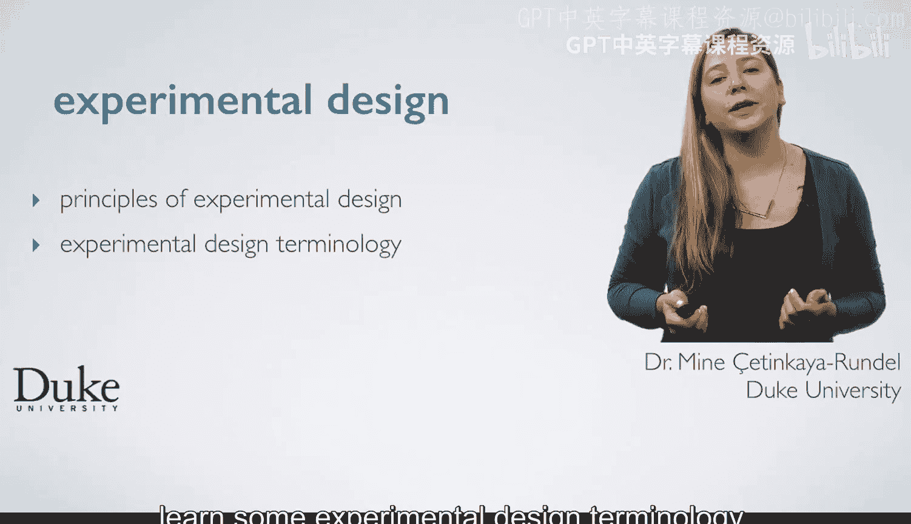
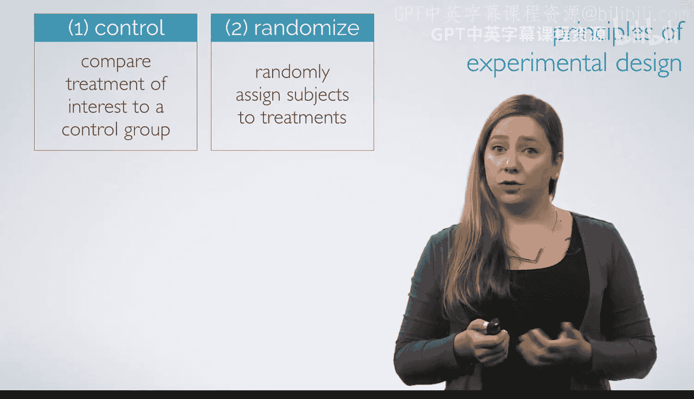
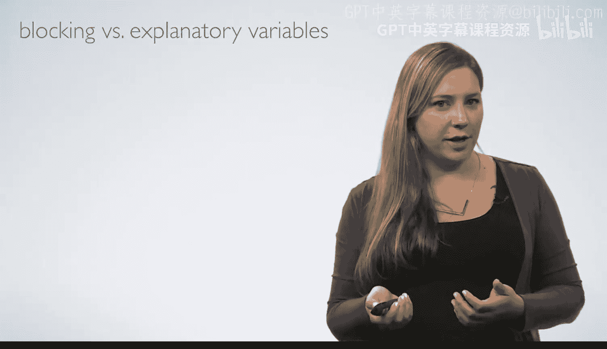
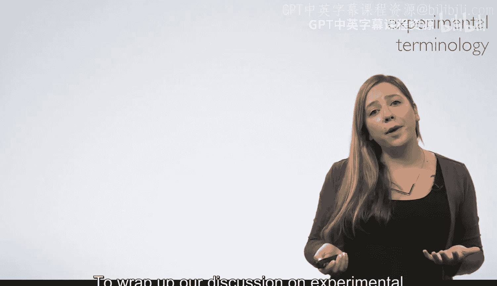
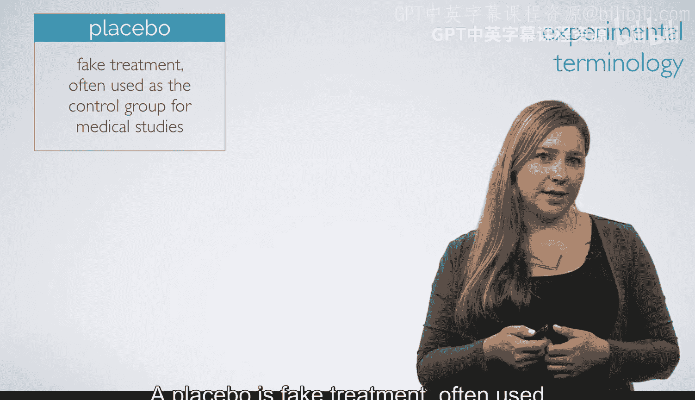
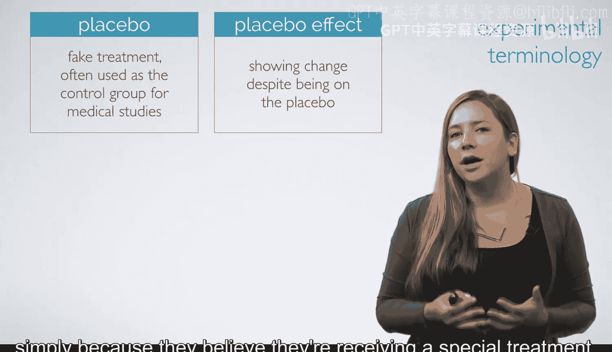

# 杜克大学《R语言数据分析（R语言、概率与数据入门，推断统计，线性回归与建模）｜Data Analysis with R》中英字幕 p06 06_02_06_实验设计.zh_en -BV1Cf421q7mU_p6-

In this video， we will discuss principles of experimental design and learn some experimental design terminology。

The four principles of experimental design are control， randomize。

 replicate and block to control means to compare treatment of interest to a control group to randomize means randomly assigning subjects to treatments。

 to replicate means collecting a sufficiently large sample within a study or to replicate the entire study。

 The last principle of experimental design is blocking。

 If there are variables that are known or suspected to affect the response variable。

 First group the subjects into blocks based on these variables and then randomized cases within each block to treatment groups。

 Let's discuss blocking a bit more。 We would like to design an experiment to investigate if energy gels make your run faster。

 The treatment group gets the energy gel。 The control group does not get any energy gel。

It is suspected that energy gels might affect pro and amateur athletes differently。 Therefore。

 we block for pro status。 To do so， we divide our sample into pro and amateur athletes。

 and then we randomly assign pro and amateur athletes to treatment and control groups。 Therefore。

 pro and amateur athletes are equally represented in the resulting treatment and control groups。

 This way， if we do find a difference in running speed between the treatment and control groups。

 we will be able to attribute it to the treatment。 the energy gel。

 and can be assured that the difference isn't due to pro status since both pro and amateur athletes were equally represented in the treatment and control groups。

So how do we tell the difference between a blocking variable and an explanatory variable。

 Expplanatory variables， also sometimes called factors are conditions we can impose on our experimental units。

 Blocking variables， on the other hand， are characteristics that the experimental units come with that we would like to control for Blocking is basically like stratifying。

 except used in experimental settings when randomly assigning as opposed to when sampling。

To wrap up our discussion on experimental design， let's go over a few new terms。

 A placebo is a fake treatment， often used as the control group for medical studies。

 The placebo effect is when experimental units show improvement simply because they believe they're receiving a special treatment。

 blindlinding is when experimental units do not know whether they are in the control or the treatment groups。

 and finally， a double blindd study is one where both the experimental units and the researchers do not know who is in the control and who is in the treatment group。

 These terms will be useful as we examine more studies throughout the course。😊。

