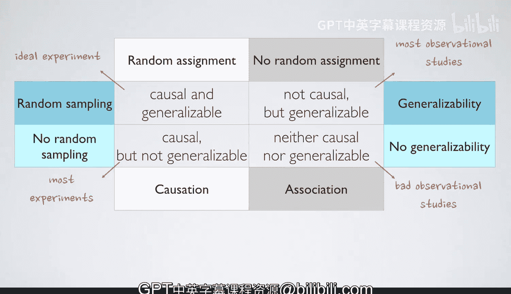

# 杜克大学《R语言数据分析（R语言、概率与数据入门，推断统计，线性回归与建模）｜Data Analysis with R》中英字幕 p07 07_02_07_聚焦：随机抽样与分配.zh_en -BV1Cf421q7mU_p7-

In this spotlight video， we will discuss random sampling and random assignment。

 two concepts that sound similar， but serve quite different purposes in study design。

 Random sampling occurs when subjects are being selected for a study。

 If subjects are selected randomly from the population。

 then each subject in the population is equally likely to be selected。

 and the resulting sample is likely representative of the population。 Therefore。

 the study's results are generalizable to the population at large。

Random assignment occurs only in experimental settings where subjects are being assigned to various treatments。

 Ta a close look at our sample， we usually see that the subjects exhibit slightly different characteristics from one another。

 through random assignment， we ensure that these different characteristics are represented equally in the treatment and control groups。

 This allows us to attribute any observed difference between the treatment and control groups to the treatment being observed on the subjects。

 Since otherwise， these groups are essentially the same。In other words。

 random assignment allows us to make causal conclusions based on the study。

Let's give a quick example， supposeose you want to conduct a study evaluating whether people read serif fonts or Sun serif。

 or in other words， without serif fonts faster， note that serifs are these small decorative pieces on the ends of each character。

Ideally， you would first randomly subjects for your study from your population。

 Then you assign the subjects in your sample to two treatment groups。

 One where they read some text in serif font and the other where they read the same text in some serif font through random assignment。

 we ensure that other factors that may be contributing to reading speed indicated here with the different colors for the subject。

 for example， fluency or how often the subject reads for leisure are represented equally in the two groups。

 we call such variables confounders or confounding variables。 in the setting。

 if we observe any difference between the average reading speeds of the two groups。

 we can actually attributed to the actual treatment。 the font type。

 and know that it's likely not due to a confounding variables。 So to recap。

 sampling happens first and assignment happens second。So in summary。

 a study that employs random sampling and random assignment can be used to make causal conclusions and these conclusions can be generalized to the whole population This would be an ideal experiment but such studies are usually difficult to carry out。

 especially if the experimental units are humans since it may be difficult to randomly sample people from the population and then impose treatments on them This is why most experiments recruit volunteer subjects you may have seen ads for these on a university campus or in a newspaper。

Such human experiments that rely on volunteers employ random assignment， but not random sampling。

 These studies can be used to make causal conclusions， but the conclusions only apply to the sample。

 and the results cannot be generalized。 A study that uses no random assignment。

 but does use random sampling is your typical observational study。

 Reult can only be used to make correlation statements。

 but they can be generalized to the population at large。 A final type of study。

 One that doesn't use random assignment or random sampling can only be used to make correlational statements。

 and these conclusions are not generalizable。 This is an un idealal observational study。

