# 杜克大学《R语言数据分析（R语言、概率与数据入门，推断统计，线性回归与建模）｜Data Analysis with R》中英字幕 p08 08_04_02_数值数据可视化.zh_en -BV1Cf421q7mU_p8-

In this video on visualizing numerical data， we will discuss scatter plots for paired data and other visualizations for describing distributions of numerical variables。

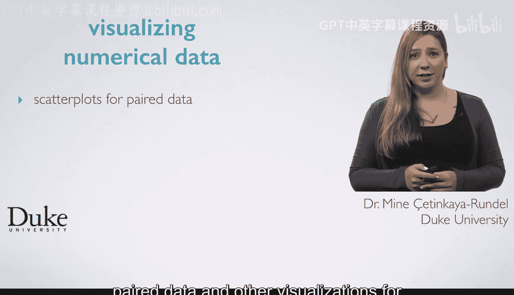

The data come from Gapminder， which pulls this information from a variety of data sources。

 we will be working with two numerical variables， income per person that's in US dollars and life expectancy in years for the year 2012。

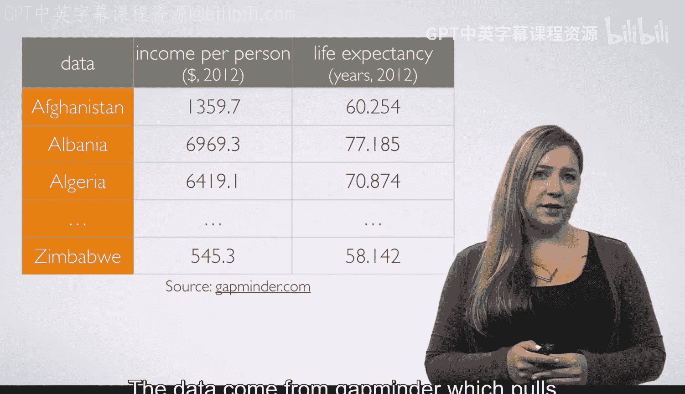

Each observation in this data set is a country， the data contains data from most but not all countries。

 since this information wasn't available for certain countries。

A common tool for visualizing the relationship between two numerical variables is a scatter plot to identify the explanatory variable in a pair of variables。

 We identify which of the two is suspected of affecting the other and plan and appropriate analysis。

 Since we might suspect that economic wealth of a country might affect the average life expectancy of its people。

 we have set up our analysis with income as the explanatory and life expectancy as the response variable。

 General， in a scatter plot， we place the explanatory variable on the x axis and the response variable on the y axis。

 It's very important to note that labeling variables as explanatory and response does not guarantee that the relationship between the two is actually causal。

 Even if an association between the two variables is identified。

 We use these labels only to keep track of which variable we suspect affects the other。 In fact。

 since these data are observational and do not come from a randomized controlled experiments。

We know that we can only talk about correlation and not causation between the two variables so what is the relationship between these two variables the best way to answer this question is to visualize a line or a curve going through the cloud of the data so here I'm drawing a curve that first shows a positive increase in life expectancy as income increases and then the relationship levels off such that countries with income levels above a certain point still have roughly 80 to 85 years of average life expectancy。

The relationship is fairly strong with not too much scatter around the curve。In addition。

 there are a few countries that stand out from the rest as potential outliers。

 we will discuss those in a detail in a moment。Let's summarize quickly what we've learned about relationships between numerical variables。

 When evaluating the relationship between two numerical variables。

 we should make sure to examine the direction of the relationship。 Is it increasing。Or decreasing。

The shape of their relationship is it linear？Or does it follow some other form？

The strength of the relationship is the relationship strong。

 indicated by little scatter or weak indicated by lots of scatter， and any potential outliers。

These can be individual observations or a group of observations。

 It's always a good idea to investigate these points carefully to make sure they're not data entry errors。

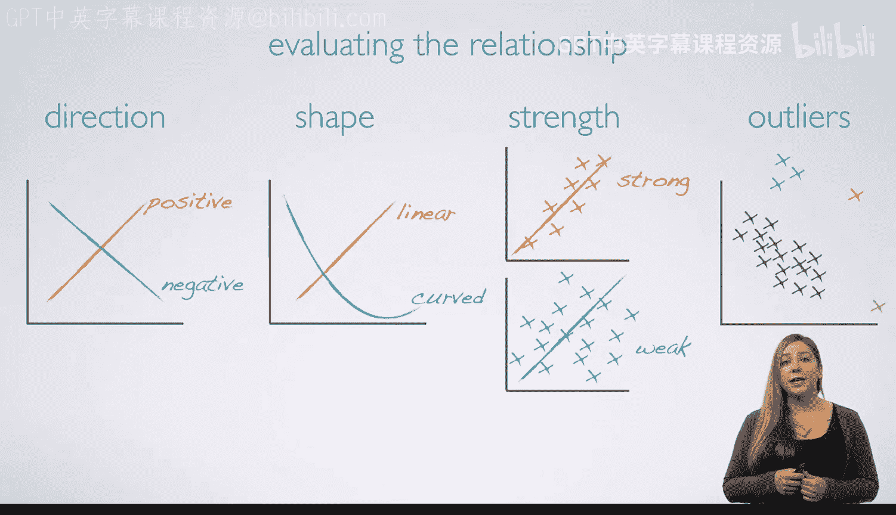

Let's take a closer look at the outliers。 Some of them have pretty high income levels。 Luxembourg。

 a rich country with a small population and hence higher income per person level。 Macao。

 a special administrative region in China and Qatar。

 a country with a small population and lots of oil。

 Another potential outlier is in Nepal where the life expectancy is considerable higher than what would be expected for the low income level compared to others。

 These are countries that we would indeed expect to behave differently than the majority of the countries。

 So it's not surprising that they stand out from the rest。

 One naive way of dealing with outliers in data analysis， is to immediately exclude them。

 but we're calling that approach naive because it's often not the right approach。

 This is a good example of when the outliers might be very interesting cases and handling them with careful consideration of the research question and other associated variables is important。

 Now， let's take a look at the distributions of the variables individually。

One good way of visualizing the distribution of a numerical variable is a histogram In a histogram。

 data are bent into intervals， and heights of the bars represent the number of cases that fall into each interval。

 In other words， a histogram provides a view of the data density。

 High bars represent where data are relatively more common。 For example。

 we can see that majority of the countries have average life expectancies between 65 to 85 years old。

 Histograms are also very useful for identifying shapes of distributions。 In this case。

 the distribution of life expectancies appear to be left skewed。

 which is expected due to the leveling off of life expectancies we've identified earlier。

 There is a physiological limit to how long people live。 And in most countries。

 people live up to that time。 but there are some countries with much lower life expectancies and fewer and fewer of these countries with lower and lower expectancies。

 resulting in a long left tail。😊，The distribution of income， on the other hand， is rightke。

 Incoms can be can't be negative， so we have a natural boundary at 0。

 but there is no real upper limit to how high incomes can go。 However， as we go higher and higher。

 we have fewer and fewer countries with such high levels of personal income， resulting in a long。

 right tail。 A shared characteristic between these two distributions is that they're both unimmodal。

 Let's focus on these statements on skewness and modality for a bit。

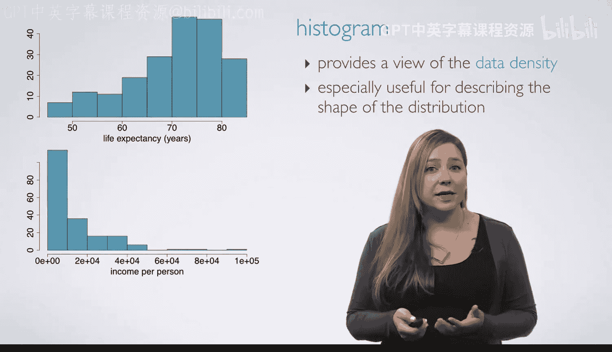

First off， skewness distributions are said to be skewed to the side of the long tail in a left skewed distribution。

 the longer tail is on the left on the negative end。 If no skewness is apparent。

 then the distribution is said to be symmetric and in a right skewed distribution。

 the longer tail is on the right， the positive end。

 As you can see the best way to assess the shape of distributions is to step back and imagine a smooth curve outlining the distribution instead of focusing on the jagged edges of the bars in the histogram。

Another important aspect of shape is modality。 A distribution might be unimmodal with one prominent peak。

 bimodal with two prominent peaks or uniform with no prominent peaks。

 with more than two prominent peaks， a distribution is usually said to be multimodal。

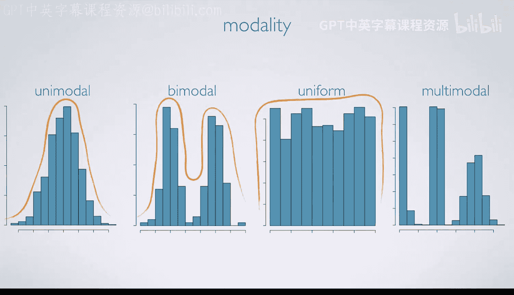

The distribution that you will most closely work with in an introductory statistics course is unimmodal。

 the normal distribution that you may also know as the bell curve。

 A bimodal distribution might indicate that there are two distinct groups in your data。 For example。

 here's a distribution of heights of individuals at a preschool。

 The first peak might be the kits and the second might be the teachers。

 A uniform distribution means there is no apparent trend in the data。

 that high and low values of the variable are equally likely to occur。

 Here's a distribution of the last digits of a random sample of people's Social security numbers As expected。

 the data show no trend is just as likely to have a social security number that ends with a zero as a six or an eye。

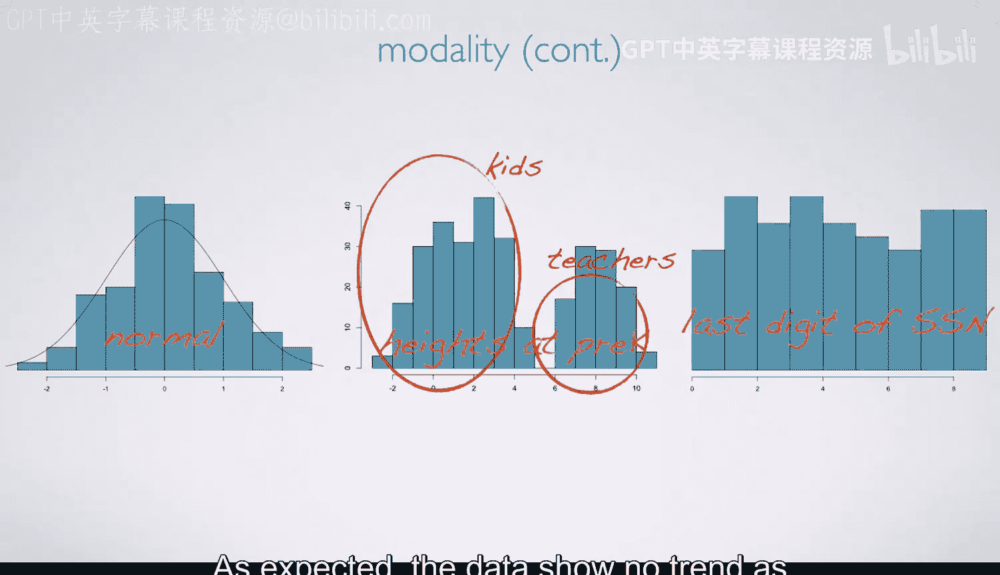

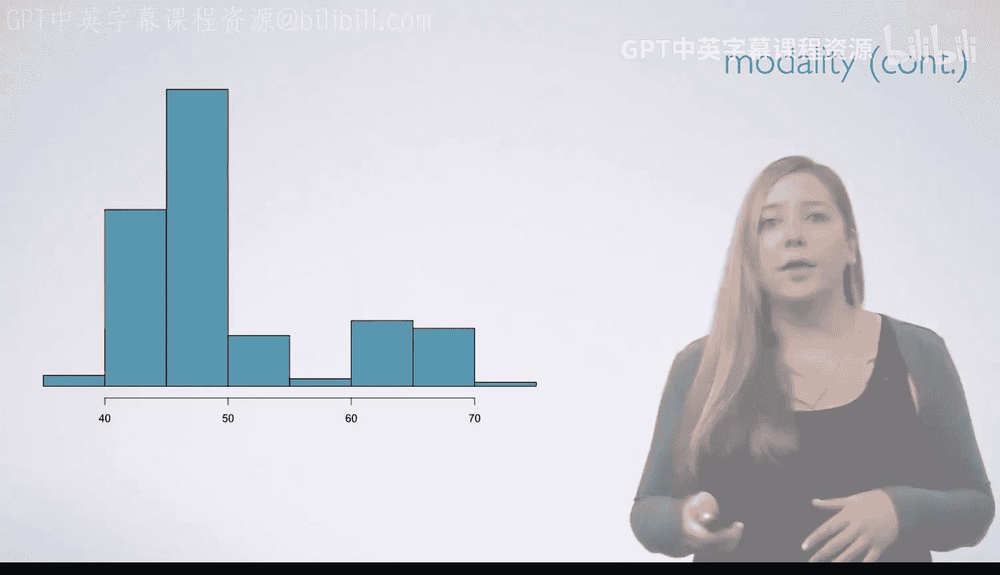

Assessing modality like shape is also best done by imagining a smooth curve outlining the distribution。

 Here's a trick。 Think of the bars of the histogram as wooden blocks and imagine dropping a limp spaghetti over them and try to imagine how the limp spaghetti would fall over and between the wooden blocks。

 Pes that are further from each other will likely result in differentiable。

 prominent peaks and peaks that are close to each other。

 like the ones around0 and2 may not identifyingdentifying the number of modes is not an exact science。

 and not one that you should dwell on too much。 Usually all you need to do is to determine whether the distribution is uniform。

 Uniimmodal or something else。😊。

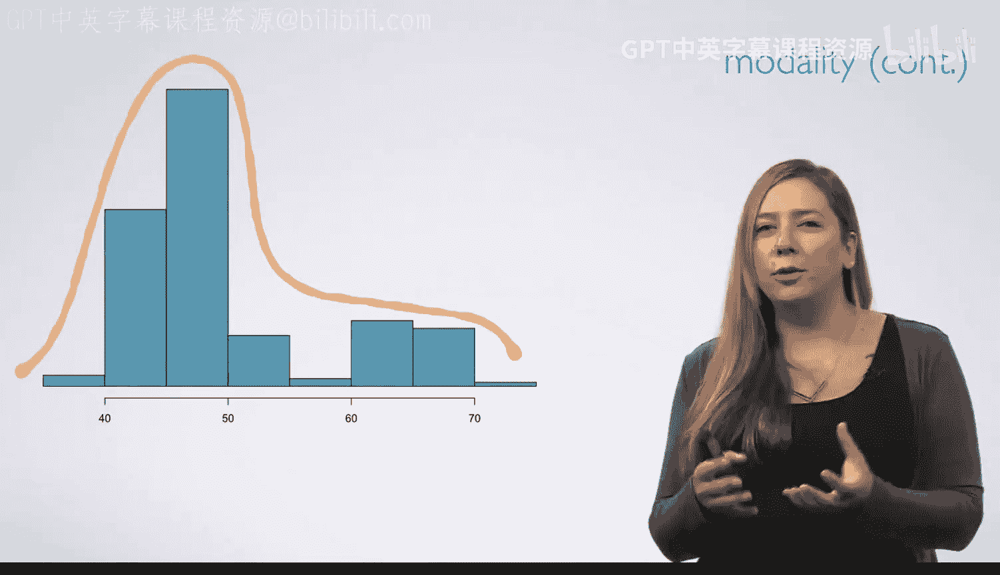

We should also note that the chosen B width of the histogram can alter the story the histogram is telling when the bandwidth width is too wide。

 we might lose interesting details。 When the bandwidth width is too narrow。

 it might be difficult to get an overall picture of the distribution。

 The ideal bandwidth width depends on the data you're working with。

 So you should try playing with it until you're satisfied with the visualization。

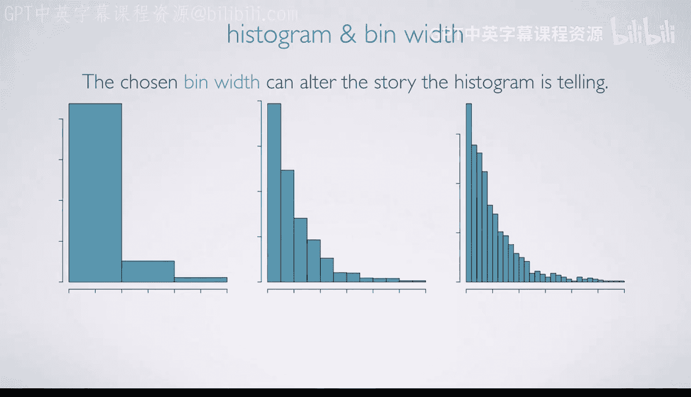

Let's go back to the life expectancy of data we were working with another technique for visualizing such data is a dot plot a dot plot is especially useful when individual values are of interest。

 however， as the sample size increases the dot plot may get too busy。

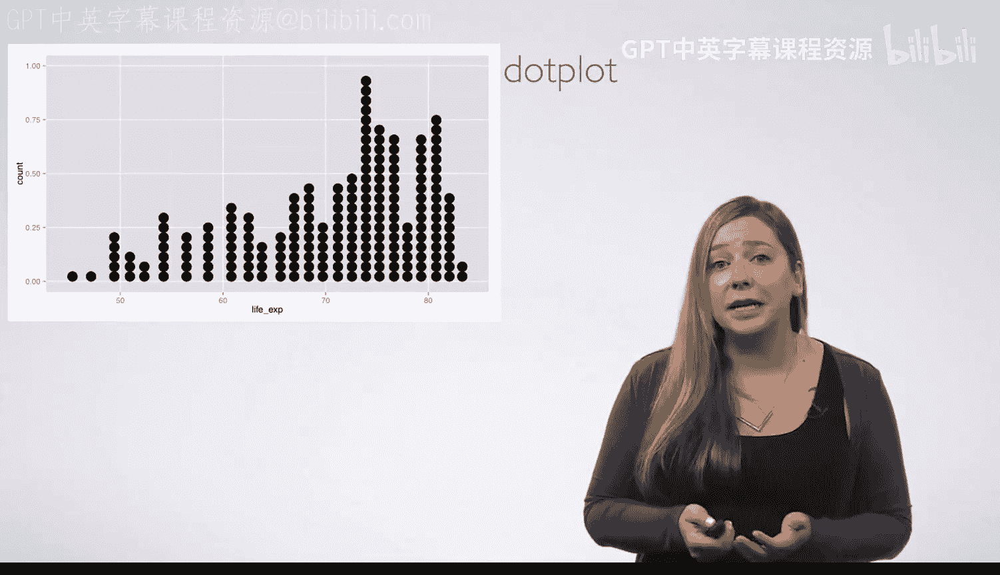

Yet another visualization technique that is especially useful for highlighting outliers is a box plot。

 A box plot also readily displays the median。 The midpoint of the distribution。

 This is the thick line inside the box and the intercortile range， the width of the box。

 According to this box plot， the median life expectancies roughly 73 years and the middle 50% of countries have average life expectancies between 65 and 77 years old。

 In addition， countries with life expectancies that are below 48 years old are considered to have unusually low life expectancies。

 A box plot of the income distribution shows the same right s distribution we've identified before。

 and the outlying countries with unusually high income per person levels stand out in this visualization as well。

😊。

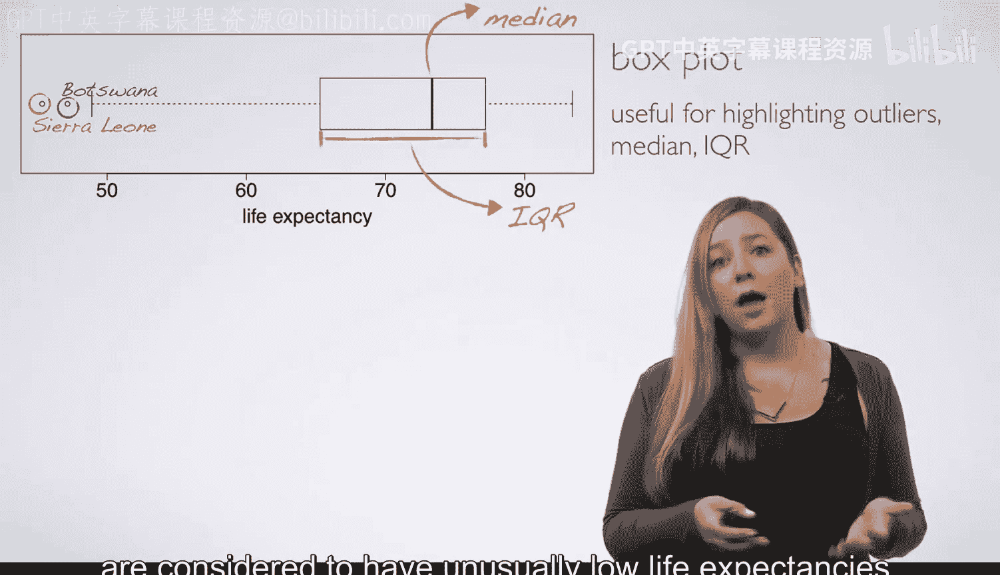

One way of determining the skewness of a distribution from a box plot is to imagine what the histogram would look like。

 The peak of the distribution will be roughly around the median。

 and the tails will extend out to the tails in the box plot。

 There is one more visualization method that we will discuss in this video and intensity map for certain types of data like the ones we've been working with in this video。

 It might be useful to view the spatial distribution。

 These displays reveal trends in the data that many of the others did not。 For example。

 we can see that both income and life expectancy are lower in Africa。

 but higher in North America and Europe。

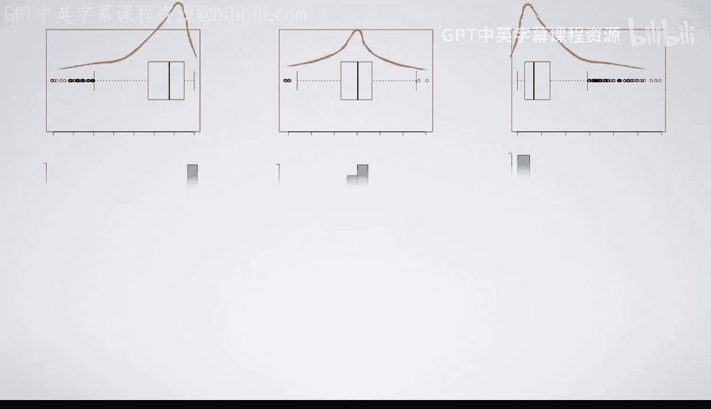