# R语言数据分析：08：数值数据可视化 📊

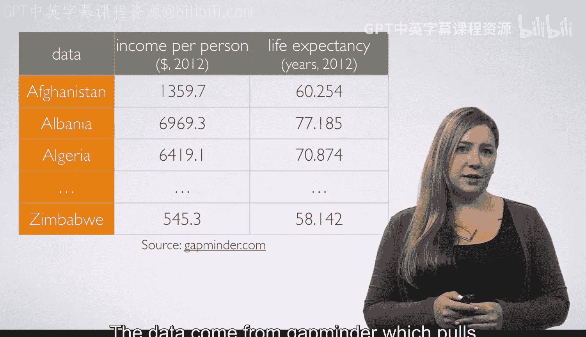

在本节课中，我们将学习如何对数值型数据进行可视化。我们将重点讨论用于成对数据的散点图，以及用于描述单个数值变量分布的其他可视化方法。

## 散点图：探索两个变量间的关系

上一节我们介绍了数据可视化的基本概念，本节中我们来看看如何可视化两个数值变量之间的关系。一个常用的工具是散点图。

我们使用的数据来自Gapminder项目，包含2012年各国的人均收入（美元）和预期寿命（年）信息。数据集中每个观测值代表一个国家。

在分析一对变量时，我们通常需要识别哪个是解释变量，哪个是响应变量。解释变量是我们认为会影响另一个变量的那个。在本例中，我们怀疑一个国家的经济财富（人均收入）可能会影响其人民的平均预期寿命。因此，我们将收入设为解释变量（x轴），将预期寿命设为响应变量（y轴）。

**重要提示**：将变量标记为解释变量和响应变量，并不能保证两者之间存在因果关系。即使我们发现了变量间的关联，这些标签也只是用来记录我们怀疑哪个变量会影响另一个。由于这些数据是观察性的，并非来自随机对照实验，我们只能讨论相关性，而不能断言因果关系。

那么，这两个变量之间的关系如何？回答这个问题的最佳方法是观察穿过数据云的一条线或曲线。通过观察，我们可以发现：随着收入的增加，预期寿命首先呈现正增长；当收入水平超过某个点后，这种关系趋于平缓，收入水平较高的国家平均预期寿命大致在80至85年之间。这种关系相当强，数据点围绕曲线的离散程度不大。

此外，有几个国家作为潜在的异常值显得与众不同。

以下是评估两个数值变量关系时需要检查的几个方面：

*   **方向**：关系是递增还是递减？
*   **形状**：关系是线性的，还是遵循其他形式？
*   **强度**：关系是强（离散点少）还是弱（离散点多）？
*   **异常值**：是否存在需要特别关注的单个或一组观测值？

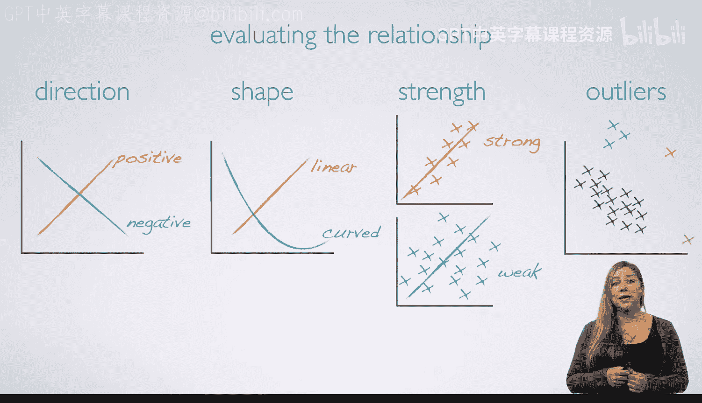

## 深入观察异常值

现在，让我们更仔细地看看这些异常值。其中一些国家的人均收入水平非常高，例如卢森堡（人口少、人均收入高）、中国澳门特别行政区，以及卡塔尔（人口少、石油资源丰富）。另一个潜在的异常值是尼泊尔，其预期寿命远高于其低收入水平所对应的预期值。

这些国家确实可能与大多数国家表现不同，因此它们显得突出并不奇怪。在数据分析中，一种天真的处理异常值的方法是立即将其排除。我们称这种方法为“天真”，是因为它通常不是正确的做法。本例就是一个很好的证明，这些异常值可能是非常有趣的案例，根据研究问题和其他相关变量对其进行仔细考量非常重要。

## 单个变量的分布：直方图

接下来，我们分别看看每个变量的分布。可视化单个数值变量分布的一个好方法是使用直方图。

在直方图中，数据被分组到多个区间（箱）中，条形的高度代表落入每个区间的案例数量。换句话说，直方图提供了数据密度的视图。高条形表示数据相对更集中。例如，我们可以看到大多数国家的平均预期寿命在65至85岁之间。

直方图对于识别分布的形状也非常有用。在本例中，预期寿命的分布呈现**左偏**。这是由于我们之前发现的预期寿命增长趋于平缓所导致的。人的寿命存在生理极限，在大多数国家，人们都能活到接近这个年龄，但也有一些国家的预期寿命低得多，并且预期寿命越低的国家数量越少，从而形成了长长的左尾。

另一方面，收入的分布是**右偏**。收入不能为负，所以我们在0处有一个自然边界，但收入可以有多高却没有真正的上限。然而，随着收入水平越来越高，人均收入如此高的国家越来越少，从而形成了长长的右尾。这两个分布的一个共同特征是它们都是**单峰**的。

## 理解分布的形状：偏度与峰态

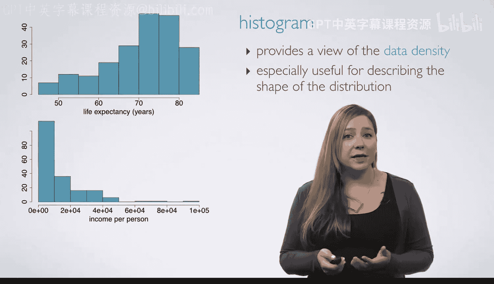

让我们更深入地探讨一下关于偏度和峰态的陈述。

首先，**偏度**。分布被描述为偏向长尾的一侧。
*   在**左偏**分布中，长尾在左侧（负端）。
*   如果看不出明显的偏斜，则分布称为**对称**。
*   在**右偏**分布中，长尾在右侧（正端）。

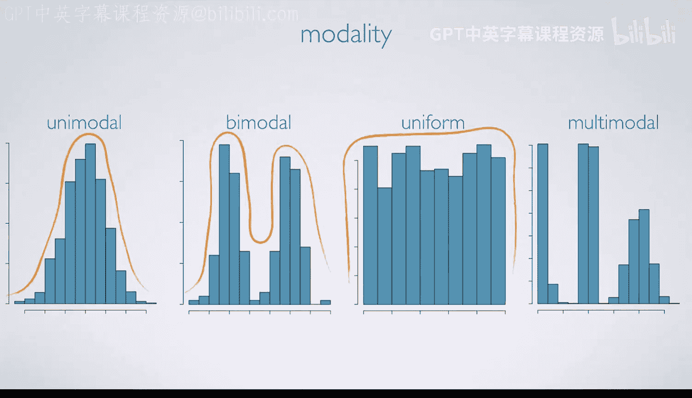

评估分布形状的最佳方法是退后一步，想象一条勾勒出分布轮廓的光滑曲线，而不是专注于直方图中条形的锯齿状边缘。

形状的另一个重要方面是**峰态**。
*   一个分布可能是**单峰**的（有一个突出的峰值）。
*   **双峰**的（有两个突出的峰值）。
*   或**均匀**的（没有突出的峰值）。
*   如果有两个以上的突出峰值，分布通常被称为**多峰**。

在入门统计课程中，你最常接触到的分布是单峰的**正态分布**，你可能也称之为钟形曲线。双峰分布可能表明你的数据中存在两个不同的群体。例如，一个幼儿园里个体身高的分布，第一个峰值可能是孩子们，第二个峰值可能是老师们。均匀分布意味着数据中没有明显的趋势，变量的高值和低值出现的可能性相同。例如，随机抽取的社会安全号码最后一位数字的分布，正如预期的那样，数据没有显示任何趋势，社会安全号码以0、6或9结尾的可能性是相同的。

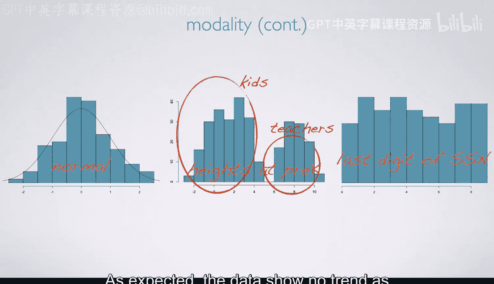

像评估形状一样，评估峰态也最好通过想象一条勾勒出分布轮廓的光滑曲线来完成。这里有一个技巧：把直方图的条形想象成木块，然后想象将一根软面条扔到它们上面，试着想象软面条会如何落在木块之间和之上。彼此距离较远的峰值可能会形成可区分的突出峰，而彼此靠近的峰值（例如在0和2附近的峰值）可能不会。识别峰的数量并非一门精确的科学，也不应过分纠结于此。通常，你只需要确定分布是均匀的、单峰的，还是其他类型。

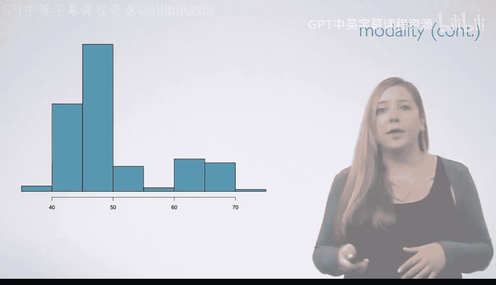

## 可视化细节：箱宽的选择

我们还应该注意，直方图选择的**箱宽**可以改变它所讲述的故事。
*   当箱宽**太宽**时，我们可能会丢失有趣的细节。
*   当箱宽**太窄**时，可能难以获得分布的整体图景。
理想的箱宽取决于你正在处理的数据，因此你应该尝试调整它，直到对可视化效果满意为止。

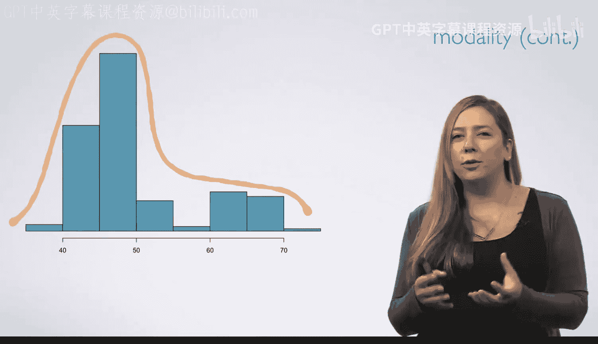

## 其他可视化方法：点图与箱线图

让我们回到正在处理的预期寿命数据。另一种可视化此类数据的技术是**点图**。当对个体值感兴趣时，点图特别有用。然而，随着样本量的增加，点图可能会变得过于杂乱。

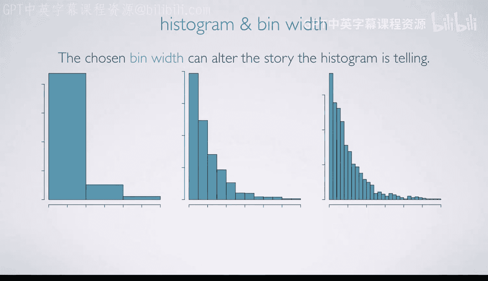

另一种特别有助于突出异常值的可视化技术是**箱线图**。箱线图还可以方便地显示分布的**中位数**（箱内的粗线）和**四分位距**（箱的宽度）。

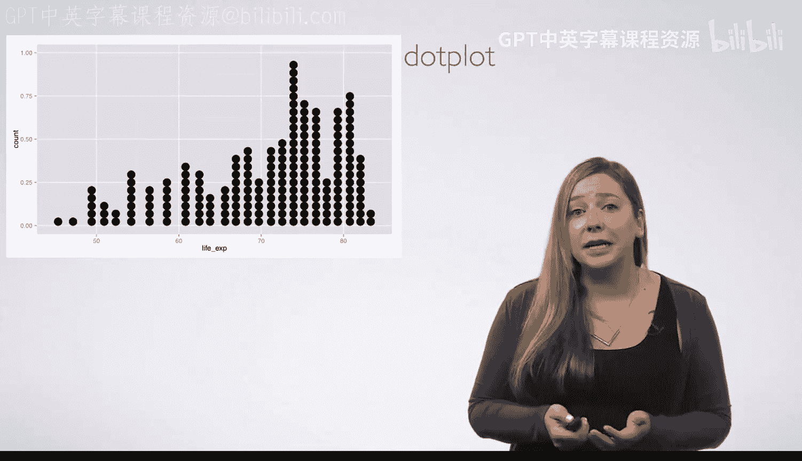

根据这个箱线图，预期寿命的中位数大约是73岁，中间50%的国家的平均预期寿命在65至77岁之间。此外，预期寿命低于48岁的国家被认为具有异常低的预期寿命。收入分布的箱线图显示了我们之前确定的相同的右偏分布，并且人均收入异常高的离群国家在这个可视化中也显得很突出。

从箱线图判断分布偏度的一个方法是想象直方图会是什么样子。分布的峰值大致在中位数附近，尾部将延伸到箱线图中的尾部。

## 空间分布：强度地图

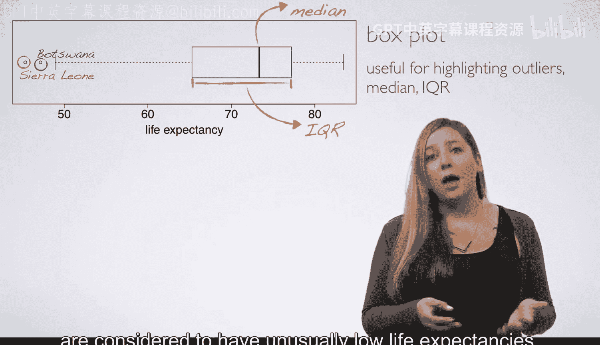

在本视频中，我们将讨论的最后一种可视化方法是**强度地图**。对于某些类型的数据（例如我们在本视频中一直在处理的数据），查看空间分布可能很有用。这些图可以揭示其他许多方法未能显示的数据趋势。例如，我们可以看到非洲的收入和预期寿命都较低，而北美和欧洲则较高。

## 总结

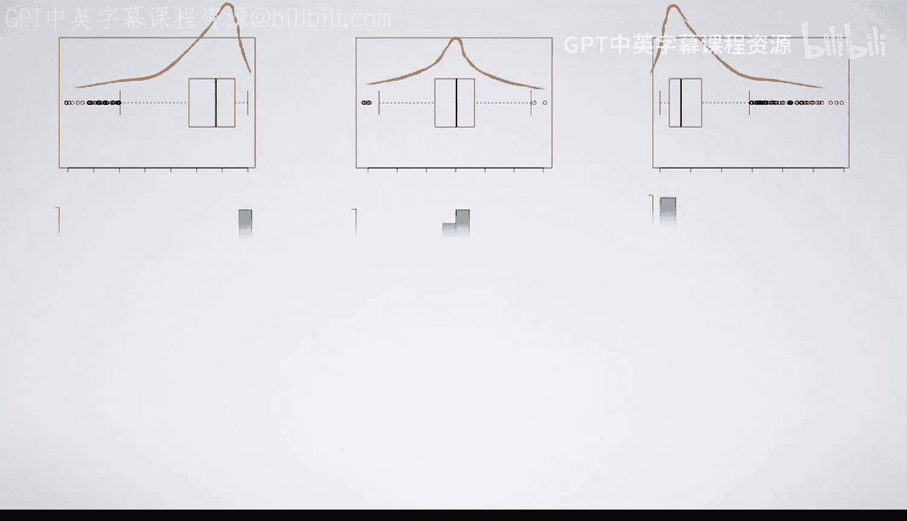

本节课中我们一起学习了多种数值数据的可视化方法。我们首先使用**散点图**探索了两个数值变量（人均收入与预期寿命）之间的关系，评估了其方向、形状、强度并识别了异常值。接着，我们利用**直方图**分别查看了单个变量的分布，理解了**偏度**（左偏、右偏）和**峰态**（单峰、双峰、均匀）的概念，并注意到箱宽选择的重要性。此外，我们还介绍了**点图**和**箱线图**，后者能清晰展示中位数、四分位距和异常值。最后，对于具有地理信息的数据，我们看到了**强度地图**在揭示空间趋势方面的价值。掌握这些工具将帮助你更有效地探索、理解和呈现数值数据。