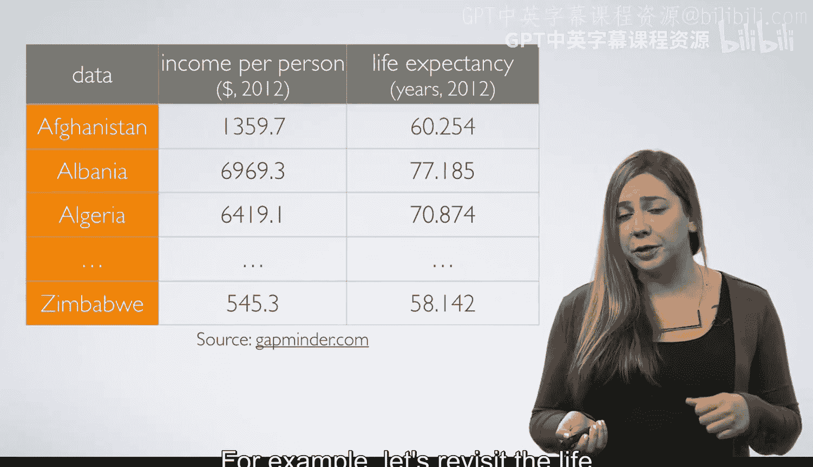
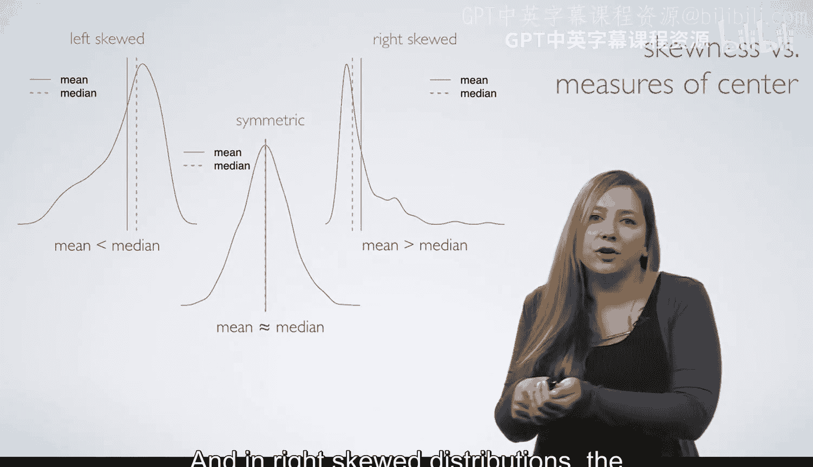
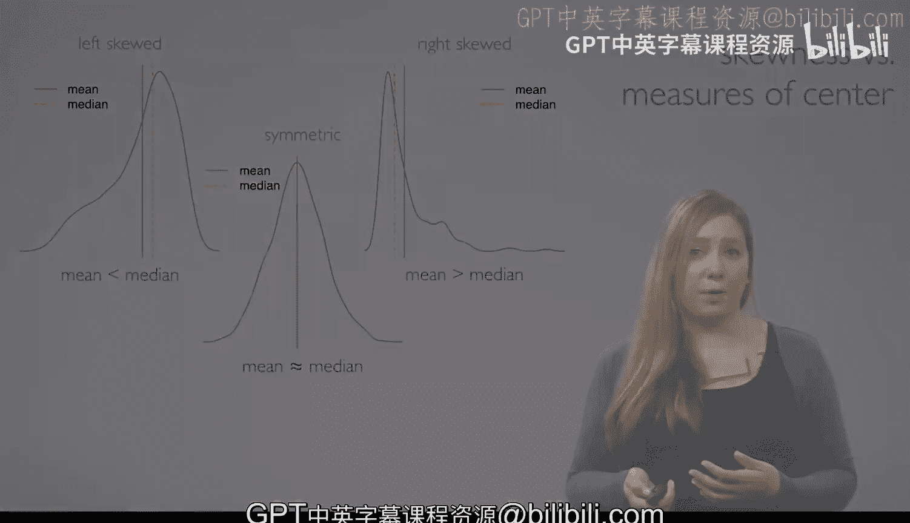

# 杜克大学《R语言数据分析（R语言、概率与数据入门，推断统计，线性回归与建模）｜Data Analysis with R》中英字幕 p09 09_04_03_集中趋势度量.zh_en -BV1Cf421q7mU_p9-

In this video， we will discuss methods of quantifying centers of numerical distributions。

 building on the previous concepts of visualizing numerical variables。Previously。

 we discussed shapes of numerical distributions。 We categorize distributions into three in terms of skewness。

 left sked， symmetric and right sked， and in terms of modality。

 we talked about variables that have a unimmodal， bimodal， uniform or multimodal distribution。

Another key characteristic that is of interest is the center of the distribution。

 Commonly used measures of center are the mean， which is simply the arithmetic average。 The median。

 which is the midpoint of the distribution， or， in other words， the 50th for centile and the mode。

 which is the most frequent observation。 If these measurements are calculated from a sample。

 They're called sample statistics。 sample statistics are point estimates for the unknown population parameters。

 They're unknown since it's usually not feasible to have information on all observations in the population。

These estimates may not be perfect， but if the sample is good。

 meaning representative of the population， they're usually good guesses。

 We usually use letters from the Latin alphabet when denoting sample statistics and letters from the Greek alphabet when denoting population parameters。

 For example， the sample mean is X bar and the population mean is mu。

Let's give a quick example with some simulated data。 Suppose we have exam scores from 9 students。

 The mean of this distribution is simply the arithmetic average of these scores。

 The mode is the most frequently observed value。 In this case， we have two students who scored 88。

 So the mode is 88。 However， we can see that with continuous distributions。

 it may be very unlikely to observe the same exact value multiple times。 Therefore。

 the mode of a distribution is not always a very useful measure。

 The median is defined as the midpoint or the 50th percentile of the distribution。

 In order to calculate the median， we need to first sort the data in increasing order。

 Then we find the midpoint of the ordered data， which in this case happens to be 87。

But what if we didn't have an exact midpoint of the distribution。

 sayy we have one more student who scored 100。 Now， the sample size is 10。

 and with an even number of observations， there isn't a single value that divides the data in health。

 In these cases， the median as defined as the average of the middle of the two observations。 Here。

 we have 87 and 88 as at the middle of our distribution。

 So the median based on this new data set would be 87。5。

Learning how these values are calculated by hand can be important for also understanding the concepts。

 but we should note that calculations like these are rarely done by hand。 Instead。

 we often rely on computation， which makes life much easier for working with data with a larger number of observations。

For example， let's revisit the life expectancy and income per person data。

 We established before that the distribution of average life expectancies are left skewed。

 The mean is 70。51， and the median is $73。34。 The mean indicated by the pink solid line in the plot is lower than the median indicated by the orange dashed line。

 This is expected based on the shape of this distribution。 Since there is a long tail to the left。

 the arithmetic average is being pulled to the lower end by the observations than the lower tail。

 On the other hand， in a right skewed distribution。

 like the distribution of average income per person for each country， the mean is roughly $1200500。

 While the median is only $7000。 The mean is much higher than the median， because this time。

 the longer tail is on the right。 and the few countries with very high income levels。

 compared to the others pull the mean up。

So to recap in a left skewed distribution， the mean is generally smaller than the median since the few low valued observations pull the average down in symmetric distributions。

 the mean and the median are roughly equal to each other， and in right skewed distributions。

 the mean is generally higher than the median， since the few high valued observations pull the average up。

