# 杜克大学《R语言数据分析（R语言、概率与数据入门，推断统计，线性回归与建模）｜Data Analysis with R》中英字幕 p10 10_04_04_离散程度度量.zh_en -BV1Cf421q7mU_p10-

Now that we have a good grasp of measuring centers of distributions。

 let's talk a bit about measures of spread。 In other words。

 statistics that tell us about the variability in the data。

 Take a look at these two curves with the same center。

 the skinny blue curve is less variable than the wider green curve as the data in the blue curve are clustered closer to the center。

 While the data in the green curve are spread further away from it。

 One measure of spread is the range， which is simply the difference between the minimum and the maximum values in the data。

 While it's easy to calculate， This is not a very reliable measure of variability of the sample since it depends on the two most extreme values。

 the endpoint of the distribution。 More reliable indicators of spread measure how close or far the bulk of the data lie from the center of the distribution。

 Most commonly used such measures of spread are the variance。

 the standard deviation and the intercorrtile range。😊。

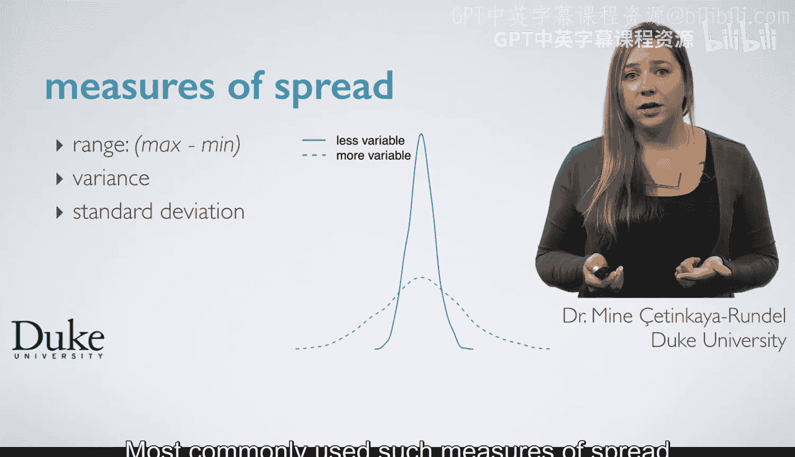

The variance is roughly the average square deviation from the mean。

 We denote a sample variance as S squared and population variance as sigma squared。

 to calculate the variance， we first find the difference between the mean and each observation。

 In other words， the deviation from the mean for each observation。

 We square each of these deviations and add them up for all observations in the dataset set。

 Then we find the average square deviation by dividing this sum by the sample size n-1。

 We'll talk about why we divide by n-1 instead of n a little later。

 Let's take a look at this example。 given that the average life expectancy is 70。5。

 and there are 201 countries in the data set。 we can calculate the standard deviation。

 The first country is 60。3-7。5 away from the mean and we square this difference。

 and then we add the square deviation from the mean for the next country and the next and the next。😊。

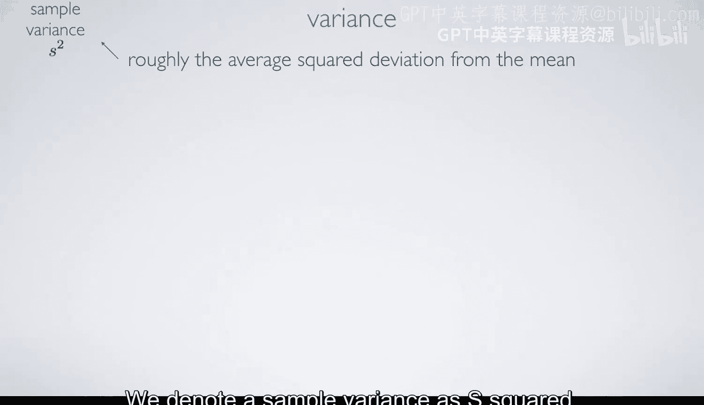

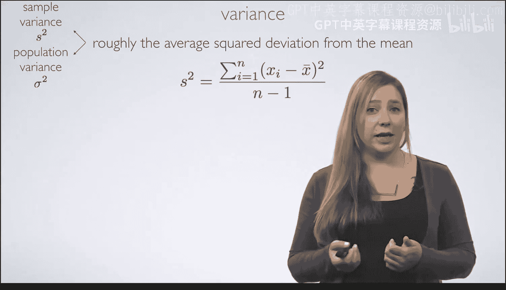

Until we reach the last one， Finally， we divide by the sample size，-1。

 and the variance comes out to be 83。06 years squared。

 The units of the variance is the square of the units of the original data。

 Since we squared the deviations from the mean in calculation of the variance。

 This is actually somewhat annoying since the result，83。06 years squared is not very meaningful。😊。

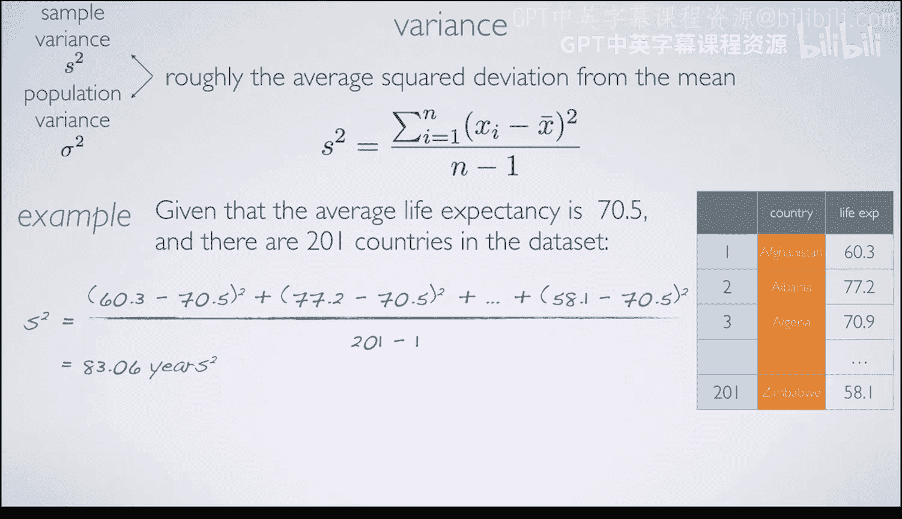

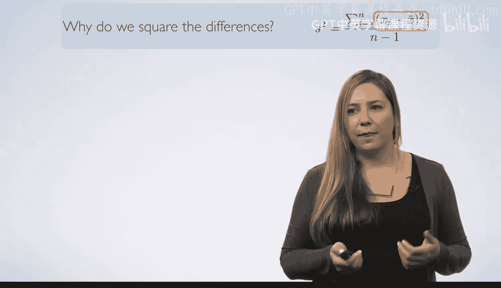

So why do we square the differences in the calculation of the variance？ First。

 it allows us to get rid of negatives。 Otherwise， when added together。

 the negative and the positive values would cancel each other。 For example。

 in asymmetric distribution centered at 0， negative2 and  two are equally distant from the mean。

 And if we were to simply add the deviations from the mean， they would cancel each other out。

 On the other hand， if we first square the deviations， both become positive。😊，But usually。

 we use the absolute value to get rid of negatives。 Why didn't we do that here。

 Saring the deviations also serve the purpose of increasing larger deviations more than smaller ones。

 Think about it。 Neative 2 squared is 4， while 3 squared is 9 and 4 squared is 16。 This way。

 larger deviations are weighed more heavily。

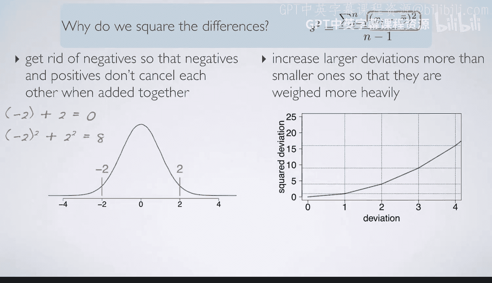

However， it's useful to square these deviations。 At the end of the day。

 we would still prefer a measure of variability that has the same units as the observed data。

 and therefore we turn to standard deviationance。 This is basically the average deviation around the mean calculated as the square root of the variance。

 Once again， we use the Latin Greek alphabet notation for denoting standard deviation S for the sample standard deviation and sigma for the population standard deviation。

The formula is simple。 It's just a square root of the variation。

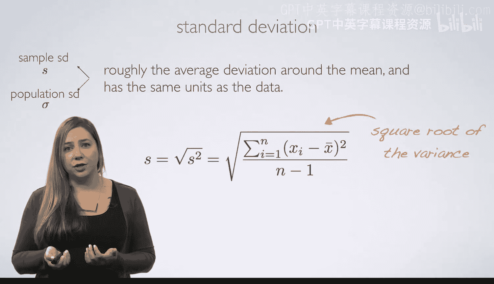

Calculating the variance and standard deviation by hand for reasonably sized data sets is tedious and prone to errors。

 so we usually use computation for these tasks。 However。

 understanding variability is essential for doing statistics。

 a concept that's often confused with variability is diversity。 Let's take a look at this question。

 Which of the following sets of cars has a more diverse composition of colors。 Se one with yellow。

 red， green， purple and blue colors or set two with three blue and two purple cars。😊。

The answer is set one， with each car having a different color， the diversity is higher。

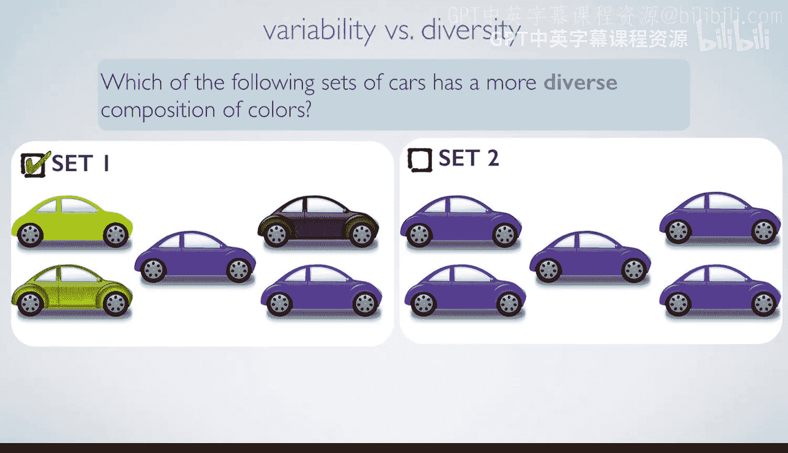

Now let's ask a different question， which of the following sets of cars has more variable mileage。

 set one with cars that get 10， 20， 30， 40 and 50 miles per gallon。

 or set two with three cars that get 10 miles per gallon and two cars that get 50 miles per gallon。

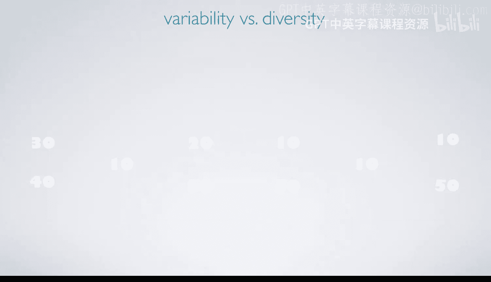

This time， the answer is actually set to。 remember。

 distributions where more observations are clustered around the center are less variable versus distributions where more observations are away from the center are more variable。

 We can take a look at dot plots of these distributions to make that point a little more clear。

 In the first set， the average gas mileages 30 miles per gallon。 And the values range from 10 to 50。

 but there is one observation at the mean and two others closer to the mean than the endpoint。

In the second set， the average gas mileage is 26 m per gallon。

 and the values also range from 10 to 50， but there are no observations at or near the mean。

 Therefore， the average deviation from the mean is higher for this set。

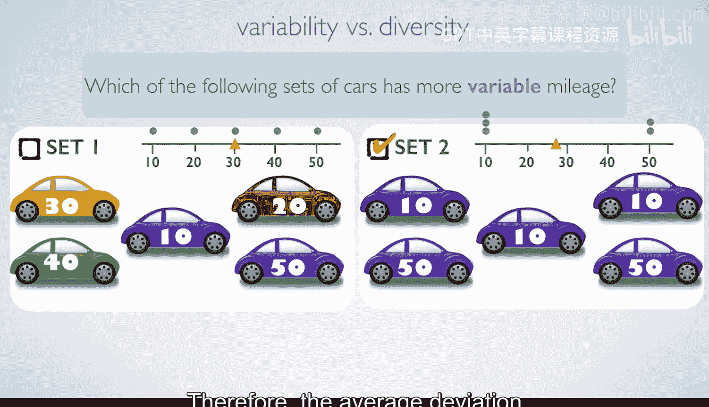

One last measure of spread that we'll discuss is the inter quartile range。

 which is the range of the middle 50% of the data， it can be calculated as the difference between the first and the third quartiles。

 that's the 25th percentile and the 75th percentile。

This measure is most readily available in a box plot。

Let's take a look back at the box plot of life expectancies。

 The first quartile or is also dened as Q1 is 65， and the third quartile is 77。

 So the IQR is the difference between these two12 In describing the distribution of life expectancies。

 we can say that the middle 50% of countries have life expectancies between 65 and 77 years old。

 The value of the IQR itself，12 isn't as informative on its own。

 but would be useful when comparing distributions。 The reason why the IQR is a more reliable measure of spread in sample data than the range which is maximum minus minimum is that it doesn't rely on the endpoints。

 which may be unusual observations or potential outliers。

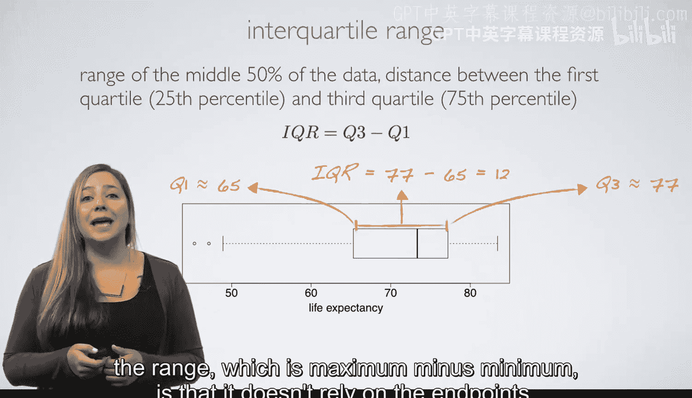