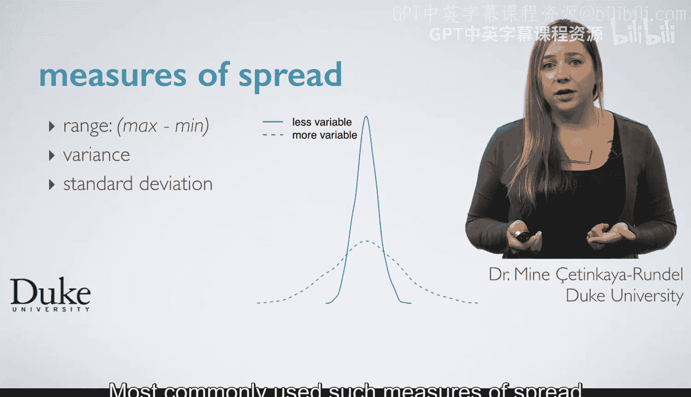
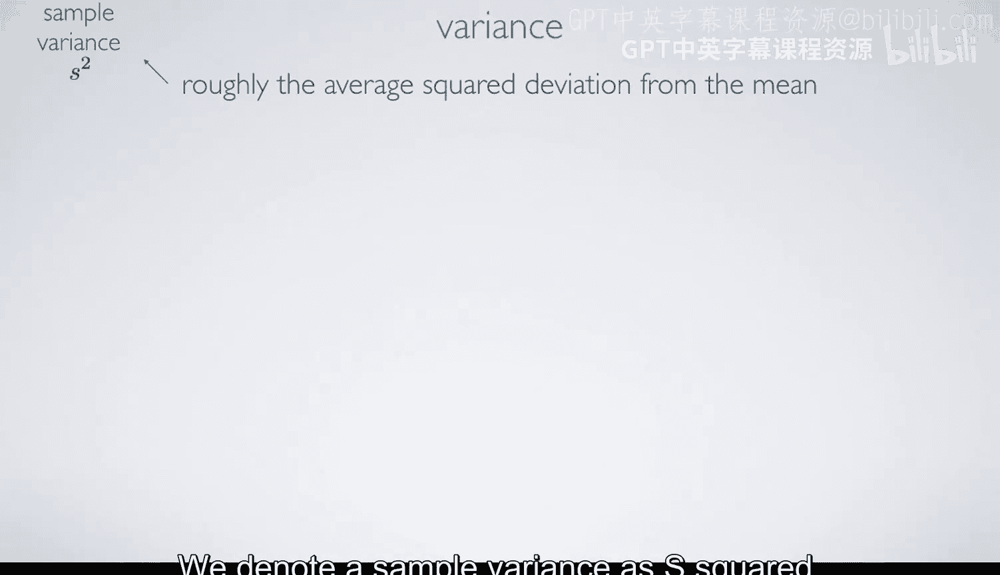
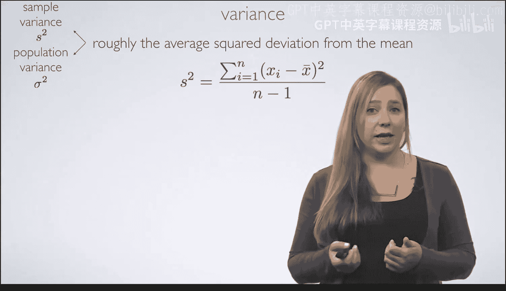
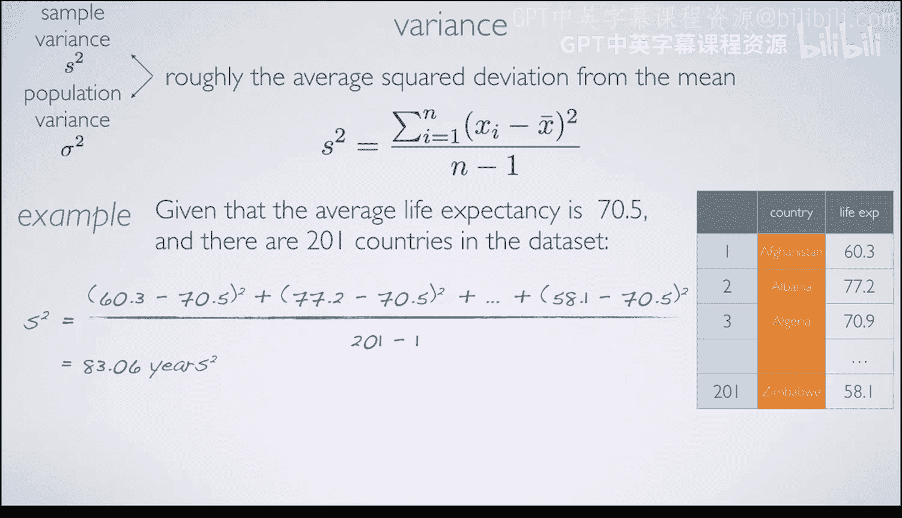
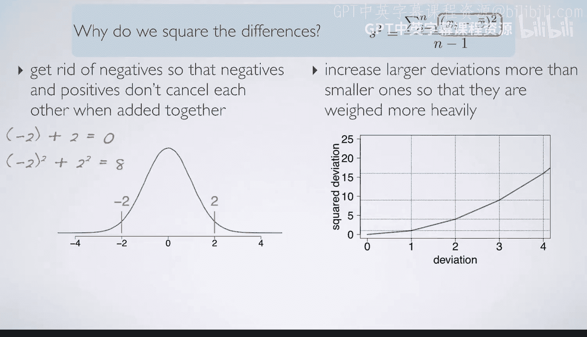
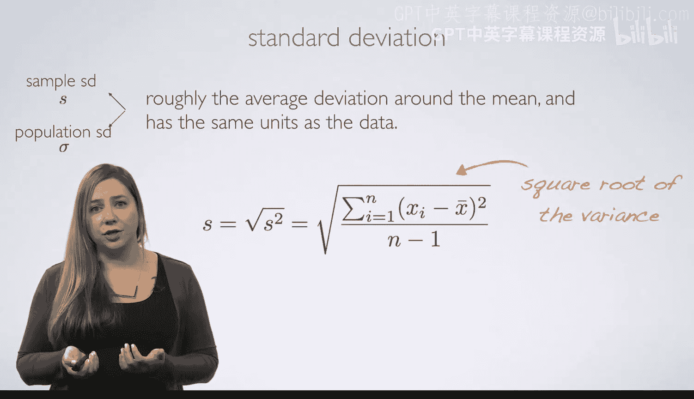
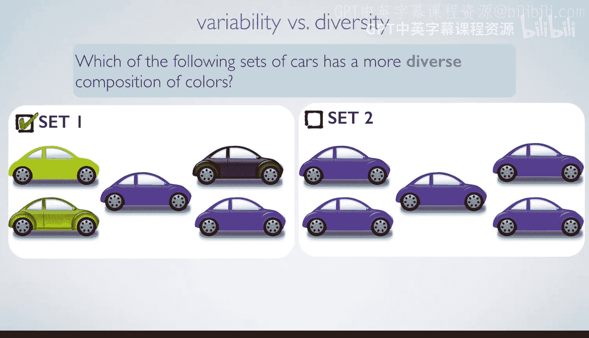
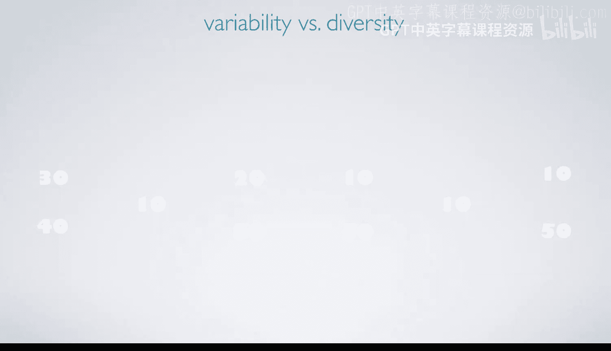
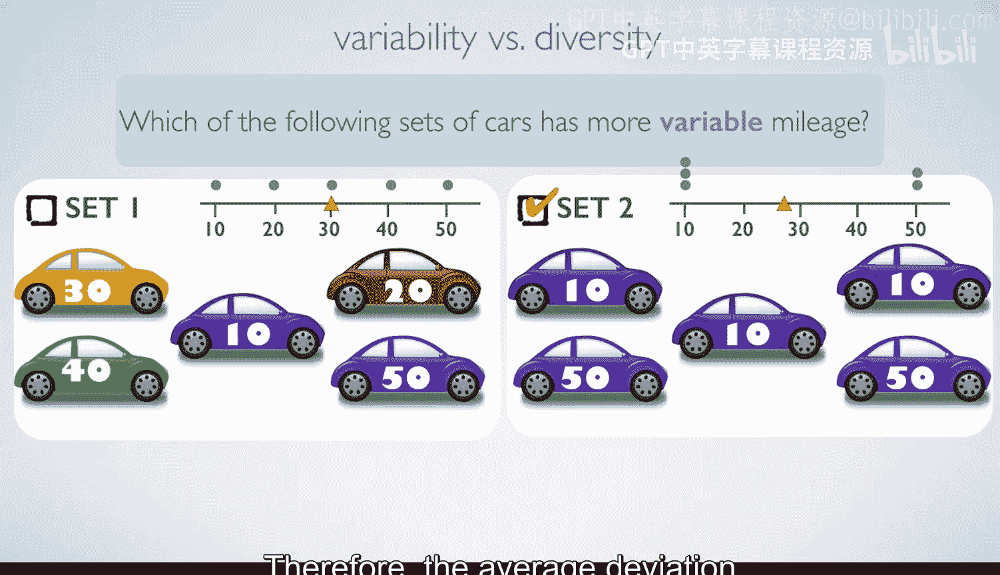
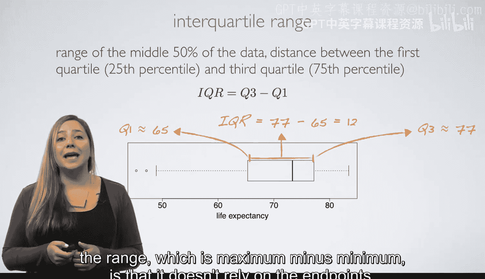

# R语言数据分析：10：离散程度度量 📊

在本节课中，我们将要学习如何度量数据分布的离散程度，即数据的变异性。上一节我们介绍了分布中心的度量方法，本节中我们来看看如何描述数据围绕中心值的分散情况。

## 概述：什么是离散程度？

观察两个具有相同中心但形状不同的分布曲线。蓝色曲线更“瘦高”，表明其数据更紧密地聚集在中心周围；而绿色曲线更“宽扁”，表明其数据更分散地远离中心。离散程度度量就是用来量化这种数据分散程度的统计量。

## 度量方法

以下是几种常用的离散程度度量方法。

### 极差

极差是最简单的度量，计算公式为数据最大值与最小值之差。

**公式**：`极差 = 最大值 - 最小值`

虽然计算简单，但极差并非衡量样本变异性的可靠指标，因为它仅依赖于分布的两个极端端点值，容易受到异常值的影响。

### 方差与标准差

更可靠的离散程度指标衡量的是大部分数据与分布中心的接近或远离程度。最常用的此类指标是方差和标准差。

#### 方差

方差大致是各数据点与均值偏差平方的平均值。样本方差记为 **S²**，总体方差记为 **σ²**。

**计算公式**：
1.  计算每个观测值与均值的差（即偏差）。
2.  将每个偏差平方。
3.  将所有平方偏差相加。
4.  用该总和除以（样本量 n - 1），得到平均平方偏差。

**公式**：`S² = Σ(xi - x̄)² / (n - 1)`

我们稍后会讨论为何除以 `n-1` 而不是 `n`。

**示例**：假设平均预期寿命为70.5岁，数据集包含201个国家。计算第一个国家（预期寿命60.3岁）与均值的偏差为 -10.2岁，将其平方。对后续每个国家重复此过程，直到最后一个。最后，将所有平方偏差之和除以（201 - 1），得到方差约为83.06“岁²”。

由于在计算中我们对偏差进行了平方，方差的单位是原始数据单位的平方。这使得结果（如83.06“岁²”）在直观上难以解释。

#### 为何要平方偏差？

在方差计算中平方偏差有两个主要原因：
1.  **消除负号**：如果不平方，正负偏差相加会相互抵消。例如，在均值为0的对称分布中，-2和2与均值的距离相等，但直接相加会得到0。平方后两者都变为正数。
2.  **放大较大偏差**：平方运算使较大的偏差获得更大的权重。例如，-2²=4，3²=9，4²=16。这样，数据中较大的波动在方差中会得到更显著的体现。

#### 标准差

为了得到一个与原始数据单位相同的变异性度量，我们使用标准差。标准差本质上是围绕均值的平均偏差，计算为方差的平方根。样本标准差记为 **S**，总体标准差记为 **σ**。

**公式**：`S = √S² = √[ Σ(xi - x̄)² / (n - 1) ]`

对于合理规模的数据集，手动计算方差和标准差既繁琐又易错，因此我们通常借助计算工具完成。然而，理解变异性的概念对于进行统计分析至关重要。

### 变异性与多样性的区别

一个常与变异性混淆的概念是多样性。让我们通过一个例子来区分：

**问题一**：以下哪组汽车的颜色组成更多样？
*   组一：包含黄、红、绿、紫、蓝五种不同颜色的车。
*   组二：包含三辆蓝色和两辆紫色的车。

**答案**：组一。因为每辆车的颜色都不同，所以多样性更高。

**问题二**：以下哪组汽车的油耗（英里/加仑）变异性更大？
*   组一：油耗分别为 10, 20, 30, 40, 50 英里/加仑的车。
*   组二：三辆油耗为10英里/加仑，两辆油耗为50英里/加仑的车。

**答案**：这次是组二。回忆一下，更多观测值聚集在中心周围的分布变异性较小，而更多观测值远离中心的分布变异性较大。我们可以通过点图来更清楚地说明这一点。

在组一中，平均油耗为30英里/加仑，数值范围从10到50。但有一个观测值正好在均值处，另外两个观测值比端点值更接近均值。
在组二中，平均油耗为26英里/加仑，数值范围同样从10到50。但没有观测值位于或接近均值。因此，这组数据的平均偏差更大，变异性更高。

### 四分位距

我们将讨论的最后一个离散程度度量是四分位距。它是数据中间50%的范围，可以计算为第一四分位数与第三四分位数之差，即第25百分位数与第75百分位数之差。

**公式**：`IQR = Q3 - Q1`

这个度量在箱线图中最容易看到。

**示例**：回顾预期寿命的箱线图，第一四分位数Q1是65岁，第三四分位数Q3是77岁。因此，四分位距IQR为两者之差，即12岁。在描述预期寿命的分布时，我们可以说中间50%的国家的预期寿命在65岁到77岁之间。

四分位距本身的值（如12）单独看信息量不大，但在比较不同分布时非常有用。四分位距比极差（最大值-最小值）更可靠，因为它不依赖于端点值，而端点值可能是异常观测值或潜在的离群点。

## 总结

本节课中我们一起学习了度量数据离散程度的几种主要方法：
1.  **极差**：计算简单但不稳定，受极端值影响大。
2.  **方差与标准差**：通过计算数据与均值的平均偏差平方（方差）及其平方根（标准差）来度量变异性，是更可靠的指标。标准差与原始数据单位一致，解释性更强。
3.  **四分位距**：描述数据中间50%的范围，对异常值不敏感，在比较分布时尤其有用。

理解这些度量有助于我们更全面地描述和比较数据分布的特征。