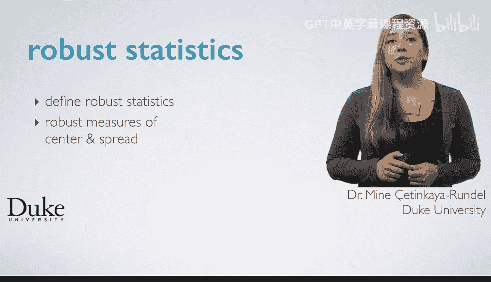
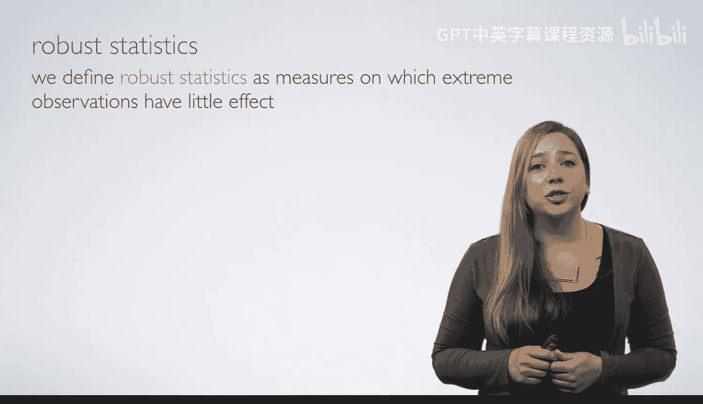
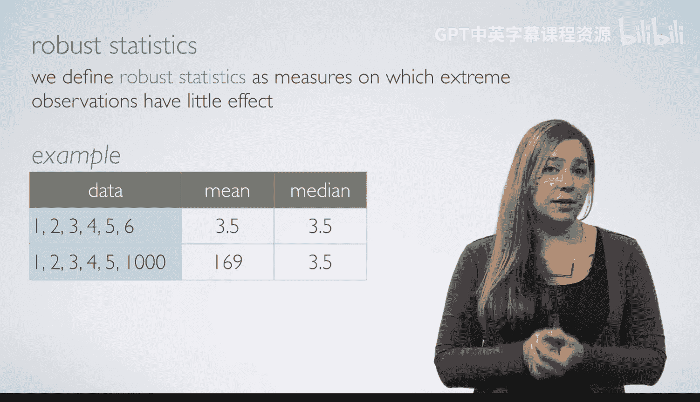
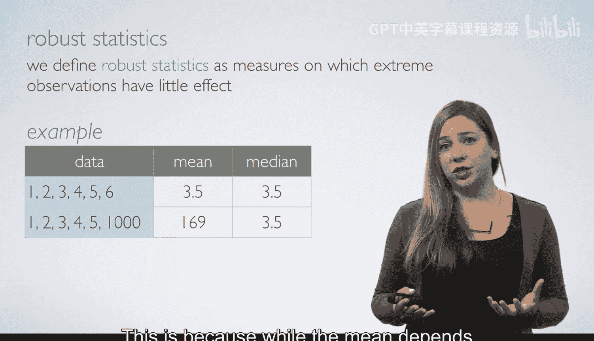
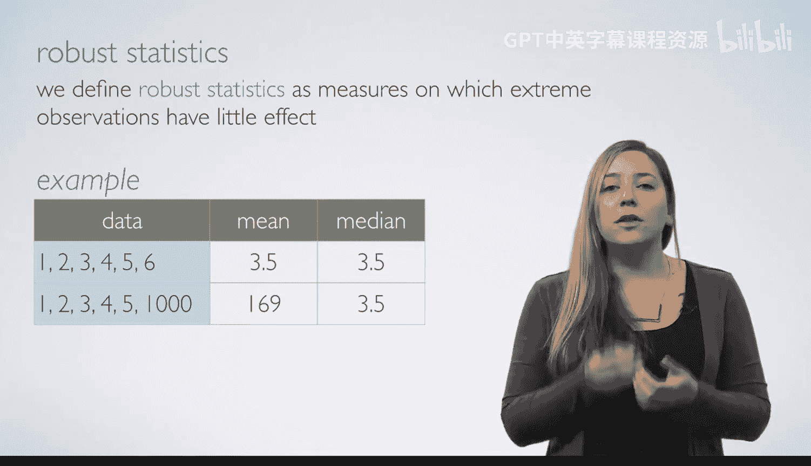
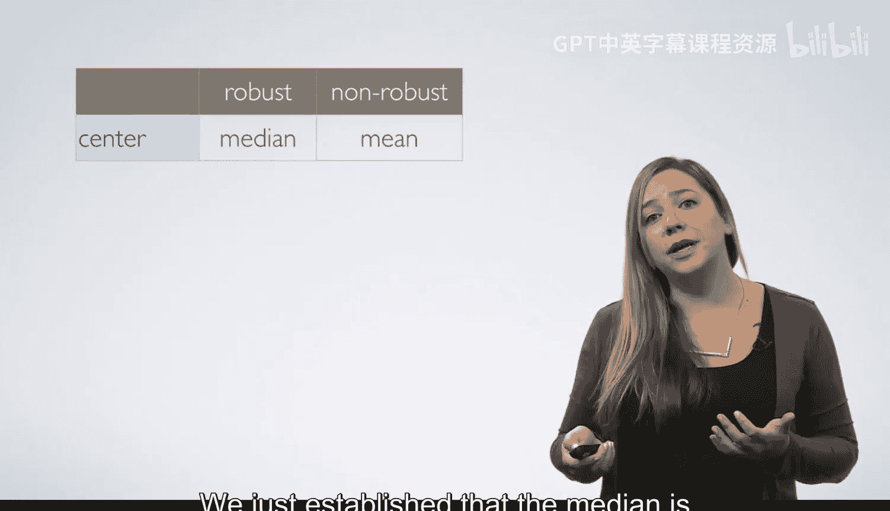
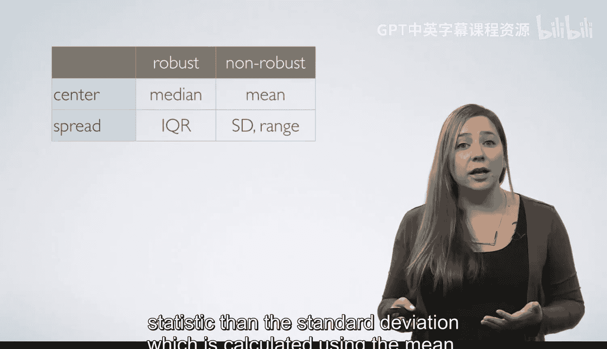
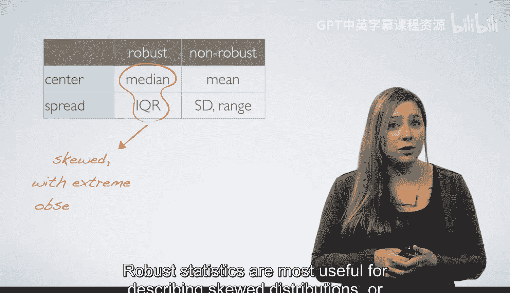
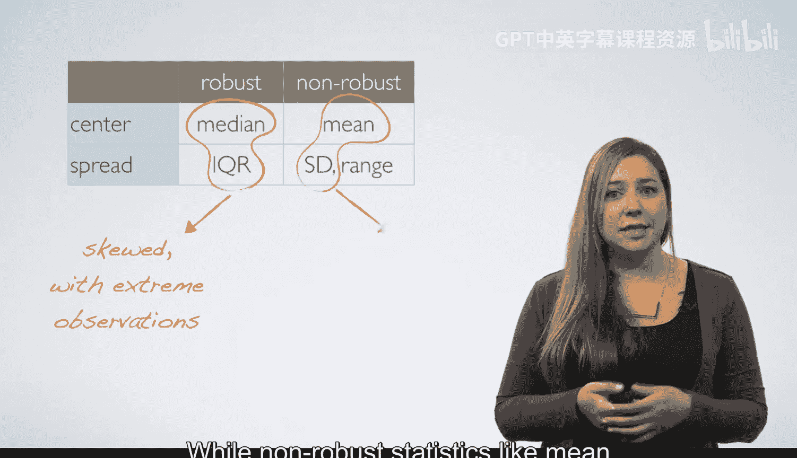
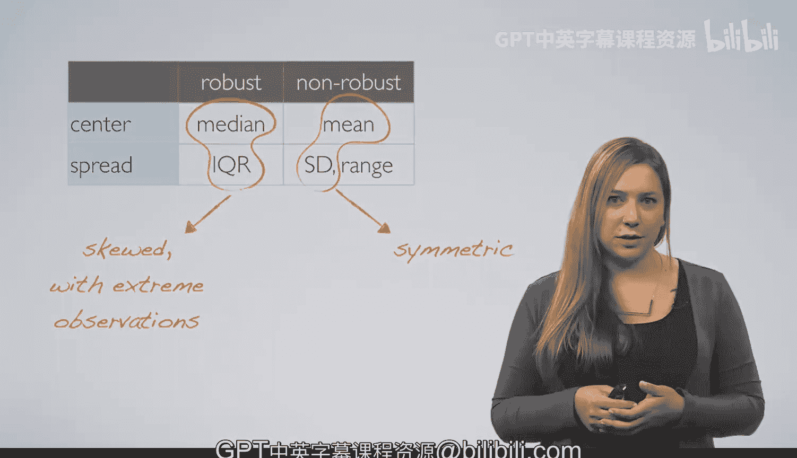

# 杜克大学《R语言数据分析（R语言、概率与数据入门，推断统计，线性回归与建模）｜Data Analysis with R》中英字幕 p11 11_04_05_稳健统计.zh_en -BV1Cf421q7mU_p11-

In this brief video， we will define what we mean by robust statistics and discuss robust measures of center and spread。

 We define robust statistics as measures on which extreme observations have little effect。

 Let's give a quick example。

We start with a small data set of values between1 and 6。

 and the mean and the median for these data are both 3。5。

What if we change one of the values in the dataset set to be much larger， say 1000。

 the mean increases greatly， but the median stays the same at 3。5。 In other words。

 the median is robust to the extreme observation。 This is because while the mean depends on all observations in the dataset set。

 it is the arithmetic average， After all， the median only depends on the midpoint of the distribution。

 and the values of the endpoints are irrelevant to its calculation。

We just established that the median is a more robust statistic of center than the mean going along with this。

 the IQR， which is based on the median， is a more robust statistic than the standard deviation。

 which is calculated using the mean， as well as range。

 which relies solely on the most extreme observations。

 robust statistics are most useful for describing skewed distributions。

 or those with extreme observations， while non-robust statistics like mean and standard deviation。

 are useful for describing symmetric distributions。

