# R语言数据分析：11：稳健统计 📊

在本节课程中，我们将学习什么是稳健统计，并讨论用于描述数据中心和离散程度的稳健度量。

我们定义稳健统计量为那些受极端观测值影响很小的度量指标。

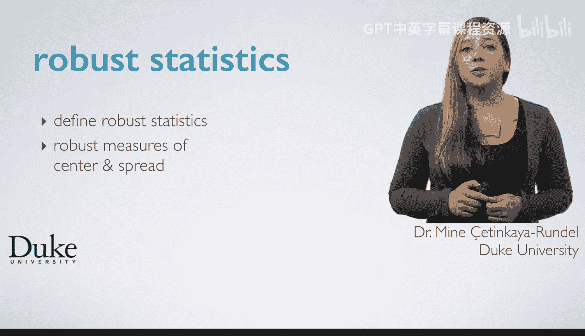

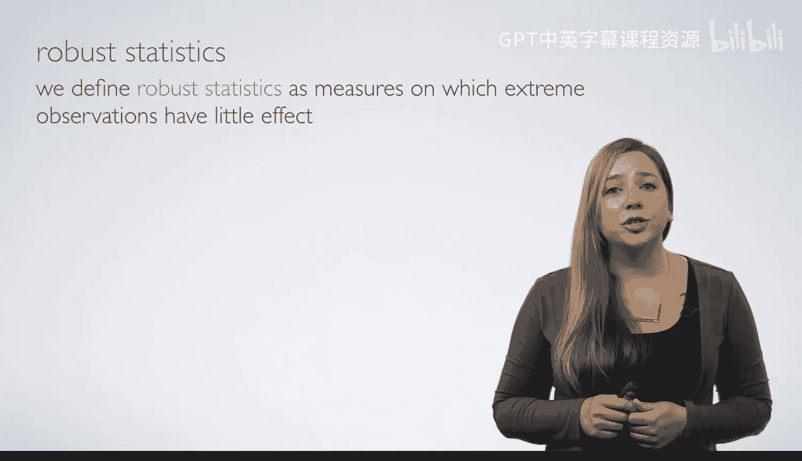

## 什么是稳健统计？🤔

上一节我们介绍了描述数据分布的不同方法。本节中，我们来看看当数据中存在极端值时，哪些统计量更可靠。

让我们通过一个简单的例子来理解。

假设我们有一个包含1到6之间数值的小数据集：`[1, 2, 3, 4, 5, 6]`。

该数据集的**均值**和**中位数**都是 **3.5**。

现在，如果我们把其中一个值改为一个非常大的数，比如1000，数据集变为：`[1, 2, 3, 4, 5, 1000]`。

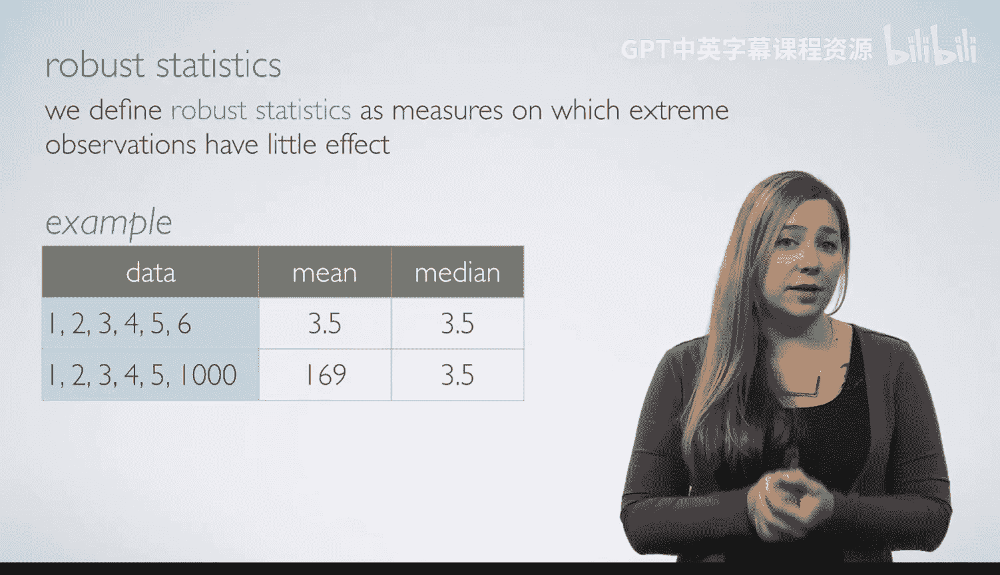

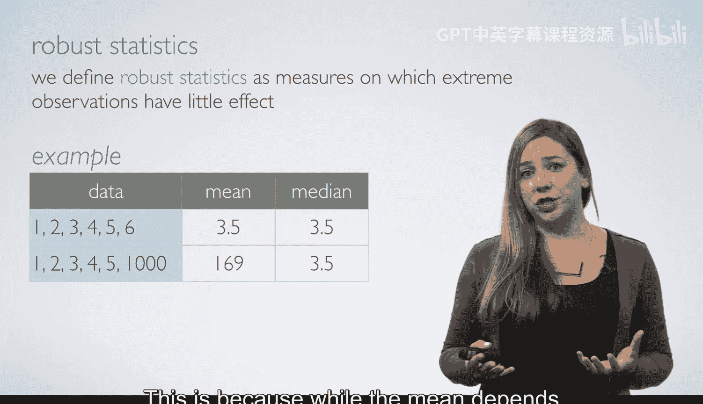

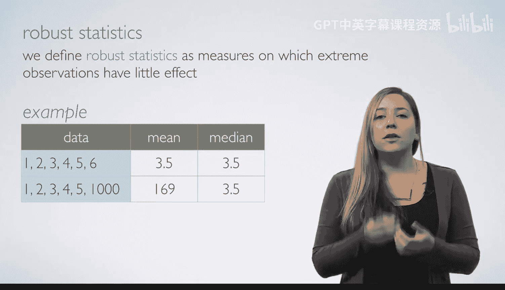

*   **均值**会急剧增加到 **169.17**。
*   **中位数**则保持不变，仍是 **3.5**。

换句话说，中位数对这个极端观测值是**稳健**的。这是因为均值依赖于数据集中的所有观测值（它是算术平均值），而中位数只依赖于分布的中间点，端点值的大小与其计算无关。

## 稳健的离散程度度量 📏

我们刚刚确定了中位数是比均值更稳健的中心度量统计量。与此相对应，基于中位数计算的**四分位距**，是比**标准差**和**极差**更稳健的离散程度统计量。

*   标准差的计算使用了均值。
*   极差则完全依赖于最极端的两个观测值。

以下是稳健与非稳健统计量的对比总结：

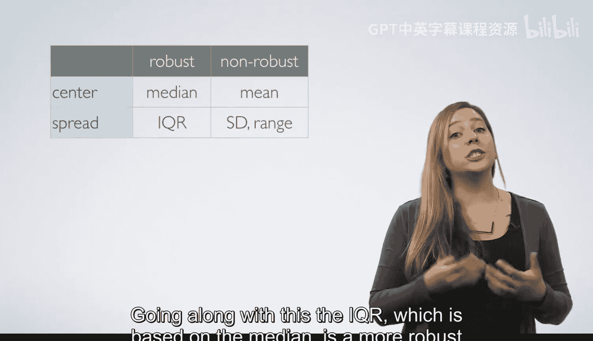

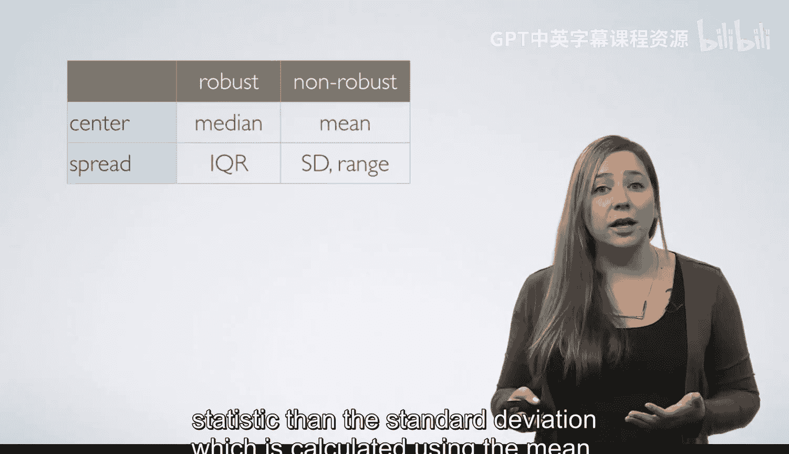

*   **稳健统计量**（如中位数、IQR）最适用于描述**偏态分布**或包含**极端观测值**的数据。
*   **非稳健统计量**（如均值、标准差）则适用于描述**对称分布**的数据。

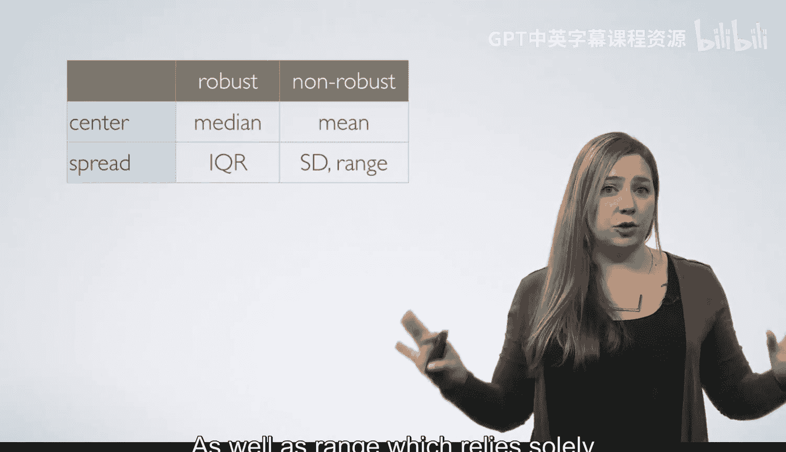

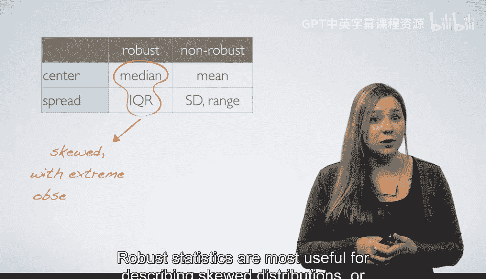

## 总结 📝

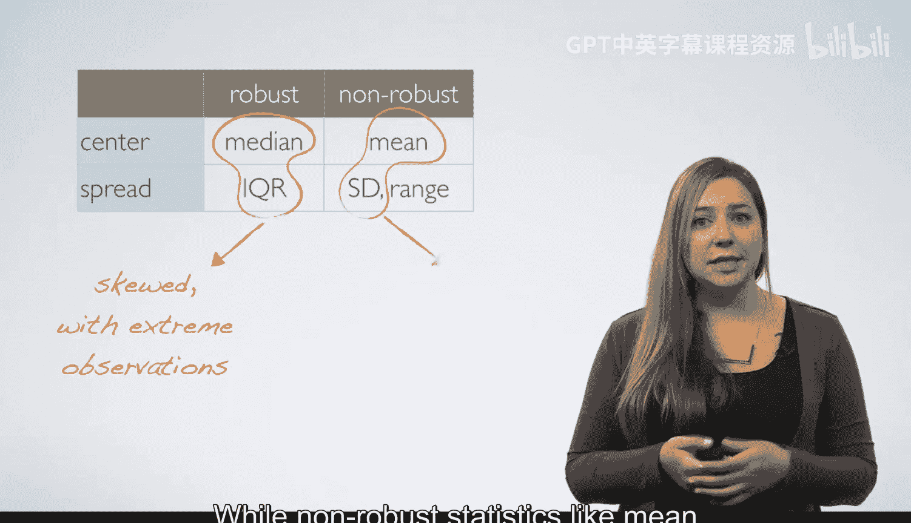

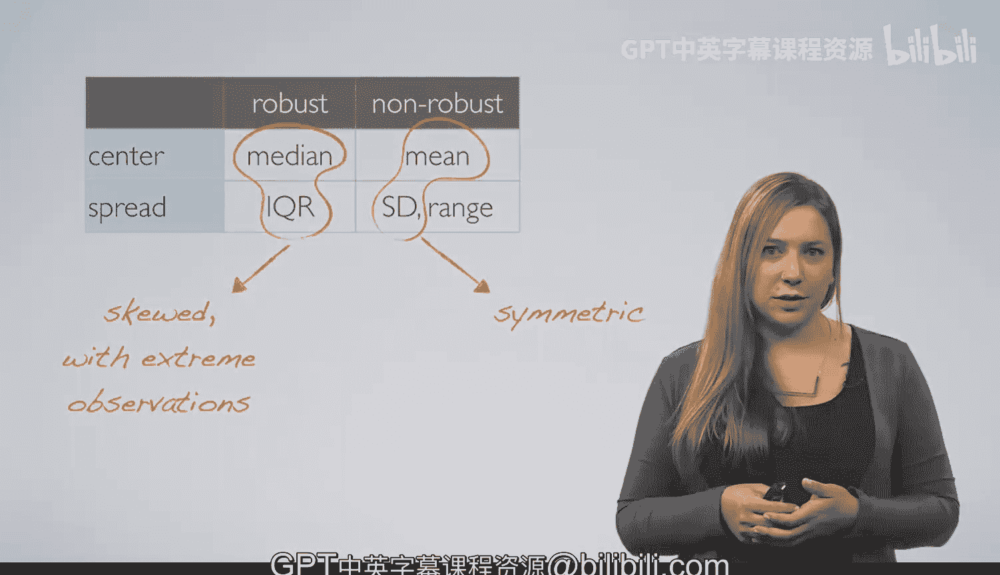

本节课中，我们一起学习了稳健统计的概念。我们了解到，稳健统计量（如中位数和四分位距）对数据中的极端值不敏感，因此在分析偏态数据或存在异常值的数据时更为可靠。相反，均值、标准差和极差等非稳健统计量容易受到极端值的影响，但能很好地描述对称分布的数据特征。根据数据的分布形态选择合适的统计量，是进行准确数据分析的关键一步。