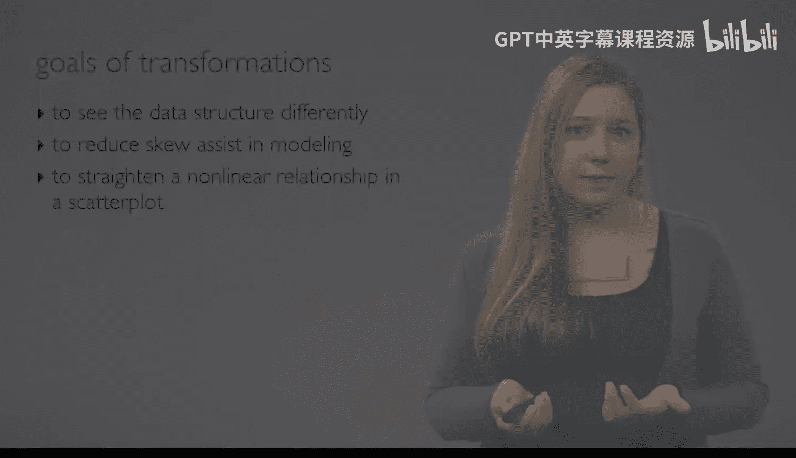

# 杜克大学《R语言数据分析（R语言、概率与数据入门，推断统计，线性回归与建模）｜Data Analysis with R》中英字幕 p12 12_04_06_数据转换.zh_en -BV1Cf421q7mU_p12-

Data transformations are useful tricks for making certain types of data easier to model。

 In this video， we will first define what we mean by transformations and then review when it might be useful or necessary to transform data。

A transformation is a rescaling of the data using a function。 When data are very strongly skewed。

 we sometimes transform them so that they're easier to model。

The most commonly used transformation is the natural log transformation。

 which is often applied when much of the data cluster near  zero relative to larger values in the data set。

 and all observations are positive。For example， we saw earlier that the distributions of income per person was heavily right skewed。

 but after applying a natural log transformation， the data become much more symmetric。

 Sometimes this type of data are much easier to model because they are much less skewed and outliers are usually less extreme。

Transformations can also be applied to one or both variables in a scatter plot to make the relationship between the variables more linear and hence easier to model with simple methods。

 For example， here we have a scatter plot of income per person versus life expectation。

 The relationship is positive and curved。 If we apply a log transformation to the response variable and the plot the relationship again。

 the relationship stays positive， but becomes more linear。

 which makes it easier to model than the untransformed data。

Transforms other than the logarithm can be useful too。

 Let's take a look at a new data set Here we have a scatter plot of a random sample of cars weights versus their city mileage。

 We can see that the two variables are inversely related， which is expected。

 Car that are bigger get fewer gallons to the mile， but the relationship is not linear。😊。

In addition to the log， we can also try a square root transformation where we plot the square root of the weight versus miles per gallon。

 or the inverse transformation， where we divide one by the weight of the car。

 It's difficult to tell just looking at these plots which transformation works better。

 or if either of the transformations actually yield something better than the original data。

 later in the course will'll get into a little more detail about how to make such a call。

 But for now， it's important to just realize that transformations can be useful。

 even though they complicate the interpretations a bit。 After all。

 log of income or the square root of weight are not easy to evaluate。

 While we can come up with some guidelines for which transformation is useful。

 instead of focusing on a list of rules， it's important to understand why we might even want to apply a transformation in the first place。

 So let's review once again， the common goals in transformationing data。

 We might want to see the data structure a little differently。

We might want to reduce S to assist in modeling。Or we might want to straight in a nonlinear relationship in a scatter plot so that we can model the relationship with simpler methods。

