# 杜克大学《R语言数据分析（R语言、概率与数据入门，推断统计，线性回归与建模）｜Data Analysis with R》中英字幕 p13 13_04_02_探索分类变量.zh_en -BV1Cf421q7mU_p13-

In this video， we will discuss describing the distribution of a single categorical variable。

 evaluating the relationship between two categorical variables。

 as well as between a categorical and a numerical variable。

Let's start with a single categorical variable。 A 2014 poll in the US asked respondents how difficult they think it is to save money。

 We can present the results of this survey in a frequency table of the 500 participants。

231 said it's very difficult to save money。196 said it's somewhat difficult。

58 said it's not very difficult。14 said it's not at all difficult。 and one respondent was not sure。

A graphical way of representing these data is a bar plot。

 These raw counts do tell us something about the data。

 Most people find it more difficult than not to save money。

 but we usually consider the relative frequencies when evaluating the distributions of categorical variables。

 We can also make a bar plot of these relative frequencies。

 which looks just like the original bar plot， but just has the relative frequencies instead of the counts on the y axis。

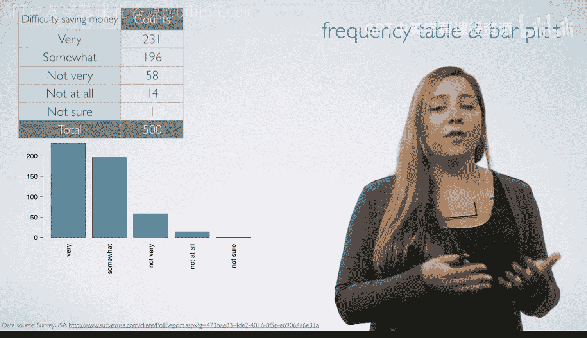

So how are bar plots different than histograms。 First。

 bar plots are used for displaying distributions of categorical variables。

 while histograms are used for numerical variables。 Second， the axis in a histogram is a number line。

 hence the orders of the bars cannot be changed。 while in a bar plot。

 the categories can be listed in any order， though some orderings make more sense than others。

 especially for ordinal variables。

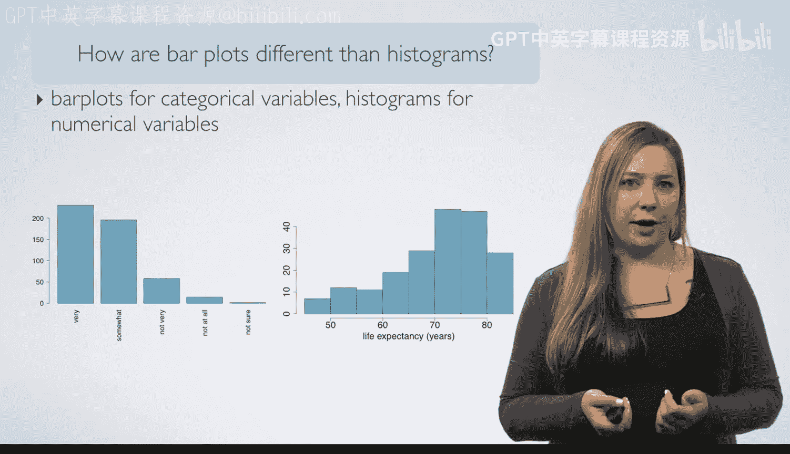

It might be tempting to also make a pie chart for these data。

 but a pie chart is actually much less informative than a bar plot。 First。

 while it tells us the relative ordering of the levels。

 it doesn't actually tell us what percentage of the distribution falls into which level。 Second。

 when there are many levels in a categorical variable with similar relative frequencies It might be difficult to determine which level is more highly represented just by looking at a pie chart。

 For example， here we have a pie chart of orders of mammal species。 Just by looking at the pie chart。

 can you tell which order and compassees the lowest percentage of mammal species， I didn't think so。

 The title of this slide was pie chart question mark。 And the answer is， no， don't bother。

 just stick to bar plots。

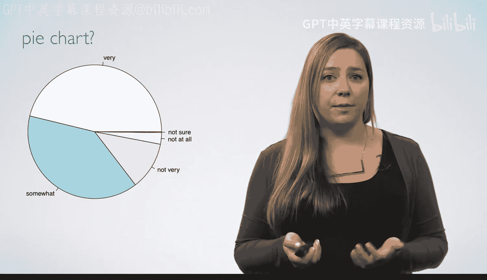

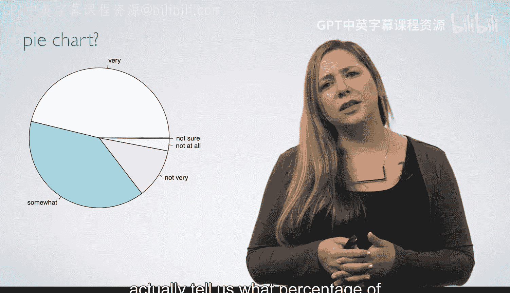

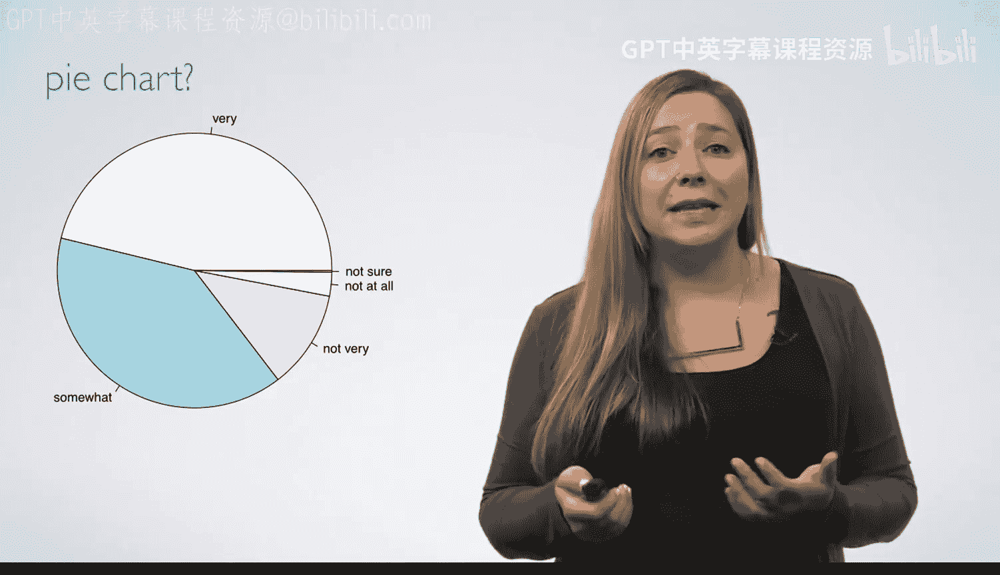

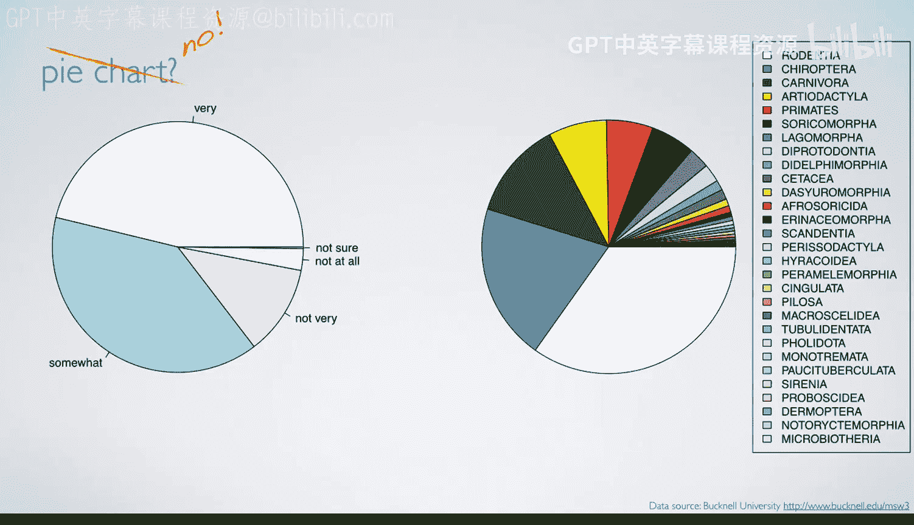

The same poll we mentioned earlier also asked how much income each participant makes。

 and we might wonder if whether people think it's difficult or easy to save money is related to their income。

 to evaluate this。 we organize these variables in a contingency table。

 There are three levels of the income we consider less than 40000 per year between 40 and 80000 per year and more than 80000 per year。

 There are also some respondents who refuse to answer this question。

 to evaluate whether income and perception of difficulty of saving are related We will need to compare people who think say it's very difficult to save money among the different income levels。

 but we can't just compare these counts since the sample sizes for each income level are different。

 Instead， we should consider the distribution of one variable conditional on the other。

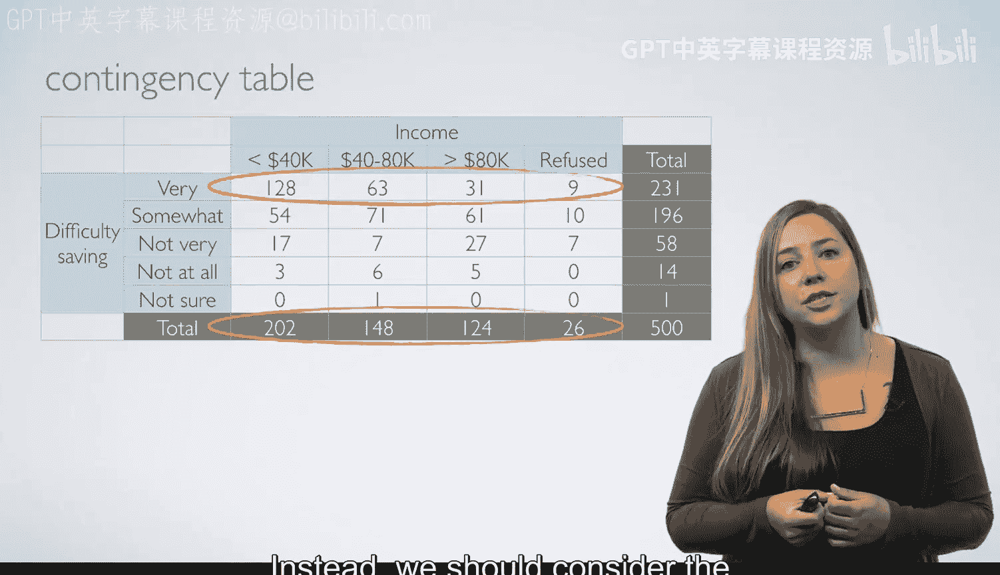

To find out what percent of people who make less than 40000 per year think it's very difficult to save money。

 we just consider the first column among the 202 people who make less than 40000 per year。

1 and 28 think it's very difficult to save money， which makes up 63%， Similarlyly。

63 out of  hundred48， those who make between 40 and 80000， or in other words，50。

43% think it's very difficult to save money。And 31 over 124， only 25% of those who make more than 80。

000 think it's very difficult to save money。For completeness。

 let's go through the same calculation for those who refuse to share their income as well。

9 out of 26 or 35% of those also think it's very difficult to save money。

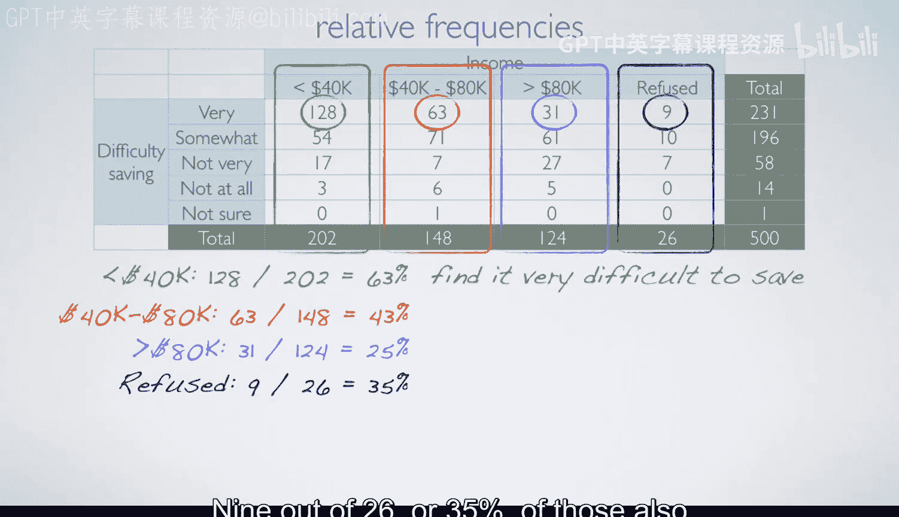

Since the percentage of those who think it's very difficult to save money varies greatly among the different income categories。

 these data suggest that the two variables under consideration。

 feelings about difficulty of saving money and income are associated， in other words， dependent。

An obvious choice for visualizing two categorical variables is a segmented bar plot。

 Seed bar plots are useful for visualizing conditional frequency distributions。 In other words。

 the distribution of the levels of one variable， the response variable conditioned on the levels of the other。

 the explanatory variable the heights of the bars indicate the numbers of respondents in various income categories and the bars are segmented by color to indicate the numbers of those who think it's very difficult to save money to not at all note that these are frequencies。

 in other words counts and not relative frequencies。

 So while segmented bar plots are useful for visualizing frequency distributions。

 in order to explore the relationship between these variables。

 we need a visualization of the relative frequencies。😊。

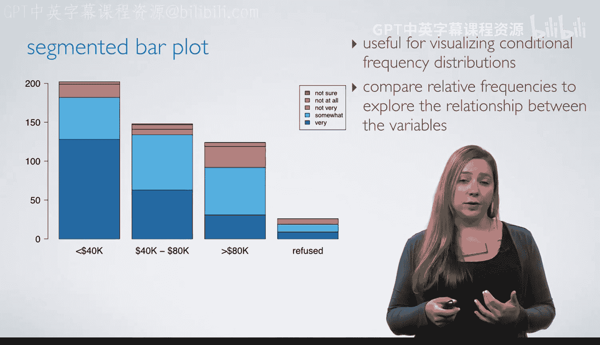

So one alternative is to plot the relative frequencies。

 This plot basically visualizes the percentages we had calculated earlier。

 such as 63% of those who make less than 40000 per year think it's very difficult to save money。

 etc cetera。

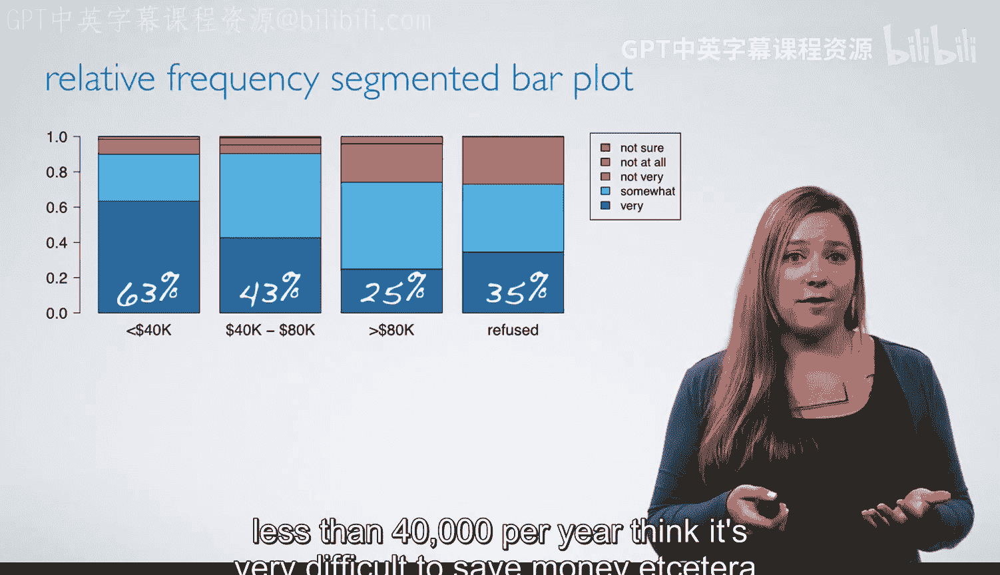

Another alternative is a mosaic plot。 A mosaic plot like this one displays the distribution of feelings about difficulty of saving money。

 conditional on income as well。 It also shows the marginal distribution of income， too。

 So let's start with the marginal distribution。 The width of the bars is what's telling us about the marginal distribution of income。

 We can see that more people make less than 40000 have been surveyed by than any other。 Now。

 let's look at the breakdown of the individual bars。 Among those who make less than 40000。

 We had seen that 63% think it's very difficult to save money。

 These respondents are represented by the segment in the first bar。 Similarlyly。

43% of those who make between 40 and 80000 and 25% of those who make more than 80000 and 35% of those who refuse to share their income。

 I are represented in the first segment within their respective bars。 Vily。

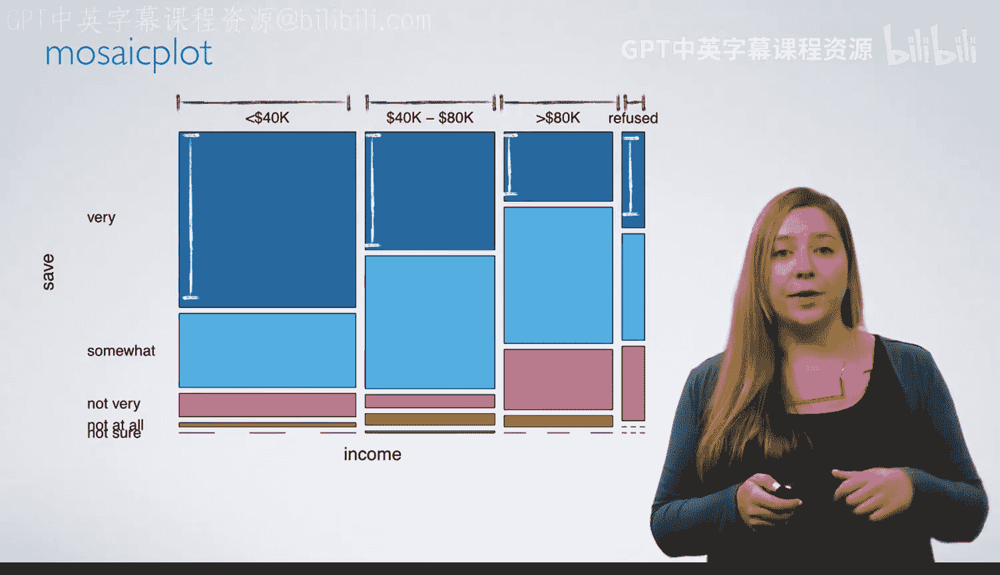

Though relying on the relative percentages we calculated earlier。

 we can see that the length of the segments representing those who think it's very difficult to save money vary by income level。

 indicating a difference of opinion among members of different income groups。

 hence suggesting a relationship between the two variables。We could， of course。

 examine the other levels of the opinion variable as well。So far in this video。

 we discussed how to describe the distribution of a single categorical variable and how to evaluate the relationship between two categorical variables to wrap up our discussion on exploratory data analysis with categorical variables。

 let's talk about one last type of relationship。 the relationship between a numerical variable and a categorical variable。

 This type of relationship is something we usually consider when comparing the distribution of a numerical variable across the levels of a categorical variable。

 For example， here we have a box plot of number of clubs。

 college students are involved with and their class year。

 The medians are pretty consistent indicating that on average。

 students belong to roughly equal numbers of clubs regardless of their year。

 the variability is higher for first year and senior students。

 while much lower for sophomores and juniors， as indicated by the lower IQRrs。

 and among the sophomores and juniors， there are some students who belong to unusually。😊。

Low or high numbers of clubs。The distributions across the class years are pretty similar。

 suggesting that number of club students belong to might be independent of their class year。

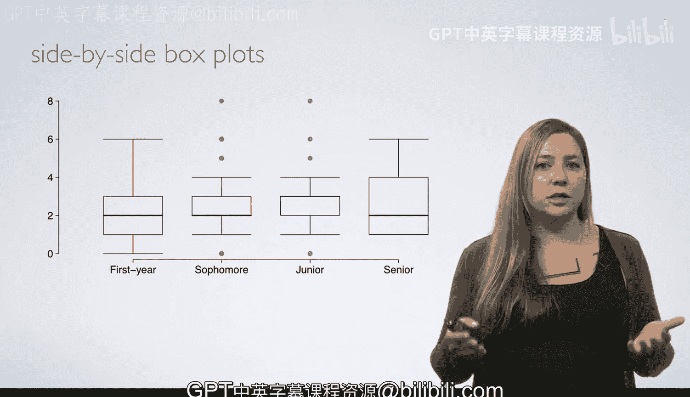