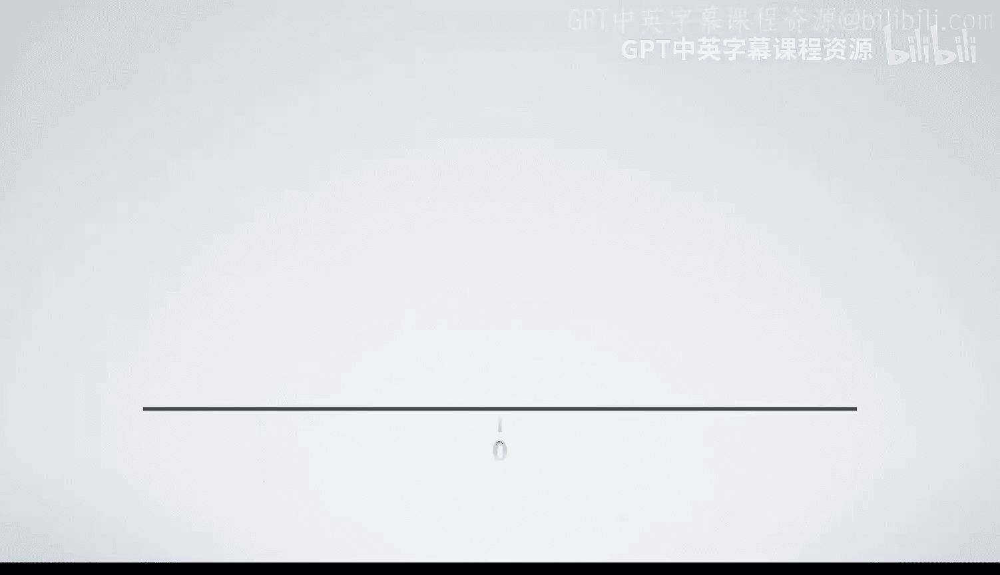
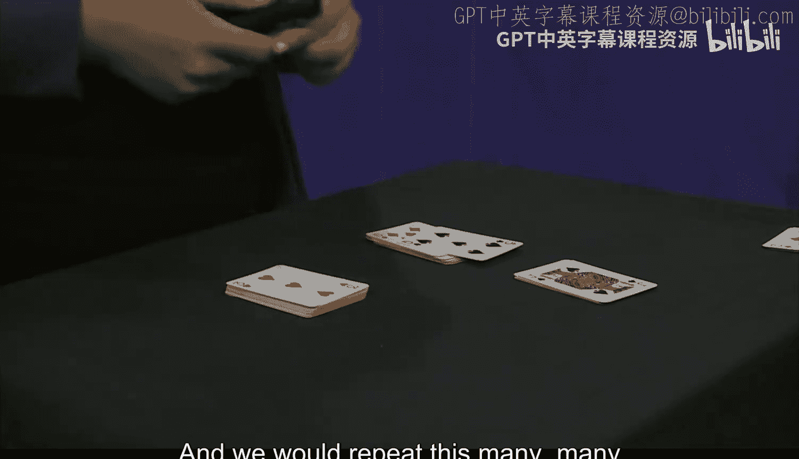
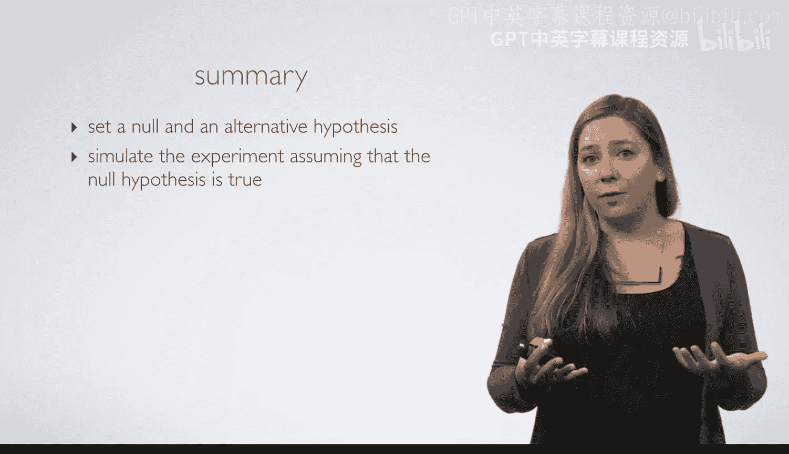

# 杜克大学《R语言数据分析（R语言、概率与数据入门，推断统计，线性回归与建模）｜Data Analysis with R》中英字幕 p14 14_04_03_统计推断导论.zh_en -BV1Cf421q7mU_p14-

In this video， we will discuss a case study on gender discrimination in promotion decisions and use this case study for a light introduction to statistical inference via simulation。

In 1972， as part of a study on gender discrimination。

 48 male bank supervisors were each given the same personnel file and asked to judge whether the person should be promoted to a branch manager job that was described as routine。

The files were identical， except that half of the supervisors had files showing the person was male。

 while the other half had files showing the person was female。

 It was randomly determined which supervisors got male applications and which got female applications of the 48 files reviewed。

35 were promoted。 The study is testing whether females are unfairly discriminated against。

Let's take a look at the data。The percentage of males promoted is 21 out of 24， roughly 88%。

 and the percentage of females promoted is 14 out of 24， roughly 58%。

 so there's a considerable difference between the proportions of males and females promoted in this study。

There are two possible explanations as to what might be going on in this study。

 And these are our two competing claims。 One， there is nothing going on。

 Promotion and gender are independent。 There's no gender discrimination。

 and the observed difference in proportions is simply due to chance。 This is our null hypothesis。

 And two， there is something going on。 Promotion and gender are dependent on each other。

 There is gender discrimination。 that observed difference in proportions is not due to chance。

 This is the alternative hypothesis。Hypothesis testing is very much like a court trial in the US。

 The null hypothesis says that the defendant is innocent。

 and the alternative hypothesis says that the defendant is guilty。

 We then present evidence or or in other words， collect data。

 then we judge this evidence and ask ourselves the question。

 could these data plausibly have happened by chance， if the null hypothesis were true。

If the data were likely to have occurred under the assumption that the null hypothesis were true。

 then we would fail to reject the null hypothesis and state that the evidence is not sufficient to suggest that the defendant is guilty。

 Note that when this happens， the jury returns with a verdict of not guilty。

 The jury does not say that the defendant is innocent。

 just that there is not enough evidence to convict。 The defendant may， in fact， be innocent。

 but the jury has no way of being sure， said statistically， we fail to reject the null hypothesis。

 we never declare the null hypothesis to be true， because we do not know and cannot prove whether it's true or not。

 Therefore， we also never say that we would accept the null hypothesis。

If the data were very unlikely to have occurred， then the evidence raises more than a reasonable doubt in our minds about the null hypothesis。

 and hence we reject the null hypothesis in favor of the alternative hypothesis of guilty in a trial。

 the burden of proof is on the prosecution in a hypothesis test。

 the burden of proof is on the unusual claim。 The null hypothesis is the ordinary state of affairs。

 the status quo， so it's the alternative hypothesis that we must consider unusual and for which we must gather evidence。

So to recap， we start with a null hypothesis that represents the status quo。

 we also have an alternative hypothesis that represents our research question。 In other words。

 what we're testing for。 we conduct a hypothesis test under the assumption that the null hypothesis is true。

 either via simulation or using theoretical methods。

 If the test results suggest that the data do not provide convincing evidence for the alternative hypothesis。

 we stick with the null hypothesis。 If they do， then we reject the null hypothesis in favor of the alternative。

So if you have a deck of playing cards handy， you can actually conduct a simulation yourself with me。

 remember， the objective is to conduct a simulation under the assumption that the null hypothesis is true。

 In other words， assuming there is no gender discrimination and that differences in promotion rates that are observed are simply due to chance。

 First， we're going to let a face card represent a not promoted and a non-face card represent a promoted file。

We're going to first start with setting aside the jokers。There are 52 cards in a deck。

 however only 48 files in our experiment to simulate the experiment。

 we need to remove some cards to hit a total sample size of 48。

 We take cards out in such a way that if we let a face card represent not promoted and a non-face card represent a promoted file。

 the distribution of face and nonface cards， match the distribution of the promoted and not promoted files so we're also going to take out three ACces。

So therefore there should be 13 face cards left in the deck， these are ACces， Kings。

 Queens and jacks， which is the total number of promoted files We're also going to take out a number card。

Just any number card so that there are exactly 35 number cards left in the deck。

 representing the promoted files。Let's repeat that one more time with a bit of visual aid。

 we're taking out three aces and one number card， a total of four cards out of a full deck of 52。

 and hence we're left with a deck of 48 cards， the same number as the observations in our study numberer cards represent files that were promoted and there are 35 of them and face cards represent files that were not promoted and there are 13 of those。

Then we shuffle the cards and deal them into two groups of size 24 representing males and females。

 note that random shuffling is what simulates this idea of leaving things up to chance。

And here is some visual aid to go along with that， as well。Next。

 we count how many number cards are in each group which represent the promoted files and we calculate the proportion of promoted files in each group and take the difference between the proportions of males and females promoted。

 just like we did with the original data。Let's go through the results of my simulation together。

 If you have been following along with your own deck of cards。

 you might have different results than mine， since the shuffling and splitting into two piles was done completely randomly。

 Since we're randomly splitting the promoted files into two groups。

 We would expect to see no difference between the proportions of male and female promotions。

 In other words， the proportions of number cards in the male and female piles。 That being said。

 the observed value may not exactly be0。 In this case， we had 18 number cards in the male pile。

 which yields a 75% promotion rate among the males。

 And there are 17 number cards in the female pile yielding a 70。8% promotion rate。

 The difference between these simulated promotion rates is what we want to keep track of。

 We expect this number to be 0， but we also expect it to vary。

 and we want to know how much it varies so that we can compare our original difference of 30%。

To the distribution of differences simulated under the assumption of independence between promotion decisions and gender。

 In this case， we calculated a difference of 4。2%。So we note that before we proceed to the next simulation。

Once we're done with one simulation， we repeat steps2 through four many times to build a distribution of simulated differences。

So let's go through this one more time。 We're going to start by shuffling the cart。

 Usually if you have a full deck of cards， it makes sense to shuffle them about seven times to get a truly random shuffle。

When you're done with that， what we want to do is to split this into two equally sized decks of size 24 representing the males and the females。

ItDoesn't really matter which one you're calling male versus female。

 So let's just say this is our male pile， and this is our female pile。

 The next step is going to be to determine how many files were promoted in each pile。

 which means we need to count the number of number cards in each pile among the males。

 I'm counting 1，2，3。4，5，6，7，8，9。10，11，12。13，14，15。17， so we have 17 out of 24 males promoted。

 which should leave about 18 out of 24 females promoted In the next step。

 we need to calculate the proportions and take the difference and note that on our dot plot。

 And we would repeat this many， many times to build a simulation distribution。

 So how do we ultimately make a decision。 If the results from the simulations look like the data。

 then we decide that the difference between the proportions of promoted files between males and females was due to chance and that promotion and gender are independent。

 If， on the other hand， the results from the simulations do not look like the data。

 then we decide that the observed difference in the promotion rates was unlikely to have happened just by chance。

 and that it can be attributed to an actual effect of gender。 In other words。

 we conclude that these data provide evidence of a dependency between promotion decisions and gender。

If we repeat the simulation many times and record the simulated differences in proportions of males and females promoted。

 we can build a distribution like this one。 For example。

 here we have a dot plot of the distribution of the simulated differences in promotion rates based on0 simulations while we showed earlier how to simulate this experiment using playing cards。

 we should note that the task of the simulation is best left up to computation it's faster and less prone to errors The distribution is centered at zero。

 which we can also think about as the null value since according to the null hypothesis there should be no difference between the proportion rates of males and females yielding a difference of zero we can see from the distribution of the simulated differences in promotion rates that it is very rare to get a difference as high as 30% the observed difference from the original data if in fact。

 gender does not play a part in promotion decisions。 The lowlike。

Of this event or a difference even more extreme， suggests that promotion decisions may not be independent of gender。

 And so we would reject the nu hypothesis。 Our conclusion is then that these data show convincing evidence of an association between gender and promotion decisions made by male bank supervisors。

We just walk through a brief example that introduces you to statistical inference and more specifically hypothesis tests。

 we started by setting a null and an alternative hypothesis， then we simulated the experiment。

 assuming that the null hypothesis were true， we evaluated the probability of observing an outcome。

 at least as extreme as the one observed in the original data， and since this probability was low。

 we decided to reject the null hypothesis in favor of the alternative。

The probability of observing data， at least as extreme as the one observed in the original study under the assumption that the null hypothesis is true is called the P value。

 one of the commonly used criteria for making decisions between competing hypotheses。

 We will continue our discussion on P values and hypothesis tests in future units as well。

 and learn various methods for conducting hypothesis tests for various types of data。

