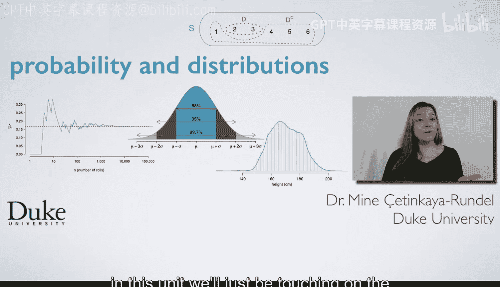
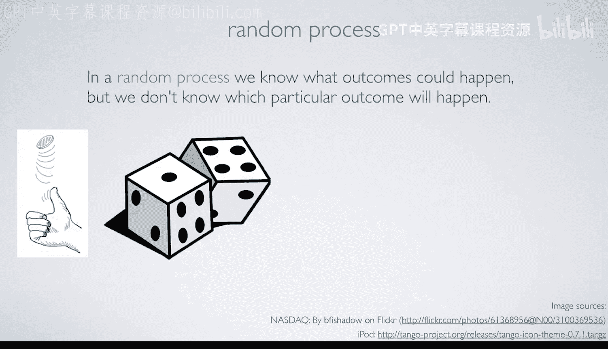
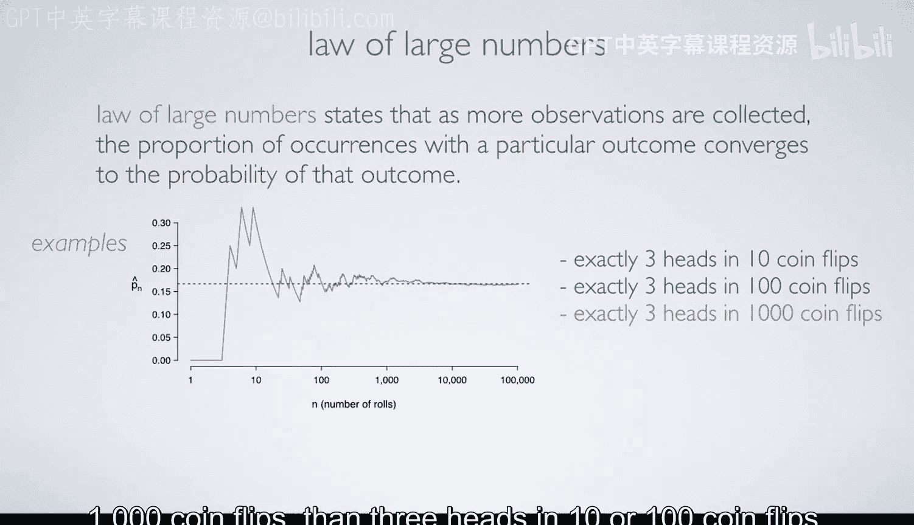
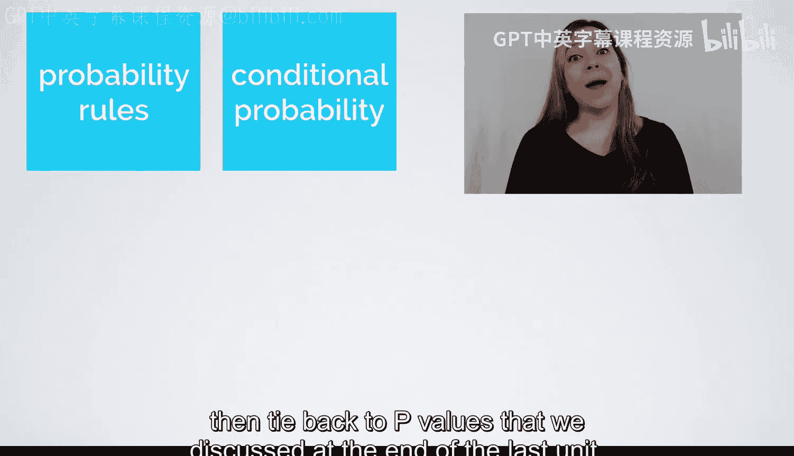
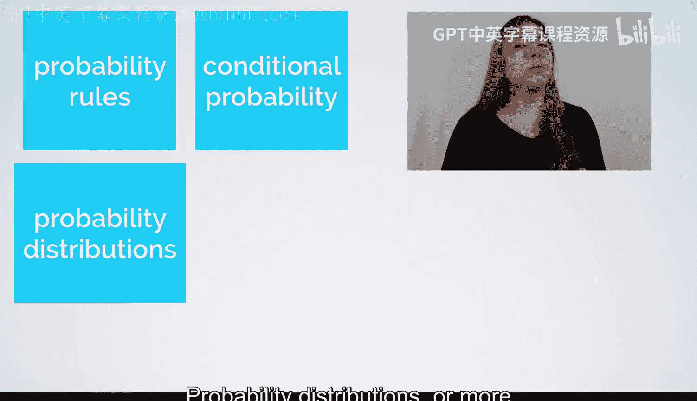
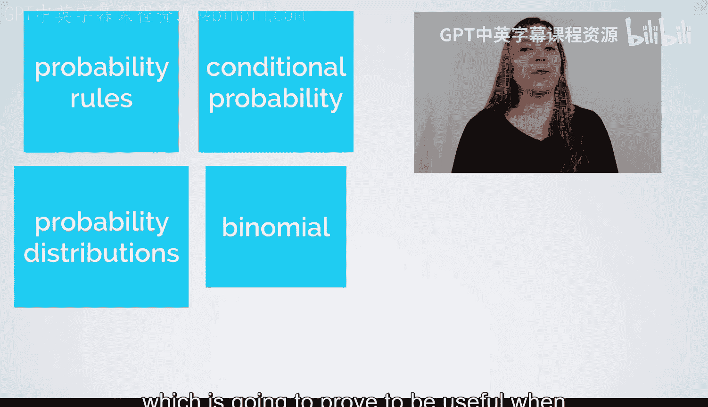
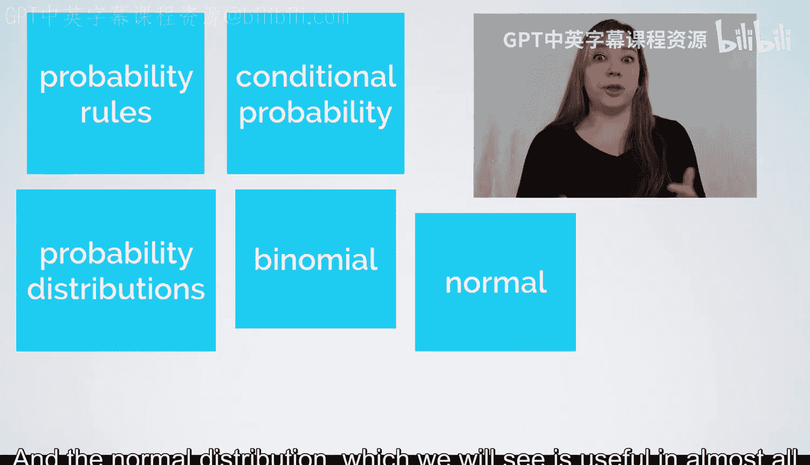

# 杜克大学《R语言数据分析（R语言、概率与数据入门，推断统计，线性回归与建模）｜Data Analysis with R》中英字幕 p15 15_06_02_导论_2.zh_en -BV1Cf421q7mU_p15-

This unit will introduce you to the basics of probability。

 probability calculations for events arising from random processes and probability distributions。

 Pro is a course in and of itself， but in this unit we'll just be touching on the fundamentals that are relevant for providing a conceptual framework for statistical inference。

Let's start by defining what we mean by a random process In a random process。

 we know what outcomes could happen， but we don't know which particular outcome will happen。

 Examples of random processes are。 Coin tosses， Di rolls。

 the shuffle mode on your music player or the stock market。 For example。

 when you hit shuffle on your music player。 You know what the possible outcomes are。

 The next song will be something from your entire music library。

 but you don't know which song will play next。 Similarlyly， a coin is tosseds。

 and we know that it can land on heads or tails， but we don't know which one。

We should also note that sometimes it can be helpful to model a process as random。

 even if it's not truly random。 For example， the stock market。

When discussing probabilities of events， we will generally use the notation P of A， that's P。

 and then in parentheses A to indicate the probability of event A。

There are several possible interpretations of probability。

 but they almost completely agree on the mathematical rules probability must follow。

 one of which is that probability of an event is always between 0 and 1。

So even if you use phrasing like there's 10 and 50% chance it's going to rain today in your daily lives。

 Note that that statement is meaningless in statistics。 This is probably not controversial。

 but something to keep in mind when you calculate probabilities。

 If you get a result less than 0 or greater than one， you know that you made a mistake。

A traditional definition of probability is a relative frequency。

 This is the frequentest interpretation of probability。

 where the probability of an outcome is the proportion of the times the outcome would occur if we observe the random process an infinite number of times。

An alternative interpretation is the Bayesian interpretation。

 A Bayesian interprets a probability as a subjective degree of belief for the same event。

 two separate people could have different viewpoints and so assign different probabilities to it。

This interpretation allows for prior information to be integrated into the inferential framework。

 Bayesian methods have been largely popularized by revolutionary advances in computational technology and methods during the last 20 years。

 And we will touch upon these from time to time throughout the course。

 while also discussing the traditional frequentest methods。

The law of large numbers states that as more observations are collected。

 the proportion of occurrences with a particular outcome converges to the probability of that outcome。

 This is why as we roll a fair die many times， we expect the proportion of。

 say fives to settle down to one6， while earlier in the sequence with two few rolls。

 we might not exactly get one in six5s。 For example， if you roll a die， say six times。

 there's no guarantee that you're going to get at least one，5 in there。 But if you roll the die。

 say 600 or 6000 times， you would expect to see about one sixthth of the time to get a5。Similarly。

 why it would be more surprising to see three heads in0 coin flips than three heads in 10 or 100 coin flips。

Let's take a look at one more example。Say you toss a coin 10 times， and it lands on heads each time。

 What do you think the chances that another head will come up on the next toss，05。

 less than 05 or more than 0。5。The probability is still 50%。

 so the probability of heads on the 11th toss is the same as the probability of heads on the 10th toss or any previous tosses。

 which is 0。5。Each toss is independent， hence the outcome of the next toss does not depend on the outcome of the previous toss。

 Another way of thinking about it is that the coin is meous。

 It doesn't remember what happened before and say to itself， well。

 let me roll over on the other side next time。In other words， the coin is not due for a tail。

The common misunderstanding of the law of large numbers is that random processes are supposed to compensate for whatever happened in the past。

 This is called the gambler's fallacy or the law of averages。

 So while we know that in a large number of tosses of a coin。

 we would expect about 50% heads and 50% cent tails。 for any given toss。

 the probability of a head or a tail is exactly 0。5，Regardless of what happened in the past。 Now。

 if you're really getting tens of20s of hundreds of thousands of heads in a row， at some point。

 you need to start thinking maybe this is not a fair coin。

Now that we got some definitions out of the way in the remainder of this unit。

 we will discuss probability rules， conditional probabilities which we will then tie back to P values that we discussed at the end of the last unit。

 probability distributions are more specifically the binomial distribution。

 which is going to prove to be useful when we're working with categorical data。

 and the normal distribution which we will see is useful in almost all circumstances that we're going to see in the remainder of this course。

