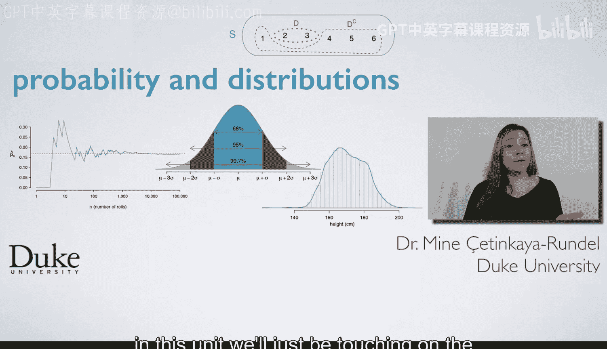
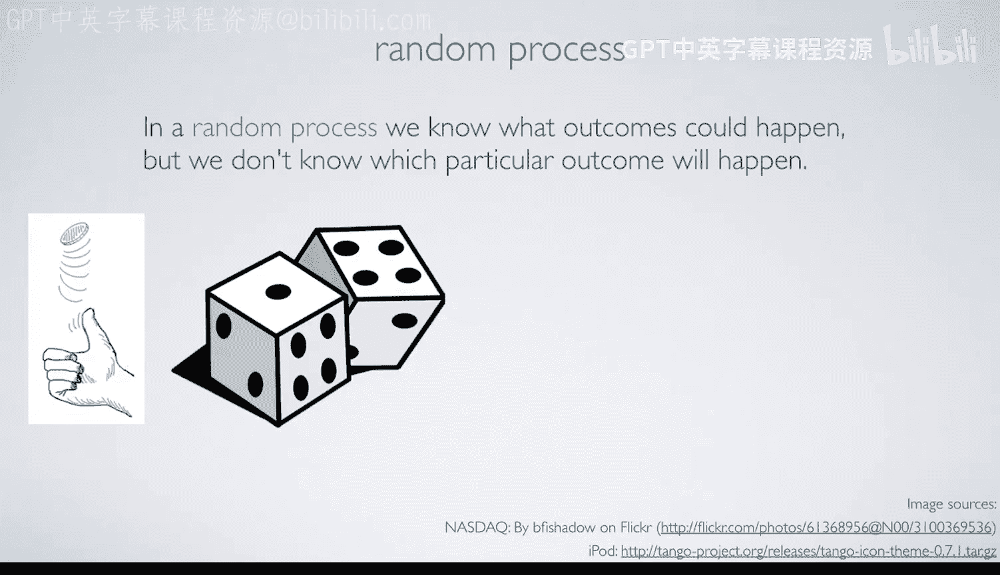
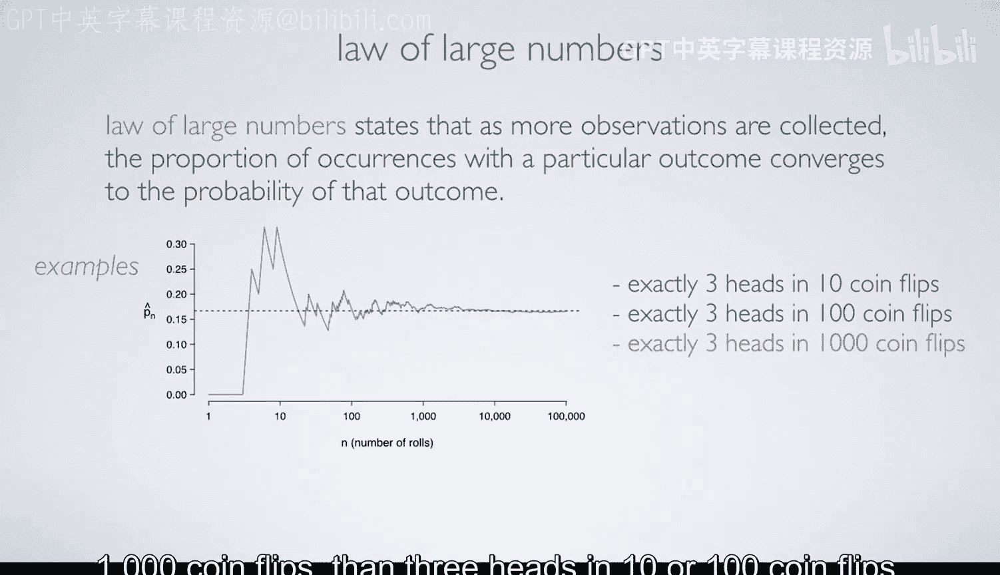
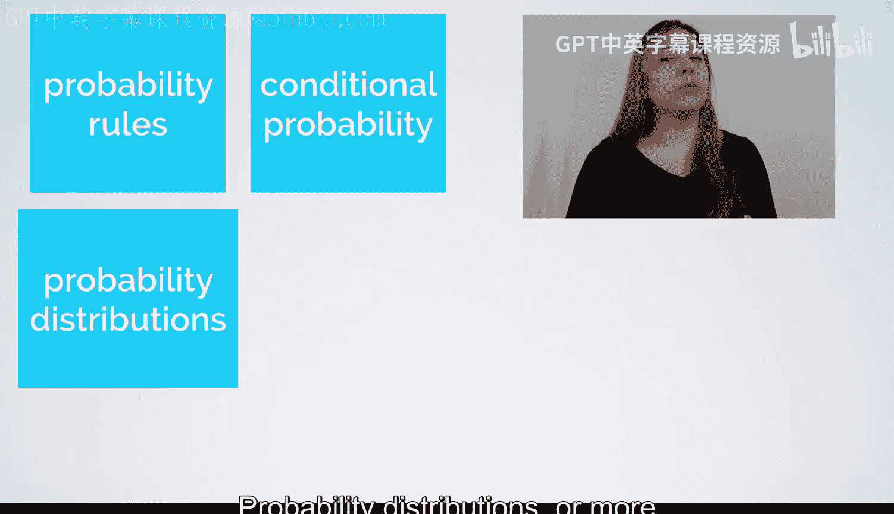
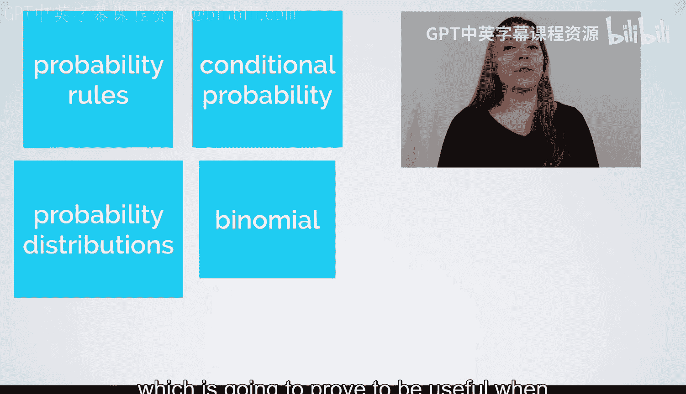
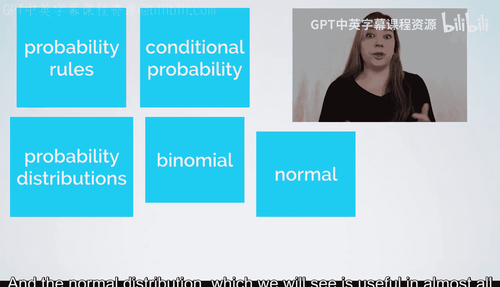

# 概率与数据入门：2：概率导论（二）🎲

在本节课中，我们将要学习概率论的基础知识，包括随机过程的定义、概率的不同解释以及大数定律。这些概念为后续的统计推断提供了重要的概念框架。

## 随机过程的定义

上一节我们介绍了概率的基本概念，本节中我们来看看什么是随机过程。在随机过程中，我们知道可能发生哪些结果，但我们不知道具体会发生哪一个结果。

以下是随机过程的例子：
*   抛硬币
*   掷骰子
*   音乐播放器的随机播放模式
*   股票市场

例如，当你点击音乐播放器的随机播放时，你知道可能的结果是什么——下一首歌将来自你的整个音乐库，但你不知道具体是哪一首歌。同样地，抛一枚硬币，我们知道它可能正面朝上或反面朝上，但我们不知道具体是哪一面。

我们还应该注意，有时将一个过程建模为随机过程是有帮助的，即使它并非真正随机。例如，股票市场。

## 概率的表示与解释

当讨论事件的概率时，我们通常使用符号 **P(A)** 来表示事件A发生的概率。

概率有几种可能的解释，但它们几乎完全认同概率必须遵循的数学规则，其中之一是：**任何事件的概率总是在0和1之间**。

因此，即使你在日常生活中使用诸如“今天有10%或50%的几率会下雨”这样的措辞，请注意这种说法在统计学中是无意义的。这一点可能没有争议，但在计算概率时需要牢记：如果你得到的结果小于0或大于1，你就知道自己犯了错误。

一个传统的概率定义是**相对频率**。这是概率的频率主义解释，即一个结果的概率是如果我们无限次观察随机过程时，该结果发生次数的比例。

另一种解释是**贝叶斯解释**。贝叶斯主义者将概率解释为对同一事件的主观信念程度。对于同一事件，两个不同的人可能有不同的观点，从而为其分配不同的概率。这种解释允许将先验信息整合到推断框架中。贝叶斯方法在过去20年中，很大程度上因计算技术和方法的革命性进步而得到普及。在本课程中，我们将在讨论传统频率主义方法的同时，不时地涉及这些方法。

## 大数定律

大数定律指出，随着收集到的观测数据越来越多，具有特定结果的发生比例会收敛于该结果的概率。

这就是为什么当我们多次掷一枚公平的骰子时，我们期望出现特定点数（例如5点）的比例会稳定在 **1/6** 左右。而在序列的早期，由于投掷次数太少，我们可能无法恰好得到1/6的5点。例如，如果你掷骰子6次，并不能保证其中至少会出现一次5点。但如果你掷骰子600次或6000次，你会期望大约有1/6的次数得到5点。

同样地，这也解释了为什么在3次抛硬币中看到3次正面，比在10次或100次抛硬币中看到3次正面更令人惊讶。

## 独立性示例与赌徒谬误

让我们再看一个例子。假设你抛一枚硬币10次，每次都是正面朝上。你认为下一次抛掷出现正面的机会是多少？是0.5，小于0.5，还是大于0.5？

**概率仍然是0.5**。因此，第11次抛掷出现正面的概率与第10次或之前任何一次抛掷出现正面的概率相同，都是0.5。每次抛掷是独立的，因此下一次抛掷的结果不依赖于之前抛掷的结果。另一种思考方式是，硬币是没有记忆的。它不记得之前发生了什么，然后对自己说：“好吧，下次让我翻到另一面吧。”换句话说，硬币并不“欠”一个反面。

对大数定律的一个常见误解是，认为随机过程应该补偿过去发生的任何事情。这被称为**赌徒谬误**或平均定律。因此，虽然我们知道在大量抛掷硬币的过程中，我们期望大约有50%的正面和50%的反面，但对于任何一次给定的抛掷，出现正面或反面的概率恰好是0.5，**无论过去发生了什么**。当然，如果你真的连续得到数十、数百甚至数千次正面，那么在某些时候，你需要开始思考：也许这不是一枚公平的硬币。

## 本单元后续内容预告

现在我们已经理清了一些定义，在本单元的剩余部分，我们将讨论概率规则、条件概率（之后我们会将其与上一单元末尾讨论的P值联系起来），以及概率分布。更具体地说，我们将学习**二项分布**（这在处理分类数据时将证明非常有用）和**正态分布**（我们将会看到，在本课程后续几乎所有情况下它都很有用）。

## 总结

本节课中我们一起学习了概率论的核心基础。我们定义了随机过程，了解了概率的频率主义和贝叶斯解释，掌握了大数定律的含义，并通过实例辨析了事件的独立性与常见的赌徒谬误。这些知识为我们后续深入学习概率规则和分布奠定了坚实的基础。