# 杜克大学《R语言数据分析（R语言、概率与数据入门，推断统计，线性回归与建模）｜Data Analysis with R》中英字幕 p16 16_06_03_互斥事件与一般加法规则.zh_en -BV1Cf421q7mU_p16-

In this video we will introduce some fundamental probability terminology and rules。

 we're going to start our discussion with disjoint events。

 we're going to talk about the general edition rule and then also discuss relevant terminology like sample spaces。

 probability distributions for now focusing on discrete distributions only and finally wrap up our discussion with introduction to complementary events。

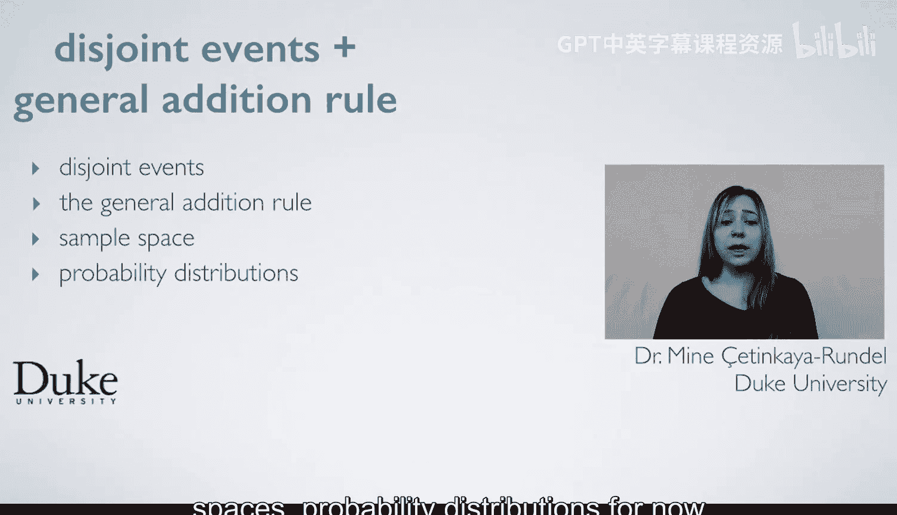

Disjoint events， by definition， cannot happen at the same time。

 A synonym for this term is mutually exclusive。 For example。

 the outcome of a single coin toss cannot be a head and a tail。

 A student cannot both fail and pass a class。 A single card drawn from a di cannot be an ace and a queen at the same time。

In Van diagram representation， where we represent each event by these circles。

 If events A and B are disjoint， we end up with two circles that don't touch each other。

 which indicates that the probability of event A and B happening at the same time。

 So probability of A and B is 0。 In other words， the events don't join。 Hence the term disjoint。

Non disjoint events， on the other hand， can happen at the same time。 for example。

 a student can get an A in statistics and an econ at the same time。

In Ven diagram representation of events A and B that are non disjoint。

 we have two circles that overlap， or in other words join。

 which indicates that the probability of event A and B happening at the same time is non0。

 so it's some number between zero and 1。

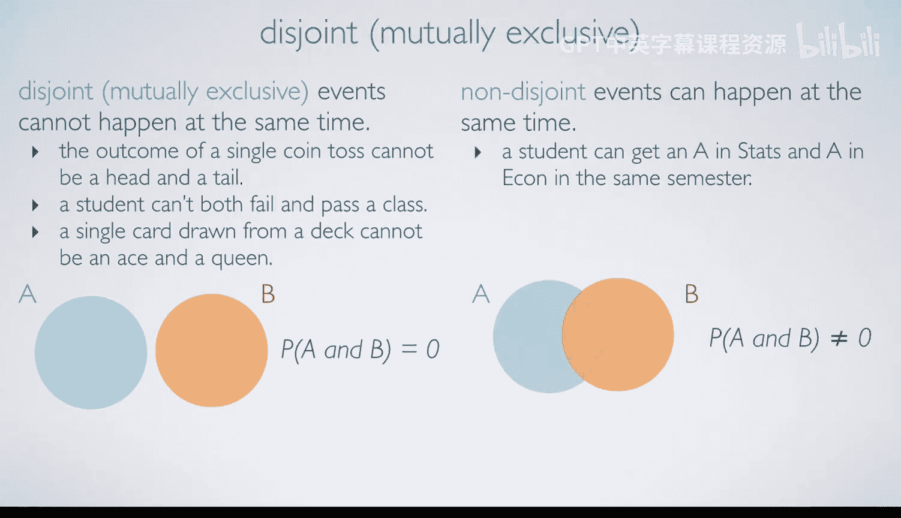

To solidify these definitions， let's put them to use。 We'll start with disjoint outcomes。

What we mean by union is that we're looking for the probability of one event or the other happening。

So the question is what is the probability of drawing a jack or a three from a wellshuffled full deck of cards。

 So here's a full deck of cards。 Remember， there are 52 cards in a full deck。 There are four jacks。

 one from each suit and four， threes， again， one from each suit。

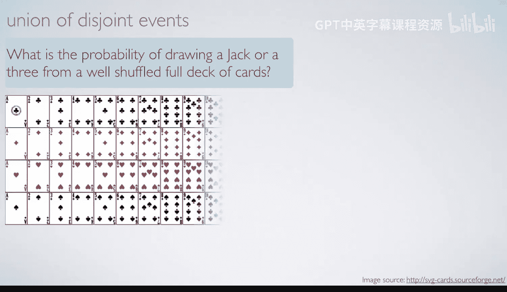

The probability of drawing a jack or a3 is simply the sum of the individual probability of drawing a jack and drawing a3。

 Each probability is 4。4 over 52， resulting in a total probability of approximately 0154。

 So let's just round that and say about 15% chance。So to generalize for disjoint events A and B。

 the probability of A or B happening is simply the probability of A plus the probability of B。

Next up， union of non disjoint outcomes。 This time。

 we want to find the probability of drawing a jack or a red card from a well shuffled full deck of cards。

 So how is this different from the previous question Here again is a full deck of cards。

 We once again have the four jacks that we saw before。 And there are 26 red cards in a deck。

 And note that there is an overlap between them， There are two red jacks that fit both criteria。

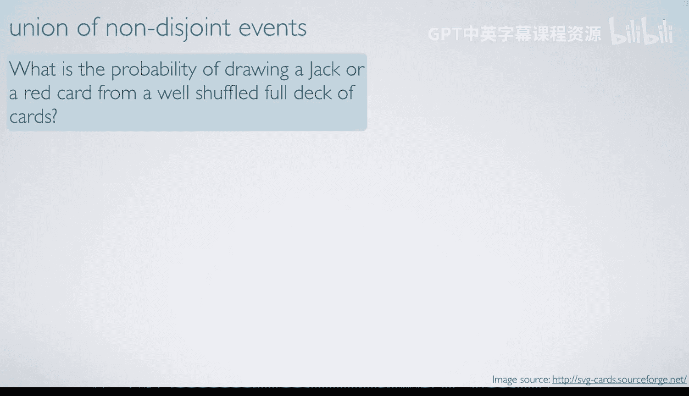

We need to consider this overlap when calculating the probability of drawing a jack or a red card。

 since we don't want to double count the two red jacks and artificially inflate our probability of the desired outcome。

To find the overall probability， we add up the individual probabilities just like before。

 and then we subtract the join probability， in other words， the overlap。

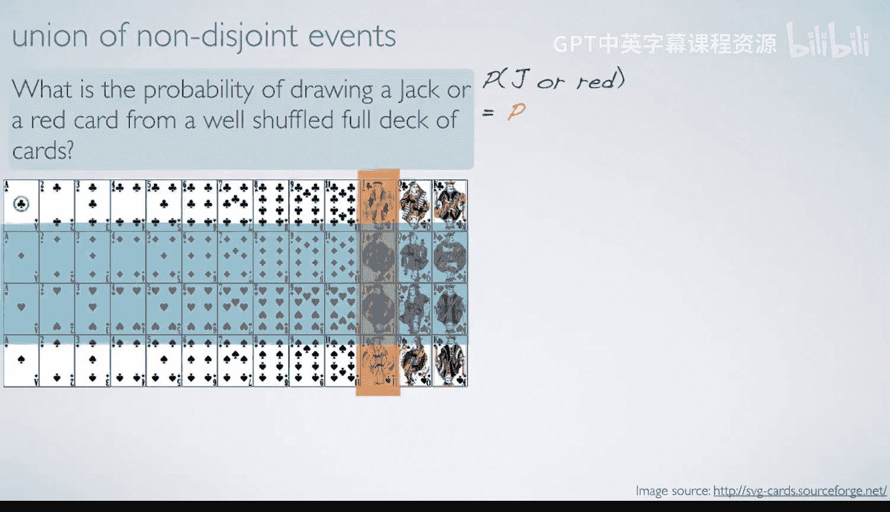

The probability of a jack is 4。4 over 52， the probability of a red card is 26 over 52。

 and the joint probability is 2 over 52 since we have two cards that meet both criteria out of the 52 cards in the full deck。

This results in an overall probability of approximately 。538 or about 54%。So to generalize。

 for non disjoint events A and B， the probability of A or B is the probability of A plus the probability of B minus the probability of A and B happening at the same time that we take away once to avoid double counting。

So to recap， probability of A or B is simply probability of A plus probability of B minus probability of A and B happening at the same time。

Note that when A and B are disjoined though probability of A and B is simply zero so the formula would simplify to what we saw earlier。

 probability of A or B is simply equal to the probability of a plus the probability of B。

 So there's really no reason to try to remember two formulas at once。

 you can kind of draw your Ven diagrams or you can sketch out whatever event you're working with and add up the relevant bits and if there is any sort of double counting。

 you subtract the join probability and if not you don't need to worry about it。

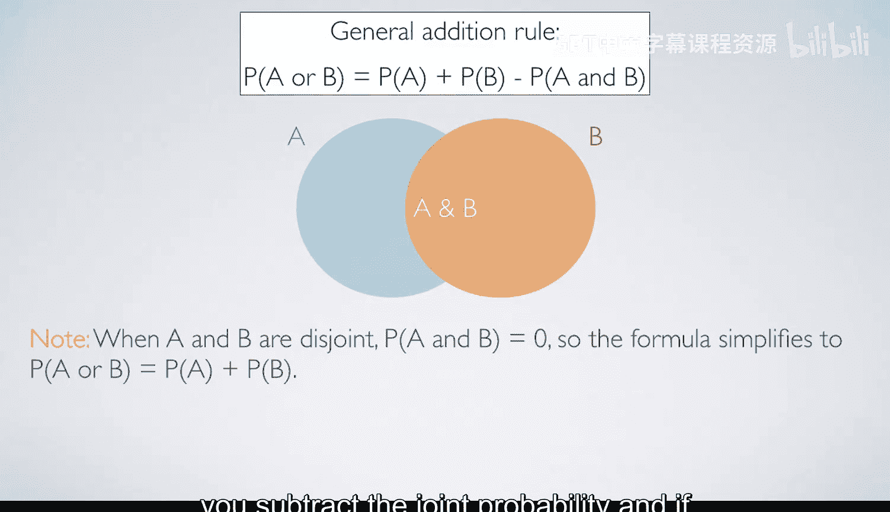

A sample space is a collection of all possible outcomes of a trial。 For example。

 say a couple has two kit。 What is the sample space for the sex of these kits。 And for simplicity。

 we're going to assume that the sex can only be male or female。 Well。

 it's possible that both kids are male。 It's possible that both are female。

It's possible that the first one is female and the second one is male。

 or the last possibility is that the first one is male and the second one is female。

 so if we write out all of these possibilities， what we have is the sample space for the two kids of this couple。

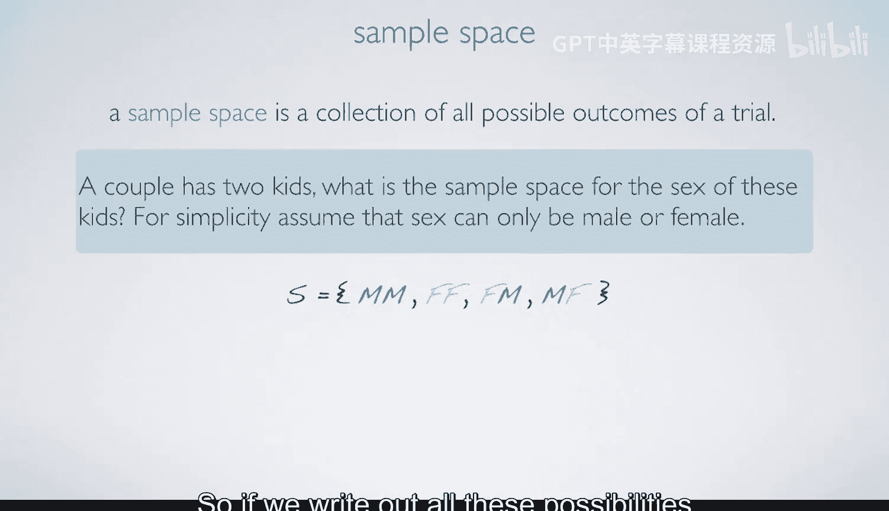

Building off of what we learned about sample spaces。

 a probability distribution lists all possible outcomes and the probabilities with which they occur。

 Let's say you toss a fair coin once。 The possible outcomes are a head or a tail。

 each of which has a 50% chance of happening。Alternatively， let's say you toss the coin twice。

 The possible outcomes are both heads， both tails。 The first tosssses ahead and the second tosssses a tail。

 or the first tosssses a tail and the second tosssses ahead。 Since each outcome is equally likely。

 we have about a 25 per cent chance of each one of them happening。

These tables are the probability distributions for the event of interest， one or two coin tosses。

 we can create similar probability distributions for any discrete event of interest and we'll talk about probability distributions for continuous variables later in the unit。

Probability distributions need to follow three broad rules。1。

 the events listed must be disjoint 2 each probability might must be between 0 and 1。

 This simply follows from what we know about probabilitybabilities that each probability always has to be a number between 0 and 1 and the sum of the probabilitybabilities listed in the probability distribution must total 1。

 So we want to make sure that our entire sample space is listed in our probability distribution。

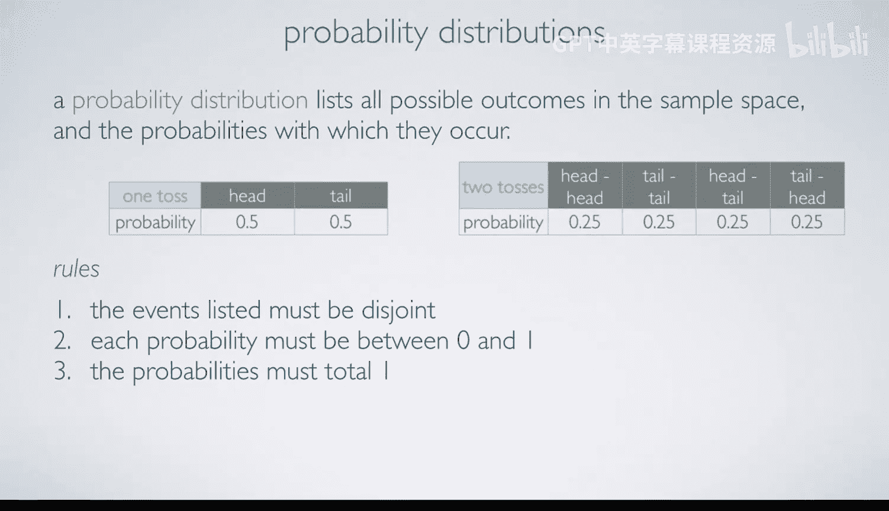

Last terminology that we're going to cover in this video is complementary events。

 These are two disjoint events or two mutually exclusive events whose probabilities add up to one。

 For example， if a coin is tossed once， the complement of a head is a tail。😊。

Say a coin is tossed twice。 The complement of the outcome head and head is simply the sum of all the other three possibilities。

 Ta， tail， head， tail or tail head。 So what we're doing is we're dividing the sample space into two。

 such that the sum of the probabilities still add up to one。

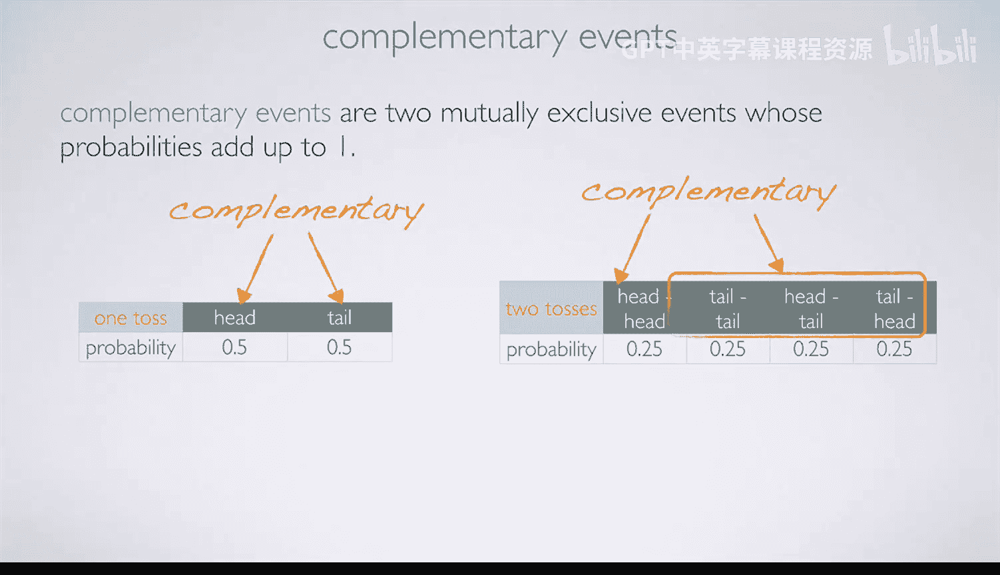

To recap， note that disjoint and complementary events do not mean the same thing。

 Let's ask ourselves two questions here。 One， do the sum of probabilities of two disjoint outcomes always add up to one。

 Let's think about that for a second。 Do the sum of probabilities of two disjoint outcomes always add up to one。

 The answer is not necessarily， if there are more than two outcomes in the sample space。

 then the probabilities of just two of those will not add up to one。 For example。

 think about running a survey in the US。 Let's say you're asking people there are party affiliation。

 They might say there are Democrat or Republican and independent or something else。 So in this case。

 if we were to take any two of those outcomes from there。 Let's say Democrat and Republican。

 The sum of the probabilities of those will likely not add up to one because you're going to have other people in your sample who have voted for or who associate themselves with the other parties。

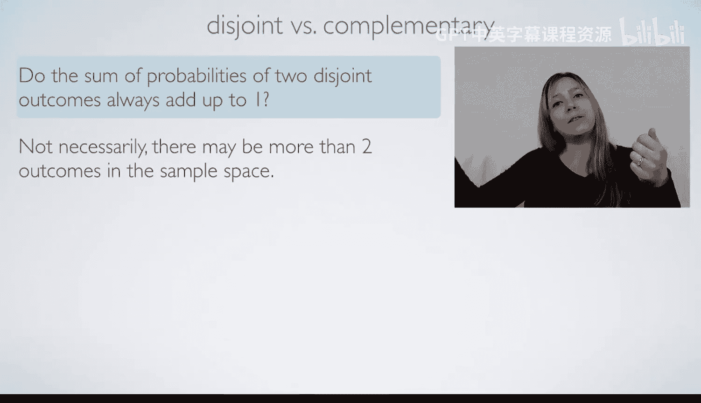

A second question is， do the sum of probabilities of two complementary outcomes always add up to one and here the answer should be straightforward。

 The answer is yes， that is indeed the definition of complementary so let's say you're doing a coin toss again and you're looking at the probabilities of heads and tails we know that these are complementary events and therefore the probabilities of those are going to add up to one。

So， therefore， complementary events are always necessarily disjoined by definition。 However。

 disjoint events are not necessarily always complementary。

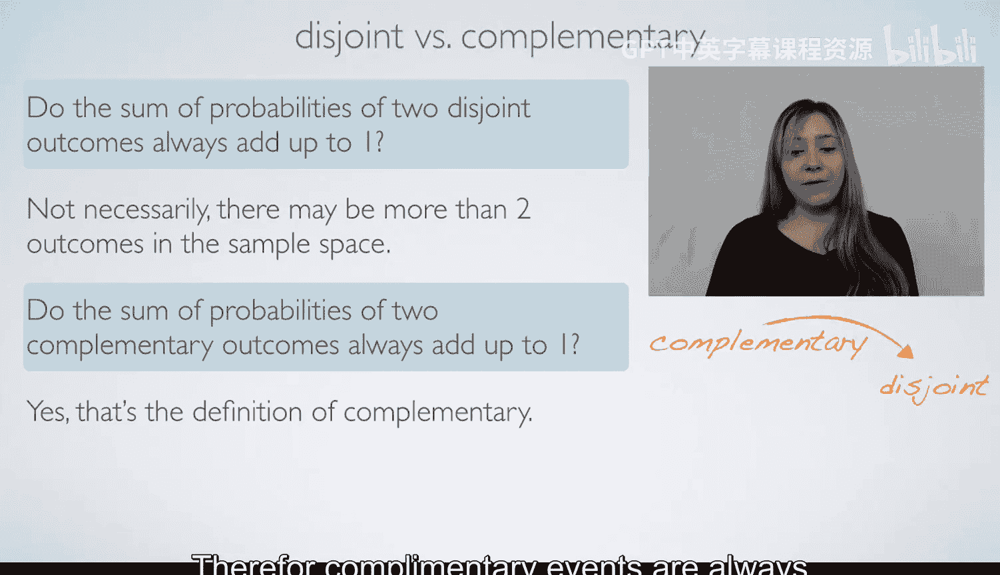

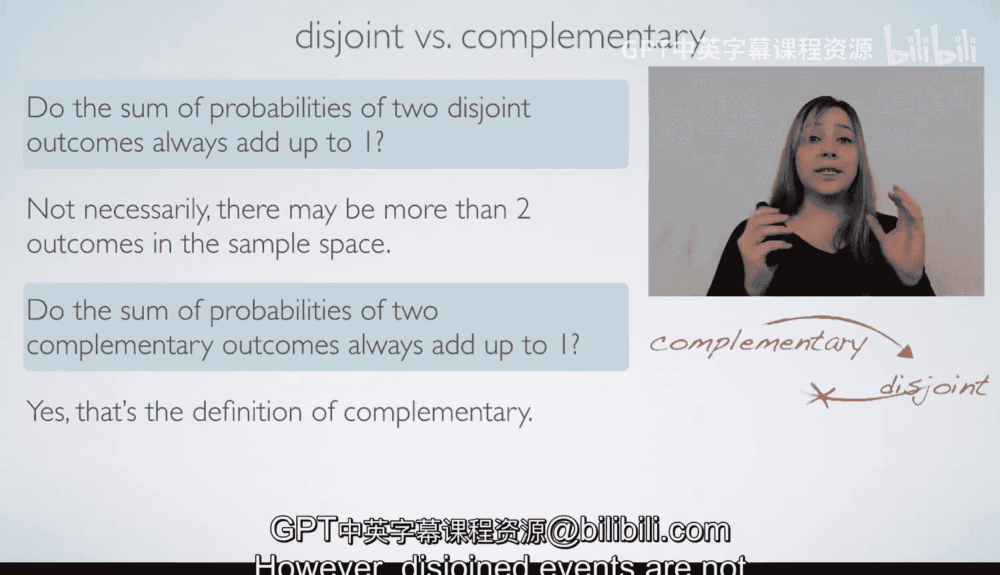