# 概率论基础：第16章：互斥事件与一般加法规则 📊

在本节课中，我们将学习概率论的一些基本术语和规则。我们将从**互斥事件**开始讨论，接着介绍**一般加法规则**，然后探讨相关的术语，如**样本空间**和**概率分布**（目前仅关注离散分布），最后以**互补事件**的介绍结束。

## 互斥事件与非互斥事件

上一节我们介绍了课程概述，本节中我们来看看**互斥事件**。

**互斥事件**，根据定义，是指不能同时发生的事件。这个词的同义词是**相互排斥**。例如：
*   一次抛硬币的结果不能既是正面又是反面。
*   一个学生不可能同时挂科和通过一门课程。
*   从一副牌中抽出一张牌，不可能同时是A和Q。

在文氏图表示中，我们用圆圈代表每个事件。如果事件A和事件B互斥，我们会得到两个互不接触的圆圈，这表明事件A和B同时发生的概率，即 **P(A 且 B) = 0**。换句话说，事件没有交集，因此称为“互斥”。

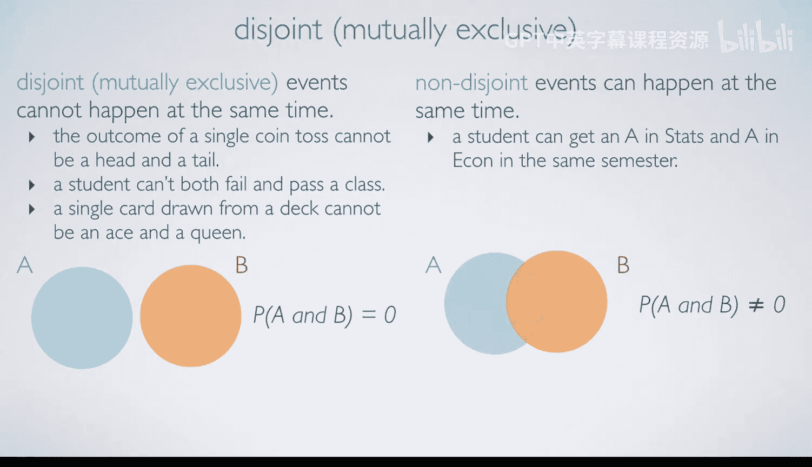

**非互斥事件**，则可能同时发生。例如，一个学生可以同时在统计学和经济学课程中获得A。

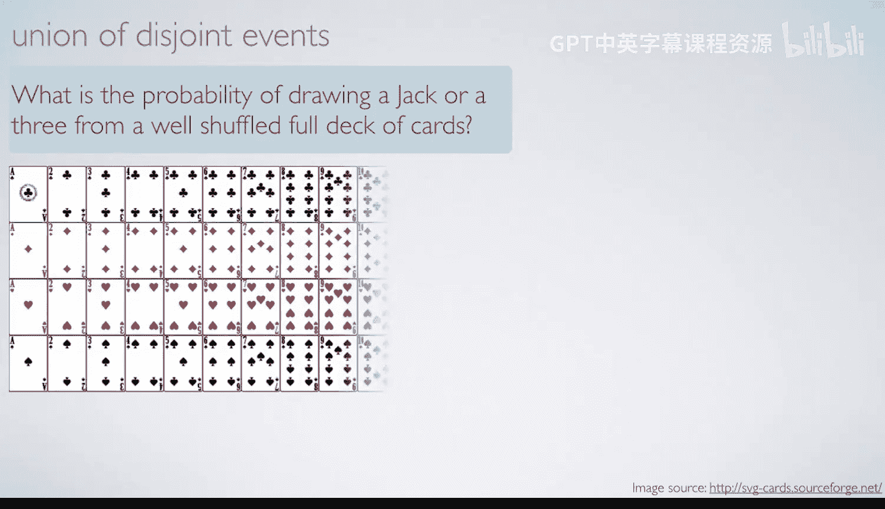

在表示非互斥事件A和B的文氏图中，两个圆圈会重叠，或者说有交集。这表明事件A和B同时发生的概率不为零，即它是介于0和1之间的某个数。

## 一般加法规则的应用

为了巩固这些定义，让我们来应用它们。我们将从互斥事件开始。

当我们谈论“并集”时，我们寻找的是一个事件**或**另一个事件发生的概率。

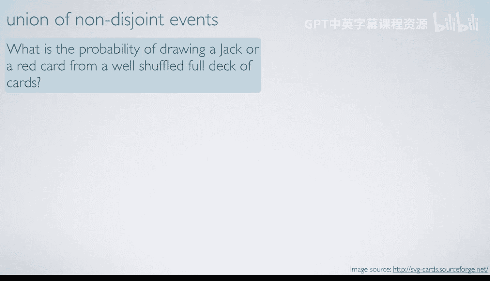

以下是计算互斥事件并集概率的步骤：
1.  确定事件A和事件B。
2.  计算每个事件的概率。
3.  将两个概率相加。

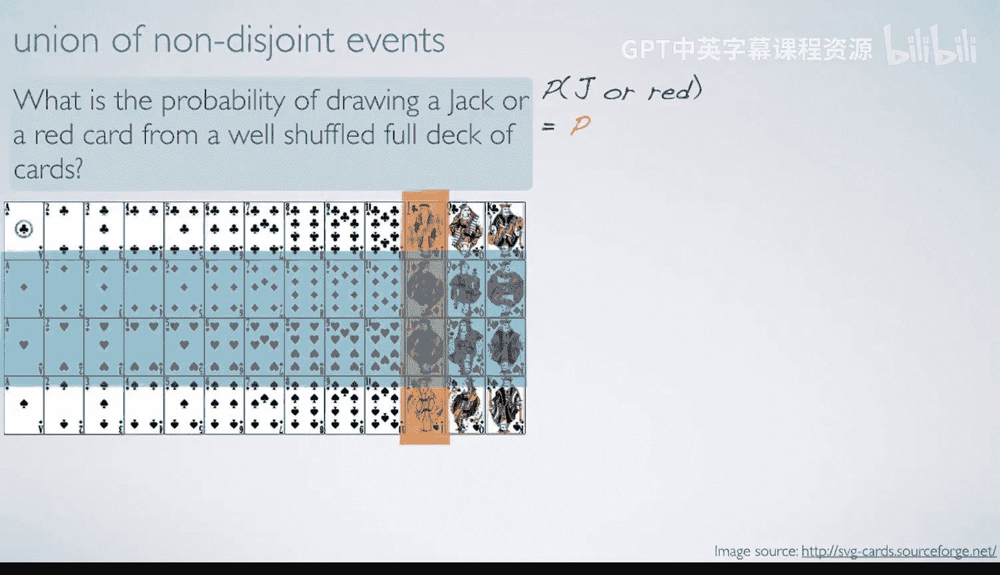

**示例**：从一副洗匀的完整扑克牌中，抽到一张J或一张3的概率是多少？
*   一副完整的牌有52张。
*   有4张J（每种花色一张）。
*   有4张3（每种花色一张）。
*   抽到J的概率是 **4/52**。
*   抽到3的概率是 **4/52**。
*   由于J和3是互斥的（一张牌不能同时是J和3），抽到J或3的概率就是两者概率之和：**4/52 + 4/52 = 8/52 ≈ 0.154**，大约有15%的机会。

因此，对于互斥事件A和B，**A或B**发生的概率就是**P(A) + P(B)**。

接下来，我们看看非互斥事件的并集。这次，我们想计算从一副洗匀的完整扑克牌中抽到一张J或一张红牌的概率。

以下是计算非互斥事件并集概率的步骤：
1.  确定事件A和事件B。
2.  计算每个事件的概率。
3.  计算事件A和B同时发生的概率（交集）。
4.  应用公式：P(A 或 B) = P(A) + P(B) - P(A 且 B)。

**示例**：
*   抽到J的概率：**4/52**。
*   抽到红牌的概率：**26/52**。
*   抽到既是J又是红牌（红桃J和方块J）的概率：**2/52**。
*   因此，抽到J或红牌的概率为：**4/52 + 26/52 - 2/52 = 28/52 ≈ 0.538**，大约有54%的机会。

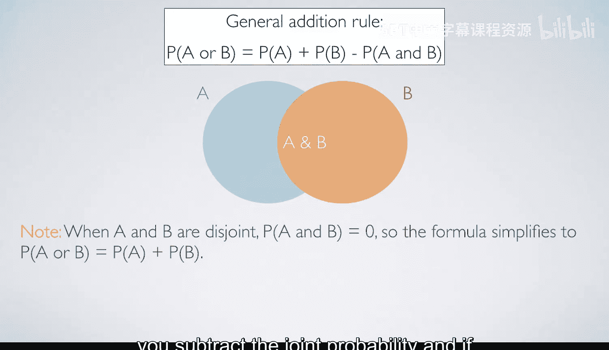

所以，对于非互斥事件A和B，**A或B**发生的概率是 **P(A) + P(B) - P(A 且 B)**。减去P(A 且 B)是为了避免对重叠部分重复计算。

**总结**：概率的加法规则可以统一为 **P(A 或 B) = P(A) + P(B) - P(A 且 B)**。当A和B互斥时，P(A 且 B) = 0，公式就简化为P(A) + P(B)。你无需死记两个公式，可以通过画文氏图或草图来帮助计算，如果有重叠就减去交集概率，没有则无需担心。

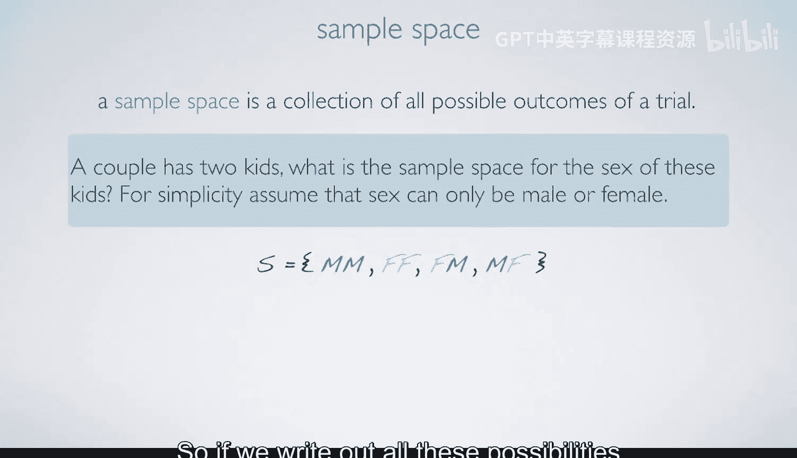

## 样本空间与概率分布

理解了事件的计算后，我们来看看如何系统地描述所有可能的结果。

**样本空间**是一次试验中所有可能结果的集合。例如，假设一对夫妇有两个孩子。这两个孩子性别的样本空间是什么？（为简化，假设性别仅为男或女）。
*   可能两个孩子都是男孩。
*   可能两个孩子都是女孩。
*   可能第一个是女孩，第二个是男孩。
*   可能第一个是男孩，第二个是女孩。
列出所有这些可能性，就得到了这对夫妇两个孩子的性别样本空间。

基于样本空间的概念，**概率分布**列出了所有可能的结果及其发生的概率。

假设抛掷一枚均匀硬币一次。可能的结果是正面或反面，每个结果发生的概率是50%。假设抛掷硬币两次。可能的结果是：两次正面、两次反面、第一次正面第二次反面、第一次反面第二次正面。由于每个结果可能性相等，每个结果发生的概率约为25%。

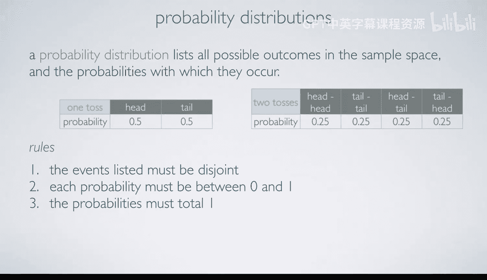

这些表格就是感兴趣事件（一次或两次抛硬币）的**概率分布**。我们可以为任何感兴趣的离散事件创建类似的概率分布，连续变量的概率分布将在本单元后面讨论。

概率分布需要遵循三条基本规则：
1.  列出的事件必须是互斥的。
2.  每个概率必须在0到1之间（这遵循概率的基本定义）。
3.  概率分布中列出的所有概率之和必须等于1（确保涵盖了整个样本空间）。

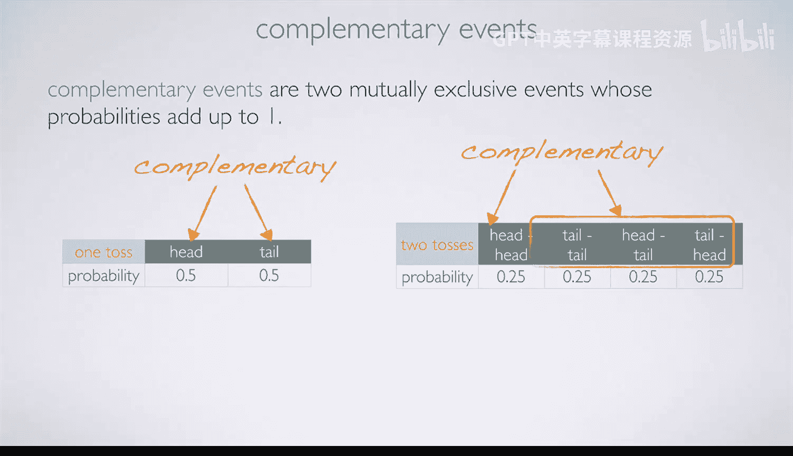

## 互补事件

最后，我们来介绍**互补事件**。

**互补事件**是两个互斥事件，且它们的概率之和为1。例如：
*   抛一次硬币，事件“正面”的补事件是“反面”。
*   抛两次硬币，事件“两次正面”的补事件是所有其他三种可能性（两次反面、正反、反正）的集合。这样，我们将样本空间分成两部分，其概率之和仍为1。

**重要辨析**：互斥事件和互补事件含义不同。
*   两个互斥事件的概率之和是否总是等于1？**不一定**。如果样本空间中存在两个以上的结果，那么其中任意两个结果的概率之和通常不会等于1。例如，在美国进行政党归属调查，结果可能包括民主党、共和党、独立人士等。仅取民主党和共和党这两个互斥事件，它们的概率之和很可能小于1，因为样本中还有属于其他党派的人。
*   两个互补事件的概率之和是否总是等于1？**是的**，这本身就是互补事件的定义。例如，抛一次硬币，正面和反面是互补事件，其概率之和为1。

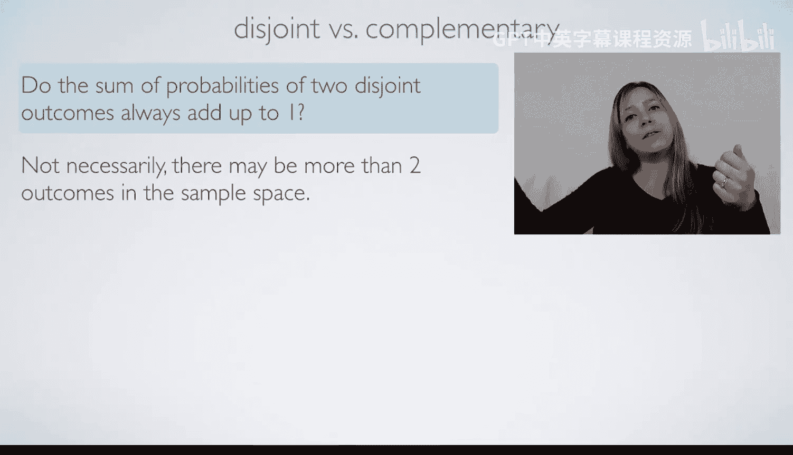

因此，互补事件根据定义必然是互斥的。然而，互斥事件不一定总是互补的。

---

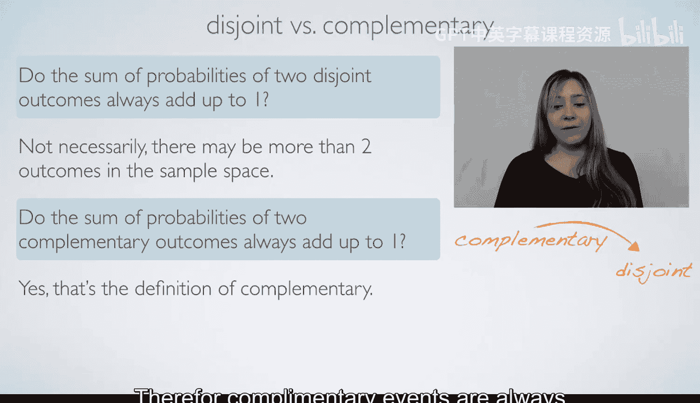

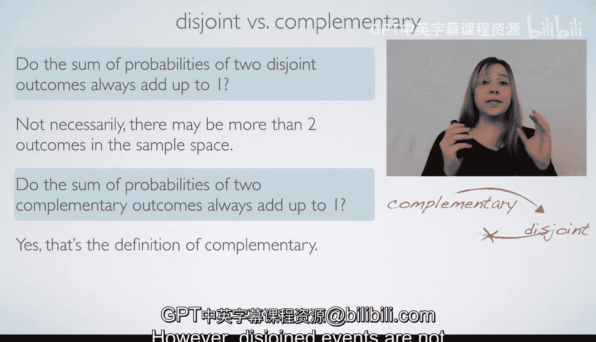

本节课中，我们一起学习了概率论的基础概念。我们定义了**互斥事件**（不能同时发生）和**非互斥事件**，并掌握了计算事件并集概率的**一般加法规则**：**P(A 或 B) = P(A) + P(B) - P(A 且 B)**。我们还了解了**样本空间**（所有可能结果的集合）和**概率分布**（列出结果及其概率），以及概率分布必须满足的三个条件。最后，我们区分了**互补事件**（概率和为1的互斥事件）与一般的互斥事件。理解这些术语和规则是进行更复杂概率计算和统计推断的基石。