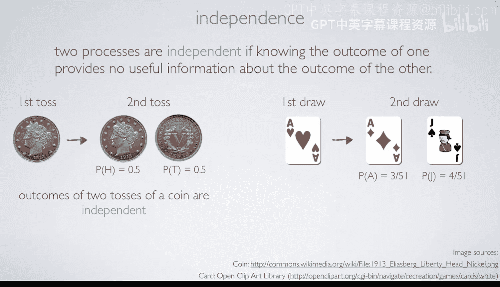
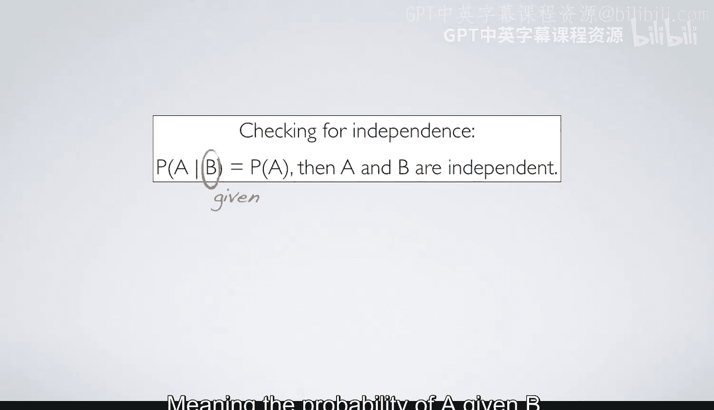
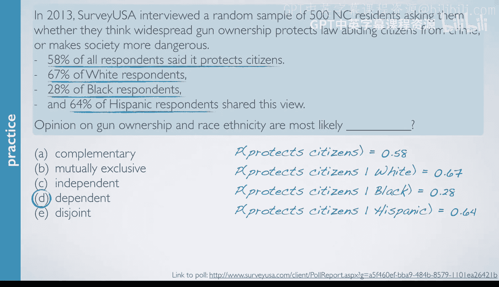
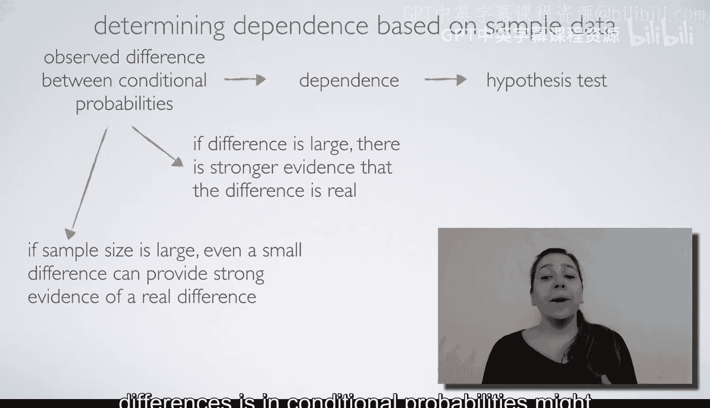
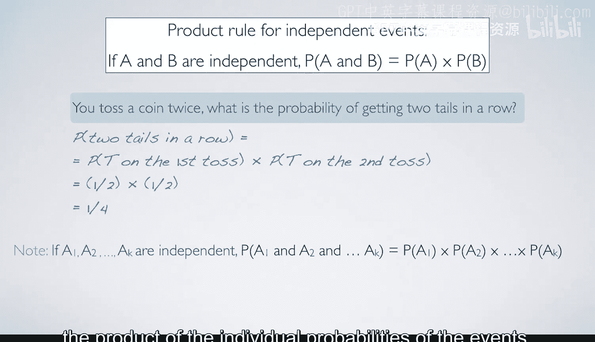
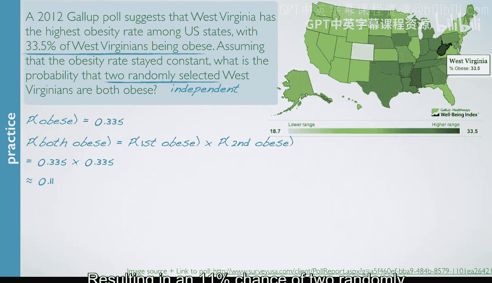

# 杜克大学《R语言数据分析（R语言、概率与数据入门，推断统计，线性回归与建模）｜Data Analysis with R》中英字幕 p17 17_06_04_独立性.zh_en -BV1Cf421q7mU_p17-

In this video， we will define what we mean by independent events。

 learn ways of assessing independence and introduce the multiplication rule for independent events。

Two processes are said to be independent。 If knowing the outcome of one provides no useful information about the outcome of the other。

 For example， knowing that the coin landed on a head on the first toss does not provide any useful information for determining what the coin will land on in the second toss。

 The probability of a head or a tail on the second tosses 0。5。

 regardless of the outcome of the first toss。 Therefore。

 outcomes of two coin tosses are said to be independent。On the other hand。

 knowing that the first card drawn from a deck is an ace does provide useful useful information for calculating the probabilities of outcomes in the second draw。

 This is if we're drawing the cards without replacement。 In other words。

 not putting the cards back into the deck after we draw them。 For example。

 probability of drawing yet another ace is going to be three over 51。

 we have 51 cards left in the deck and only three of them are aces。

 while the probability of drawing a jack is going to be 4 or 51。

 since we still have four jacks left in the deck。 Therefore。

 outcomes of two draws from a deck of cards without replacement are dependent。

Based on this definition， we can develop a general rule for checking for independence between random processes。

If the probability of an event A occurring， given that event B occurred is the same as the probability of event A occurring in the first place。

 then event A and B are said to be independent。 This rule basically says that knowing B tells us nothing about A note that we use this vertical line notation to mean given。

 meaning probability of A， given B。

So let's put that rule to use real quick In 2013， Survey USA interviewed a random sample of 500 North Carolina residents asking them whether they think widespread gun ownership protects law abiding citizens from crime or makes society more dangerous。

 58% of all respondents said it protects citizens，67% of white respondents。

28% of black respondents and 64% of Hispanic respondents shared this view。Based on these。

 we want to fill in the blank in the following sentence。

 opinion on gun ownership and race ethnicity are most likely， which of the following。

 complementaryary， mutually exclusive， independent， dependent or disjoint。

 These should all be terms that you are familiar with by now。Let's take a look at what we're given。

 We're given that the probability that a randomly chosen resident believes that guns protect citizens is 0。

58。We also know that if the resident is white， then this probability is 0。67。 Once again。

 we use this vertical line notation to say the probability that somebody believes that guns protect citizens given that they're white and that probability is 0。

67。If they're black， the probability is 0。28。And lastly， if the resident is Hispan。

 the probability that they believe that guns protect citizens is 0。64。

Since the probabilities of thinking that guns protect citizens vary greatly based on the person's race or ethnicity。

 opinion on gun ownership and race ethnicity are most likely dependent。

 so knowing somebody's ethnicity might actually give us useful information about their opinion on guns and therefore we are saying that the two variables are most likely dependent on each other。

We've been using wording like most likely dependent since we're working with sample data and we're not yet using statistical inference tools that allow us to take the results that we get from our sample and expand that to the population at large。

If we observe a difference between the conditional probabilities that we calculate based on the sample。

 we say that these data suggest dependence。 The next natural step would then be to actually conduct a hypothesis test to see if what we observed these differences that we observed could have just happened due to chance or natural random sampling。

Or if there's actually a real difference in the population。

 we've done a little bit of that at the end of the last unit。

 and we're going to get back to doing that in the next unit as well。

 but for now we're kind of picking up building blocks to get us there。 However， before we get there。

 we can actually do a little bit of speculating based on the magnitude of the differences that we observe as well as the sample size。

For example， if the observed differences between the conditional probabilities。

 this is kind of like the probabilities we were just looking at。

 probability that guns protect citizens given that somebodys white given that they're black versus given that they're Hispanic。

 if these conditional probabilities vary greatly， in other words， the differences are large。

 then there is stronger evidence that the difference is real。

 that we would see something similar to that， had we had data from the entire population as well。

On the other hand， if the sample size is large， even small differences in conditional probabilities might provide strong evidence of a real difference。

Now that we know how to check for independence， let's see what we can do with events once we find out that they're independent。

 The product rule for independent events says that if A and B are independent。

 then the probability of A and B happening is simply the product of their probabilities。

Say you tosa coin twice。 What is the probability of getting two tails in a row。

 Sounds pretty simple eh。Probability of two tails in a row。

 it's simply going to be the probability of a tail on the first toss times the probability of a tail on the second toss we've seen before and we've talked about before that coin tosses are independent of each other。

 therefore we are able to apply this rule that we've just learned。

Probability of tail on either toss is simply 05 or 1 over 2。

 so the overall probability is going to be a quarter or about 25%。A quick note。

 this rule isn't really limited to just two events and it can actually be expanded to as many independent events as you need。

 So if instead of doing two coin tosses， we had100 of them。

 we could simply multiply100 of the same probabilities together， generically said if a1。

 A2 all the way through a K are independent， then probability of all of these events happening at once is simply going to be the product of the individual probabilities of the events。

Let's put what we just learned to use with some real data。

A 2012 Gallup poll suggests that West Virginia has the highest obesity rate among US states， with 33。

5% of West Virginians being obese。Assuming that the obesity rate stayed constant。

 what is the probability that two randomly selected West Virginians are both obese？

We're given that 33。5% of West Virginians are obese。

 which we can denote as probability of being obese as 0。

335 It's often useful to make list of the givens in the problem as we've been doing in the past couple examples。

 this helps to keep everything neat and organize and then makes it easier for you to refer back to these values when you need them later in your calculations。

We're told that the two individuals are randomly selected。

 which means that they're going to be independent of each other with respect to their obesity status。

For example， if we pick two people from the same household and one is obese。

 the other one might be more likely to be obese as well。

 given that people who live in the same household are more likely to have shared eating and exercising habits。

However， since we're randomly selecting these individuals， we can say that they're independent。

 and since the two are independent， the probability of both of them being obese will simply be the probability will simply be the probability of the first one being obese times the probability of the second one being obese。

 each of which is 0。335， resulting in an 11 per cent chance of two randomly selected West Virginians being obese。

This value， 11% of the probability of both of these people being obese is less than the probability of either of them being obese。

 which makes sense for two reasons， mathematically speaking。

 we multiplying two values between 0 and 1。 so the product will necessarily be a value lower than either one of them。

And conceptually， we want to find two people that fit a certain criteria。At the same time， therefore。

 the likelihood of us getting what we want should be lower than the likelihood of getting finding just one person who fits that criterion。

Reasoning through the final numerical answer this way is often useful。

 It helps us really understand why the formulas that we're using work the way they do without getting into theoretical proofs。

 and it's also useful for checking the final numerical answer in the context of the data that you're working with。

 In other words， it's really a good way to check your work。

