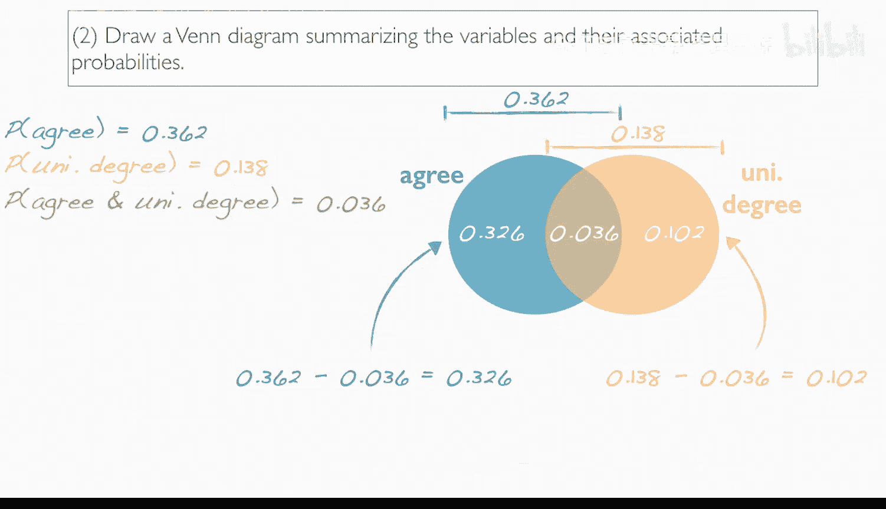
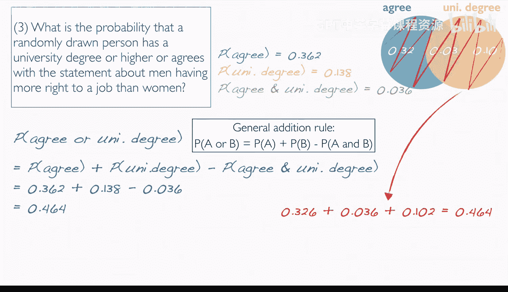
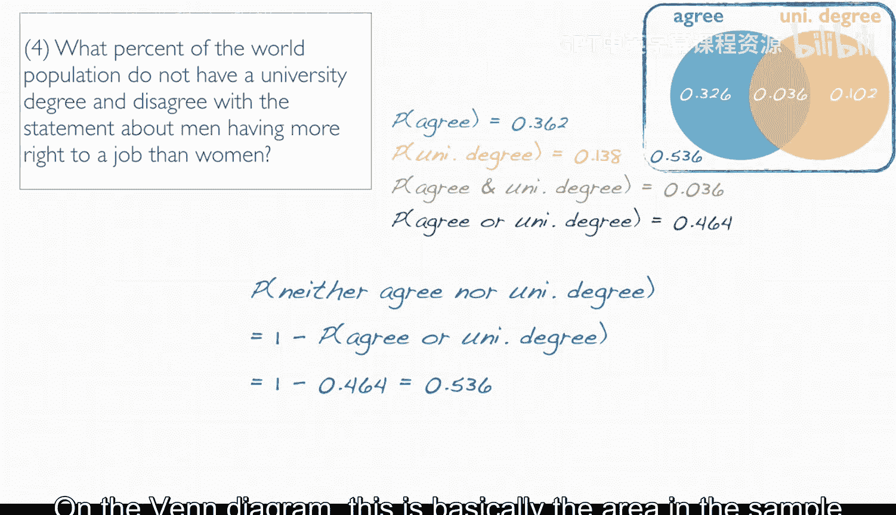
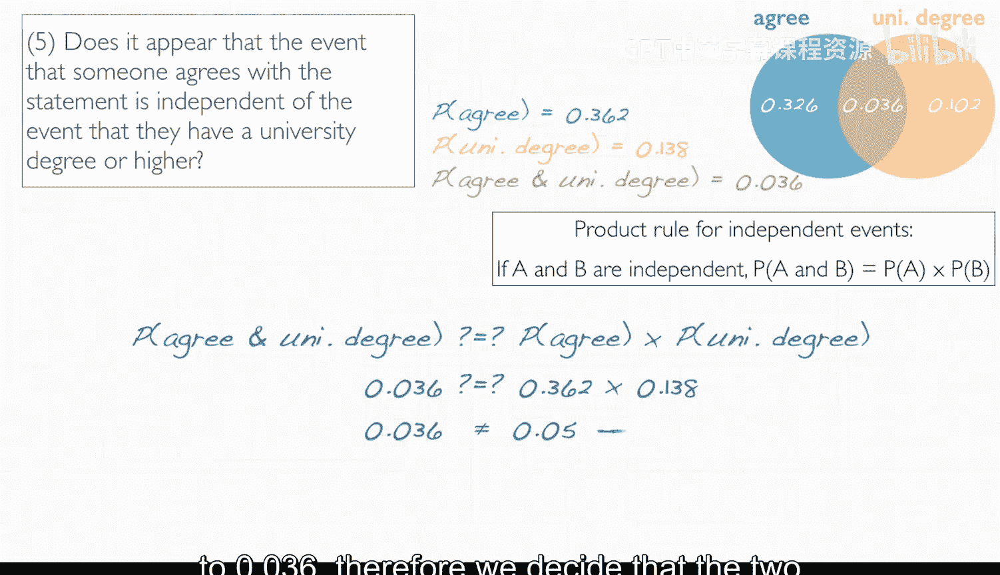
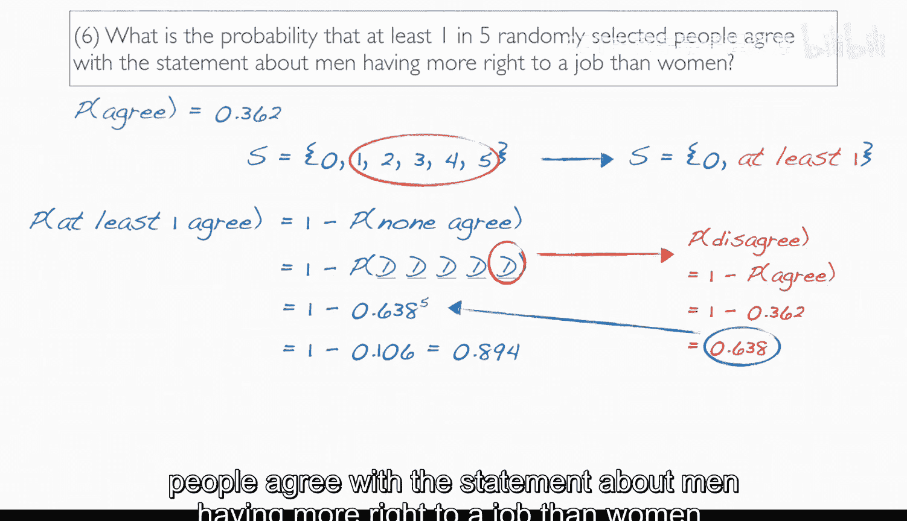
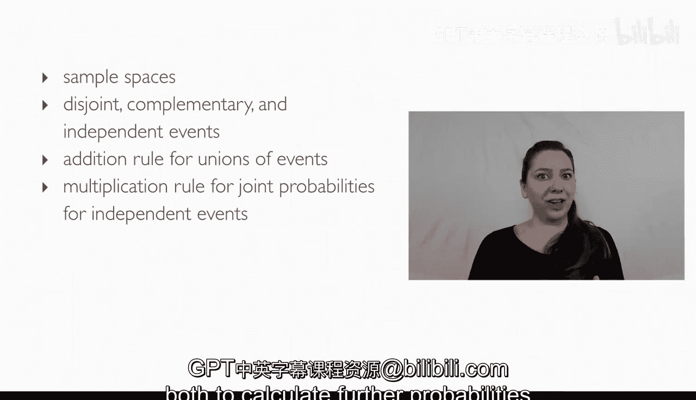

# 杜克大学《R语言数据分析（R语言、概率与数据入门，推断统计，线性回归与建模）｜Data Analysis with R》中英字幕 p18 18_06_05_概率示例.zh_en -BV1Cf421q7mU_p18-

The World Values surveyve is an ongoing worldwide survey that polls the world population about perceptions of life。

 work， family， politics， et cetera。 The most recent phase of the survey that polled 77882 people from 57 countries estimates that 36。

2% of the world's population agree with the statement。

 men should have more right to a job than women。The survey also estimates that 13。

8% of people have a university degree or higher and that 3。6% of people fit both criteria。

Let's start by listing what we know。36。2% of the world's population agree with the statement men should have more right to a job than women。

 so probability of agree is 0。362。13。8% of people have a university degree or higher。

 so probability of a university degree is 0。13138。 It's actually a university degree or higher。

 but we'll just use a shorthand notation here。And 3。6% of people fit both criteria。

 so probability of agree and university degree is 0。036。First question we'll tackle is。

 are agreeing with the statement， men should have more right to a job than women and having a university degree or higher disjoint events。

Let's bring back the list of givenbbs we listed earlier。

Since the probability of agreeing with the statement and having a university degree or higher is not zero。

 the events are not disjoint。Next， we're asked to draw a Venn diagram summarizing the variables and their associated probabilities。

We have two events that we determine to be non disjoint。

 so we start by drawing two overlapping circles， one for agree and one for university degree。

Then we mark the joint probability in the middle， the 3。6% of people who fit both criteria。

We know that the total percentage of those who agree is 36。2%。

 and this includes those who also have a university degree or higher。

 so to find those who agree but don't have a university degree。

 we subtract the two probabilities and find that 32。6% of people， agree with the statement。

 but don't have a university degree。Similarly， 13。8% of people have a university degree or higher。

 and taking out those who also agree with this statement leaves us with 10。

2% of people who disagree with this statement， but have a university degree or higher。

Next， we want to find the probability that a randomly drawn person has a university degree or higher or agrees with a statement about men having more right to a job than women。

Let's also put back on the screen what we know so far。

We're looking for the probability of a or university degree。

 and that should remind us the general edition rule。

 probability of a or B is equal to probability of a plus probability of B minus probability of A and B。

 or in context， probability of agree plus probability of university degree minus probability of agree and university degree from here onwards。

 we can just plug in the probabilitybilities that we already know。 That's 0。3，62，4 p of agree。

13138 for a P of university degree and minus。036 for the intersection。Resulting in 0。464。

 so there is about a 46% chance that a randomly drawn person has a university degree or higher or agrees with the statement about men having more right to a job than women。

An alternative way of getting at the same answer would be using the Venn diagram。

 The desired probability is basically represented by the area covered by the two circles。

 So we could simply add all of the shown probabilities where we have already adjusted for the double counting due to the joint probability in the intersection of the two circles and arrive at the same answer。

What person of the world population do not have a university degree and disagree with the statement about men having more right to a job than women？

We could simply phrase this as probability of neither agree nor having a university degree。

 which is basically going to be the complement of probability of agree or having a university degree that we found earlier。

 we had found that that probability was 46。4%， so the complement is 53。6%。On the Venn diagram。

 this is basically the area in the sample space outside of a and university degree。😊。

Next， we evaluate independence Does it appear that the event that someone agrees with the statement is independent of the event that they have a university degree or higher？

Remember the product rule that says if A and B are independent。

 probability of A and B is equal to probability of A times probability of B。

We can easily check if this is the case by setting up an equation where we check if probability of agree and university degree equals probability of agree times probability of university degree。

 we have all three of these as givens from our introduction earlier。

 so all we need to do is plug them in That is is 0。036 equal to 0。362 times 0。138。

The right hand side of the equation is approximately 5%， which is not equal to 0。036。 Therefore。

 we decide that the two events do not appear to be independent。

Lastly， let's take a look at this， What is the probability that at least one in five randomly selected people agree with the statement about men having more right to a job than women。

Remember， probability of a is 0。362 and this is really the only relevant information for this question。

If selecting five people randomly， our sample space for the number of people who might agree with the statement range from 0 to 5。

 It is possible that none of them agree。 Just one agrees，2 agree， et cetera。

 all the way to all five agree。We're interested in instances where at least one person agrees with the statement。

 so we can divide up the sample space into two complementary events。

 None indicated by the0 and at least one， which covers all possible outcomes from one through 5。

To find the probability of at least one out of five people agreeing with the statement。

 we simply subtract the probability of its complement， none agree from one。

So that is1 minus the probability of all of them disagreeing。

 Let's take a moment to think about this。 If none of them agree。

 that basically means each one of them disagrees。So first we need to figure out what is the probability that any given person disagrees with the statement that is also going to be a compliment and it's the complement of the probability of agreeing which we know to be 0。

362 so the probability that any given person disagrees with the statement is 0。

638 we're going to use this and we need five such people to make up our desired outcome of five people all disagreeing with the statement。

Plugging that back into the formula。 we have 1-0。638 to the fifth power。

 We can multiply each one of these probabilities because we know that whether one person in our group disagrees with the statement is independent of another because we're randomly sampling them。

 So the result comes out to be 0。894。 So there is roughly 89。

4% chance that at least one person out of five randomly selected people agree with the statement about men having more right to a job than women。

In this example we brought together many of the concepts that we've learned recently。

 we touched on sample spaces， we talked about disjoint complementary and independent events。

 we also use the addition rule for unions of events as well as the multiplication rule for joint probabilities of independent events。

 both to calculate further probabilities and to check independence as well。

