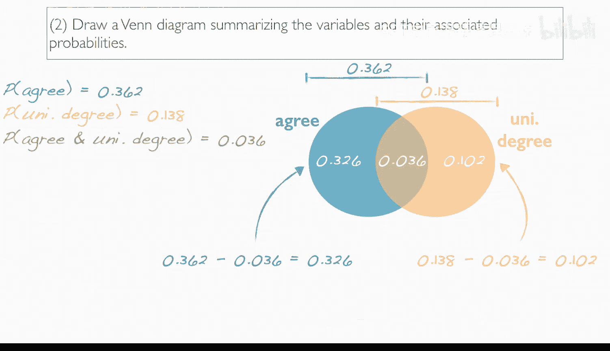
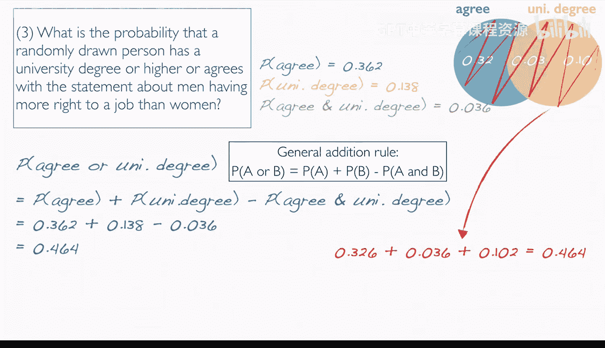
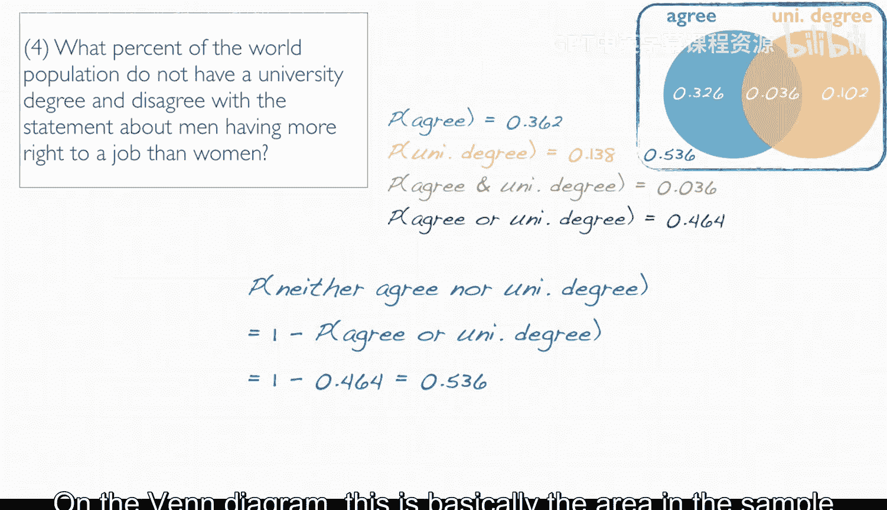
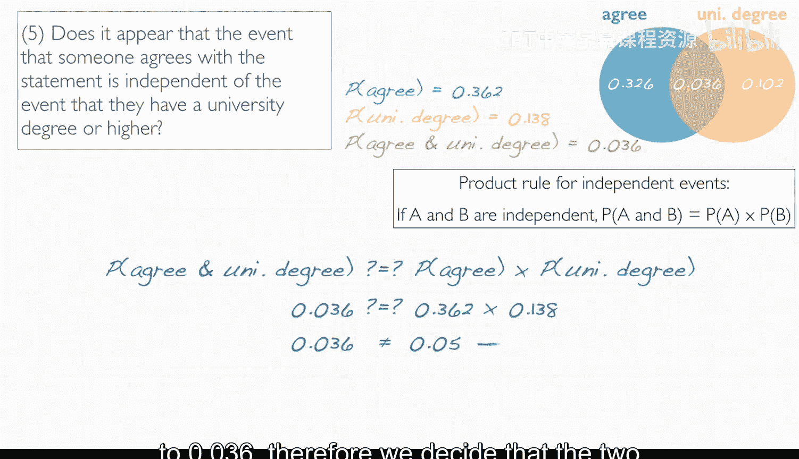
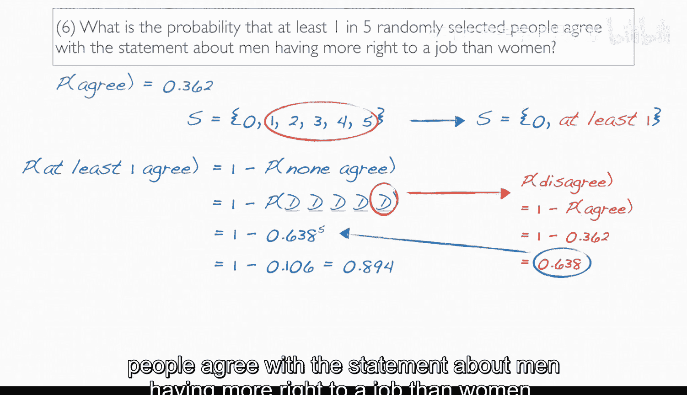
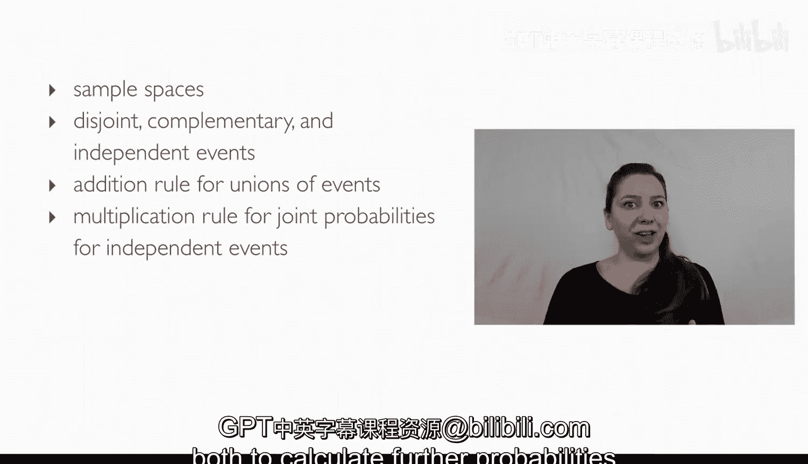

# R语言数据分析：18：概率示例 🎲

在本节课中，我们将通过一个来自“世界价值观调查”的真实数据示例，综合运用概率论的核心概念。我们将学习如何判断事件的互斥性与独立性，如何计算事件的并集与补集概率，以及如何利用这些规则解决实际问题。

---

世界价值观调查是一项持续进行的全球性调查，旨在了解全球人口对生活、工作、家庭、政治等方面的看法。最近一期调查涵盖了来自57个国家的77882人，其估计显示：全球有36.2%的人口同意“男性应比女性拥有更多工作权利”这一说法。

调查还估计，13.8%的人拥有大学或更高学历，同时有3.6%的人同时满足以上两个条件。

首先，我们列出已知信息：
*   全球36.2%的人口同意该说法，即 **P(同意) = 0.362**。
*   13.8%的人拥有大学或更高学历，即 **P(大学学历) = 0.138**。
*   3.6%的人同时满足以上两个条件，即 **P(同意 ∩ 大学学历) = 0.036**。

---

## 判断事件是否互斥

第一个问题是：同意“男性应比女性拥有更多工作权利”这一说法，与拥有大学或更高学历，这两个事件是互斥的吗？

回顾我们列出的已知信息。由于**P(同意 ∩ 大学学历) = 0.036**，不等于零，因此这两个事件**不是互斥的**。互斥事件意味着两者不可能同时发生，但此处的数据表明有人同时满足两个条件。

---

## 绘制文氏图

接下来，我们被要求绘制一个文氏图来总结这些变量及其关联的概率。

既然我们已确定这两个事件并非互斥，我们首先画出两个重叠的圆圈，一个代表“同意”，另一个代表“大学学历”。

然后，我们在中间的重叠区域标记联合概率，即那3.6%同时满足两个条件的人。

我们知道同意者的总比例为36.2%，这包括了那些同时拥有大学学历的人。因此，要找出同意但没有大学学历的人，我们用总同意概率减去联合概率：**0.362 - 0.036 = 0.326**。所以，有32.6%的人同意该说法但没有大学学历。

类似地，拥有大学学历的总比例为13.8%，减去同时同意该说法的人后，得到**0.138 - 0.036 = 0.102**。所以，有10.2%的人不同意该说法但拥有大学学历。

---

## 计算“或”事件的概率

现在，我们想计算随机抽取的一个人“拥有大学或更高学历”或“同意关于男性工作权利的说法”的概率。

让我们再次回顾目前已知的信息。

我们要求的是 **P(同意 ∪ 大学学历)**，这让我们想起**一般加法公式**：
**P(A ∪ B) = P(A) + P(B) - P(A ∩ B)**

在本题上下文中，即：
**P(同意 ∪ 大学学历) = P(同意) + P(大学学历) - P(同意 ∩ 大学学历)**

接下来，我们只需代入已知概率：0.362 + 0.138 - 0.036 = **0.464**。

因此，随机抽取的一个人拥有大学学历或同意该说法的概率约为46.4%。

另一种得到相同答案的方法是使用文氏图。所需的概率基本上由两个圆圈覆盖的总面积表示。我们可以简单地将图中显示的所有概率相加（这些概率已经对重叠部分的重复计算进行了调整），从而得到相同的答案。

---

## 计算“既不…也不…”的概率

全球人口中有多少百分比的人既没有大学学历，也不同意关于男性工作权利的说法？

我们可以将其表述为 **P(既不同意也无大学学历)**，这基本上是前面求得的 **P(同意 ∪ 大学学历)** 的补集。

我们之前求得该概率为46.4%，因此其补集为 **1 - 0.464 = 0.536**，即53.6%。

在文氏图上，这基本上就是样本空间中“同意”和“大学学历”两个圆圈之外的区域。

---

## 判断事件是否独立

接下来，我们评估独立性：某人同意该说法的事件，与他们拥有大学学历的事件，看起来是相互独立的吗？

回忆**乘积规则**：如果A和B独立，则 **P(A ∩ B) = P(A) × P(B)**。

我们可以通过建立一个等式来检查是否成立：**P(同意 ∩ 大学学历) 是否等于 P(同意) × P(大学学历)**？

我们从引言中已经获得了这三个概率的给定值，只需代入即可：**0.036 是否等于 0.362 × 0.138**？

等式右边计算结果约为0.05，不等于左边的0.036。因此，我们判定这两个事件**看起来并不独立**。

---

## 计算“至少一个”的概率

最后，让我们看这个问题：在随机选择的五个人中，至少有一人同意关于男性工作权利的说法的概率是多少？

记住，**P(同意) = 0.362**，这是回答这个问题唯一相关的信息。

如果随机选择五个人，同意该说法的人数可能从0到5。可能没人同意，可能一人同意，两人同意，……，直到五人都同意。

我们感兴趣的是“至少一人同意”的情况。我们可以将样本空间划分为两个互补的事件：“0人同意”（用0表示）和“至少一人同意”（涵盖了从1到5的所有可能结果）。

要找到五人中至少一人同意的概率，我们只需用1减去其补事件“无人同意”的概率：**1 - P(无人同意)**。

让我们思考一下：如果无人同意，基本上意味着他们每个人都不同意。所以，我们首先需要知道任何一个人不同意该说法的概率。这也是一个补集，是同意概率的补集：**P(不同意) = 1 - 0.362 = 0.638**。

我们需要五个这样的人来构成“五人都不同意”的期望结果。由于我们是随机抽样，一个人是否不同意该说法与另一个人是独立的，因此我们可以将每个概率相乘。

代入公式：**1 - (0.638)^5**。计算结果约为 **0.894**。

因此，在随机选择的五个人中，至少有一人同意该说法的概率大约为89.4%。

---

## 总结

在本示例中，我们综合运用了近期学习的许多概念。我们涉及了样本空间，讨论了互斥事件、互补事件和独立事件。我们还使用了事件的**并集加法规则**以及独立事件的**联合概率乘法规则**，既用于计算更复杂的概率，也用于检验事件的独立性。

