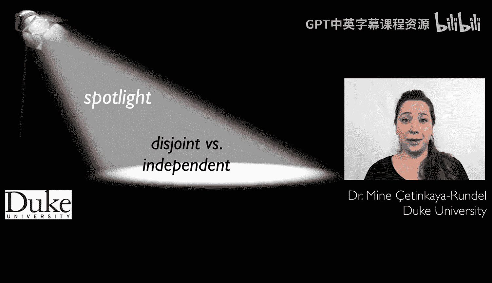
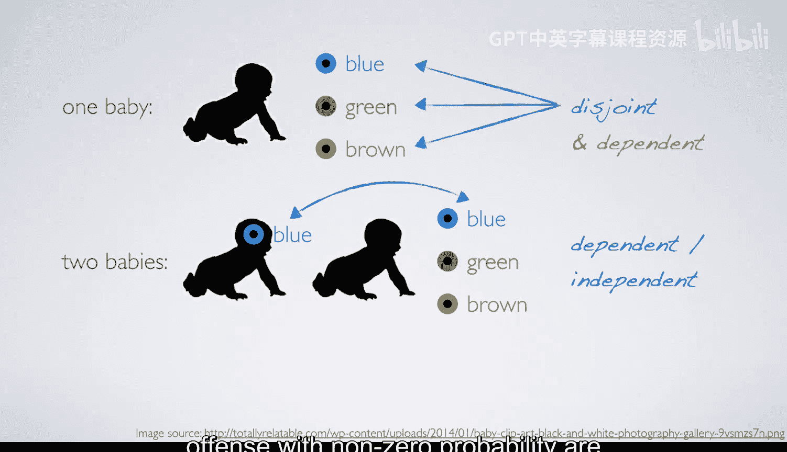
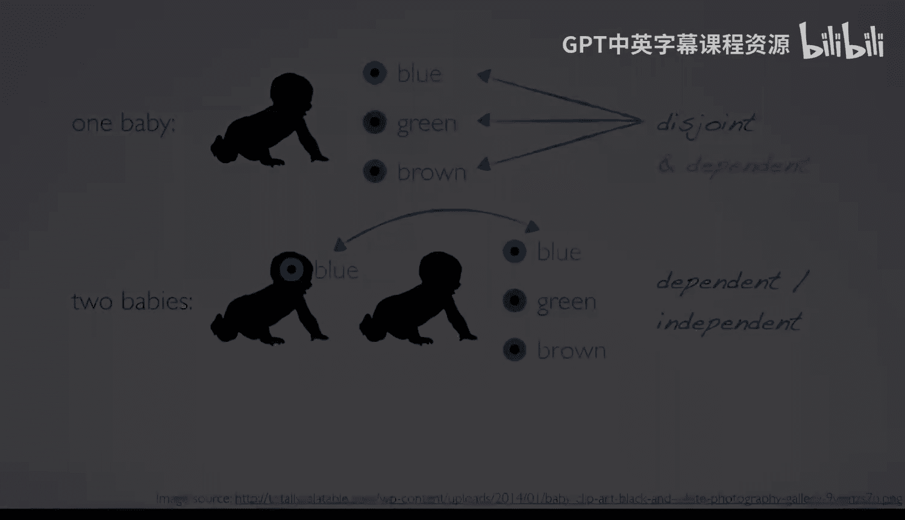

# 杜克大学《R语言数据分析（R语言、概率与数据入门，推断统计，线性回归与建模）｜Data Analysis with R》中英字幕 p19 19_06_06_聚焦：互斥与独立辨析.zh_en -BV1Cf421q7mU_p19-

In this spotlight video， we're going to discuss disjoint and independent events。

 These are two terms that sound like each other and that are often confused with each other。

 So we're going to take a step back again and redefine them and give some examples that highlight why they really do not mean the same thing。

As a quick reminder， two events that are disjoint， also called mutually exclusive。

 can happen at the same time。 While two processes are independent。

 if knowing the outcome of one provides no useful information about the outcome of the other。

 So disjointness is about events happening at the same time。 So if events A and B are disjoint。

 probability of A and B is 0。 While independence is about processes not affecting each other。

 So if events A and B are independent， probability of A given B is equal to simply probability of a。

Say we're interested in the eye color of babies。 And the only possibilities are blue。

 green and brown。 And yes， there are some people who have one eye blue and one eye green。

 but we're going to ignore that possibility and assume that the baby can have either blue eyes。

 green eyes or brown eyes。 Suppose there's one baby。 The possible eye colors are blue。

 green and brown。These outcomes are disjoint since they can happen at the same time。

Now suppose there are two babies and suppose that we know that the first one has blue eyes。

 The possibilities for the second one are again blue。

 green and brown these three outcomes for the second baby are also disjoined from each other。

 however， the eye color of the first and the second baby may be dependent or independent depending on whether the babies are related or randomly drawn from the population。

 the babies are related， and we know that one has blue eyes。

 the other one is going to be more likely to also have blue eyes， but if not related。

 and they're randomly drawn from the population， the fact that the first one has blue eyes will not provide any useful information about the second one having blue eyes。

One last item to note is that the disjoint outcomes， the color of one baby's eyes。

 blue green or brown， are also dependent on each other because if we know that the baby has blue eyes。

 we also know that it doesn't have green or brown eyes。

We can generalize this to say that disjoint events with nonzero probability are always dependent on each other because if we know that one happened。

 we know that the other one cannot happen。

