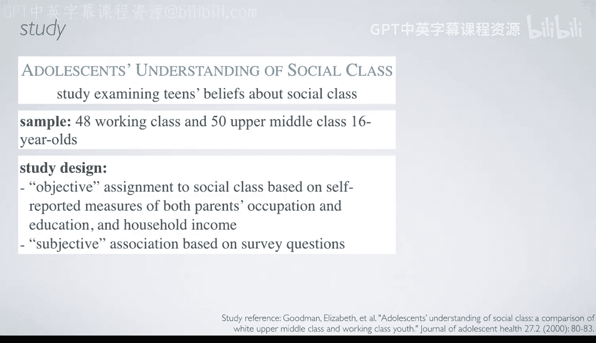
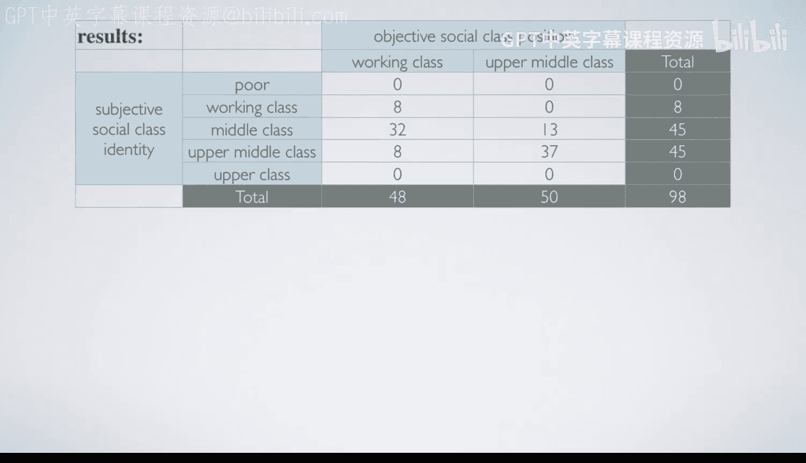
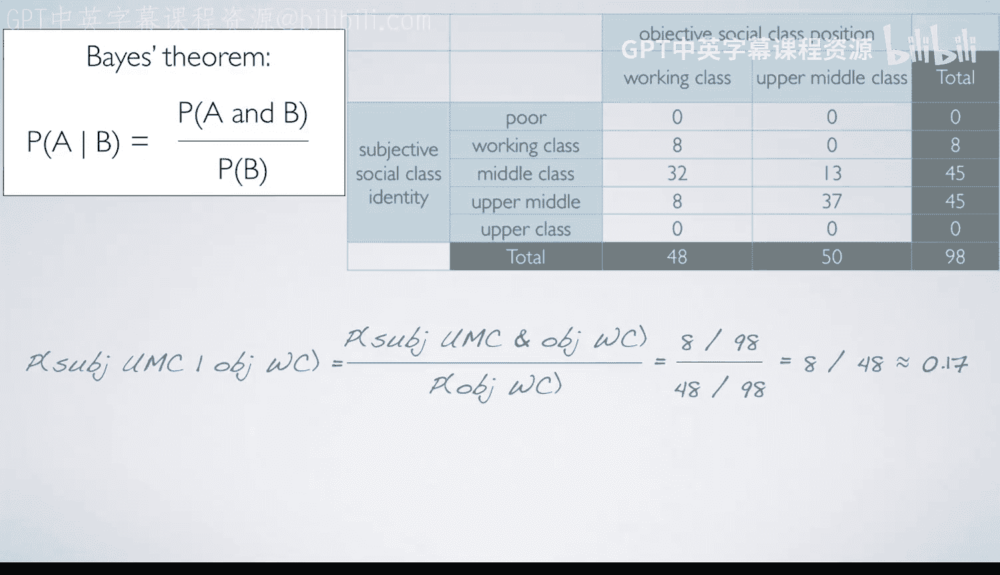
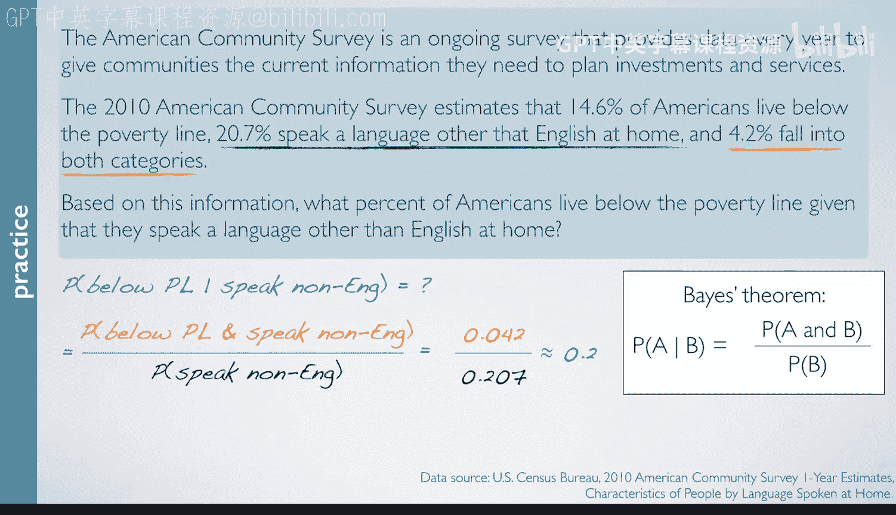
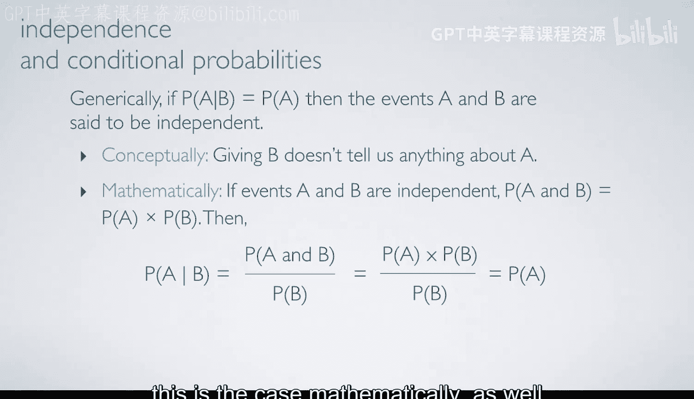
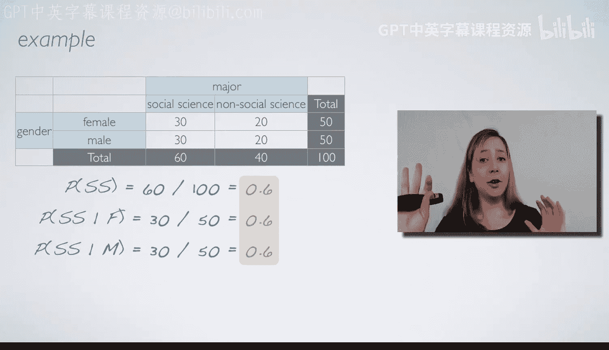
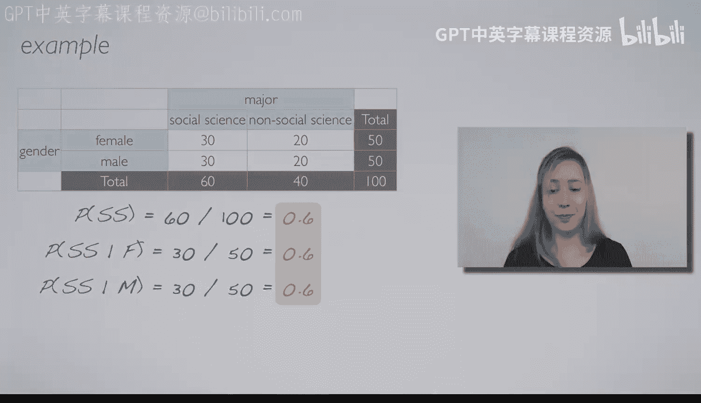

# 杜克大学《R语言数据分析（R语言、概率与数据入门，推断统计，线性回归与建模）｜Data Analysis with R》中英字幕 p20 20_06_02_条件概率.zh_en -BV1Cf421q7mU_p20-

In this video， we will define marginal joint unconditional probabilities。

 introduce base theorem for calculating conditional probabilities and generalize the product rule for calculating joint probabilities。

 regardless of whether the events are dependent or independent。

 remember that previously we've talked about the probability of A and B equals probability of A times probability of B rule and we said that there was a caveat to this rule that the events had to be independent。

 So we'll wrap up the discussion in this video with what do we do when the events are dependent or if we don't know and cannot check whether the events are independent or not。

Let's first introduce the dataset that we'll be working on。

 The study titledAs Understanding of Social Class is a study examining teens beliefs about social class。

 In this study， the sample consists of 48 working class and 50 upper middle class 16 year olds In the study what was done was the students were first categorized into their social class objectively based on their selfrepared measures of parents's occupation。

 education and household income。 and this is the social class that were taking to be the truth。

 Students were also asked a series of questions to determine their own subjective association to a social class。

 So this is the social class that students think they belong to。

Given two categorical variables， objective and subjective social class。

 the study results can be summarized into a contingency table like this one。

Let's start with marginal probabilities。 What is the probability that a student's objective social class position is upper middle class to answer this question。

 we look at the objective upper middle class column and see that there are 50 students who belong in this category out of a total of 98 students and the probability is simply 50 over 98 that's roughly 51%。

We'll denote this probability probability of objective UMC the upper middle class。

 The notation isn't all that important， but it will make it easier to compare to joint un conditionitional probabilities once we define them in the next few slides。

 Note that the term marginal probability comes from the fact that the counts we use to calculate this probability came from the margins of the contingency table。

 Next， what is the probability that a student's objectiveive position and subjective identity are both upper middle class。

 This time， we're looking for students whose objective class upper middle class and subjective class is also upper middle class。

 There are 37 students that meet this criteria。 out of a 98 total。

 So the probability is 37 over 98 or roughly 38%。We'll denote this probability。

 probability of objective upper middle class and subjective upper middle class。

 The important term here is the wordant。The term joint probability comes from the fact that we're considering the students who are at the intersection of the two events of interest。

 So if we were to turn this into a Venn diagram， the 37 would go in the intersection。

 representing students who are both objectively upper middle class and subjectly associate with that identity as well。

 and the eight students who are working class objectively。

 but associates with upper middle class would be in the subject circle and the 13 who are objectively upper middle class but associate with other classes would be in the objective circle outside of the intersection。

Lastly， what is the probability that a student who is objectively in the working class associates with upper middle class This time we're looking for students who is actually working class。

 but associates with upper middle class。 There are 8 students that meet this criteria among all 48 who are working class。

 so the probability is 8 over 48 roughly 17%。We denote this probability。

 probability of subjective upper middle class， given that the objective class is working class。

 the important thing to note here is the vertical given line that separates what we are looking for and what we know to be true about the students。

We call this a conditional probability because we first conditioned on the working class and then calculated the probability based on counts only in this column。

 so we disregarded everything else in the contingency table when finding conditional probabilities from contingency tables like this once you figure out what you're given is you can literally physically cover up the rest of the table because you know that you're not going to need any of that other information。

 we know the type of student we're interested in objectively belongs in the working class so we don't really need to worry about the students that are outside of that column all we care about are the students that are in that column and from within that column we use the counts to calculate the conditional probabilities。

A little more formally， we calculate conditional probabilities using basees theorem。

 which states that probability of a given B is probability of A and B divided by probability of B。

 so that's the joint probability on the numerator divided by what you're conditioning on in the denominator using the same data set。

 And if we go back to the same question we were working with before。

 probability of subjective upper middle class， given objective working class。

 is going to be equal to the joint probability of subjective upper middle class and objective working class divided by probability of objective working class。

 what we're conditioning on。 The numerator is 8 out of 98。

8 students out of 98 total meet both criteria。 and the denominator is 48 out of 98。

48 out of 98 students are working class based on their objective categorization。

 which gets us to the same answer。The 7%。So the formula。

 the base theorem here is a bit of an overkill， we already arrived at this answer earlier by simply reasoning through the table。

 but if we didn't have the counts neatly organized in the table using base theorem to calculate a conditional probability would be much more intuitive。

 so next let's give such an example。

The American Community Survey is an ongoing survey that provides data every year to give communities the current information they need to plan investments and services。

 The 2010 American Community Survey estimates that 14。6% of Americans live below the poverty line，20。

7% speak a language other than English at home， and 4。2% fall into both categories。

 based on this information， what percent of Americans live below the poverty line。

 given that they speak a language other than English at home。

Were asked for the probability of living below the poverty line。

 given that the person speaks a language other than English at home。

Since this is a conditional probability， we will use the base theorem。

 which says that probability of A given B is the joint probability of the two events divided by the marginal probability of the event we're conditioning on in context。

 this is probability of living below the poverty line and speaking a language other than English at home。

 divided by the probability of speaking a language other than English at home。

Now we go back to the description of the survey findings to fish for the information that we need。

First， we're told that 4。2%。Meet meet both of these criteria。

 so we know that our numerator is going to be 0042。And 20。

7% speak a language other than English at home， so the marginal that goes in the denominator is 0。

207。Which gives us a conditional probability result of roughly 0。2。

 meaning that roughly 20% of Americans who speak a language other than English at home also live below the poverty line。

What do we do with this information。 One use of this information would be to compare to the general public。

 Remember， we also know that 14。6% of all Americans live below the poverty line。

 So it seems like living below the poverty line is more prevalent for people who speak a language other than English at home。

 where comparing the 14。6% for the general public to the 20% that we arrived at for the part of the public that speaks a language other than English at home。

This finding suggests that language spoken at home and poverty level may be dependent。Earlier。

 we saw that if two events are independent， their joint probability is simply the product of their probabilities。

If the events are not believed to be independent or we can't check whether they're independent or not。

 the joint probability needs to be calculated slightly differently。😡。

Since base theorem does not have an independence condition。

 we can actually simply rearrange it and calculate the joint probability of A and B as the product of the conditional probability of A given B multiplied by the marginal probability of B。

 so all we've done is taken the base theorem， shoovel things around and come up with a new rule for calculating joint probabilities。

Generically， if probability of a given B equals probability of A。

 then the events A and B are said to be independent。 We can explain this in two ways。 conceptually。

 this rule works because it's saying that B if B tells us nothing about A。

 then A and B are independent， meaning that whether we have the probability with B given or not。

 the probabilities are exactly the same。 That basically tells us that given giving B is worthless or in other words。

 the two events are independent。Mathematically， we know that if events A and B are independent。

 then probability of A and B equals probability of A times probability of B。Then。

We also know from base theorem that probability of a given B is probability of A and B divided by the probability of B。

 Remember for a second， we're going to assume that A and B are independent。

 so the numerator can simply be replaced with probability of A times probability of B。

 the denominator stays the same。 the probability of B's in the numerator and denominator cancel each other and where left with probability of a。

 So we have defined this rule probability of a given B equals probability of a suggests that the events are independent earlier。

 and now that we know base theorem， we can actually prove why this is the case mathematically as well as reasoning through it conceptually。

Consider the following hypothetical distribution of gender and major of students in an introductory class。

 We have 100 students in this class。60 of them are social science majors and 40 of them are not。

 So if I wanted to find the overall probability of social science majors in this class that would be 60 out of 100。

 So the probability that a randomly selected students is a social science major is 0。6。

 Now this condition on the gender， what is the probability that a randomly selected female in this student is a social science major。

 Well， we have 50 females in the class and 30 of them are social science majors。

 So probability of social science given female is going to be 30 out of 50，60% as well。Lastly。

 what about the males，50 males in the class，30 of which are social science majors。 So once again。

 probability of social science given male is 30 out of 50，60% as well。

 So what we're seeing here is that all of these probabilities are exactly the same。

 So this goes back to probability of a given B， if that equals probability of A。

 then we know that the events are independent。 In this case， probability of social science。

 equals probability of social science given female or social science given male。

 So we would determine that the two variables， gender and major are independent of each other。

 given this hypothetical distribution。

