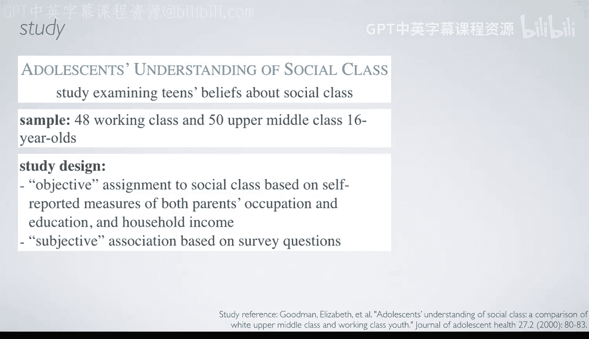
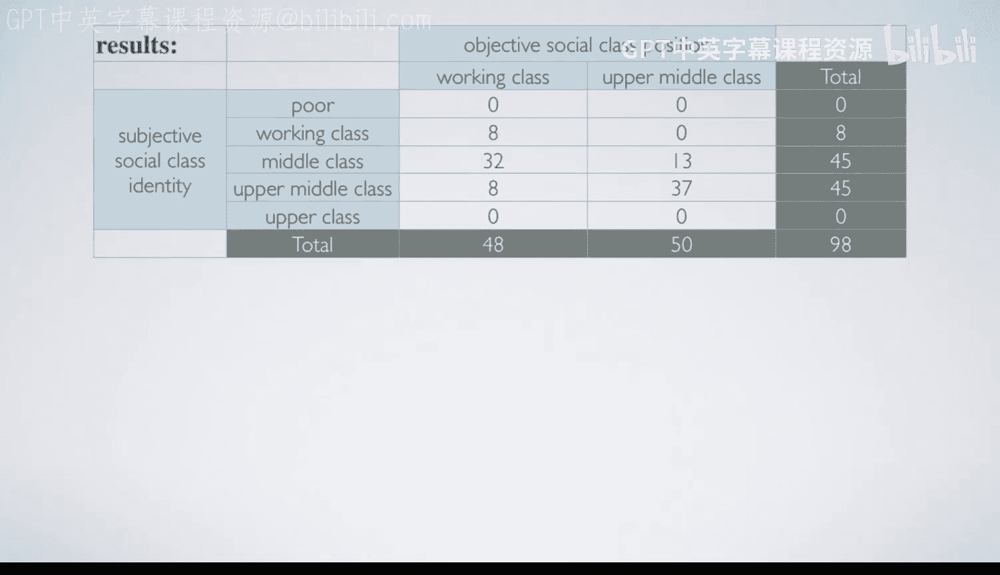
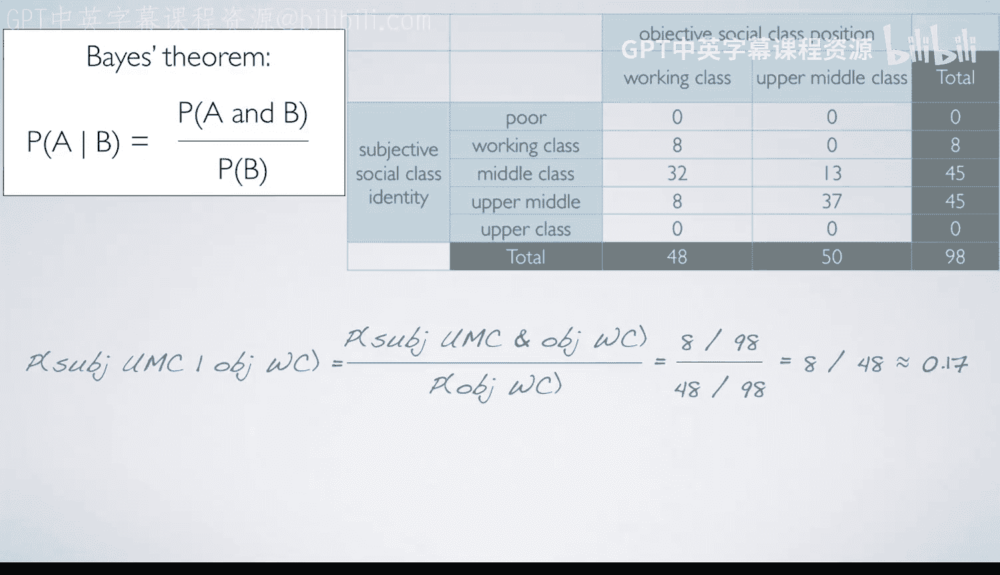
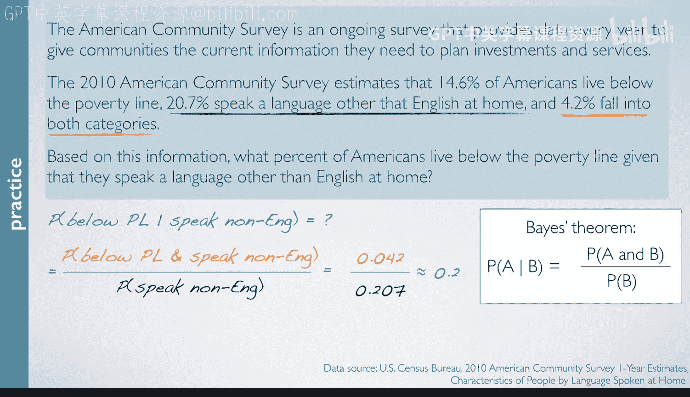
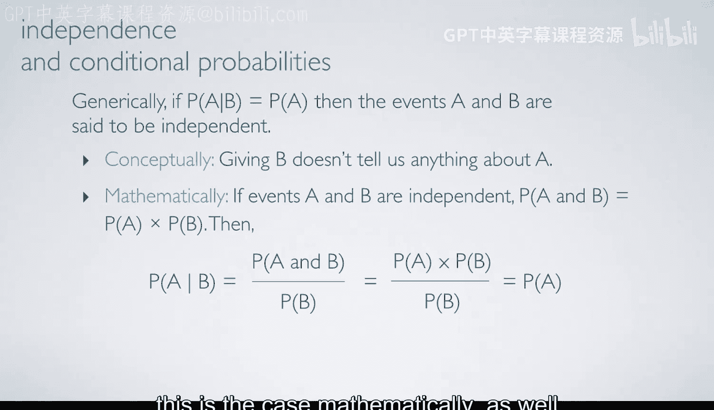
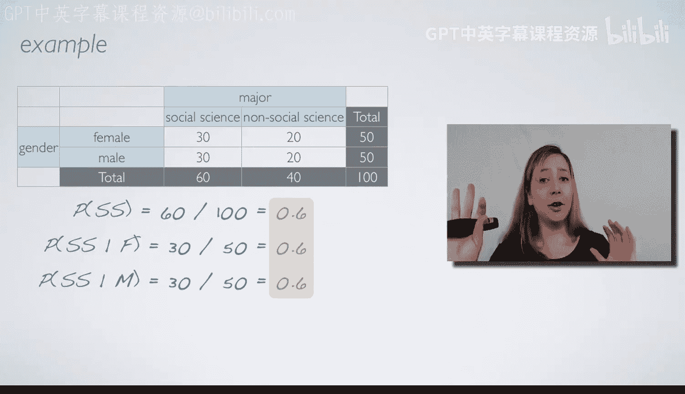
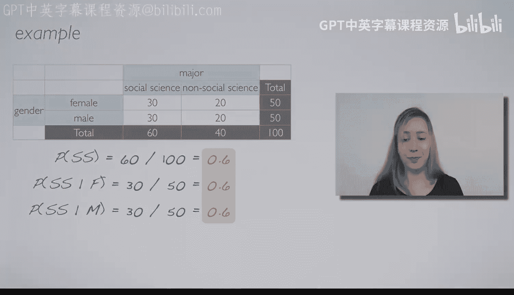

# R语言数据分析：20：条件概率 📊

在本节课中，我们将学习概率论中的几个核心概念：边际概率、联合概率以及条件概率。我们将通过具体的数据集示例来理解这些概念，并学习如何使用贝叶斯定理计算条件概率。最后，我们将探讨事件独立性的概念，并了解当事件不独立时如何计算联合概率。

---

## 边际概率

首先，我们介绍边际概率。边际概率是指单个事件发生的概率，不考虑其他任何事件。其名称来源于列联表的“边缘”合计。

以下是一个关于青少年社会阶层认知研究的列联表。该研究包含48名工薪阶层和50名中上阶层的16岁青少年。

| 客观阶层 \ 主观认同 | 工薪阶层 | 中上阶层 | 其他 | 合计 |
| :--- | :---: | :---: | :---: | :---: |
| 工薪阶层 | 29 | 8 | 11 | 48 |
| 中上阶层 | 13 | 37 | 0 | 50 |
| 合计 | 42 | 45 | 11 | 98 |

**问题**：一个学生的客观社会阶层是中上阶层的概率是多少？

**解答**：我们关注“客观中上阶层”这一列。总共有50名学生属于此类别，而学生总数为98人。因此，概率为 50/98 ≈ 51%。

我们将其记为 **P(客观 = 中上阶层)**。

---

## 联合概率

上一节我们介绍了单个事件的概率，本节我们来看看两个事件同时发生的概率，即联合概率。

**问题**：一个学生的客观阶层和主观认同**都**是中上阶层的概率是多少？

**解答**：我们需要找到同时满足“客观中上阶层”和“主观中上阶层”的学生。从表中可知，有37名学生满足条件。因此，概率为 37/98 ≈ 38%。

我们将其记为 **P(客观 = 中上阶层 且 主观 = 中上阶层)**。联合概率关注的是两个事件交集中的个体。

---

## 条件概率与贝叶斯定理

理解了单个和多个事件的概率后，现在我们来探讨在已知某些信息的情况下，事件发生的概率，即条件概率。

**问题**：已知一个学生的客观阶层是工薪阶层，那么他主观上认同为中上阶层的概率是多少？

**解答**：我们已知该学生客观上是工薪阶层（共48人）。在这些学生中，主观认同为中上阶层的有8人。因此，概率为 8/48 ≈ 17%。

我们将其记为 **P(主观 = 中上阶层 | 客观 = 工薪阶层)**。竖线“|”表示“在...条件下”。

计算条件概率的通用公式是**贝叶斯定理**：

**P(A | B) = P(A 且 B) / P(B)**

---

### 应用示例：美国社区调查

假设我们没有现成的列联表，但知道以下总体数据：
*   14.6% 的美国人生活在贫困线以下（事件 A）。
*   20.7% 的美国人在家说英语以外的语言（事件 B）。
*   4.2% 的美国人同时满足以上两个条件（事件 A 且 B）。

**问题**：在家说非英语的美国人中，生活在贫困线以下的百分比是多少？即求 **P(A | B)**。

**解答**：根据贝叶斯定理：
P(贫困 | 说非英语) = P(贫困 且 说非英语) / P(说非英语) = 0.042 / 0.207 ≈ 0.203

因此，大约 **20.3%** 在家说非英语的美国人生活在贫困线以下。我们可以将此条件概率与总体的14.6%进行比较，发现贫困现象在说非英语的群体中更为普遍，这暗示了两个变量可能是相关的。

---

## 独立事件与广义乘法法则

之前我们学过，如果事件A和B独立，那么它们的联合概率为：**P(A 且 B) = P(A) × P(B)**。

那么，当事件不独立，或者我们无法判断其是否独立时，该如何计算联合概率呢？本节我们将利用贝叶斯定理推导出通用的计算方法。

我们可以对贝叶斯定理进行变形，得到计算联合概率的**广义乘法法则**：

**P(A 且 B) = P(A | B) × P(B)**

这个公式无论事件是否独立都成立。当事件独立时，P(A | B) = P(A)，该公式就简化为我们熟悉的独立事件乘法公式。

---

### 如何判断独立性？

判断两个事件是否独立，一个关键的方法是检查条件概率是否等于边际概率。

**定义**：如果 **P(A | B) = P(A)**，则事件A和B是独立的。

**概念解释**：这意味着知道事件B发生，并没有改变事件A发生的可能性，说明B对A没有提供任何信息，两者独立。

**数学证明**：若A和B独立，则 P(A 且 B) = P(A) × P(B)。代入贝叶斯定理：
P(A | B) = P(A 且 B) / P(B) = [P(A) × P(B)] / P(B) = P(A)

---

### 独立性示例

假设一个班级有100名学生，专业与性别的分布如下：

| 性别 \ 专业 | 社会科学 | 非社会科学 | 合计 |
| :--- | :---: | :---: | :---: |
| 女性 | 30 | 20 | 50 |
| 男性 | 30 | 20 | 50 |
| 合计 | 60 | 40 | 100 |

*   P(社会科学) = 60/100 = 0.6
*   P(社会科学 | 女性) = 30/50 = 0.6
*   P(社会科学 | 男性) = 30/50 = 0.6

由于 P(社会科学 | 女性) = P(社会科学 | 男性) = P(社会科学) = 0.6，因此在该假设分布中，学生的**专业与性别是独立的**。

---

## 总结 📝

本节课中我们一起学习了概率论的核心概念：
1.  **边际概率**：单个事件发生的概率。
2.  **联合概率**：两个事件同时发生的概率。
3.  **条件概率**：在已知一个事件发生的条件下，另一个事件发生的概率，可通过 **贝叶斯定理 P(A|B) = P(A且B)/P(B)** 计算。
4.  **事件独立性**：如果 P(A|B) = P(A)，则事件A和B独立。对于独立事件，联合概率可用简单乘法法则计算；对于非独立事件或情况不明时，应使用**广义乘法法则 P(A且B) = P(A|B) × P(B)** 来计算联合概率。

这些概念是进行更复杂统计推断和数据分析的基础。