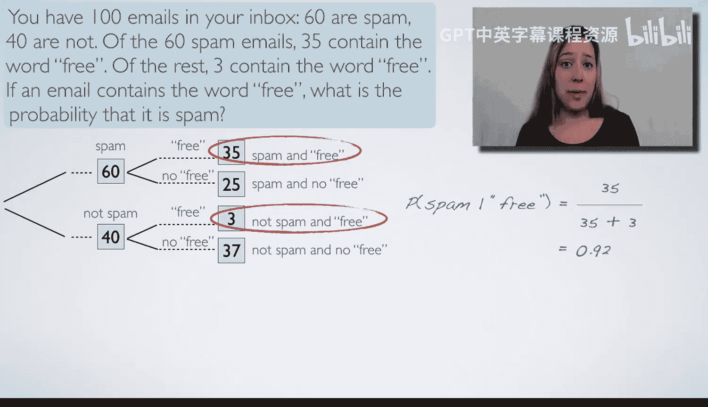
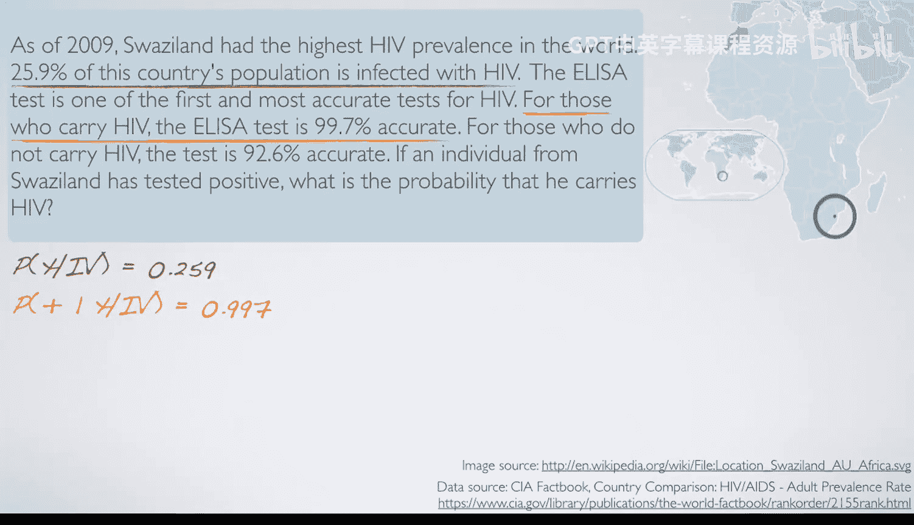
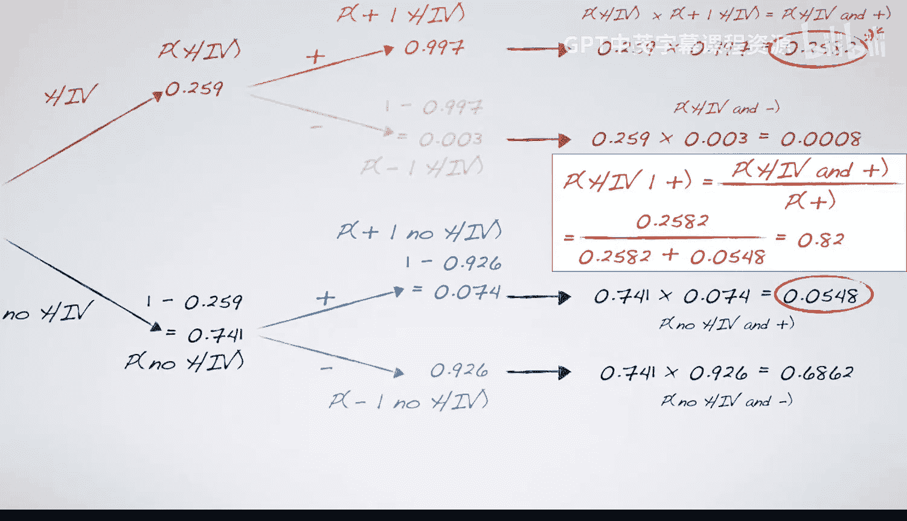
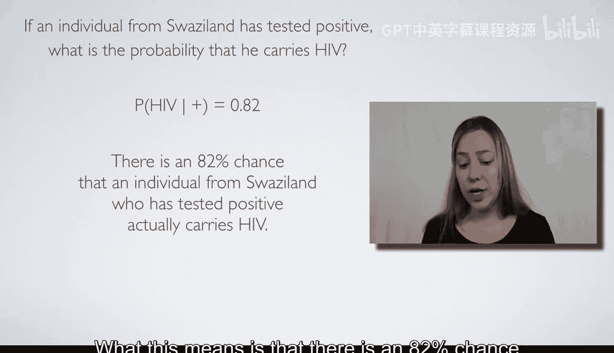
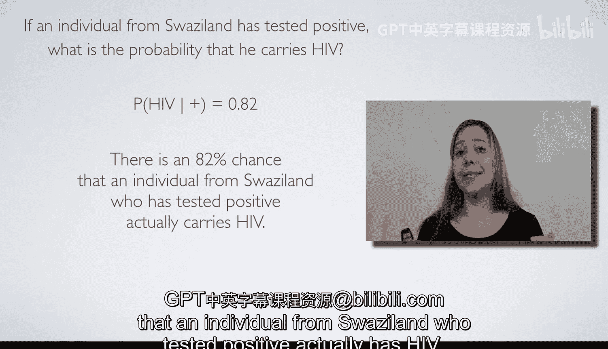

# 杜克大学《R语言数据分析（R语言、概率与数据入门，推断统计，线性回归与建模）｜Data Analysis with R》中英字幕 p21 21_06_03_概率树.zh_en -BV1Cf421q7mU_p21-

In this video， we will learn to use probability trees to solve for conditional probabilities。

 highlighting that they are especially useful when the probability we asked for is the reverse of what were given。

Let's start with a simple example and then we'll work our way to more involved situations。

You have 100 emails in your inbox。60 of them are spam and 40 or not of the 60 spam emails。

35 contain the word free of the rest。 only three contain the word free。

If an email contains the word free， what is the probability that it is spam。

 So what we want to do first is to organize this information into a probability tree。

 We're going to start by dividing our population are inbox in this case is our population into two based on whether the email is spam or not spam So we have 60 emails that are spam and 40 emails that are not spam now that we've done this branching we can actually further branch out from these and list how many of the spam emails have the word free in them and how many of them do not and likewise for the no spam nonsm emails of the 60 spam emails。

35 have the word free in it and and the remainder 25 do not and of the not spam emails。

 only three of them have the word free in it and 37 do not Now that we have organized the information that were given into a probability tree。

 what we want to do next is to go back to the question and try to figure out what it is。

Exactly that we're being asked for。 The question is， if an email contains the word free。

 what is the probability that it is spam。 So we know that the email contains the word free。

 So that's going to be our given and we're asked for the probability that it's spam。

 so we can denote this as probability of spam given that the word free is in the email。

Since we're saying that we know the word free is in the email。

 we're basically saying we can ignore the rest of the email so first what we want to do is figure out how many emails in total。

 how the word free in them， 35 of those come from the spam folder and three of them come from the not spam folder for a total of 38 and of these only 35 of them are of interest to us because those are the spam emails so 35 out of 38 gives us roughly 92%。

Here， we've implicitly made use of the Bays theorem。

 What we have in the numerator is our joint probabilities， spam and free。

 And what we have in the denominator is the marginal probability of what we're conditioning on the free。

 except instead of working with probabilities in this case， to make things simple。

 with've worked with counts。 So what we're going to do next is actually move on to a situation where we're working with probabilities from the get go。

 And we don't know the sample size or the population size that we're dealing with。

Swaziant has the highest HIV prevalence in the world。25。

9% of this country's population is infected with HIV。

 The Eliza test is one of the first and most accurate tests for HIV。 for those who carry HIV。

 the Eliza test is 99。7% accurate for those who do not carry HIV。 The test is 92。6% accurate。 Note。

 by the way， that these probabilities are estimates。

If an individual from Swazilland has tested positive， what is the probability that he carries HIV？

So we're told that 25。9% of these country's population is infected with HIV。

 so the probability of having HIV is 0。259。We also know something about the accuracy of the test which seems to vary depending on whether the person has HIV or not。

 this is very common for medical tests， they tend to have accuracy。

 different accuracy rates for whether the patient has a disease or does not have the disease。

This statement for those who carry HIV， the Eliza test is 99。7% accurate。

 basically means that probability of testing positive because that's what an accurate result would be if a person has HIV。

 so probability of positive given HIV is 0。997。

The statement for those who do not carry HIV， the test is 92。6% accurate。

 means probability of testing negative because that's what accurate would mean in this case。

 given that the patient does not have HIV is 0。926。The question says。

 if an individual from Swazziant has tested positive， what is the probability that he carries HIV。

 so what we know is that the person tested positive。

 we're looking to see what is the probability that they have HIV。

What we can see here is that we have a situation where we're asked for a conditional probability and the condition has been reversed from one of the things that were given。

 And we should really think about a tree diagram。 In this case。

 Those tend to be the most effective method for getting to the answer。

 There are definitely other ways you can solve this problem。

 And you can organize the information that's given to you。

 but a tree diagram tends to be one where you can。Really efficiently and effectively organize the information that you're given and you're going to get to the right answer if you do it the right way。

So。The first branch in the tree is always made up of marginal probabilities since we're dividing up our population without conditioning on any other attributes。

 some people in the population have HIV。 That's the top branch and others don't。

 That's the bottom branch。 So probability of having HIV， as we saw was 0。259 in Swazziland。

 And the probability of not having HIV is the complement of that。 One-。259 is going to give us 0。741。

 So about 74。1% of the population in Swwaziland does not have HIV。

Note that probabilities on a set of branches always add up to one。Next。

 we move on to conditional probabilities。 Let's start with a part of the population who has HIV。

 so we're going to be working with a top branch here。 When these people take the test。

 they may get a positive or a negative result because the test isn't 100% accurate。 Therefore。

 we divide up the HIV population into two。 Those who test positive and those who test negative。

Based on information on the tests that we were provided earlier。

 we know that the probability of testing positive if someone has HIV is 0。997。

Then probability of testing negative， if someone has HIV。

 this would be a false negative will be the complement of that 。003。Similarly。

 among those who don't have HIV， some still test positive and some test negative。

Probability of accurately testing negative if the patient doesn't have HIV is 0。926。

And the probability of a false positive that's testing positive。

 even though the patient does not have HIV is the complement of that 。074。Remember。

 our goal is to find the probability of having HIV given that the patient has tested positive。

 which based on base theorem should be probability of HIV in positive。

 divided by probability of testing positive。 remember the numerator is always the joint probability and the denominator is the marginal probability of what we're conditioning on。

So far， we don't have the building blocks we need to calculate the probability that we're interested in。

To get the joint probabilities like the one in the numerator using the probability tree。

 all we need to do is to multiply across the branches。

 this is why a probability tree is useful because it organizes the information for you in a way where you no longer have to think what should I multiply with what and all you need to do is to carry along the branches and pick up the building blocks along the way。

We start with the marginal probability of having HIV。

 and we multiply it by the probability of testing positive， given that the patient has HIV。

 so I'm following the first the very top branch here。

Which is going to yield us the joint probability of having HIV and testing positive so what we get is 0。

259 from the first branch times 0。997 from the second branch， which gives us 0。2582， so there's a 25。

82% chance that a randomly drawn person from the Swwaillon population has HIV and tests positive。

Similarly， probability of HIV and negative is going to be the probability of HIV 0。

259 times the probability of negative given HIV 0。003， that's a really tiny probability 0。0008。

We can keep going and calculate similar probabilities for the lower branch。

 the no HIV population as well。Probability of no HIV and positive comes out to be 5。48%。

 and probability of no HIV and negative comes out to be 68。62%。

We've done a bunch of calculations so far， but let's go back to the task at hand。

 we're only interested in those who test positive because that's what our given are and among these we're especially interested in those who actually have the HIV。

So the probability of HIV and positive is 0。2582， that's the numerator， the joint probability。

 and the denominator is comprised of two segments of the population who test positive。

So the overall probability of testing positive is the sum of these。

 so a person can test positive because they have HIV or even though they don't have HIV。

 since we're saying or and these are disjoint probabilities to get the overall probability of testing positive。

 we actually add the two probabilities The result comes out to roughly 0。82。

So to recap， we were asked if an individual from Swwaazziland has tested positive。

 what is the probability that he carries HIV and the result we found was probability of HIV given positive is 0。

82。 What this means is that there is an 82% chance that an individual from Swazziland who tested positive actually has HIV。

