# 杜克大学《R语言数据分析（R语言、概率与数据入门，推断统计，线性回归与建模）｜Data Analysis with R》中英字幕 p22 22_06_04_贝叶斯推断.zh_en -BV1Cf421q7mU_p22-

In this video， we will virtually play a game to introduce a Bayesian approach to inference throughoutout the video we will be making use of Bayes theorem。

 properties of conditional probabilities， as well as probability trees。

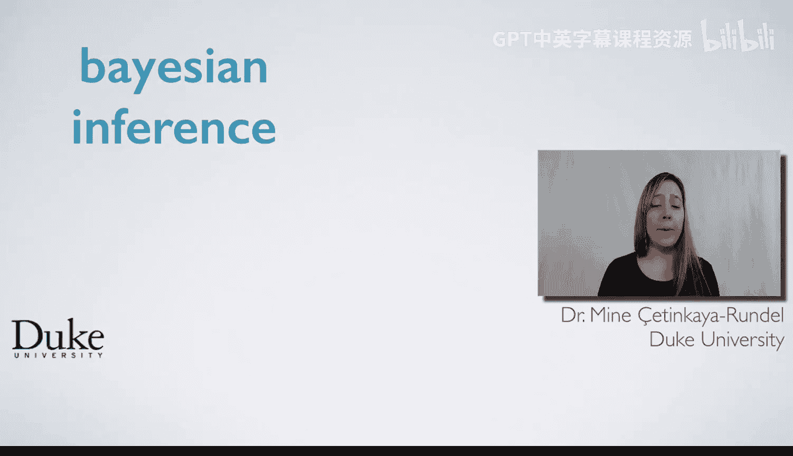

So here's the setup。 I have a die in each hand。 One of them is a six sided die。

 Look something like this， and the other one is a 12 sided die。 Look something like this。

 The ultimate goal of the game is to guess which hand is holding which die。

But this is more than just a guessing game before you make a final decision。

 you will be able to collect data by asking me to roll the die in one hand。

 and I'll tell you whether the outcome of the role is greater than or equal to4。

Before we delve further into the rules of the game。

 let's pause for a moment and think about what it means to roll the number greater than or equal to four with the two types of dice we have。

We're going to ask two questions。 What is the probability of rolling a value greater than or equal to 4 with a six sided die and what is that probability with a 12 sided die with a six sided die。

 The sample space is made up of numbers between 1 and 6。

 We are interested in an outcome greater than or equal to 4。

 The probability of getting such an outcome is then three out of6 or one out of 2 or 50%。

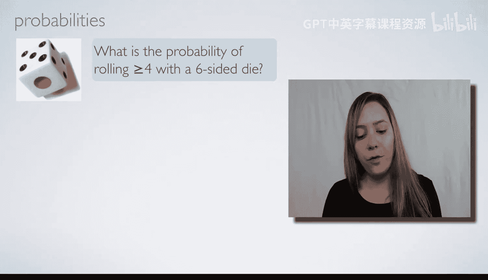

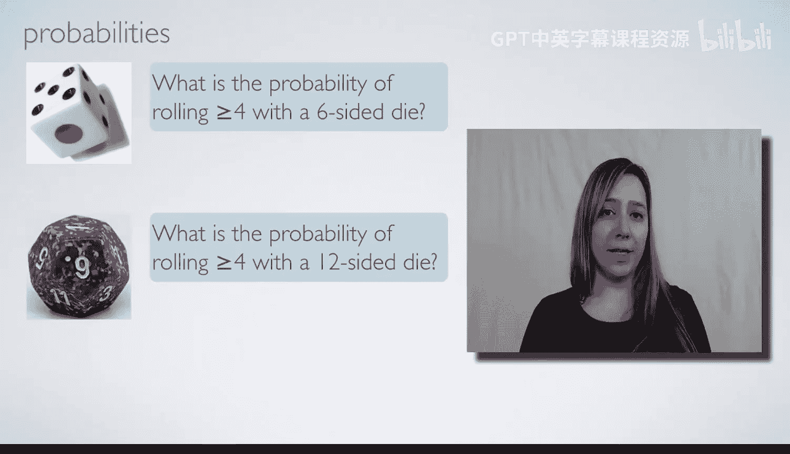

With a 12 side to die， the sample space is bigger， number is between1 and 12。

 and once again we're interested in outcomes4 or greater。

 the probability of getting such an outcome is 9 out of 12 or3/ fourths or 75%。

Say you're playing a game where the goal is to roll a number greater than or equal to4。

 like the one we're playing right now， if you could get your pick。

 which die would you prefer to play this game with the six sided or the 12 sided die？

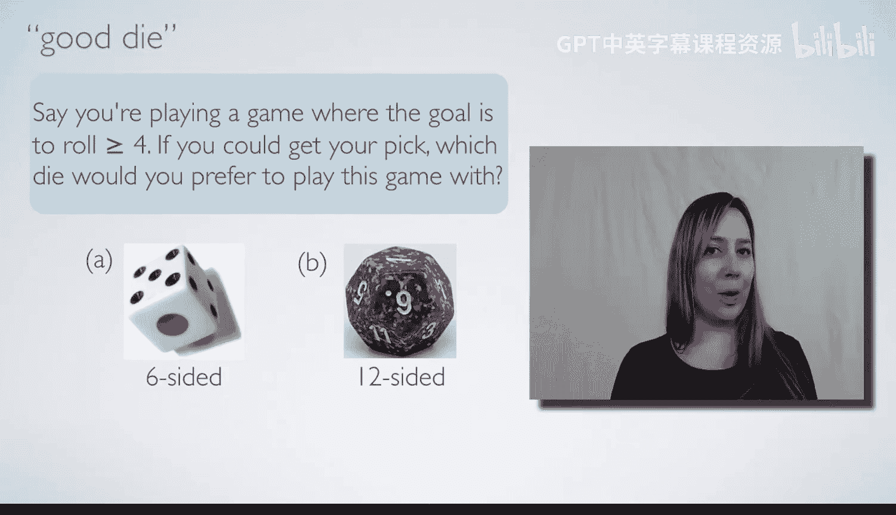

Hopefully， your answer is the 12 sided die。 Remember， we already work through the probabilities here。

 the probability of rolling a number greater than or equal to 4 is much higher。

75% compared to the 50% with the 12 sided die。 So what we're going to call this dye is the good dye。

 This is the ultimate goal you're going to try to figure out which hand is holding the good die。

 or in other words， the 12 sided die。

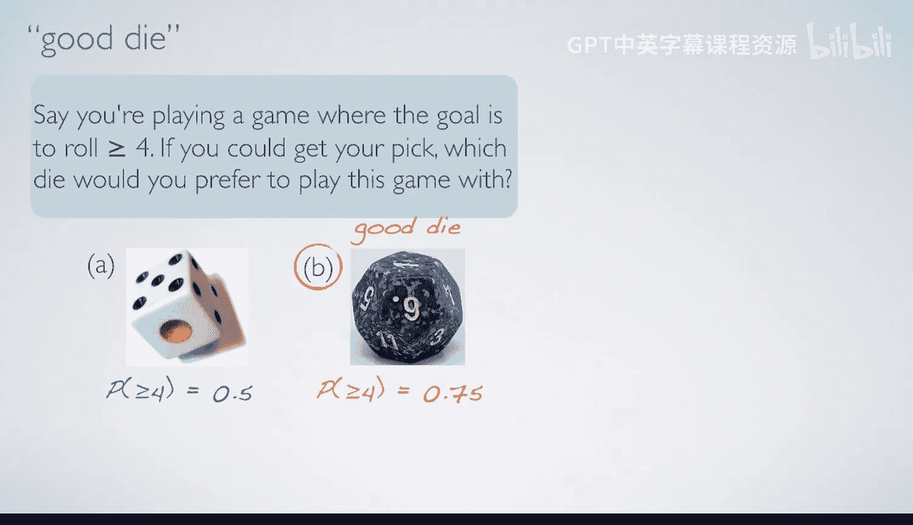

Here are the rules。 Remember， I have two dice，1 excitedd， the other 12 sided。

 I keep one dye in the left hand and the other in the right。

 but I won't tell you which dye I'm holding in which hand You pick a hand left or right， I roll it。

 And I tell you if the outcome is greater than or equal to 4 or not。

 I won't tell you what the outcome actually is， since that could actually give away which dye is in which hand。

 Think about it。 If I tell you that you rolled an 11。

 You know that you had picked the hand holding the 12 sided die since it's impossible to roll an 11 with a excited die。

Then based on that piece of information， you make a decision as to which hand holds the good the 12 sided die。

 You could also choose to try again。 In other words， collect more data。

 you could ask me to roll again。 And I could tell you one more time if the hand you picked resulted in a role that's greater than or equal to4 or not。

 But each round costs you money。 So you don't want to keep trying too many times。

 You want to make a call。 This is obviously just a game。

 And we're kind of making up some rules to make a point。 But if you think about data collection。

 It's always costly。 And while we love large sample sizes。

 it takes a huge amount of resources to obtain such samples。

 So the rules we're imposing aren't haphazardly made up。

 And they reflect some reality about conducting scientific studies。

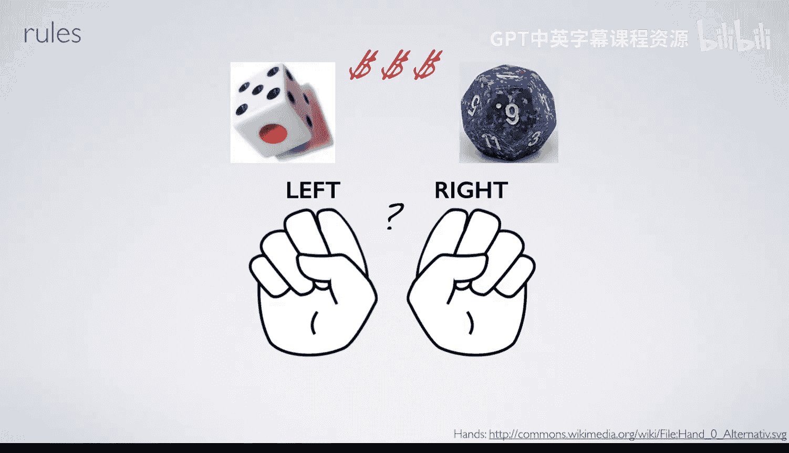

Before we move on to the game， let's first evaluate the possible decisions we might make。

There are two possibilities for the truth。 Either the good die is in the right hand or the good die is in the left hand。

 If you guess that the right hand is holding the good die and the good die is indeed on the right。

 then you win the game。 However， if the good die is on the left， but you picked right。

 you lose the game。Similarly， if you pick left and the good die is on the right， then you lose。

Otherwise， you win。To avoid losing the game， you might want to collect as much data as possible。

 but remember we said that's costly， so at some point before you're entirely sure you'll have to just go ahead and make a guess。

If there are no consequences to losing the game， like in this scenario。

 you might not care much whether you win or lose， but say you had lots of money running on it。

 Then you might be conservative about calling the game too early。

Here we're basically talking about balancing the cost associated with making the wrong decision and losing the game against the certainty that comes with additional data collection。

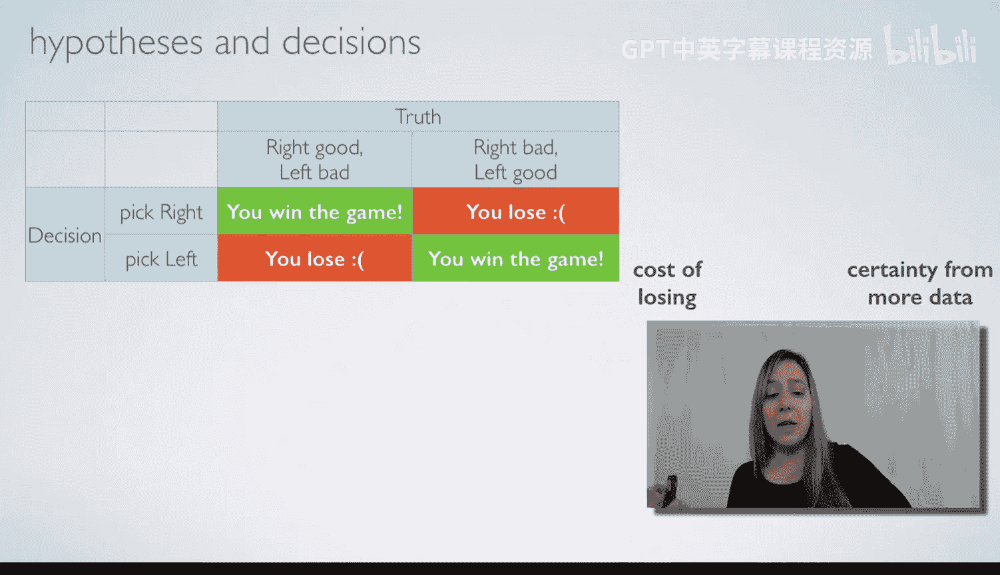

Before we collect any data， you have no idea if I' am holding the good dye。

 the 12 sided dye on the right hand or the left hand。

 then what are the probabilities associated with the following hypothesisses。

 The first hypothesis is that the good dye is on the right。

 and the second hypothesis is that the good dye is on the left。

While this is a somewhat subjective question。The chances are you answered。

50 per cent chance that the good die is on the right and 50 per cent chance that the good die is on the left。

 These are your prior probabilities for the two competing claims， the two competing hypotheses。

 That is， these probabilities represent what you believe before seeing any data。

 You could have conceivably made up these probabilities。 But instead。

 you have chosen to make an educated guess。What would be a situation where you might not pick this answer。

 but pick something else， Say， you know that I tend to favor ver my left。 If you knew this about me。

 then you might put a higher probability of me holding the good die with my left hand。

 But if you don't have any additional information like that about me，50。

50 is going to be your best bet。

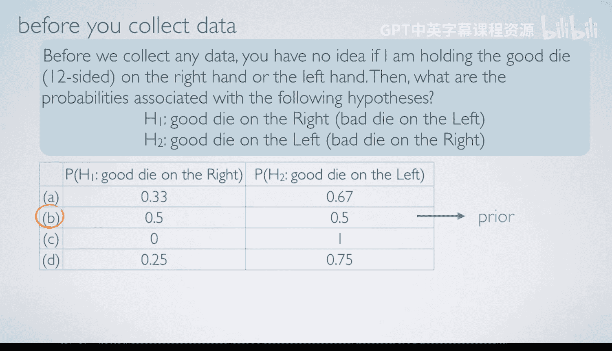

Now that we have sufficient background information on the game we can finally play。

 say you pick the right hand for the first round I roll the die in that hand and va。

 you roll a number greater than or equal to 4。 remember。

 I won't tell you which die is on the right hand and I won't tell you what the outcome is but at least I'm telling you that you rolled a high number。

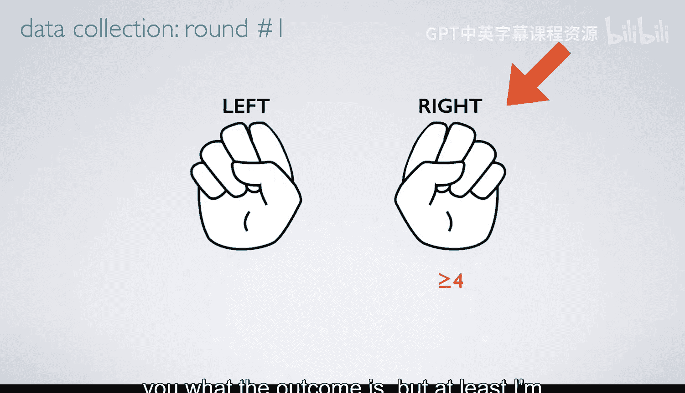

Now we revalate our stance。 You chose the right hand。

 and you got a number greater than or equal to4 as a result of rolling the die on the right hand。

 Having observed this data point， how， if at all， do the probabilitybabilities you assign to the same set of hypotheses changed。

 The first hypothesis was that the good die is on the right。

 And the second was that the good die is on the left。

 The calculation of the specific probability will take a few steps。

 and we're going to get to that in a minute。 But first。

 let's try to think whether the new probability for H1， the first hypothesis should still be 0。5。

 less than 0。5 or more than 0。5。Hopefully， your answer is B。

 the probability of the good dye being on the right should now be slightly more than 0。

5 because we just rolled the die in that hand and got a high valued outcome。

 We know that this is more likely to happen with the 12 sided die。

 so the probability that the right hand is holding the 12 sided die should be a little higher than what we had initially assigned。

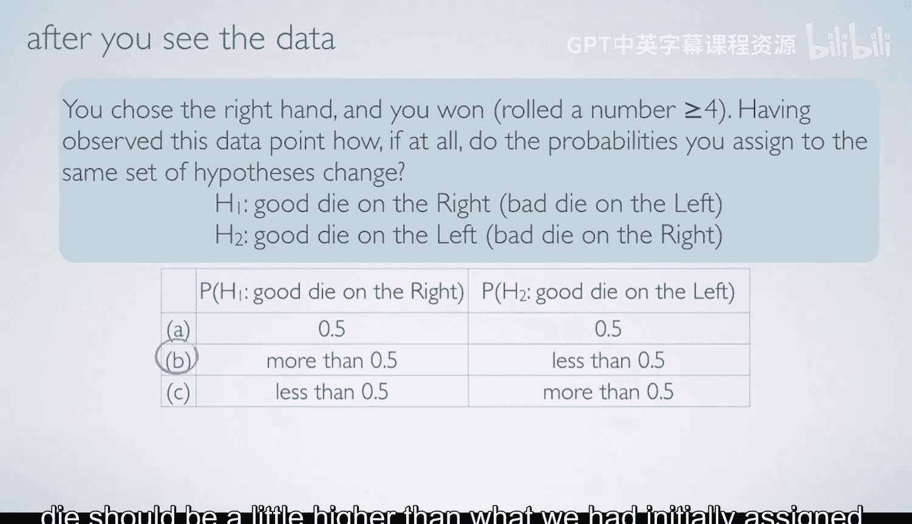

Let's actually calculate that probability。 We started with two hypotheses。

 good dies on the right or the bad dies on the right。

 and we said that initially we're going to give these equal chances of 50% chance of being true before we actually get started with the data collection。

 Remember these were our priors。Then we think about the data collection stage。

 If it is true that the good die is on the right， the probability of rolling a number greater than or equal to 4 is going to be 75%。

 and the complement of that Rolling a number less than 4 is going to be 25%。If on the other hand。

 you're actually holding the bad die on the right and you're picking the right hand。

 the probability of rolling a number greater than or equal to 4 is only 50% and the complement rolling a number less than4 is also 50% usually in probability trees。

 the next step is to calculate the joint probabilities。

 so we multiply across the branches there's a 37。5% chance that the good dyes on the right and you roll the number greater than or equal to 4。

There is a 12。5% chance that the good die is on the right， and your role the number less than four。

There is a 25% chance that the bad die is on the right。

 and you roll the number greater than or equal to 4。

And there's a 25% chance that the bad dye is on the right and your roll a number less than four。

Remember， we did indeed roll a number greater than or equal to4。

 so these are the two outcomes that we're most interested in the very top branch and the third branch。

 good die on the right and roll a number greater than or equal to4 or bad die on the right and roll a number greater than or equal to4。

We had earlier asked you guys to kind of think about now。

 how does the probability change for the hypothesis， The first hypothesis being true。 Well。

 that probability could formally be written as probability that the good die is on the right。

 given your old and number greater than or equal to4， with the die on the right。

If we want to find this probability， it's a conditional probability。 we can make use of base theorem。

 which basically says if you're looking for a given B。

 find the join probability of A and B divided by the marginal probability of B。 So in the numerator。

 we have good die is on the right and your all the number greater than or equal to 4 divided by。

Simply the probability of rolling a number greater than or equal to 4 with a dial on the right hand。

The joint probability is the probability that we're grabbing from the first branch， the 37。5%。

 and the marginal probability of rolling a number greater than or equal to 4 is going to be simply the 0。

375 plus the 025。 You may be rolling in number greater than or equal to 4 with a die on the right hand。

Because it was the good dye or because it was the bad die。

 and because we're saying or for these two disjoint outcomes， we add the two probabilities。

The result comes out to be 60%。Earlier， we had guessed that the probability of the hypothesis being true should increase from 50%。

 and in fact， now with the one data point we have observed， we can indeed see an increase up to 60%。

The probability we just calculated is also called the posterior probability。

 It's the probability that the good die is on the right。

 given that you'll roll a number greater than or equal to4 with the die on the right。

 posterior probability is generally defined as probability of the hypothesis given the data。

 or in other words， it's the probability of a hypothesis we set forth。

 given the data we just observed。 It depends on both the prior probability we set and the observed data。

 This is different than what we calculated at the end of the randomization test on gender discrimination。

 the probability of observed or more extreme data， given than all hypothesis being true。

 In other words， the probability of data， given the hypothesis， which we had called a P value。

 We'll see a lot more of those throughout the rest of the course。

 but this time we making our decision based on what we call the posterior probability as opposed to the P value。

In the Bayesian approach， we evaluate claims iteratively as we collect more data in the next iteration。

 the next role， if we were to play this game one more time and you had asked me to roll a die on either the right or the left hand again。

 and we had done the calculation of the posterior one more time。

 we get to take advantage of what we learned from the data。 In other words。

 we update our prior with our posterior probability from the previous iteration。

So in the next iteration， our updated prior for the first hypothesis being true is going to be the 60%。

 the posterior from the previous iteration， and the complement of that 40% is going to be the probability of the competing hypothesis。

So to recap， the Bayesian approach allows us to take advantage of prior information like a previously published study or a physical model。

 it also allows us to naturally integrate data as you collected and update your priors。

We also get to avoid the counterintuitive definition of a P value。

 the probability of observed or more extreme outcome given the nu hypothesis is true。

 and instead we can based our decisions on the posterior probability。

 the probability that the hypothesis is true given the observed data。A good prior helps。

 but a bad prior hurts。 Remember that when we set our priors， the 50。

50 chance for the two hypotheses being true， we said that we were taking an educated guess。

 So we don't want to just make up our prior probabilities。 But the prior matters less。

 the more data you have。 So if you even if you didn't have a great prior to begin with。

 As you collect more more data。 you're going to be able to converge to the right probabilities。

 In this course， the Bayesian inference examples that we're going to give will be much simpler。

 However， they will provide a solid framework， should you decide to continue your studies with statistics and work with more advanced Bayesian models。

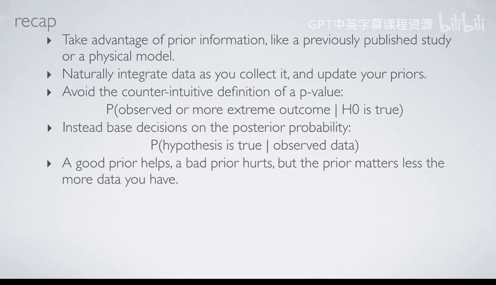