# 数据分析与R语言：22：贝叶斯推断 🎲

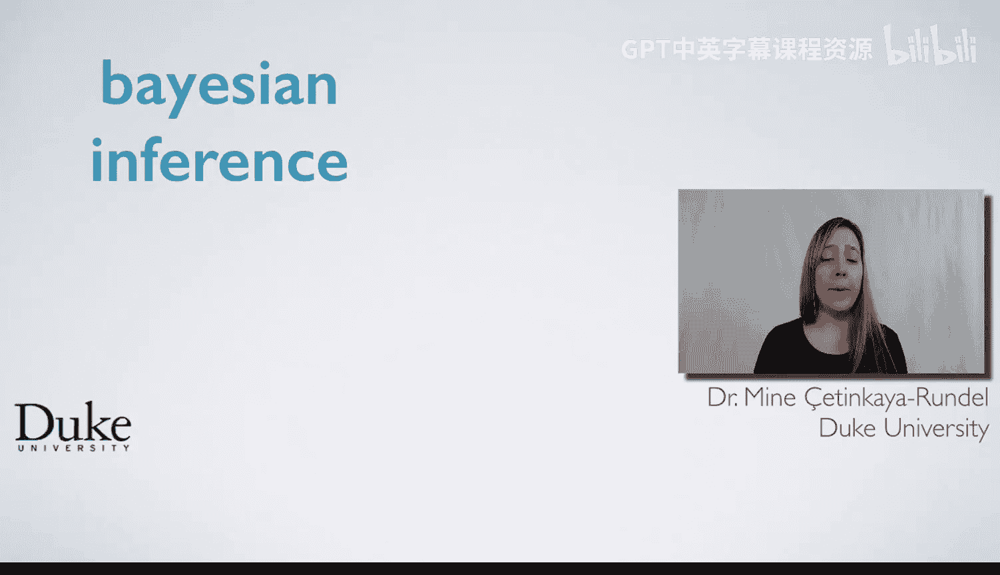

在本节课中，我们将通过一个虚拟游戏来介绍贝叶斯推断方法。我们将学习如何利用贝叶斯定理、条件概率的性质以及概率树，在收集数据的过程中更新我们对不同假设的信念。

---

## 游戏设定

我两只手各拿了一个骰子。一个是六面骰，另一个是十二面骰。游戏的最终目标是猜出哪只手拿的是哪个骰子。

但在你做出最终决定之前，这不仅仅是一个猜谜游戏。你可以通过要求我掷出其中一只手的骰子来收集数据，我会告诉你掷出的结果是否大于或等于4。

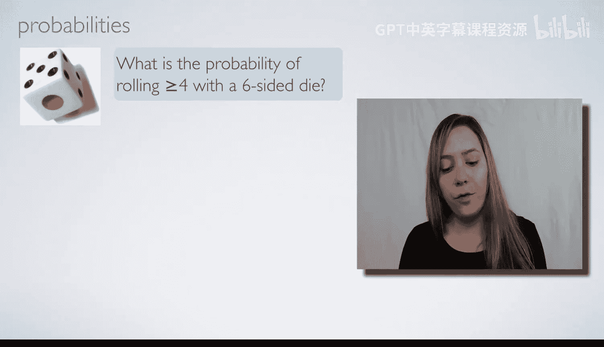

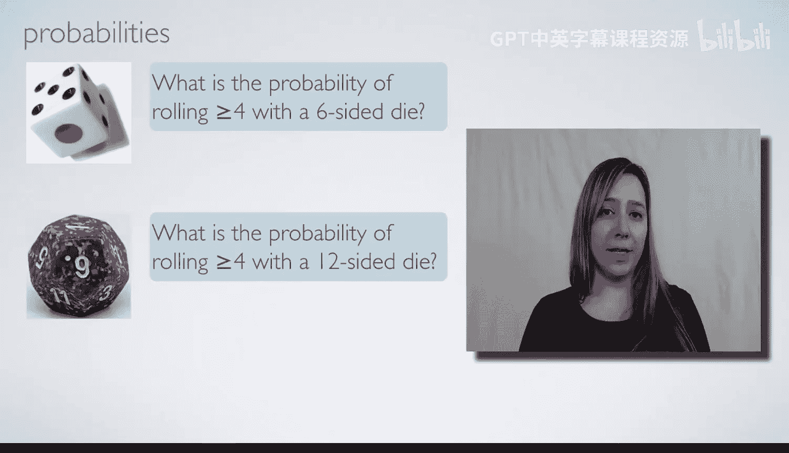

在我们深入探讨游戏规则之前，让我们先思考一下，用我们拥有的两种骰子掷出大于或等于4的数字意味着什么。

我们将提出两个问题：
1.  用六面骰掷出大于或等于4的值的概率是多少？
2.  用十二面骰掷出这个结果的概率是多少？

对于六面骰，样本空间由1到6的数字组成。我们感兴趣的结果是大于或等于4。得到这种结果的概率是 **3/6**，即 **1/2** 或 **50%**。

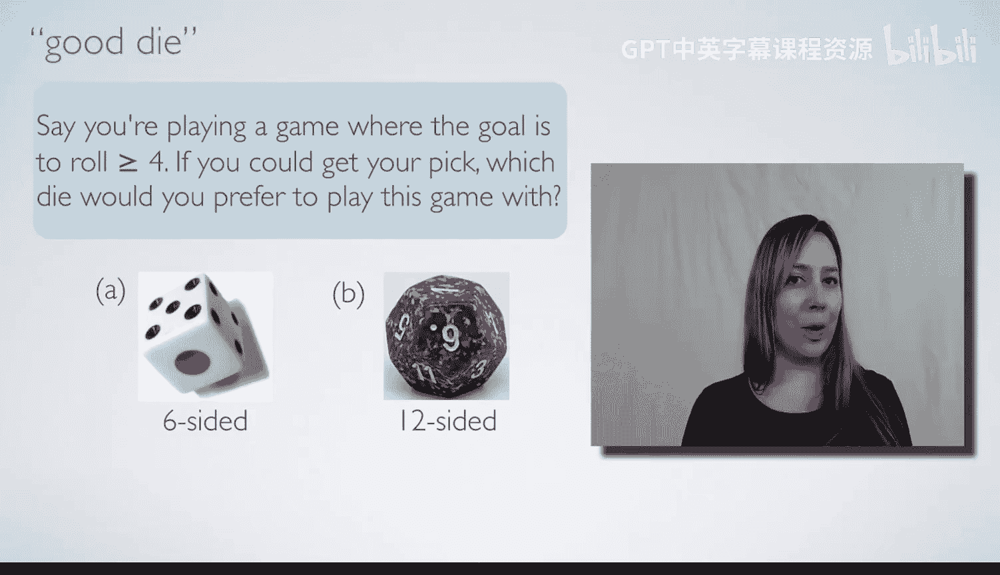

对于十二面骰，样本空间更大，数字在1到12之间。我们再次对大于或等于4的结果感兴趣。得到这种结果的概率是 **9/12**，即 **3/4** 或 **75%**。

假设你正在玩一个目标就是掷出大于等于4的游戏，就像我们现在玩的一样。如果可以让你选，你更愿意用哪个骰子来玩这个游戏，六面骰还是十二面骰？

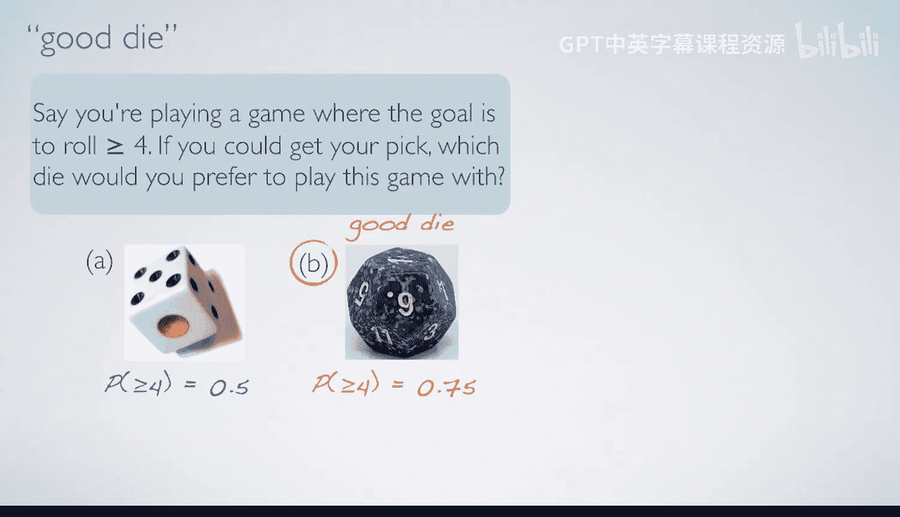

希望你的答案是十二面骰。我们刚刚计算过概率，掷出大于等于4的数字的概率要高得多，是 **75%**，而六面骰只有 **50%**。因此，我们将这个骰子称为“好骰子”。

你的最终目标就是弄清楚哪只手拿着这个好骰子，或者说，十二面骰。

---

## 游戏规则

记住，我有两个骰子，一个六面，一个十二面。我把一个骰子放在左手，另一个放在右手，但我不会告诉你哪个骰子在哪个手里。

你选择一只手（左或右），我掷出那只手里的骰子，然后告诉你结果是否大于或等于4。我不会告诉你实际的结果是什么，因为这实际上可能会泄露哪个骰子在哪个手里。想想看，如果我告诉你掷出了11，你就知道你选的那只手拿的是十二面骰，因为用六面骰不可能掷出11。

然后，基于这条信息，你决定哪只手拿着好骰子（十二面骰）。你也可以选择再试一次，换句话说，收集更多数据。你可以要求我再掷一次，我可以再告诉你一次你选的那只手掷出的结果是否大于或等于4。但每一轮都会花费你的钱，所以你不想尝试太多次，你想做出判断。

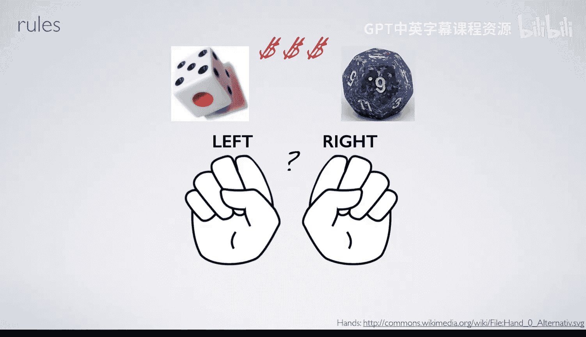

这显然只是一个游戏，我们制定这些规则是为了说明一个观点。但如果你考虑数据收集，它总是有成本的。虽然我们喜欢大样本量，但获取这样的样本需要大量资源。因此，我们制定的规则并非随意编造，它们反映了进行科学研究的一些现实情况。

---

## 可能的决策

在我们继续游戏之前，让我们先评估一下我们可能做出的决定。

关于真相有两种可能性：要么好骰子在右手，要么好骰子在左手。

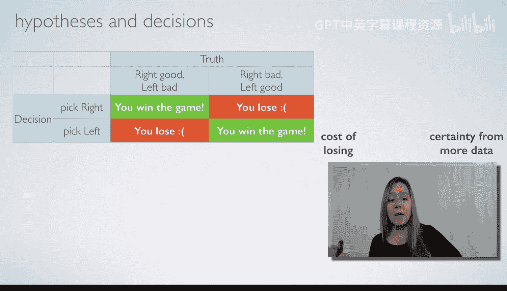

*   如果你猜右手拿着好骰子，而好骰子确实在右手，那么你赢了游戏。
*   然而，如果好骰子在左手，但你猜了右手，你就输了游戏。
*   同样，如果你猜左手而好骰子在右手，那么你输了。
*   否则，你就赢了。

为了避免输掉游戏，你可能希望收集尽可能多的数据，但请记住，我们说这是有成本的。所以在某个时刻，在你完全确定之前，你将不得不做出猜测。

如果输掉游戏没有后果，就像在这个场景中，你可能不太在意输赢。但假设你押上了很多钱，那么你可能会对过早下结论持保守态度。

这里我们基本上是在讨论平衡做出错误决定和输掉游戏的代价，与通过额外数据收集带来的确定性之间的关系。

---

## 先验概率

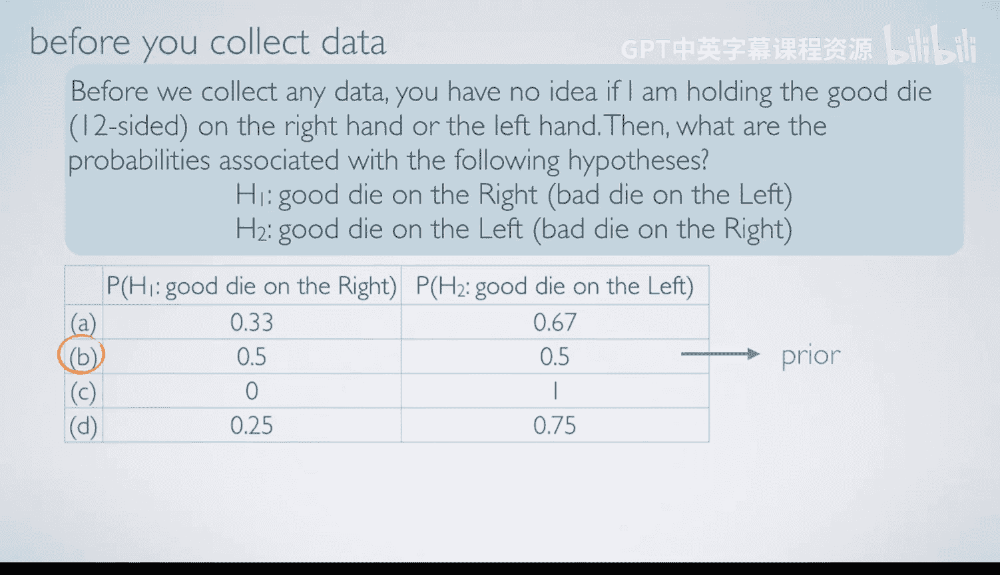

在收集任何数据之前，你不知道我是把好骰子（十二面骰）拿在右手还是左手。那么，以下假设相关的概率是多少？

1.  第一个假设（H1）：好骰子在右手。
2.  第二个假设（H2）：好骰子在左手。

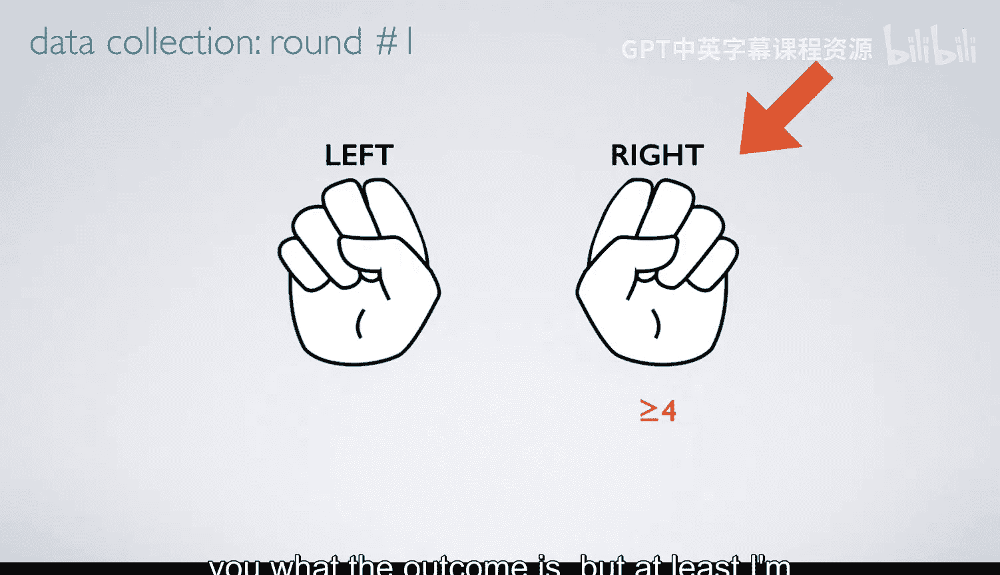

虽然这是一个有点主观的问题。很可能你的答案是：好骰子在右手的概率是 **50%**，在左手的概率是 **50%**。这些是你对两个相互竞争的主张（假设）的**先验概率**。也就是说，这些概率代表了你在看到任何数据之前的信念。

你本可以凭空编造这些概率，但你选择做出一个有根据的猜测。在什么情况下你可能不会选择这个答案，而是选择别的？比如说，你知道我通常偏爱我的左手。如果你知道这一点，那么你可能会给我左手拿着好骰子赋予更高的概率。但如果你没有关于我的任何额外信息，**50/50** 将是你最好的选择。

---

## 开始游戏并收集数据

现在我们有了足够的游戏背景信息，终于可以开始玩了。

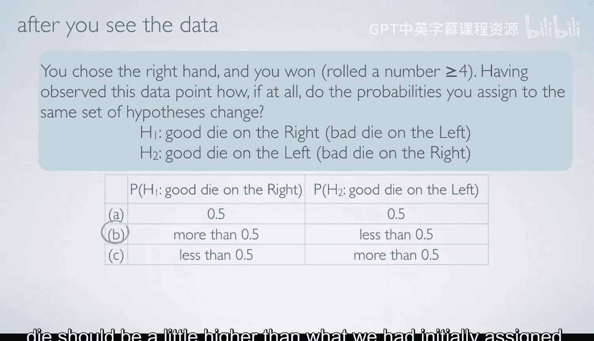

假设你在第一轮选择了右手。我掷出那只手里的骰子，哇，你掷出了一个大于或等于4的数字。记住，我不会告诉你右手拿的是哪个骰子，也不会告诉你结果是什么，但至少我告诉你掷出了一个高数字。

---

## 更新信念：后验概率

现在我们重新评估我们的立场。你选择了右手，并且掷骰子的结果是大于或等于4。观察到这个数据点后，你分配给同一组假设的概率（如果会变的话）如何变化？

第一个假设（H1）是好骰子在右手。第二个假设（H2）是好骰子在左手。

具体概率的计算需要几个步骤，我们马上就会讲到。但首先，让我们试着思考一下，对于H1这个假设，新的概率应该仍然是0.5，小于0.5，还是大于0.5？

希望你的答案是**大于0.5**。因为我们在那只手掷了骰子并得到了一个高值结果。我们知道这更可能发生在十二面骰上，所以右手拿着十二面骰的概率应该比我们最初设定的要高一点。

让我们实际计算一下这个概率。

我们一开始有两个假设：好骰子在右手，或者坏骰子在右手。我们说在开始数据收集之前，我们给它们相等的真实机会，即 **50%**。记住，这些是我们的**先验概率**。

然后我们考虑数据收集阶段：
*   如果好骰子在右手是真的，那么掷出大于等于4的数字的概率是 **75%**，其补集（掷出小于4的数字）是 **25%**。
*   另一方面，如果你实际上右手拿的是坏骰子，那么掷出大于等于4的概率只有 **50%**，其补集（掷出小于4）也是 **50%**。

通常在概率树中，下一步是计算联合概率，所以我们沿着分支相乘：
*   有 **37.5%** 的概率好骰子在右手**并且**你掷出大于等于4的数字。
*   有 **12.5%** 的概率好骰子在右手**并且**你掷出小于4的数字。
*   有 **25%** 的概率坏骰子在右手**并且**你掷出大于等于4的数字。
*   有 **25%** 的概率坏骰子在右手**并且**你掷出小于4的数字。

记住，我们确实掷出了一个大于等于4的数字，所以我们最感兴趣的是最上面的分支和第三个分支：好骰子在右手且掷出大于等于4，或者坏骰子在右手且掷出大于等于4。

我们之前请你们思考，现在假设H1为真的概率如何变化？这个概率可以正式地写为：**P(好骰子在右手 | 用右手骰子掷出≥4)**。

如果我们想找到这个概率，它是一个条件概率，我们可以利用**贝叶斯定理**。贝叶斯定理基本上是说，如果你要找 P(A|B)，那就用 A 和 B 的联合概率除以 B 的边际概率。

所以，在分子中，我们有“好骰子在右手**并且**掷出≥4”的概率。在分母中，是“用右手骰子掷出≥4”的简单概率。

联合概率是我们从第一个分支得到的 **37.5%**。掷出大于等于4的边际概率就是 **0.375 + 0.25**。你掷出大于等于4可能是因为右手是好骰子，也可能是因为是坏骰子。因为我们对这两个互斥的结果说“或”，所以我们把两个概率相加。

结果算出来是 **60%**。之前我们猜测假设为真的概率应该从50%增加，事实上，现在有了一个观察到的数据点，我们确实看到了增加到 **60%**。

我们刚刚计算的这个概率也被称为**后验概率**。它是在给定你用右手骰子掷出大于等于4的条件下，好骰子在右手的概率。后验概率通常定义为 **P(假设 | 数据)**，换句话说，它是给定我们刚刚观察到的数据，我们提出的假设为真的概率。它既取决于我们设定的先验概率，也取决于观察到的数据。

这与我们在性别歧视随机化检验结束时计算的不同，那里计算的是在零假设为真的条件下，观察到或更极端数据的概率，即 **P(数据 | 假设)**，我们称之为 **P值**。在本课程后面的部分我们会看到更多P值，但这次我们基于所谓的**后验概率**来做决定，而不是P值。

---

## 贝叶斯方法的迭代更新

在贝叶斯方法中，我们随着收集更多数据而迭代地评估主张。在下一次迭代（下一次掷骰子）中，如果我们再玩一次这个游戏，你要求我再次掷出右手或左手的骰子，并且我们再次进行后验计算，我们就可以利用从数据中学到的东西。换句话说，我们用上一次迭代的后验概率来更新我们的先验。

所以在下一次迭代中，我们对于第一个假设（H1）为真的更新后的先验将是 **60%**（即上一次迭代的后验），而其补集 **40%** 将是竞争假设的概率。

---

## 总结

本节课中我们一起学习了贝叶斯推断的基本思想。让我们来总结一下关键点：

*   **贝叶斯方法**允许我们利用先验信息（如先前发表的研究或物理模型）。
*   它允许我们在收集数据时自然地整合数据并更新你的先验信念。
*   我们可以避免P值那种反直觉的定义（在零假设为真的条件下，观察到或更极端结果的概率），而是可以根据**后验概率**（在给定观察数据的条件下，假设为真的概率）来做决定。
*   一个好的先验有帮助，但一个坏的先验有损害。记住，当我们设定先验（两个假设为真的概率各50%）时，我们说我们是在做有根据的猜测。所以我们不想凭空编造先验概率。
*   然而，你拥有的数据越多，先验的影响就越小。所以，即使你一开始没有一个很好的先验，随着你收集越来越多的数据，你也能够收敛到正确的概率。

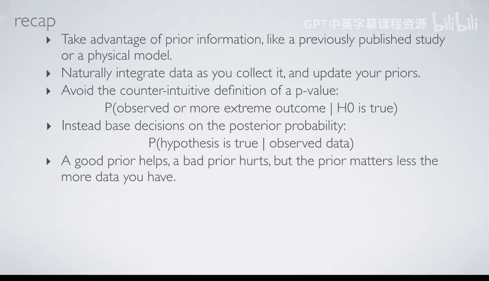

在本课程中，我们将给出的贝叶斯推断例子会简单得多。然而，它们将提供一个坚实的框架，如果你决定继续学习统计学并使用更高级的贝叶斯模型的话。