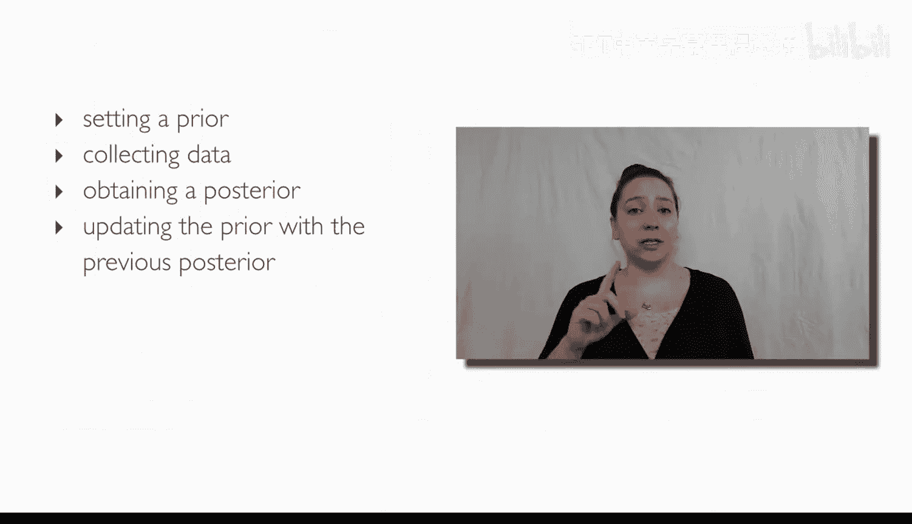

# R语言数据分析：23：贝叶斯推断示例 🧮

在本节课中，我们将通过一个乳腺癌筛查的真实案例，学习贝叶斯推断的核心思想与应用。我们将看到如何利用先验概率、新收集的数据（检测结果）来更新我们对事件的信念，从而得到后验概率。

## 概述

贝叶斯推断是一种基于贝叶斯定理的统计方法，它允许我们在获得新证据后，更新对某个假设的概率估计。本节将通过一个具体的医学诊断例子，演示如何从初始的先验概率出发，结合检测结果，一步步计算出后验概率。

## 解析已知概率

首先，我们需要理解题目中给出的几个关键概率估计值。

*   根据美国癌症协会的估计，女性患乳腺癌的概率约为 **1.7%**。
*   根据Susan G. Komen基金会的数据，对于确实患有乳腺癌的女性，乳腺X光检查（钼靶）能正确识别的概率约为 **78%**。这被称为**敏感性**。
*   一篇2003年的文章指出，高达 **10%** 的钼靶检查结果是假阳性。这意味着，即使没有患癌，也有10%的概率检测结果呈阳性。

这些概率都是估计值，但在此示例中，我们将它们作为已知条件。用符号表示如下：

*   **P(癌症) = 0.017**
*   **P(阳性 | 癌症) = 0.78**
*   **P(阳性 | 无癌症) = 0.10**

## 计算先验概率

在患者未进行任何检测、医生不了解其任何信息之前，医生应如何估计该女性患者患乳腺癌的概率？

由于我们对该患者的病史一无所知，最合理的做法是将其视为从总体中随机抽取的一个人。因此，我们会将这个概率设定为 **0.017**。这就是我们在收集数据（即进行检测）之前，为患者患癌所分配的**先验概率**。

## 首次检测：阳性结果的后验概率

当患者接受乳腺癌筛查时，存在两种相互竞争的可能性：患者有癌症，或患者没有癌症。

**问题**：如果一次钼靶检查结果为阳性，那么患者实际患有癌症的概率是多少？

用概率符号表示，我们被要求计算 **P(癌症 | 阳性)**。而我们之前得到的是相反的条件概率 **P(阳性 | 癌症)**。当条件相反时，概率树有助于我们的计算。

以下是构建概率树的步骤：

1.  **第一层分支（假设）**：患者有癌症，或没有癌症。
    *   P(癌症) = 0.017
    *   P(无癌症) = 1 - 0.017 = 0.983

2.  **第二层分支（检测结果，基于假设）**：
    *   **如果患者有癌症**：
        *   P(阳性 | 癌症) = 0.78
        *   P(阴性 | 癌症) = 1 - 0.78 = 0.22
    *   **如果患者无癌症**：
        *   P(阳性 | 无癌症) = 0.10
        *   P(阴性 | 无癌症) = 1 - 0.10 = 0.90

已知患者检测结果为阳性，因此我们只关注图中标为“阳性”的两个分支。

接下来，我们计算联合概率：
*   P(癌症 且 阳性) = P(癌症) × P(阳性 | 癌症) = 0.017 × 0.78 = **0.01326**
*   P(无癌症 且 阳性) = P(无癌症) × P(阳性 | 无癌症) = 0.983 × 0.10 = **0.0983**

现在，我们使用贝叶斯定理计算后验概率：
**P(癌症 | 阳性) = P(癌症 且 阳性) / P(阳性)**

其中，分母 **P(阳性)** 是检测结果为阳性的总概率，即两个“阳性”分支的联合概率之和（因为它们是互斥事件）：
P(阳性) = P(癌症 且 阳性) + P(无癌症 且 阳性) = 0.01326 + 0.0983 = 0.11156

因此：
**P(癌症 | 阳性) = 0.01326 / 0.11156 ≈ 0.119 或 12%**

这个 **12%** 就是我们求得的**后验概率**。最初，由于对患者一无所知，我们赋予其患癌的概率是1.7%。在收集了“检测结果为阳性”这一新数据后，我们更新了对该患者的认识，现在认为其患癌的概率约为12%。

## 第二次检测：再次阳性的后验概率

由于一次阳性结果并不一定意味着真正患癌，医生可能会决定让患者重新检测。

**问题**：如果第二次钼靶检查结果也为阳性，那么患者患癌的概率是多少？

我们再次使用概率树进行分析。但关键的变化在于：这位患者不再是来自总体的一个“陌生人”。我们已经对她进行过一次检测，并且结果为阳性。因此，我们拥有关于她的额外信息，应该用这个信息来更新我们的先验概率。

换句话说，我们将**上一次迭代的后验概率（12%）作为本次计算的新先验概率**。

1.  **更新后的第一层分支（新先验）**：
    *   P(癌症) = 0.12 （来自第一次检测的后验概率）
    *   P(无癌症) = 1 - 0.12 = 0.88

2.  **第二层分支（检测性能不变）**：
    *   检测的准确性没有改变，因此条件概率与之前相同：
        *   P(阳性 | 癌症) = 0.78
        *   P(阴性 | 癌症) = 0.22
        *   P(阳性 | 无癌症) = 0.10
        *   P(阴性 | 无癌症) = 0.90

同样，我们只关注“第二次检测为阳性”的分支。

计算新的联合概率：
*   P(癌症 且 阳性) = 0.12 × 0.78 = **0.0936**
*   P(无癌症 且 阳性) = 0.88 × 0.10 = **0.088**

计算第二次检测后的后验概率：
P(阳性) = 0.0936 + 0.088 = 0.1816
**P(癌症 | 两次阳性) = 0.0936 / 0.1816 ≈ 0.515 或 51.5%**

在连续两次检测结果均为阳性后，我们评估该患者实际患癌的概率上升到了约 **51.5%**。

## 总结

在本节课中，我们一起学习了贝叶斯推断的一个完整示例。我们回顾了贝叶斯统计推断的基本流程：**设定先验概率 -> 收集数据 -> 计算后验概率 -> 将后验概率作为新的先验进行更新**。此外，我们还练习了条件概率、概率树以及贝叶斯定理的应用。这个例子清晰地展示了数据如何影响和更新我们对不确定事件的信念。

*（示意图：贝叶斯更新过程）*

*（示意图：概率树分析）*