# 杜克大学《R语言数据分析（R语言、概率与数据入门，推断统计，线性回归与建模）｜Data Analysis with R》中英字幕 p24 24_08_02_正态分布.zh_en -BV1Cf421q7mU_p24-

In this video we will introduce you to the normal distribution and discuss some of its properties such as the 68-9599。

7% rule， this motion is going to make sense in a little bit when you see what we're talking about。

 and we're also going to introduce standardized scores commonly known as Z scores。

 and we're going to give examples of working with these Z scores to find probabilities and percentiles under the normal distribution curve。

Many variables in nature are nearly normally distributed。 A commonly used example is heights。

 We're going to take a look at a distribution of reported heights of members of an online dating website。

 O， Cupid。 since members of this website are US residents and likely represent a random sample from the US population。

 we would expect their heights to follow the same height distribution of all Americans。 However。

 a closer look shows that that's not exactly the case。 In this plot。

 the light purple curve shows the distribution of heights of US males。

The dotted line represents the distribution of heights reported by males an O Cupid。

 and the dark purple solid line is the implied distribution of heights of these men。

 So the men on you O Cupid。 We can see that heights reported by men on O Cupid very nearly follow the expected normal distribution。

 except the whole thing is shifted to the right of where it should be。

 It appears that males and O Cupid add， on average a couple inches to their heights。Additionally。

 starting at about 5，8， the top of the dotted curve tilts even further rightward。

 indicating that guys as they get closer to the 6 feet round up a bit more than usual。

 which the O Cupupid blog interprets as stretching for that coveted psychological benchmark of being 6 feet tall。

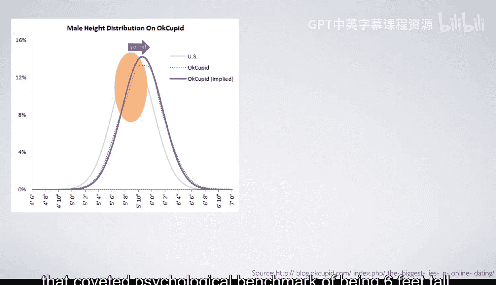

We see a similar height exaggeration with females as well。

 though without the lurch towards a benchmark height。

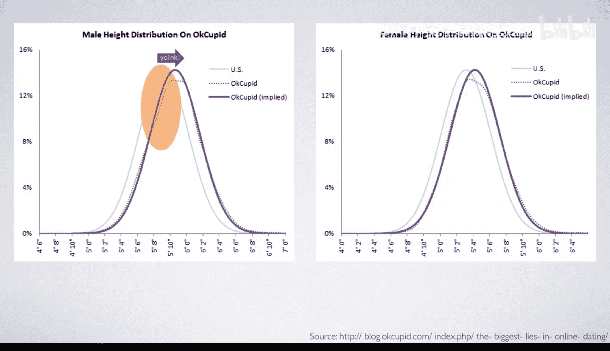

As we just saw， the normal distribution is unimmodal and symmetric。

 You may have also heard of it being referred to as the bell curve due to the distribution resembling a bell shape。

 However， it's not just any symmetric unimmodal curve。

 It follows very strict guidelines about howvariably the data are distributed around the mean。

 While many variables are nearly normal， None are exactly normal due to these strict guidelines。

The normal distribution has two parameters， mean that we usually denote as mu and the standard deviation that we usually denote as sigma。

Here we see two normal distributions， one centered at 0 with a standard deviation of 1 and the other centered at 19 with a standard deviation of 3。

 so these are a good representation of how changing the center and the spread of the distribution actually changes the overall shape of the distribution as well。

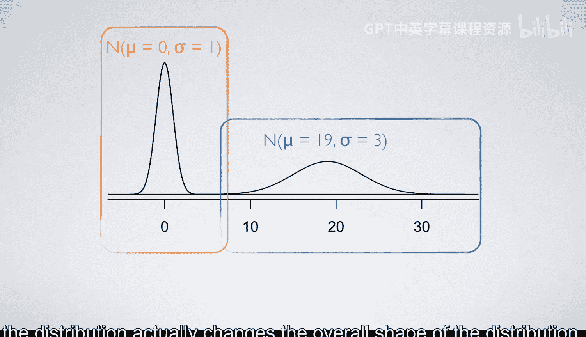

So what are these strict rules that govern the variability of normally distributed data around the mean of the distribution Well。

 for nearly normally distributed data，68% falls within one standard deviation of the mean。

 95% falls within two standard deviations of the mean， and 99。

7% falls within three standard deviations of the mean。

 It's possible for observations to fall 4 or5 or even more standard deviations away from the mean。

 but these occurrences are very rare if the data are nearly normal。

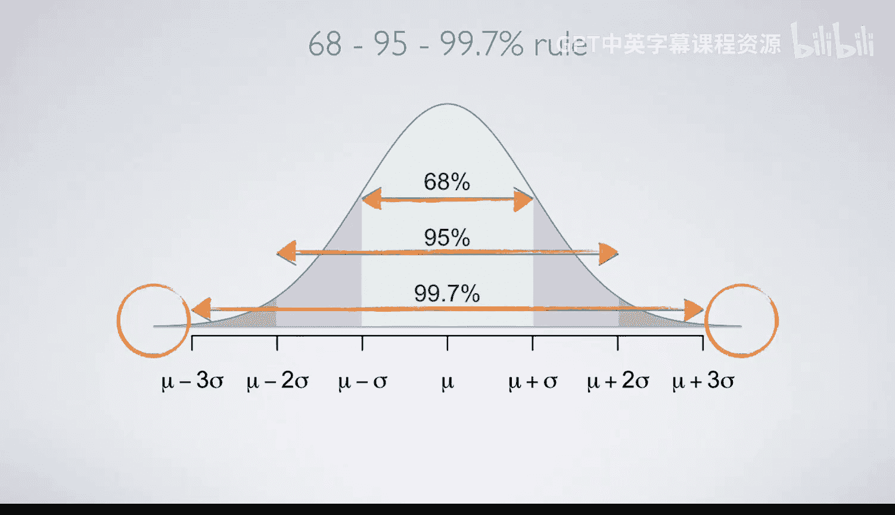

We can also use the 68 to 9599。7% rule to estimate the standard deviation of a normal model。

 given just a few parameters about the distribution of the data。 Let's take a look at an example。

A doctor collects a large set of heart rate measurements that approximately follow a normal distribution。

 He only reports three statistics， The mean 110 beats per minute， the minimum 65 beats per minute。

 and the maximum 155 beats per minute， which of the following is most likely to be the standard deviation of the distribution。

We're told that the distribution is normal。 So the very。

 very first thing that we want to do is to draw the normal curve。

 Then we mark our mean at 110 in the center。 The minimum is given to be 65。

 and the maximum is given to be 1 hundred and55。 We're going to make use of the fact that in a normal distribution。

 almost all of the data lie within three standard deviations of the mean。

If the standard deviation is 5， we can calculate the expected minimum and maximum as 1 10 plus or3 times 5。

 So the expected minimum would be 95， and the expected maximum would be 125。

 These end points do not quite reach the endpoints of our distribution。

 So the observed heart rates must have a larger standard deviation than 5。

If the standard deviation is 15， the expected minimum and maximum would be 65 and 155 respectively。

 These seem right on the mark。 We can similarly calculate the expected minimum and maximum for a standard deviation of 35。

 as well as 90。 and we can see that the endpoints that we obtain from these choices are too high or too far off from the me。

 So the best choice among these is a standard deviation of 15。

 which would give us that within three standard deviations would be the minimum and the maximum of the data。

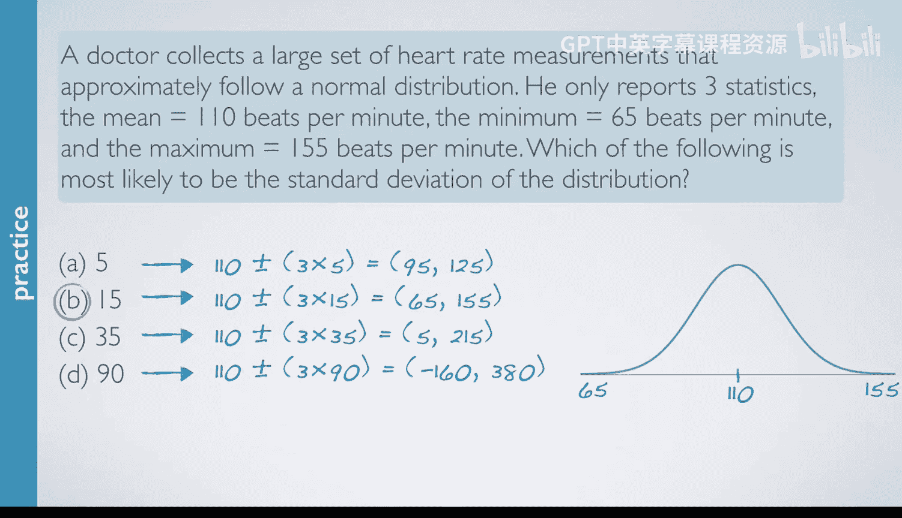

Let's take a look at another example。 A college admissions officer wants to determine which of the two applicants scored better on their standardized test with respect to the other test takers。

 Pam， who earned an 1800 on her SAT or Jim， who scored a 24 on his AC T。

We're also told that SAT scores are nearly normally distributed with mean 1500 and standard deviation 300。

 and ACT scores are distributed nearly normally with mean 21 and standard deviation 5。

We can draw the distribution of SAT scores and see that Pam scored 300 points above the mean。

 and similarly， we can see that Jim scored only three points above the mean of ACT scores。 However。

 we can't just compare these raw scores of 1800 versus 24 and say while Pam did better because her score is higher since they are measured on different scales。

 so here we would be comparing apples and oranges， which we know not to do。

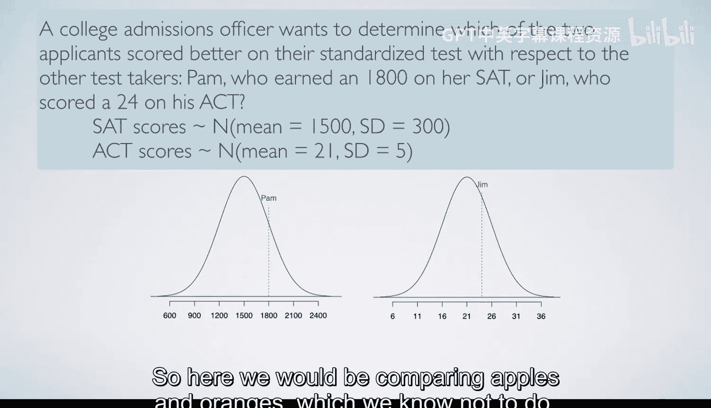

Instead， we want to figure out how many standard deviations about the respective means of their distributions。

 Pam and Jim scored。The standard deviation of SAT scores is 300。

 so Pam scored one standard deviation above the mean to calculate this。

 we first calculate how far off Pam is from the mean， so 1800 minus1500。

 and then we divide by the standard deviation of 300 and find that she is one standard deviation above the mean。

And the standard deviation of ACT scores is 5。 So 24 Jim score minus the mean 21 divided by 5 gives us 0。

6。 So Jim only scored 06 standard deviations above the mean。

Plotting these values on the same distribution， we can see that Pam， indeed， do better than gym。

These values are called standardized scores。 We define a standardized or Z score as the number of standard deviations and observations fall below or above the mean。

 The Z actually comes from the Z in standardized， which might sound a little odd。

 Why wouldn't we just use S。 The initial letter of the word。

 But that's because we tend to spare S for standard deviations。

 and we don't want to be confusing our abbreviation。

 So we're going to be referring to standardized scores as Z scores from this point onwards。

 We calculate the z score of an observation as that observation minus the mean divided by the standard deviation。

Then， by definition， the z score of a mean is0 because we would simply be plugging in the mean as the observation itself and get a0 for the numerator in our calculation。

 Standardized scores are also useful for identifying unusual observations。

 usually observations with absolute Z scores above2。

 so that's either two standard deviations below or above the mean or something beyond that are considered to be unusual。

While we introduce Z scores within the context of a normal distribution。

 note that theyre actually defined for distributions of any type， after all。

 every distribution will have a mean and a standard deviation， therefore for any observation。

 whatever distribution the random variable follows， we could calculate a Z score。

 but we're going to talk about why we brought this up within the context of normal distributions in a moment。

When the distribution is normal， Z scores can also be used to calculate percentiles Perile is the percentage of observations that fall below a given data point graphically it's the area below the probability distribution curve to the left of that observation So why is it that we can only use the z scores under normal curves but not in distribution of a different shape。

 well we can always calculate percentiles for any sort of distribution。

 except if the distribution does not follow this nice unimmodal symmetric normal shape。

 we would need to use calculus for them and for the purposes of this course。

 we're not going to be using calculus， so therefore we're going to be sticking to normal distributions for calculating percentiles or areas under the curve。

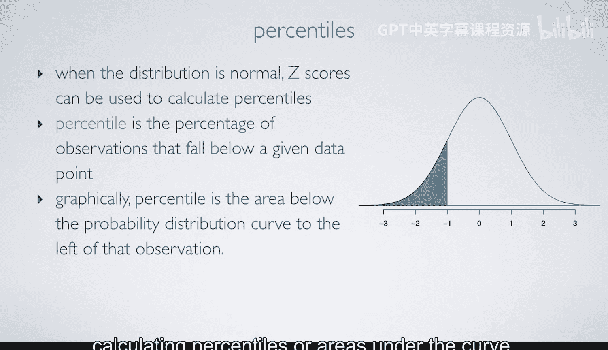

In this NNH， percentiles are easily calculated using computation For example， in R。

 the function p norm gives the percentile of an observation given the mean and the standard deviation of the distribution。

 so p norm of negative1 for a distribution with mean 0 and standard deviation of 1 is estimated to be about 0。

1587。

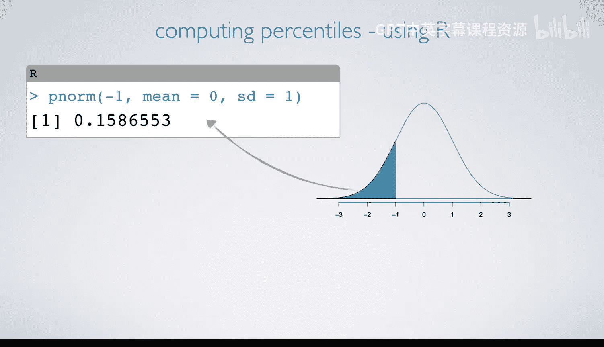

We can also obtain the same probability using a web applet。

 So no need for access to R to use this one。 So let's go to the URL that's on the slide to the Web applet and do a live demo of how we would use the applet to calculate this percentile。

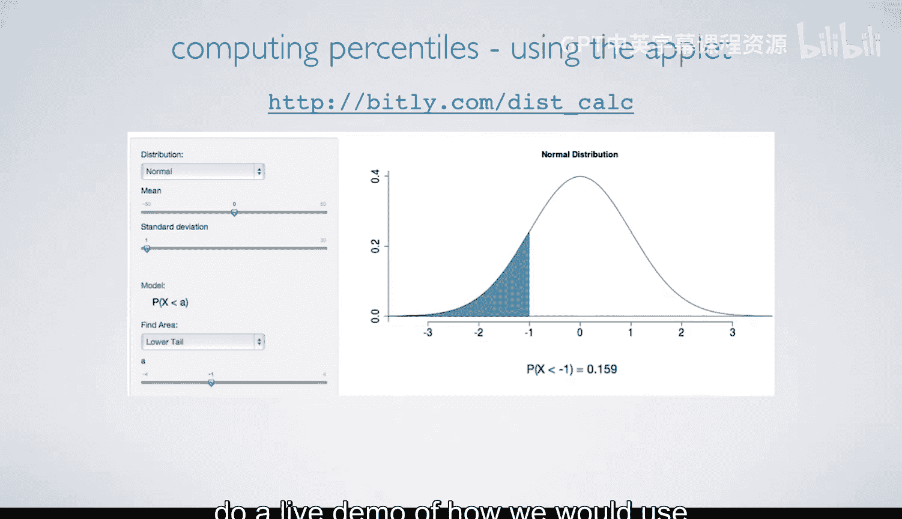

So to use the applet， the first thing we do is to select our distribution to be normal。

 we can change our mean as we desire， but we're going to leave it at 0， since that's a distribution。

 the standard normal distribution we're working with for now。

 We could also slide our standard deviation around。 But let's leave that at 1 for now as well。

 And we were interested in the area under the curve below the cutoff value of negative 1。

 And we want to pick the lower tail here。 And once again， we get to the same answer，15。9%。 Lastly。

 we can also avoid computation altogether and use a normal probability table。

 We locate the z score on the edges of the table and grab the associated percentile value given in the center of the table。

 So for a z score of negative1。 We look in the negative 1。

0 row and 000 column for the second decimal and arrive at the same answer，1587 or roughly 15。9。

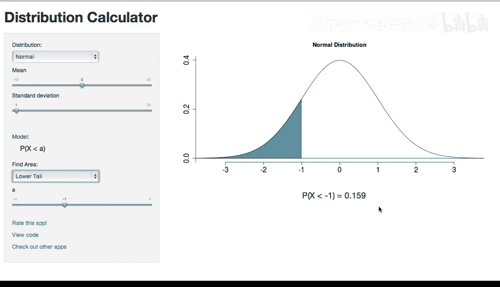

Percent。Obviously， we don't have to keep using all methods here。

 We've talked about three different methods using R using a web applelet or using the table。

 You're welcome to use whichever you like in your calculations。

 while the computation approach is a little less archaic。

 the tables are actually very useful for getting a conceptual understanding of what we mean by area under the curve So I encourage you to use the computational approaches。

 but for the time being as you're learning this material。

 also make sure that you get a chance to interact with the tables and make sure that you sketch out your distributions and don't just rely on the numbers that the computer is spitting out at you。

 but make sure that you confirm them by hand as well。

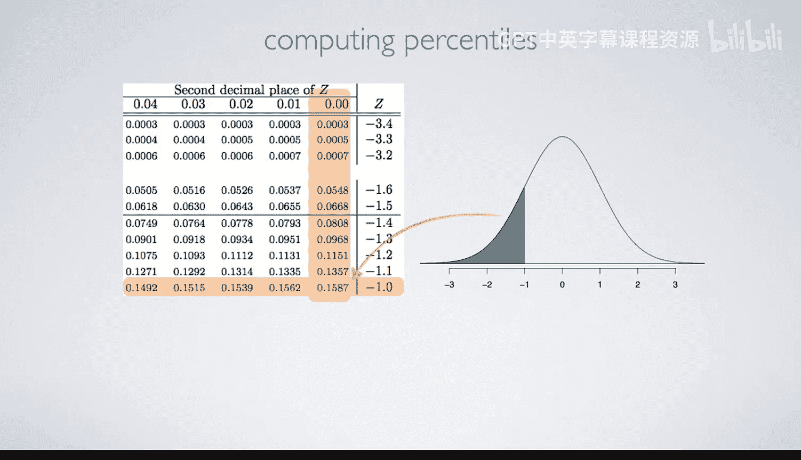

Let's take a look at a quick example， we know that S scores are distributed normally with mean 1500 and standard deviation 300 We also know that Pam earned an 1800 on her SAT and we want to find out what is her percentile score。

Soon as we find out that the distribution is normal。

 the first thing to do is to always draw the curve， mark the mean and shade the area of interest。

 Here， we have a normal distribution with mean 1500。

 And to find the percentile score associated with an SAT score of 1800。

 we shade the area under the curve below 1800。We can do this using R and the P arm function。

 So here the first argument is the observation of interest。 The second argument is the mean。

 and the third argument is the standard deviation， which spits out an associated percentile of 0。

8413， meaning that Pam scored better than 84。13% of the SAT takers。

We could also use the table to arrive at the same conclusion。First。

 we calculate the Z score as the observation 1800 the mean 1500 divided by the standard deviation 300。

 The Z score is one。 Remember， we actually saw this before。 Then in the table。

 we look for the Z score of one。The row is 1。0 and the column is 0。00 and get the same probability 0。

8413 as the probability of obtaining a Z score less than one。

 which basically means the same thing that the shaded area under the curve below 1800 is 0。8413。

As we said before， you don't need to keep using all of these methods for each question。

 but we're going through all approaches here just for practice。

Note that both the table and the penor function always yield the area under the curve below the given observation。

If we actually wanted to find out the area above the observation。

 we simply would't need to take the complement of this value since the total area under the curve is always one。

 so Pam scored worse than 1 minus 08413， which amounts to 15。87% of the test takers。

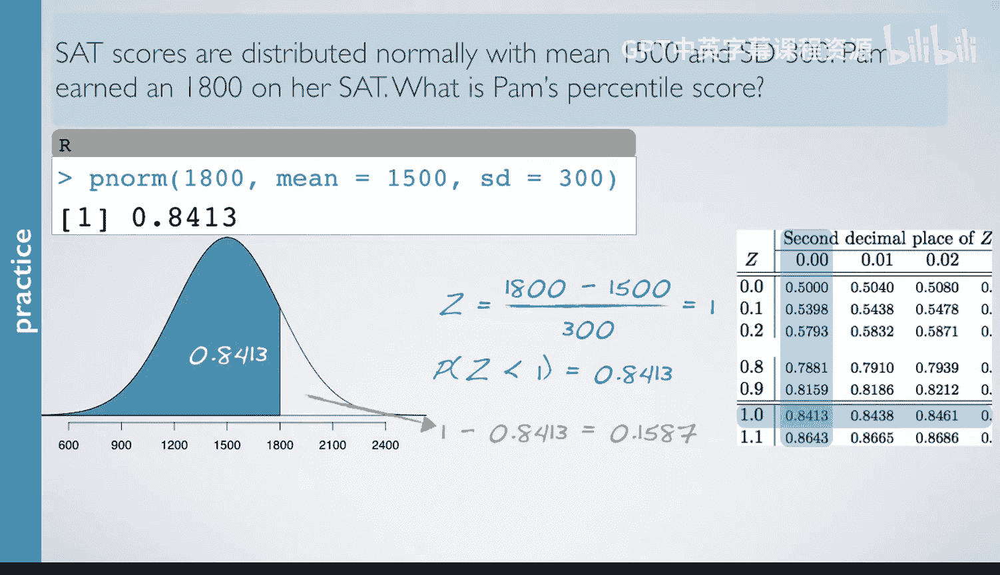

We can also use the same properties of the standard normal distribution in other words the distribution of Z scores to find cutoff values corresponding to a desired percentile。

 here's an example illustrating this。A friend of yours tells you that she scored in the top 10% on the SAT。

 What is the lowest possible score she could have gotten。 Remember。

 SAT scores are normally distributed with mean 1500 and standard deviation 300。

 We're looking for the cut off value for the top 10% of the distribution。

This is a different problem than the one we worked on earlier， as this time。

 we don't know the value of the observation of interest， but we do know。

 or at least we can get its percentile score。 Since the total area under the curve is 1。

 the percentile score associated with the cut off value for the top 10% is 1-010。90。

Remember that the formula for the Z score is observation minus mean divided by the standard deviation。

 and we know the mean。 we know the standard deviation。And if we also knew the Z score。

 we could solve for the unknown observation。Using the table。

 we can find the Z score associated with the 9th percentile。

 So what we want to do is to locate the 90th percentile inside the mess of this table and grabbing the Z score from the edges of the table。

 We don't actually see exactly 0。9 here， but the closest we can get is 0。

8997 and traveling to the edges of the table， we can obtain that the Z score is 1。28。

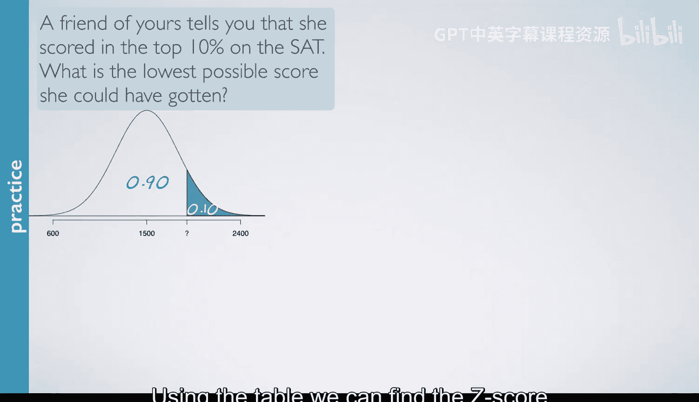

We know that this number 1。28 is equal to the unknown observation。

 we're calling it x here minus the mean divided by the standard deviation。

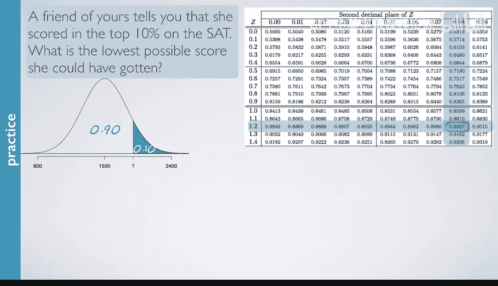

A little bit of algebra multiplying both sides by 300 and adding 1500。

 and we find that the cutoff value is 1884， so the cutoff value for the top 10% or the bottom 90% of the distribution of SAT scores is 1884。

 in other words， if you have scored above 1884， you know that you're in the top 10% of the distribution。

We could also do this using R and we're going to use the Q norm function this time。

 so P norm for probabilities， Q norm for quantiles or cutoff values。

 which takes the percentile as the first input， the mean and the standard deviation as the second and the third。

 just like the function we saw earlier， and the result is the same with either approach 1884。

