# R语言数据分析：24：正态分布 📊

在本节课中，我们将学习正态分布及其核心性质，例如68-95-99.7法则。我们还将介绍标准化分数，即Z分数，并通过实例演示如何利用Z分数计算正态分布曲线下的概率和百分位数。


## 自然界中的正态分布 🌍

许多自然界的变量都近似服从正态分布。一个常用的例子是身高。我们将观察一个在线约会网站OkCupid会员报告的身高分布。由于该网站的会员是美国居民，可能代表了美国人口的随机样本，我们预期他们的身高会遵循所有美国人的身高分布。然而，仔细观察发现情况并非完全如此。


在上图中，浅紫色曲线显示了美国男性的身高分布。


虚线代表了OkCupid上男性报告的身高分布，而深紫色实线是这些男性身高的隐含分布。我们可以看到，OkCupid上男性报告的身高非常接近预期的正态分布，只是整个分布向右偏移了。这表明OkCupid上的男性平均会将自己的身高多报几英寸。此外，从大约5英尺8英寸开始，虚线曲线的顶部进一步向右倾斜，表明接近6英尺的男性会比通常更多地向上取整，OkCupid博客将此解释为向“6英尺高”这一令人向往的心理基准靠拢。

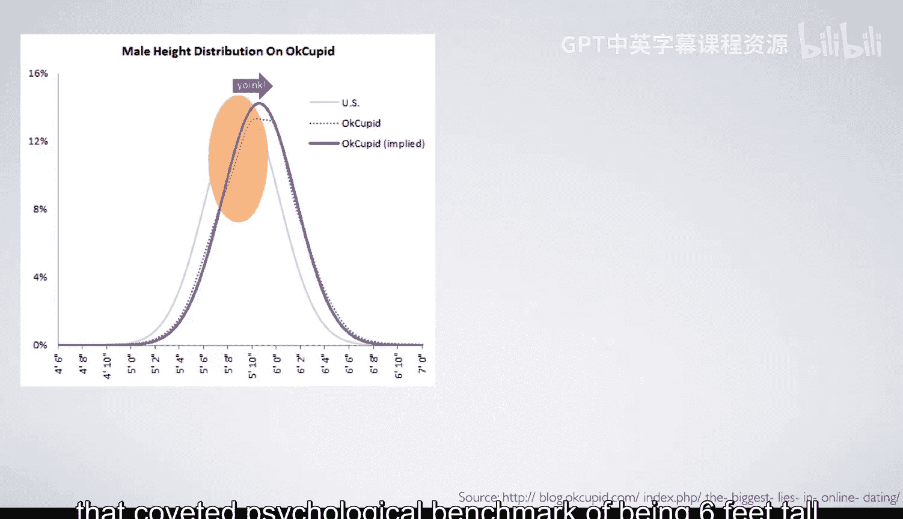


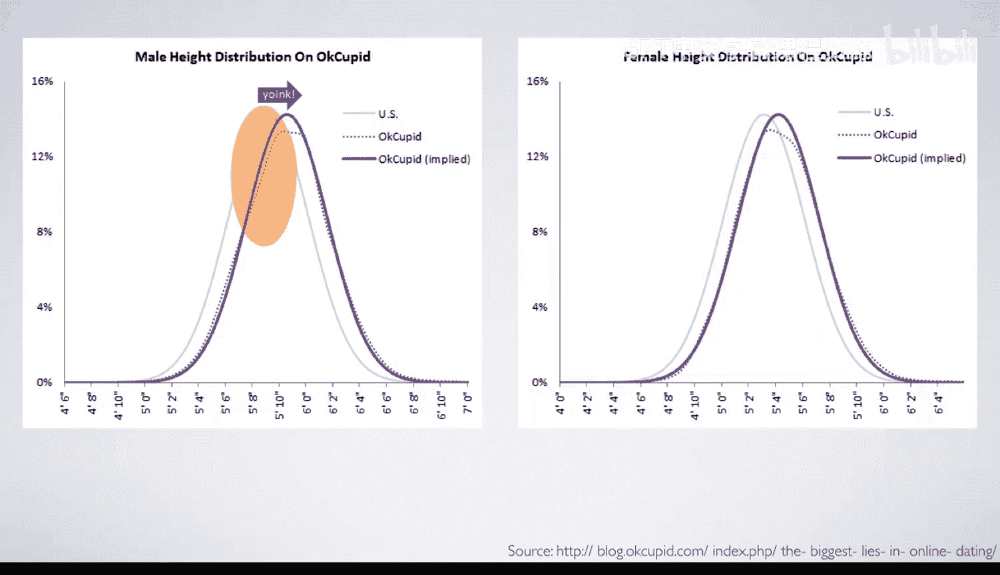

我们在女性中也看到了类似的身高夸大现象，但没有向某个基准身高突变的趋势。


## 正态分布的性质 🔔

正如我们所见，正态分布是单峰且对称的。由于其形状类似钟形，你可能也听说过它被称为“钟形曲线”。然而，它并非任何对称的单峰曲线。它遵循关于数据围绕均值分布的变异性非常严格的准则。虽然许多变量近似正态，但由于这些严格的准则，没有一个变量是完全正态的。

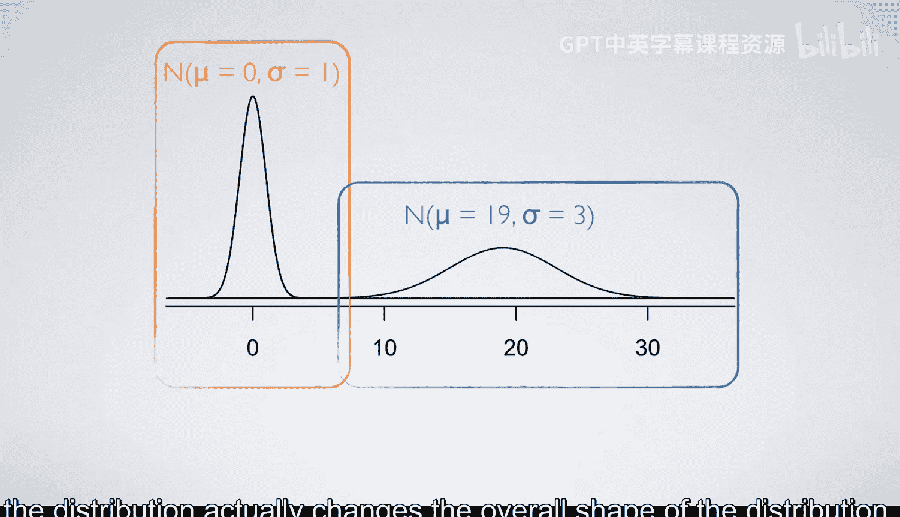

正态分布有两个参数：均值（通常表示为 **μ**）和标准差（通常表示为 **σ**）。


上图展示了两个正态分布：一个以0为中心，标准差为1；另一个以19为中心，标准差为3。这很好地展示了改变分布的中心和离散程度如何改变分布的整体形状。

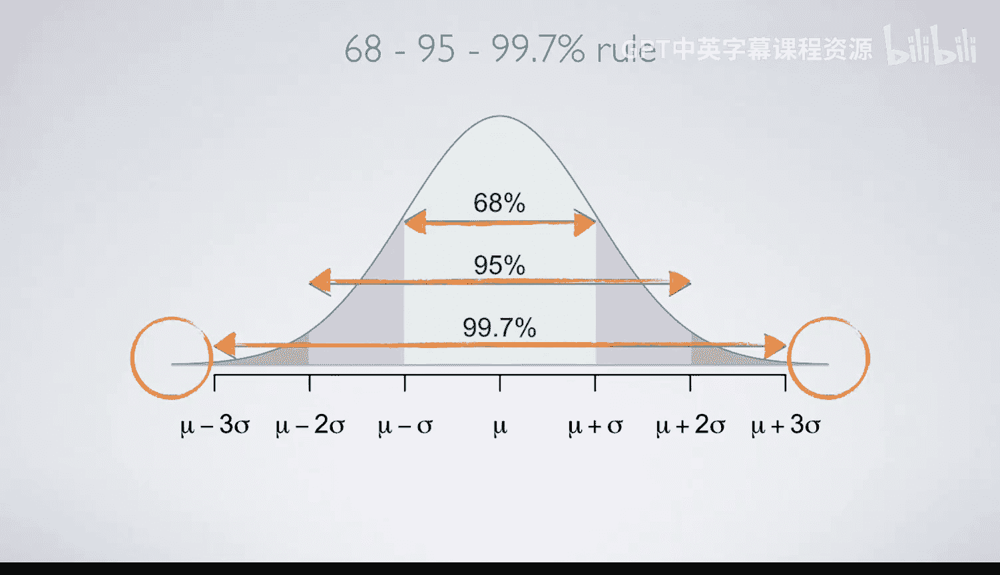

## 68-95-99.7法则 📏

那么，这些支配正态分布数据围绕均值变异性的严格规则是什么呢？对于近似正态分布的数据：
*   约68%的数据落在均值的一个标准差范围内。
*   约95%的数据落在均值的两个标准差范围内。
*   约99.7%的数据落在均值的三个标准差范围内。

观测值有可能落在均值4个、5个甚至更多标准差之外，但如果数据近似正态，这些情况非常罕见。


我们也可以利用68-95-99.7法则，在仅知道数据分布的少数几个参数时，估计正态模型的标准差。让我们看一个例子。

一位医生收集了大量近似服从正态分布的心率测量值。他只报告了三个统计量：均值（每分钟110次）、最小值（每分钟65次）和最大值（每分钟155次）。以下哪个最可能是该分布的标准差？

我们知道分布是正态的。因此，首先要做的是画出正态曲线。然后在中心标记均值110。已知最小值为65，最大值为155。我们将利用正态分布中几乎所有数据都落在均值三个标准差范围内这一事实。

如果标准差是5，我们可以计算期望的最小值和最大值为 110 ± 3×5。因此，期望最小值为95，期望最大值为125。这些端点没有达到我们分布的端点，所以观测到的心率必须具有比5更大的标准差。

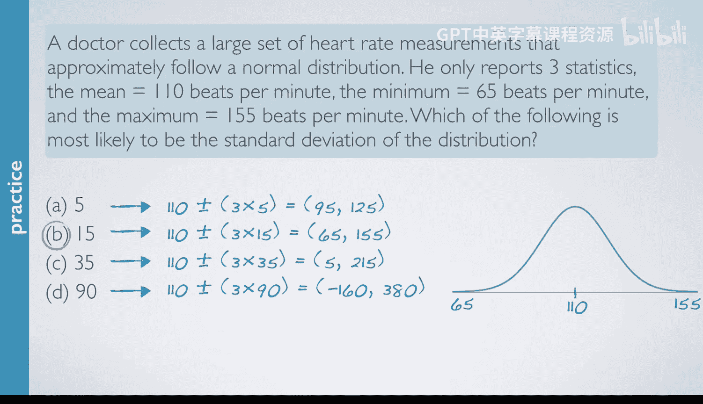

如果标准差是15，期望的最小值和最大值将分别是65和155。这看起来正好符合。我们可以类似地计算标准差为35和90时的期望最小值和最大值，可以看到这些选择得到的端点要么太高，要么离均值太远。因此，最佳选择是标准差为15，这将使数据的最小值和最大值正好落在三个标准差范围内。

## 标准化分数（Z分数） 📐

让我们看另一个例子。一位大学招生官想确定两位申请者中，谁在标准化考试中相对于其他考生表现得更好：Pam在SAT中得了1800分，还是Jim在ACT中得了24分。

我们还知道SAT分数近似正态分布，均值为1500，标准差为300；ACT分数近似正态分布，均值为21，标准差为5。

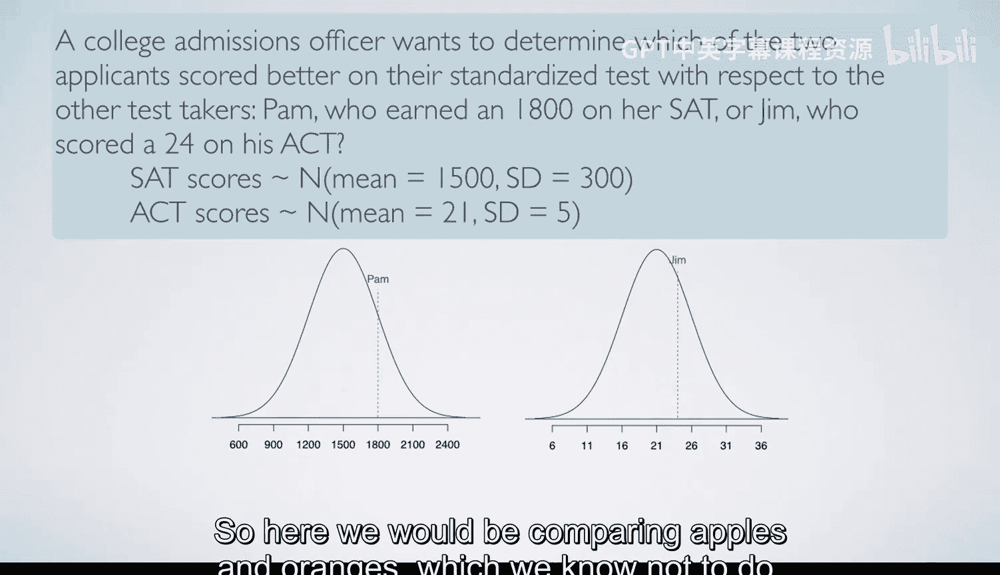

我们可以画出SAT分数的分布，看到Pam的分数比均值高300分。同样，我们可以看到Jim的分数只比ACT均值高3分。然而，我们不能仅仅比较1800和24这两个原始分数就说Pam做得更好，因为它们的测量尺度不同，这是在比较苹果和橘子。


相反，我们想计算Pam和Jim的分数分别比各自分布的均值高多少个标准差。SAT分数的标准差是300，所以Pam的分数比均值高一个标准差。计算如下：首先计算Pam与均值的距离（1800 - 1500），然后除以标准差300，得出她比均值高一个标准差。

ACT分数的标准差是5。所以（24 - 21）/ 5 = 0.6。因此Jim只比均值高0.6个标准差。

将这些值绘制在同一分布上，我们可以看到Pam确实比Jim表现更好。

这些值被称为标准化分数。我们将标准化分数或Z分数定义为一个观测值低于或高于均值的标准差数量。Z实际上来自“标准化”一词中的Z。我们计算观测值的Z分数公式为：

**Z = (观测值 - 均值) / 标准差**

根据定义，均值的Z分数为0。标准化分数对于识别异常观测值也很有用，通常绝对值大于2的Z分数（即低于或高于均值两个标准差或更多）被认为是异常的。

虽然我们在正态分布的背景下引入了Z分数，但请注意它们实际上可以定义在任何类型的分布上。毕竟，每个分布都有均值和标准差。然而，当分布是正态时，Z分数还可以用来计算百分位数。

## 使用Z分数计算百分位数 📊

百分位数是落在给定数据点以下的观测值百分比。在图形上，它是概率分布曲线在该观测值左侧下方的面积。为什么我们只能在正态曲线下使用Z分数，而不能在其它形状的分布中使用呢？我们总是可以为任何类型的分布计算百分位数，但如果分布不遵循这种良好的单峰对称正态形状，我们需要使用微积分。在本课程中，我们不使用微积分，因此我们将坚持使用正态分布来计算百分位数或曲线下面积。

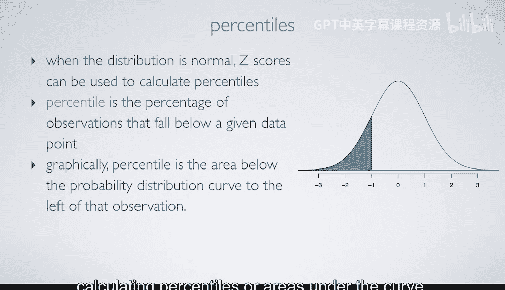

在现代实践中，百分位数很容易通过计算获得。例如，在R语言中，函数 `pnorm` 在给定分布的均值和标准差时，可以计算观测值的百分位数。

```r
pnorm(-1, mean = 0, sd = 1) # 估计约为 0.1587
```


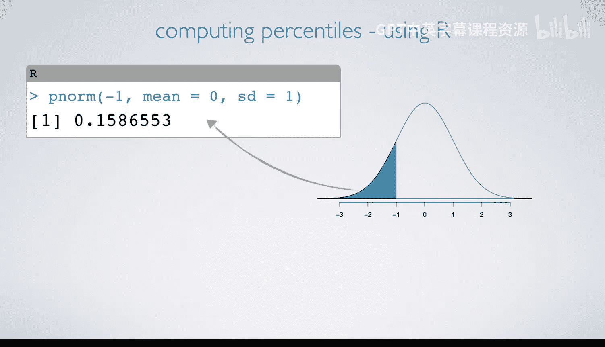

我们也可以使用网络小程序获得相同的概率，无需访问R。让我们转到幻灯片上的URL，现场演示如何使用该小程序计算这个百分位数。


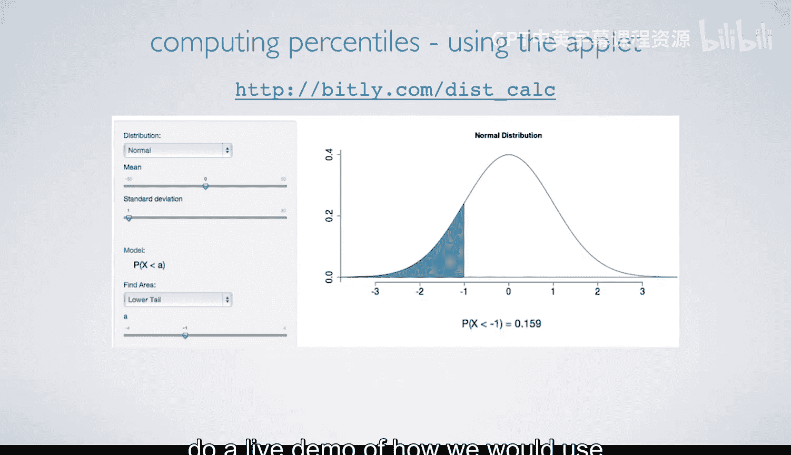


使用小程序时，首先选择分布为“正态”。我们可以根据需要更改均值，但暂时保留为0（标准正态分布）。也可以调整标准差，暂时保留为1。我们感兴趣的是曲线在临界值-1以下的面积，因此选择“下尾”。我们再次得到相同的答案：15.9%。

最后，我们也可以完全避免计算，使用正态概率表。我们在表格边缘找到Z分数，并获取表格中心给出的相关百分位数值。对于Z分数-1.0，我们在-1.0行和.00列（第二位小数）查找，得到相同的答案：0.1587，约15.9%。

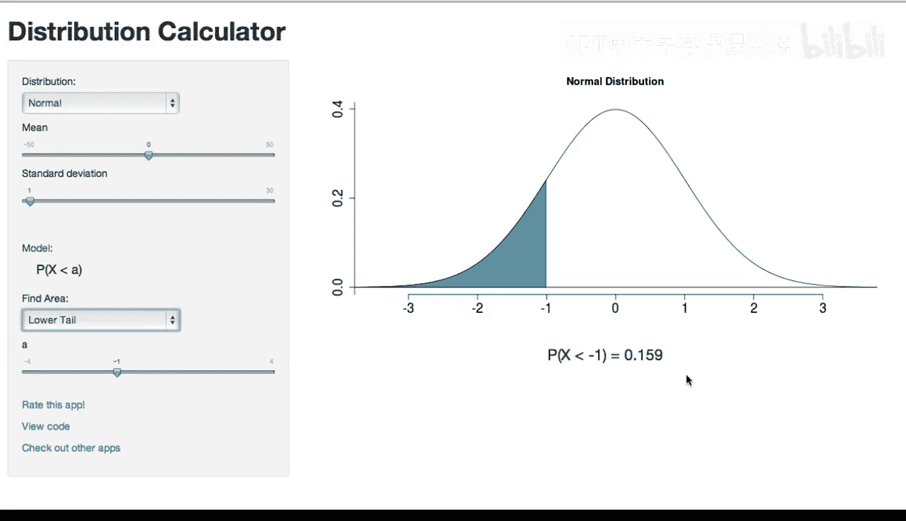

显然，我们不必每次都使用所有方法。我们讨论了三种不同的方法：使用R、使用网络小程序或使用表格。你可以在计算中使用你喜欢的任何一种。虽然计算方法不那么古老，但表格对于理解“曲线下面积”的概念实际上非常有用。我鼓励你使用计算方法，但在学习这些材料时，也请确保有机会与表格互动，并画出你的分布草图，不要仅仅依赖计算机输出的数字，也要确保通过手工计算来验证。


## 应用示例：计算SAT百分位数 🎓

让我们看一个快速示例。我们知道SAT分数服从正态分布，均值为1500，标准差为300。我们知道Pam在SAT中得了1800分，我们想知道她的百分位分数是多少。

一旦发现分布是正态的，首先要做的总是画出曲线，标记均值，并给感兴趣的区域涂上阴影。这里，我们有一个均值为1500的正态分布。为了找到与SAT分数1800相关的百分位分数，我们给曲线下1800以下的区域涂上阴影。

我们可以使用R和`pnorm`函数来计算。

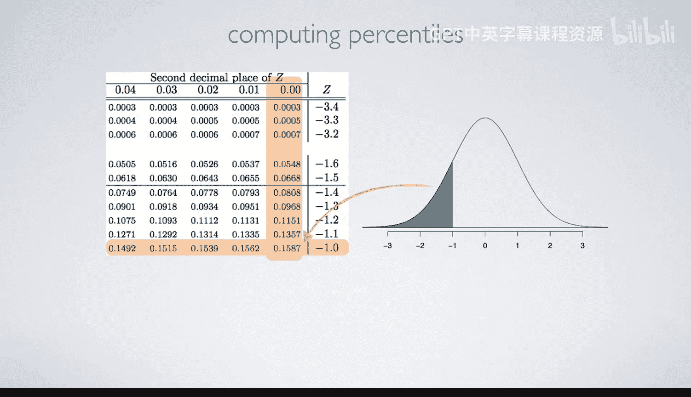

```r
pnorm(1800, mean = 1500, sd = 300) # 输出 0.8413
```

这意味着Pam的分数比84.13%的SAT考生要好。

我们也可以使用表格得出相同的结论。首先，计算Z分数：(1800 - 1500) / 300 = 1。然后在表格中查找Z分数1.0（行1.0，列.00），得到相同的概率0.8413，即获得小于1的Z分数的概率，这基本上意味着曲线下1800以下的阴影面积为0.8413。

如前所述，你不需要对每个问题都使用所有这些方法，但我们在这里练习了所有方法。

请注意，表格和`pnorm`函数总是给出给定观测值以下的曲线下面积。如果我们想找到观测值以上的面积，我们只需要取这个值的补数，因为曲线下的总面积总是1。所以，Pam比1 - 0.8413 = 15.87%的考生考得差。

## 寻找特定百分位数对应的分数 🎯

我们也可以利用标准正态分布（即Z分数的分布）的相同性质，来寻找与所需百分位数对应的临界值。下面是一个说明这一点的例子。

你的一个朋友告诉你，她的SAT成绩排在前10%。她可能得到的最低分数是多少？记住，SAT分数服从正态分布，均值为1500，标准差为300。我们正在寻找分布中前10%的临界值。

这是一个与我们之前解决的问题不同的问题，因为这次我们不知道感兴趣的观测值，但我们知道（或至少可以得到）它的百分位分数。由于曲线下的总面积为1，与前10%临界值相关的百分位分数是1 - 0.10 = 0.90。

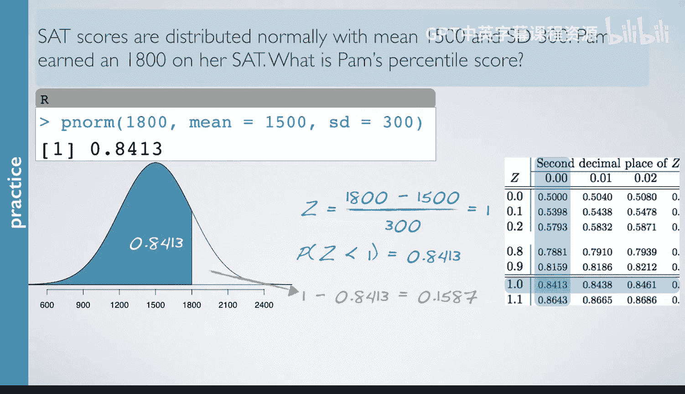

记住Z分数的公式是：Z = (观测值 - 均值) / 标准差。我们知道均值，也知道标准差。如果我们还知道Z分数，我们就可以解出未知的观测值。

使用表格，我们可以找到与第90百分位数相关的Z分数。我们需要在表格中找到0.90，并从表格边缘获取Z分数。我们没有看到正好0.9，但最接近的是0.8997，对应表格边缘的Z分数是1.28。


我们知道这个数字1.28等于未知观测值（我们称之为x）减去均值除以标准差。

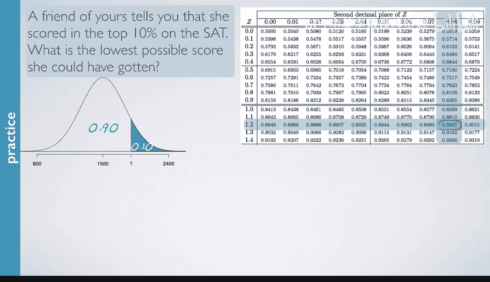

通过简单的代数运算（两边乘以300再加上1500），我们发现临界值是1884。因此，SAT分数分布中前10%（或后90%）的临界值是1884。换句话说，如果你的分数高于1884，你就知道自己在分布的前10%之内。


我们也可以使用R来做这个计算，这次使用`qnorm`函数（`pnorm`用于概率，`qnorm`用于分位数或临界值）。


```r
qnorm(0.90, mean = 1500, sd = 300) # 输出 1884
```

两种方法得到的结果相同：1884。

## 总结 📝

在本节课中，我们一起学习了正态分布的核心概念。我们了解了正态分布是单峰、对称的钟形曲线，由均值（μ）和标准差（σ）两个参数描述。我们掌握了68-95-99.7法则，它描述了数据围绕均值分布的规律。我们引入了标准化Z分数的概念及其计算公式 **Z = (X - μ) / σ**，并学会了如何利用Z分数在正态分布中计算百分位数（曲线下面积）以及根据特定百分位数反推原始分数。最后，我们探讨了使用R语言函数（`pnorm`, `qnorm`）、网络工具和概率表等多种方法来实现这些计算。理解这些内容是进行统计推断和数据分析的重要基础。