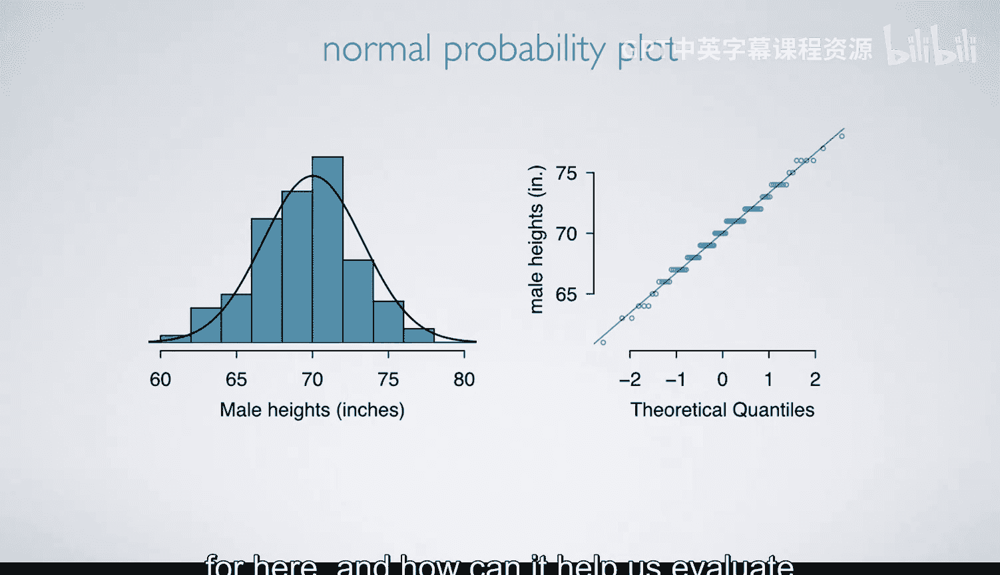
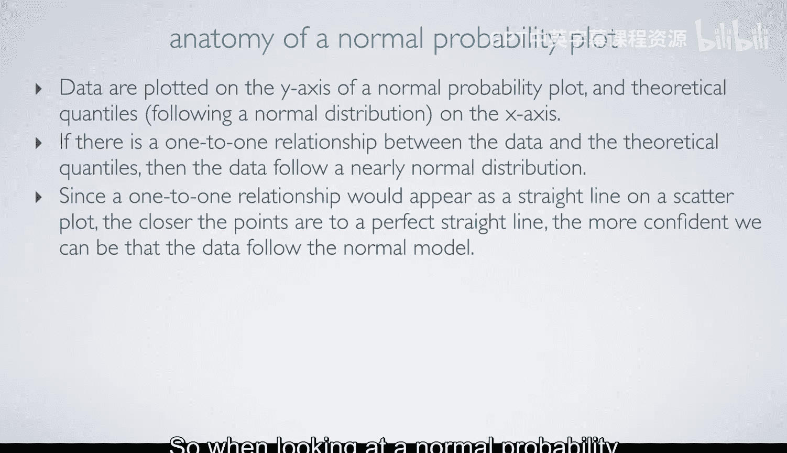
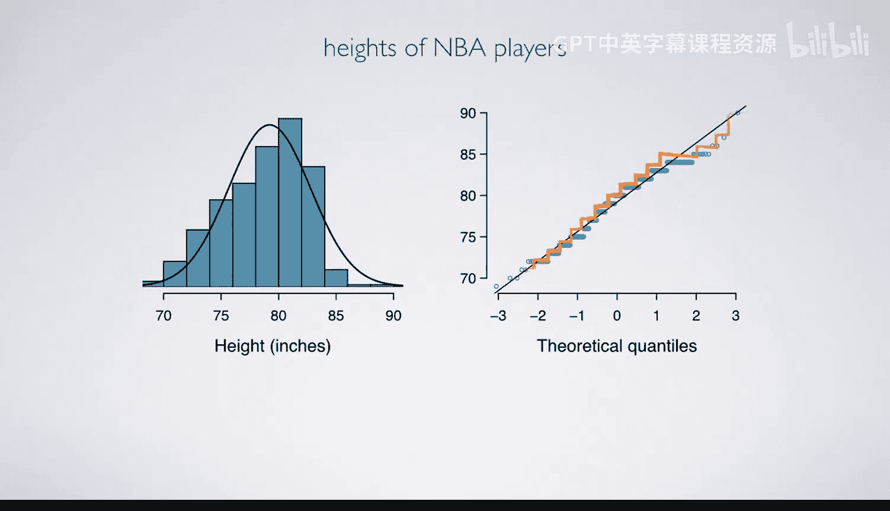
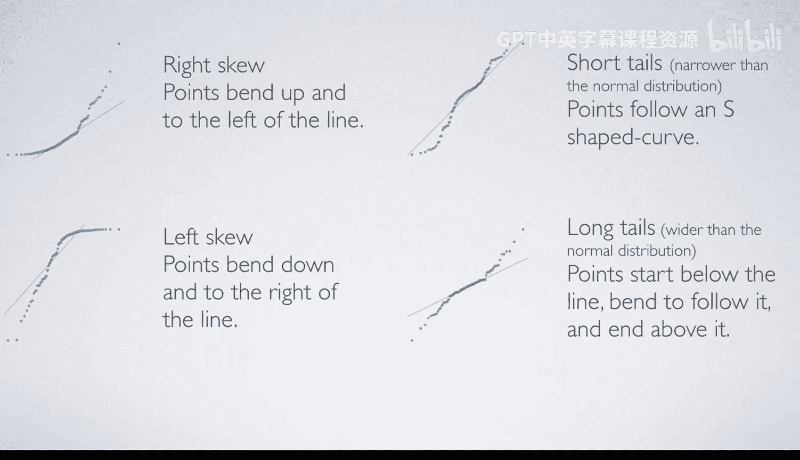
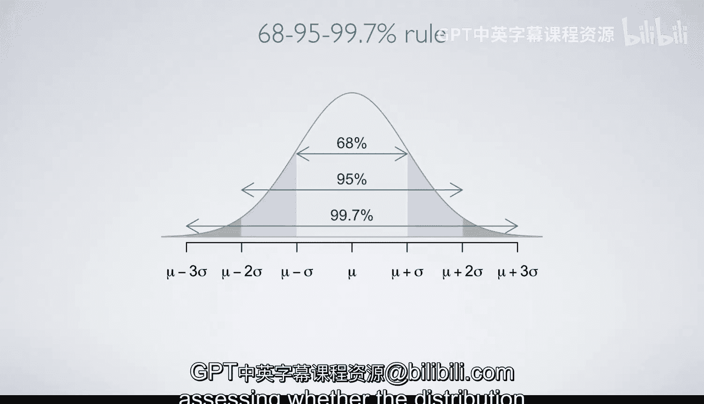

# 杜克大学《R语言数据分析（R语言、概率与数据入门，推断统计，线性回归与建模）｜Data Analysis with R》中英字幕 p25 25_08_03_正态分布评估.zh_en -BV1Cf421q7mU_p25-

Now， let's talk a little bit about how to evaluate whether a distribution is nearly normal or not。

Here we have a histogram and what we call a normal probability plot of a sample of 100 mile heights。

 so let's focus on the normal probability plot and talk about what are we really looking for here and how can it help us evaluate whether a distribution is normal or not。

On a normal probability plot， data are plotted on the Y axis and theoretical quantiles that means quantiles that follow a normal distribution or what would be expected under the normal distribution are plotted on the X axis。

If there is a one to one relationship between the data and the theoretical quantiles。

 then the data follow a nearly normal distribution。

Since a one to one relationship would appear as a straight line on a scatter plot。

 the closer the points are to a perfect straight line。

 the more confident we can be that the data follow a normal model。

 So when looking at a normal probability plot， we're looking for straight lines。

Constructing a normal probability plot requires calculating percentiles and corresponding Z scores for each observation in your dataset。

 which can be quite tedious， especially if you have a large sample。

 which is what we like to work with。 Therefore， we generally rely on software when making these plots。

Here's an example of data that do not really follow a normal distribution。

 how it appears on a histogram and how it appears on a normal probability plot。

 These are heights of NBA players from the 2008 and 2009 season Since NBA players tend to be disproportionately taller compared to the general population The distribution of their heights is left sket on a normal probability plot。

 left Skew appears as point bend down into the right of the normal line。

We can also see that these points have jumps and that's actually due to rounding when reporting heights。

Just like with histograms， normal probability plots also reveal shapes of distributions in a right skewed distribution。

 points bend up and to the left of the line。 If the distribution is left skewed。

 like the one we saw earlier， points bend down into the right of the line。

 distributions with short tails。 This means a distribution that's narrower or skinnier than the normal distribution follow an S shaped curved。

While those with long tails， so a distribution that's wider than the normal distribution starts below the line。

 then to follow it and above it。

We can also use the 68，9599。7% rule to evaluate normality by assessing whether the distribution follows what's required by this rule。

