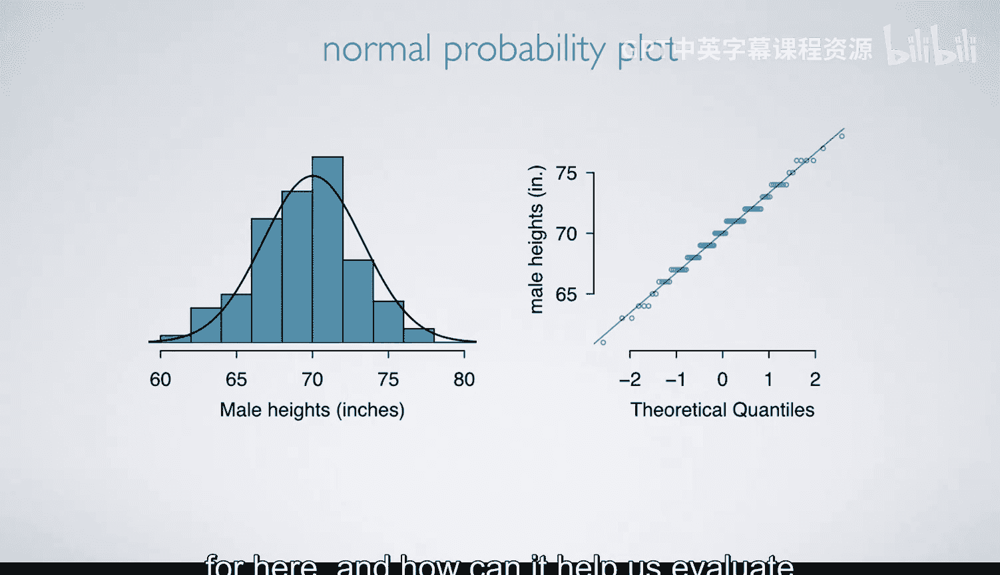
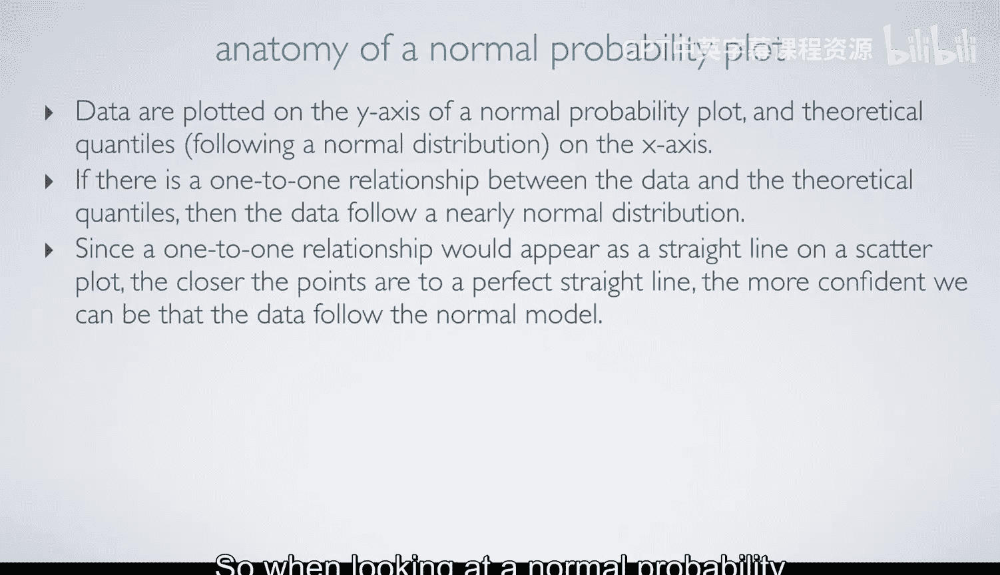
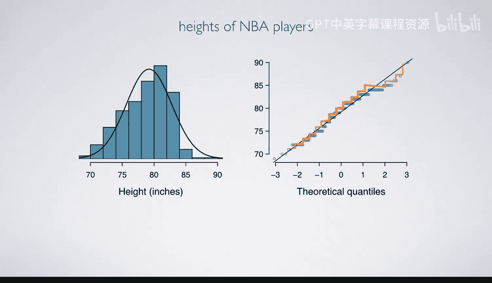
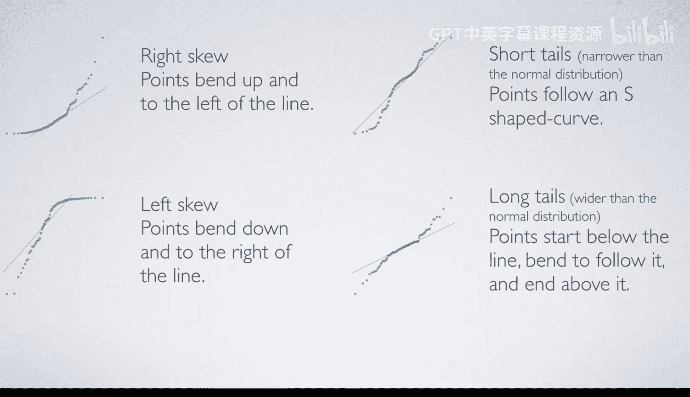
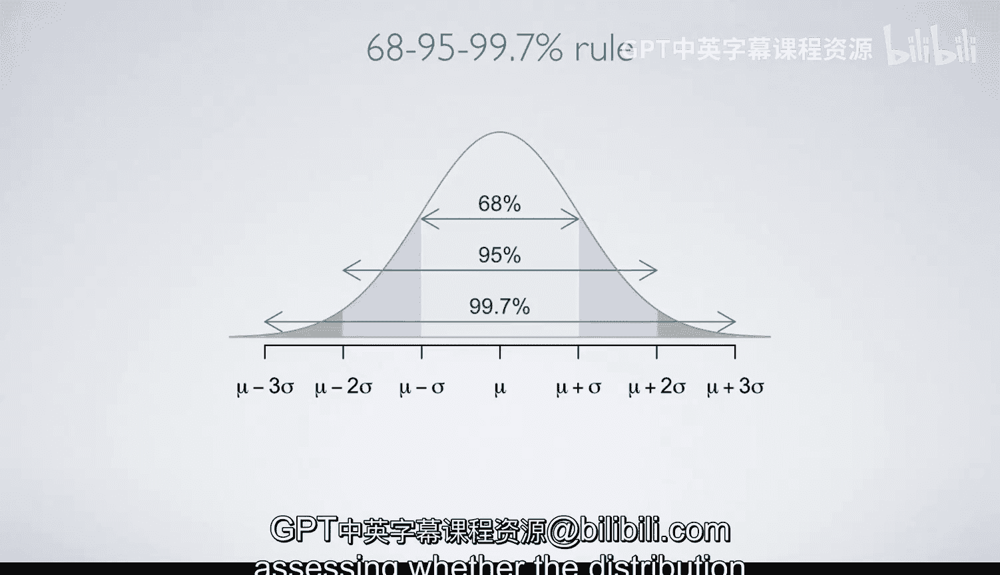

# R语言数据分析：25：正态分布评估 📊

在本节课中，我们将学习如何评估一个数据分布是否近似于正态分布。我们将重点介绍正态概率图，并解释如何通过它以及68-95-99.7法则来判断数据的正态性。

## 正态概率图简介

上一节我们介绍了正态分布的基本概念，本节中我们来看看如何通过可视化工具进行判断。

正态概率图是一种特殊的散点图，用于评估数据分布与正态分布的接近程度。在该图中，**Y轴**代表我们观测到的实际数据值，而**X轴**代表理论分位数，即如果数据完全服从正态分布时，我们预期会出现的数值。

如果数据与理论分位数之间存在一一对应的关系，那么数据就遵循一个近似正态的分布。由于一一对应的关系在散点图上会呈现为一条直线，因此，点越接近一条完美的直线，我们就越有信心认为数据遵循正态模型。所以，观察正态概率图时，我们主要寻找**直线**。

## 如何解读正态概率图

以下是解读正态概率图时可能遇到的几种模式：

*   **右偏分布**：数据点会向上并向直线的左侧弯曲。
*   **左偏分布**：数据点会向下并向直线的右侧弯曲。
*   **短尾分布**（比正态分布更窄）：数据点会呈现一个S形曲线。
*   **长尾分布**（比正态分布更宽）：数据点会从直线下方开始，然后穿过直线，最后运行到直线上方。

## 实例分析：NBA球员身高

让我们通过一个实例来加深理解。下图展示了2008-2009赛季NBA球员身高的直方图与正态概率图。

由于NBA球员的身高普遍远高于普通人群，其身高分布是**左偏**的。在正态概率图上，这种左偏表现为数据点向下并向理论直线的右侧弯曲。我们还可以看到数据点有跳跃，这实际上是由于报告身高时进行了四舍五入造成的。

## 使用68-95-99.7法则评估

除了正态概率图，我们还可以运用**68-95-99.7法则**来评估正态性。具体方法是计算数据中落在均值±1个标准差、±2个标准差、±3个标准差范围内的比例，并与理论值（68%， 95%， 99.7%）进行比较。如果实际比例与理论值接近，则可以为数据服从正态分布提供了支持。

## 总结

本节课中我们一起学习了评估数据正态性的两种主要方法：
1.  **观察正态概率图**：寻找数据点是否紧密排列在一条直线上，并根据点的弯曲方向判断偏态与峰态。
2.  **应用68-95-99.7法则**：通过计算实际数据在特定标准差范围内的比例，与理论预期进行对比。

在实践中，由于手动计算分位数和Z分数非常繁琐，我们通常依赖R语言等统计软件来生成正态概率图并进行计算。掌握这些评估方法，能帮助我们在进行后续的统计推断（如t检验、方差分析、线性回归）前，确认数据是否满足正态性假设。