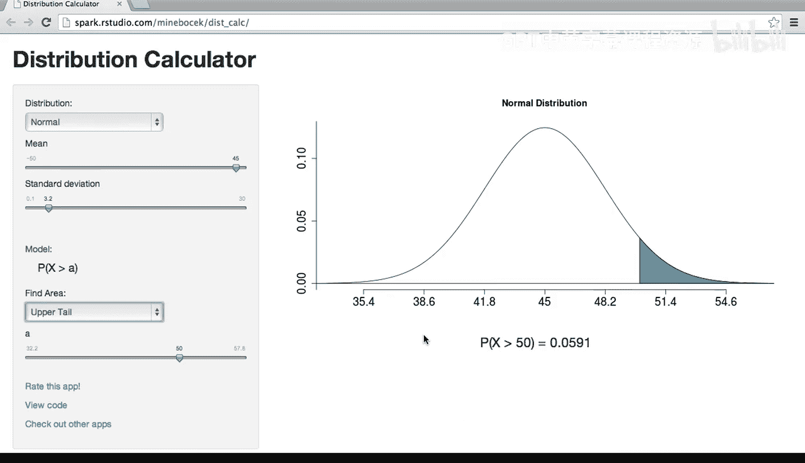

# 杜克大学《R语言数据分析（R语言、概率与数据入门，推断统计，线性回归与建模）｜Data Analysis with R》中英字幕 p26 26_08_04_正态分布应用.zh_en -BV1Cf421q7mU_p26-

Yeah。

Suppose weights of checked baggage of airline passengers follow a nearly normal distribution with mean 45 pounds and standard deviation 3。

2 pounds。Most airlines charge a fee for baggage that weigh in excess of 50。

 which roughly corresponds to about 23 kilos。1% of airline passengers are expected to incur this fee。

We're told that baggage weights are nearly normally distributed with mean 45 and standard deviation 3。

2， so we can write out our normal model here。And to find the desired probability。

 one approach would be to use the applet。 So let's go to the applet at this address and work through how we can actually use that to calculate the probability。

We select the distribution to be normal， we want us set our mean to 45 so we can slide it across to 45。

 and we want us set our standard deviation to 3。2。Here we can see our normal distribution being drawn and remember that we want to find the upper tail because we're looking to see what percent of the passengers have baggages that weigh in excess of 50 pounds。

 so we're going to slide our cutoff value of interest to 50。It gives us that about 5。

91% of passengers are expected to have baggages that weigh in excess of 50 pounds。

Another approach is to use R directly and the P norm function that we learned earlier。 So in R。

 we set our P norm function， our cutoff values 50 mean 45 standard deviations 3。2。

 and we find that the area under the curve that's below 50 is 09409。 Well。

 that is not really the area that we're interested in。

 So to find the desired area we need to find the complement of this answer So 1 minus0。

9409 gets us to the same answer 0。0591 So roughly 5。

91% of the passengers are expected to have baggages that weigh in excess of 50。

 We can also do this calculation by hand using z scores and the normal probability table For that。

 the first thing we need to do is to calculate our z score as the observation 50 minus the mean 45 divided by the standard deviation 3。

2 which gets us to a z score of 1。56。 Then we refer to our table。 locate。5 on the row and 。

06 on the column and a Z score of 1。56 then corresponds to the value at the intersection of these 0。

9406 remember this is going to be the area under the curve below 50 and to find the area above the curve below this value we simply need to find the complement。

 which once again gets us to the same value roughly 5。9%。Another question。

 the average daily high temperature in June in La A is 77 degrees Fren with a standard deviation of 5 degrees Fren。

 Suppose that temperatures in June closely follow a normal distribution。

 How cold are the coldest 20% of the days during June in L。

 We are told that the distribution is nearly normal with mean 77 degrees Fren and standard deviation 5 degrees Fren。

 So we can draw our curve。 And we also mark the coldest 20% of the day。

 So that's going to be at the lower end of our distribution。 So the shaded area here is 0。20。

 This time， we don't know our cutoff value。 That's the number that we're trying to get to。

 So in order to do that。 We need to first figure out which standardized score or Z score this corresponds to。

 We can do that using R。 And for that， we're going to use the other function that we learned about the Q norm function where the。

First input is the percentile， the second input is the mean。

 and the third input is the standard deviation， and that gives us 72。79。

 meaning that the coldest 20% of the days during June and LA are colder than  72。

79 degrees Fahrenheit。Another approach would be to do this by hand。 Once again， let's draw our curve。

 let's mark our percentile and then what we want to do is we want to figure out using the table what z score the 0。

2 corresponds to so we're looking in the table and we're going to look in the center to get as close to 0。

2 is possible and it appears that the closest we can get is going to be somewhere between 0。

1977 and 0。2005 Well how do we choose between these two let's go with the closest so 0。

2005 which gives us a z score of negative。Po84。We know that this value can also be calculated as the unknown observation minus the mean 77 divided by the standard deviation of 5。

 And if we solve 4 x here， multiplying both sides by 5 and adding the 77。

 we once again get to roughly the same answer，72。8 degrees Fahrenheit。

