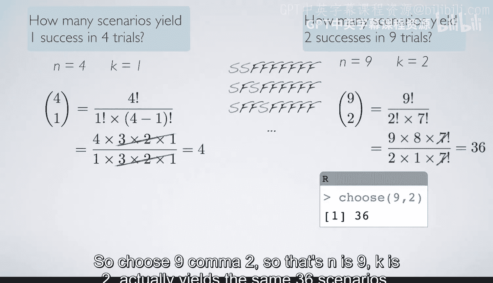
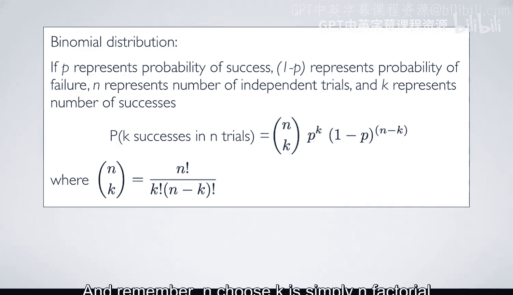
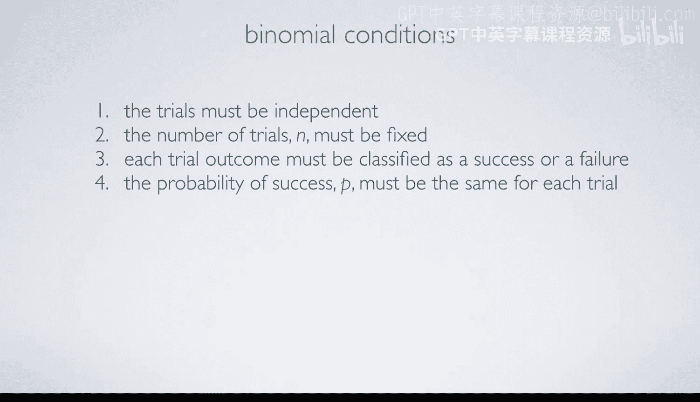
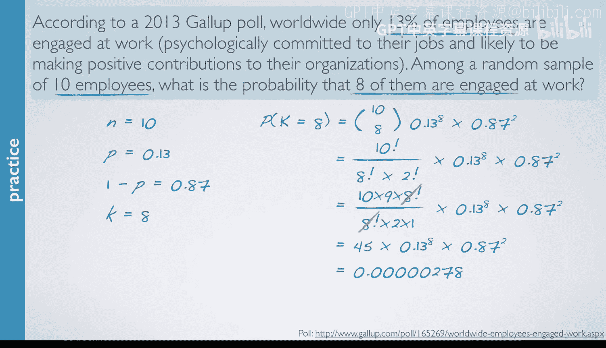
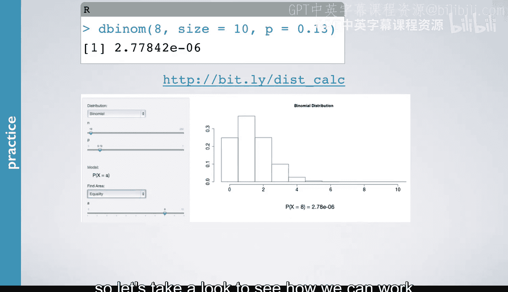
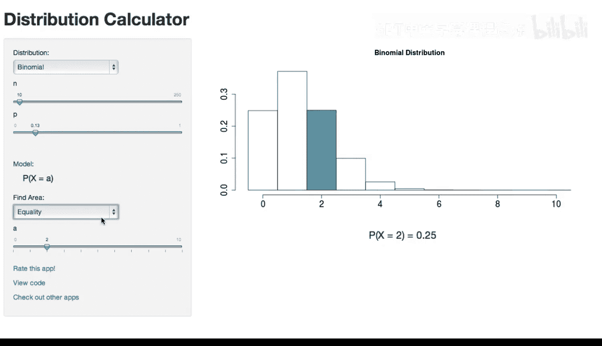
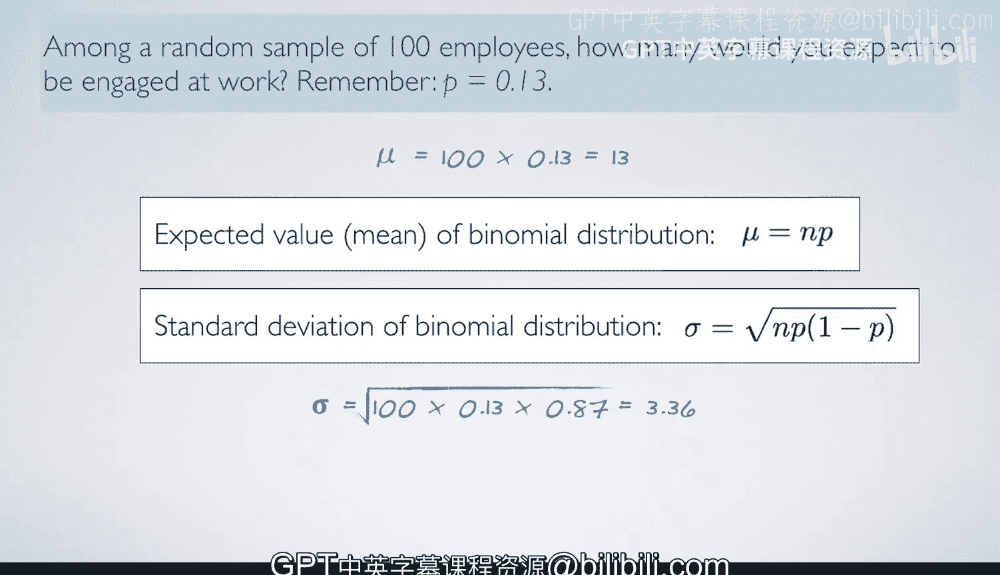

# 杜克大学《R语言数据分析（R语言、概率与数据入门，推断统计，线性回归与建模）｜Data Analysis with R》中英字幕 p27 27_08_02_二项分布.zh_en -BV1Cf421q7mU_p27-

In this video， we're going to define the binomial distribution， discuss its properties。

 and list conditions required for a random variable to follow a binomial distribution。

 We will also calculate probabilities under the binomial distribution using web applets R。

 as well as doing hand calculations。 Finally， we're going to evaluate characteristics of the binomial distribution。

 such as its mean and its standard deviation。

We're going to frame our discussion using an example from a classic psychology experiment conducted by Stanley Milgram。

 a Yale University psychologist， starting in the 1960s。

 These experiments measured willingness of participants to obey an authority figure who instructed them to perform acts that conflicted with their personal conscience。

 Here is the setup。 The experimenter orders the teacher to give severe electric shocks to a learner each time the learner answers a question incorrectly。

The teacher is the subject of the study， and the learner is actually just an actor。

 and the electric shots are not real， but pre recorded sound is played each time the teacher administers an electric shock。

 So they actually think that they are really shocking these people。

 Milgram found that about 65 per cent of people would obey authority and give such shocks Over the years。

 additional research suggested this number is approximately consistent across communities and time。

Each person in Milgram's experiment can be thought of as a trial。

 A person is labeled a success if she refuses to administer a severe shock and failure。

 if she administers such a shock， since only 35% of people refuse to administer such a shock。

 the probability of success as P equals 0。35， not that we're just defining success and failure here as we like。

 because in the remainder of the analysis we're going to focus on people who refuse to administer the shock。

When an individual trial has only two possible outcomes like the one here。

 it is called a Bernoulli random variable。Suppose we randomly select four individuals to participate in this experiment。

 What is the probability that exactly one of them will refuse to administer the shock。

 Let's name our four individuals， Anthony， Brittany， Clara and Dorian will refer to them as ABC D。

 respectively。We're interested in one out of four people refusing to administer the shock。

 and there are multiple scenarios where this can happen。

 So let's run through them In scenario number one， we have four people in our experiment。

 and let's say that the first person refuses to administer the shock and the remainder of them all do not refuse to administer the shock。

 The probability associated with refusing is 。35 and the probability associated with all the rest is 0。

65。 Since we're saying that the first person will refuse and the second person will shock and the third person will shock and the fourth person will shock when we say and and these are remember independent trials because since these are a random sample of people。

 we multiply these probabilities。So the probability associated with this first scenario。

 first person refuses and everybody else shocks is 0。0961。What other scenario can we think of Well。

 again， we have these four people that are are placeholders。 Let's say that the first person shocks。

 the second person refuses and the remainder of them shock。

 the probability of shocking for the first person as 0。65， the probability of refusing is 0。

35 and the remainder is 0。65 as well。 Once again， we want to multiply these probabilitybabilities。

 and we get arrive at the same probability for the overall scenario。

 So even though the order has changed， the overall probability has not changed because the order in which you multiply numbers does not change the product。

Scenario 3 would be one where you have again four people the first two people shock。

 the third person refuses and the last one shock， so the probabilities are 0。

65 for the first two354 to third and 65 for the last one multiplying these probabilities once again gets us to the same answer。

 Lastly scenario number 4 we again have our four people This time we're going to have the first three people shocking A B and C and D not refusing to shock the probability associated with shocking is 0。

65 for the first three and 0。35 for the last person Once again we multiply the probabilities since these are independent outcomes and we're looking for the joint probability and the answer once again is 0。

0961。So what's going on here， what we're saying is that the possible scenarios could be scenario number one or scenario number two or scenario number3 or scenario number four。

 These are disjoint scenarios， disjoint outcomes， they can't all happen at the same time。

 therefore when we say or we add the probabilitybabilities and therefore we find that the overall probability that exactly one person out of four refuses to administer the shock is 03844。

 We could have actually arrived at this answer， but as the probability of the first scenario or any scenario times the number of scenarios。

 So if we didn't have to go through the scenarios one by one for illustrative purposes after we were done with the first calculation we could quickly try to figure out how many scenarios there are and simply multiply the probability of one scenario with the number of scenarios to arrive at the same answer。

This is a perfect setting for the binomial distribution。

 as this distribution describes the probability of having exactly K successes in N independent Bernoulli trials with probability of success P。

 We show that this probability can be calculated as the product of the number of scenarios times the probability of a single scenario。

 The probability of a single scenario is simply P to the K times 1 minus P to the n minus K。

 Let's decipher what this means。 This means the probability of success to the power of number of successes。

 That was our K multiplied by the probability of failure。To the power of number of failures。

To find the number of scenarios， we actually enumerated each possible scenario。

 But this was only feasible since there were only four of them。 And to be frank。

 it was a little tedious and ahor as well。 If there were many more。

 say we were looking for how many scenarios for four successes in 100 trials。

 This method would be very tedious and also very error pro。 Therefore。

 we usually use an alternative approach， namely the choose function。

 which is useful for calculating the number of ways to choose K successes in N trials。

 to evaluate this function， we divide n factorial， but by K factorial times and minus K factorial。

 Let's give a couple examples here。😊，Say you want to find how many scenarios yield one success in four trials here。

 N is 4。 K is 1。 Therefore， n choose K is 4， choose 1。

 which is four factorial divided by one factorial times 4-1 factorial。 Expand these out。

 We get  four times 3 times 2 times 1 in the numerator and one factorial。

 So that's one times three factorial，3 times  two times 1 in the denominator。

 A little bit of simplification here， and we find that there are four possible scenarios。

 We already knew that from the earlier example Anyway， Let's take a look at another example。

How many scenarios yield two successes in 9 trials and is equal to 9 K is equal to 2。

 Let's take a look to see if we can enumerate these easily。

 just like we did with the earlier example。 The first two might be successes and the remainder failures。

 The first one might be a success， The second one of failure。

 The third one a success and the remainder failures。

 We could also have the first and the fourth one successes， and the remainder are failures。

 And this could go on and on。 Obviously， this is not the way to go。 So we'll use the choose function。

 In this case，9 choose 2 is 9 factorial divided by two factorial times 7 factorial。

 And we can expand this out to 9 times 8 times 7 factorial divided by two times 1 times 7 factorial。

 We purposefully didn't expand everything out。 Since the7 factorials cancel easily。

 and we're left with9 times 8。Divided by2， so that's 72 divided by 2， a total of 36 scenarios。

These hand calculations are nice， but to speed things up， we can also use computation in R。

 the associated function is also called choose and it takes two arguments n and K。

 so choose 9 comma 2 so that's n is 9 k is 2 actually yields the same 36 scenarios。

Putting all of this together， if p represents probability of success。

 1 minus p represents probability of failure， n represents number of independent trials and k represents the number of successes。

 the probability of k successes and n trials can be thought of n choose k that's the number of scenarios times the probability of1 scenario made up of p to the k power times 1 minus p to the n minus k power。

 and remember n choose k is simply n factorial divided by k factorial times n minus k factorial。

Now that we know how to apply these formulas and calculate binomial probabilities。

 let's pause for a moment， step back and think about what does it take for a random variable to follow a binomial distribution1。

 the trials must be independent2， the number of trials and must be fixed3。

 each trial outcome must be classified as either a success or a failure and4。

 the probability of success P must be same for each trial。

 This loss condition actually goes hand in hand with the first one。

 because if you have independent trials， then it can be reasonably certain that the probability of success is going to be the same for each one。

According to a 2013 Gallup poll， worldwide， only 13% of employees are engaged at work。

 engaged meaning psychologically committed to their jobs and likely to be making positive contributions to their organizations among a random sample of 10 employees。

 what is the probability that eight of them are engaged at work？

First let's parse through the information that we're given we're told that we have 10 employees so n is equal to 10 we're also told that 13% of them are engaged so probability of success is 0。

13， then the probability of failure will be the complement of this 0。

87 this value is going to come in handy during our calculations。Lastly。

 we're looking for eight successes， the probability that eight of them are engaged。

 so we set our number of successes K equal to 8。We can find this probability using the binomial distribution because we actually meet the conditions required for the binomial distribution。

 We have a random sample of employees。 Therefore， the independence condition for or the independent trials condition is met。

 And since we have independent trials， the probability of success is going to be 0。

13 for each employee。 for each employee there are only two possible outcomes either they are engaged or theyre not engaged and lastly。

 we have a fixed number of trials and is equal to 10。 therefore。

 to find the probability of8 successes in 10 trials。

 we would first calculate the number of scenarios using 10 choose 8。

 and then multiply that by the probability of one scenario， probability of success 0。

13 to the eighth power， the number of successes times the probability of failure 0。

87 to the number of failures 2。Expanding out the choose function gives us 10 factorial in the numerator and 8 factorial times 2 factorial in the denominator。

 the rest of it is the same。Expanding this even further in the numerator。

 we get 10 times 9 times 8 factorial divided by 8 factorial in the denominator times 2 times 1。

 And again， the rest of the equation is the same。 The 8 factorials are going to cancel， therefore。

 to calculate the number of scenarios。 All we need to do is multiply 10 by 9。

 That's 90 divided by 2 gives us 45 different scenarios。 Each with a probability of 0。

13 to the8 times 0。87 to the second power。The result is a pretty tiny probability。

 So if that's what you had guessed earlier， you're on the right track。

 Why is this a pretty low probability？ Well， out of 10 employees。

 we would expect so much fewer employees to be engaged than 8。

 if the probability of success is only 13%。 That's why what we're looking for here is a highly unlikely outcome and highly unlikely means a very low probability。

We can also calculate the same probability using R and to use R here we would use the D by no function where the first argument is the number of successes。

 the second argument is our sample size or our number of trials 10 and the third argument is the probability of success 0。

13 and once again we get to the very same tiny probability as our response One other approach is to use our distribution calculator applet so let's take a look to see how we can work with the binomial distribution on this applet。

First， we select our distribution to be the binomial。

 we can choose our n and the default was actually good enough and is equal to 10 for our scenario and our probability of success is 0。

13 so if we slide that down to 0。13 remember that we're looking for eight successes so we can slide our cir for the number of successes over to 8 however we're not looking for a tail we're actually looking for exactly eight successes。

We can't even see the shaded area here anymore because the probability of eight successes is very。

 very low， so it's almost invisible on our plot here。

 but we can see down here that the probabilities is calculated to be that very same low probability Let's take a moment to look at the plot that we're seeing here Each bar represents a possible outcome and the height of each bar in the plot represents the probability of that outcome So for example。

 if we were looking for a different number of successes say what's the probability of getting exactly two successes in 10 trials with the probability of successes 0。

12 we would be looking at the height of the bar corresponding to a number of successes of  two and that would be about 25%。

Among a random sample of 100 employees， how many would you expect to be engaged at work？ Remember。

 P is equal to 0。13。 Easy enough， the expected number of engaged employees is going to be 100 times 0。

13， so n times P13。Or more firmly， the expected value or the mean of the binomial distribution is simply equal to n times p。

 But this doesn't mean that in every random sample of 100 employees。

 exactly 13 will be engaged at work In some samples。

 the number of engaged employees will be fewer and in others more。

 So how much would we expect this value to vary。 As usual。

 we can quantify the variability around the mean using the standard deviation。

 And for a binomial distribution， the standard deviation is defined as the square root of n times P times 1 minus P。

And plugging the values from the original survey， we would expect the square root of 100 times 0。

13 times 0。87， 3。36。This means that 13 out of 100 employees are expected to be engaged at work。

 give or take approximately 3。36。Note that the mean and the standard deviation of a binomial might not always be whole numbers。

 And that's all right。 These values represent what we would expect to see， on average。

