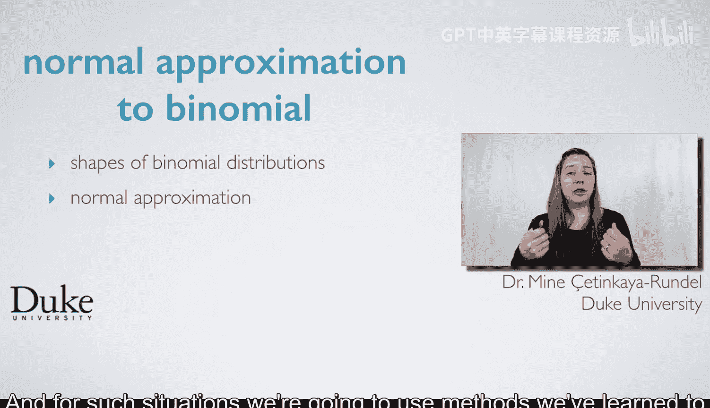
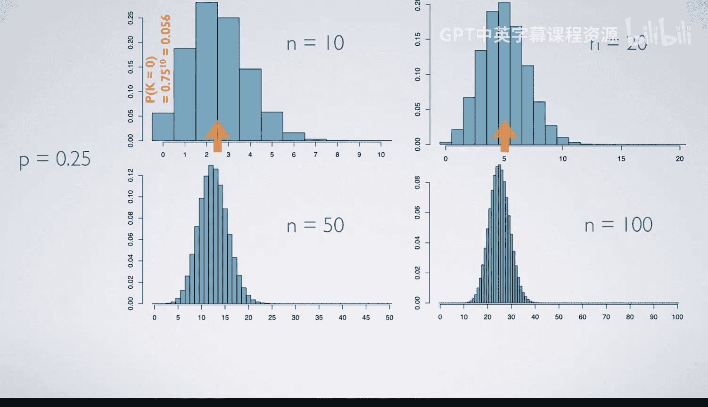
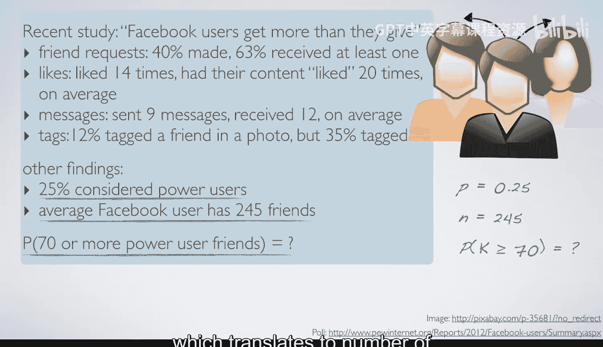
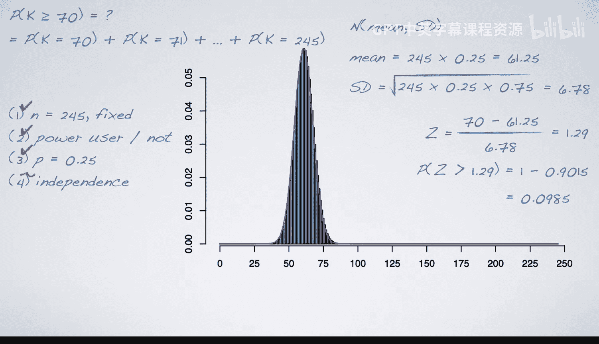
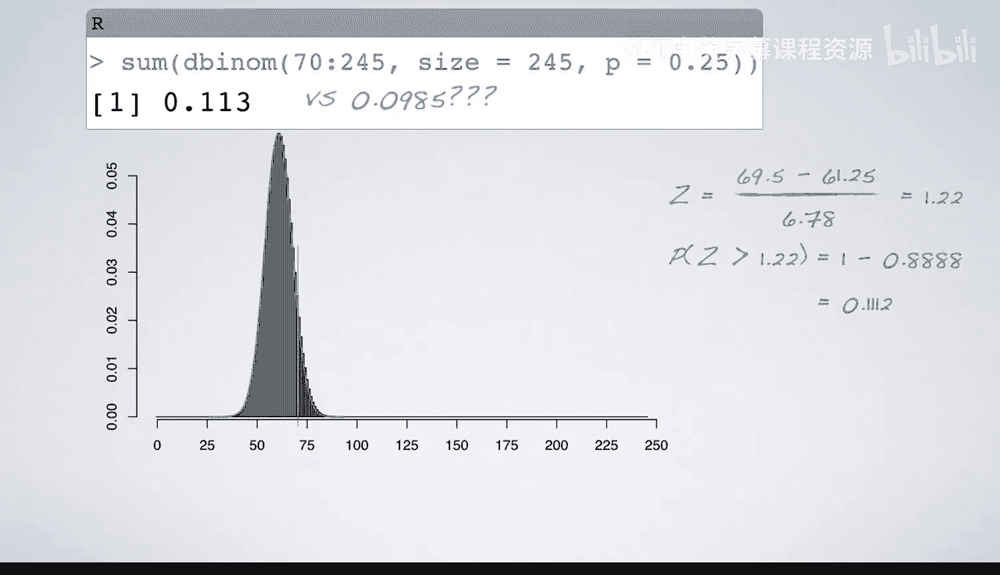
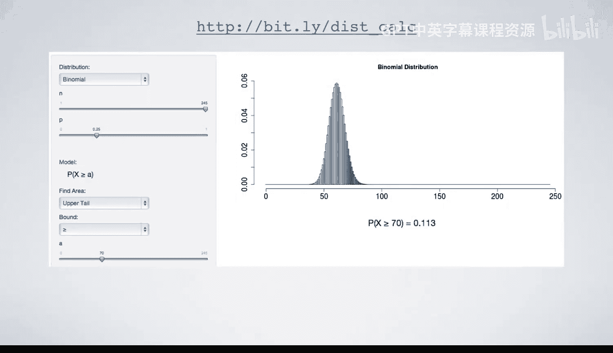
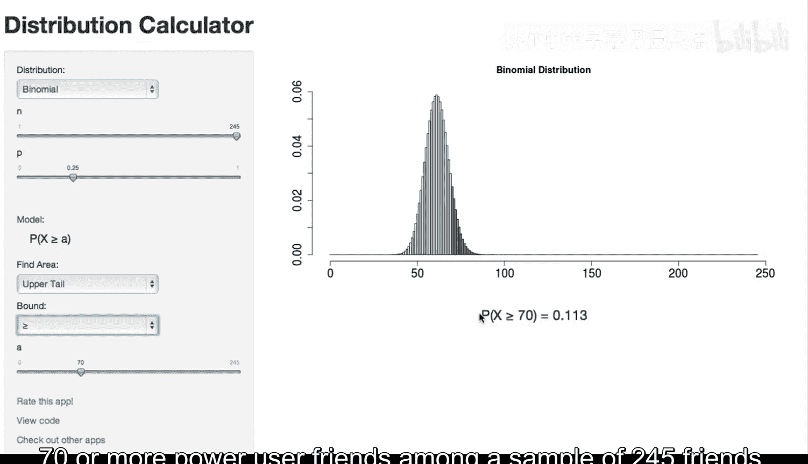
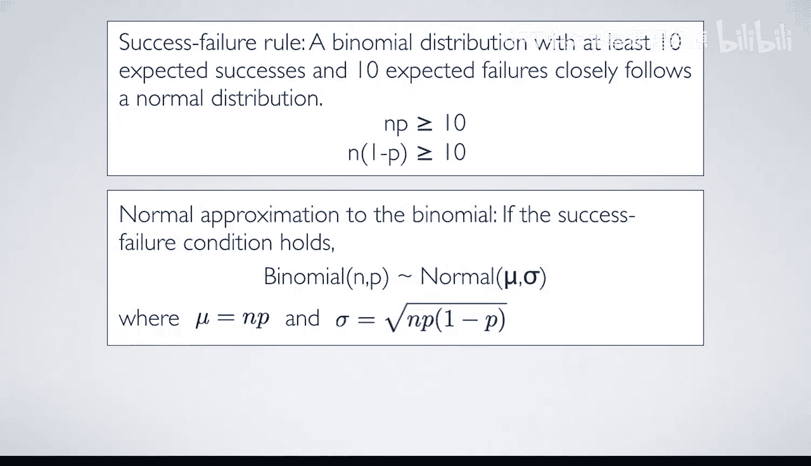
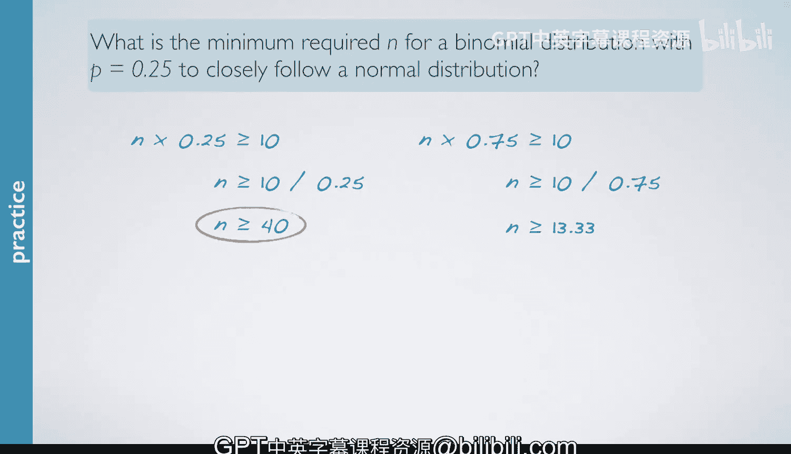

# 杜克大学《R语言数据分析（R语言、概率与数据入门，推断统计，线性回归与建模）｜Data Analysis with R》中英字幕 p28 28_08_03_二项分布的正态近似.zh_en -BV1Cf421q7mU_p28-

In this video we will discuss shapes of binomial distributions and take a look at how they change as we tweak some of its parameters。

 such as the number of trials or the probability of success。

 we will also talk about the fact that when the number of trials increases。

 the shape of the binomial actually starts looking closer and closer to a normal distribution and for such situations we're going to use methods we've learned to calculate normal probabilities to approximate binomial probabilities。

Say we have a binomial random variable with probability of success 0。25。

 This is what the distribution looks like when n is equal to 10。

 Let's pause for a moment and carefully examine what we're seeing here。

 Each bar represents a potential outcome with 10 trials。

 The number of successes could range anywhere from 0 to 10， and therefore we have 11 bars here。

 heights of the bars represent the likelihood of these outcomes。 For example。

 the probability of 0 successes can be calculated as 0。75。

 The probability of failure raised to the 10th power since 0 successes basically means 10 failures。

 This value comes out to be approximately 0。056， which is the height of this bar。

With n equals 10 and p equals 0。25， the expected number of successes is 2。5。

 and hence the distribution is centered around this value。

 So the binomial distribution with P equals 0。25 and n equals 10 is right skewed。

Let's increase the sample size a bit， keeping P constant at 025。 with n equals 20。

 We see a change in the center of the distribution。

 which is expected since n times P is now different， but we also see a change in the shape。

 The distribution， while still right skewed is looking much less skewed。

Increasing the sample size further to 50， the distribution looks even more symmetric and much smoother。

 and increasing the sample size even further to 100。

 The distribution looks no different than the normal distribution。

 So let's take a look at why this might be of interest within the context of data from a study on Facebook usage。

A recent study found that Facebook users get more than they give， for example。

 40% of Facebook users in our sample made a friend request， but 63% received at least one request。

Users in the sample pressed the like button next to friend's content an average of 14 times。

 but had their content liked an average of 20 times。 Users sent 9 personal messages on average。

 but received 12，12% cent of users tagged a friend in a photo。

 but 35% cent were themselves tagged in a photo。So what explains this phenomenon。

 The answer is power users， those who contribute much more content than the typical user。

 I'm sure you all have a few friends like that who are so much more active than everyone else on your friend list。

Some of the other findings from the study are that 25% of Facebook users are considered power users。

 so these are the ones that give more than they get and that the average Facebook user has 245 friends。

We're looking for the probability that an average Facebook user with 245 friends have 70 or more friends who are power users。

So what do we have here， 25% are considered power users。

 which means that probability of success is 0。25， and the average Facebook user has 245 friends。

 meaning that n is equal to 245。The probability we're interested in is 70 or more power user friends。

 which translates to number of successes equal to or greater than 70。

We have n equals 245 trials， a fixed number， Each trial outcome can be classified as a success or a failure。

 power user or now power user， The probability of success is the same for each trial 25% and we're going to assume that the trials are independent。

 they might not be in reality since if you're the type of person to have some friends who are power users。

 the others might be more likely to be power users as well， but again。

 we're going to assume independence for the sake of this example。

This is what the binomial distribution with n is equal to 245 and p is equal to 0。25 looks like。

 and we're interested in the probability of 70 or more successes。

 meaning that 70 or more power user friends among 245 What does that mean that 70 or 71 or 72 all the way up to 245？

So what we're interested in is the sum of probabilities of each one of these outcomes 70 through 245。

We can calculate each one of these probabilities using the binomial formula and add them up。

 but that really does not sound like fun。 This is where the resemblance between the binomial distribution and the normal distribution comes in very handy。

 The blue shaded area of interest can just as well be calculated as the area under the smooth。

 normal curve that closely resembles the more jagged binomial distribution。

Because calculating a shaded area under the normal curve is a much simpler task than calculating individual binomial probabilities for all of these outcomes and adding them up。

 we might want to use that method。To calculate a normal probability。

 we need a little more information on the parameters of the normal distribution。

These can be estimated by the mean and the standard deviation of the original binomial distribution。

 The mean is n times p， so that's 245 times 0。25，61。

25 and the standard deviation is the square root of 245 times 025 times 0。75 which comes out to be 6。

78， so among 245 friends， we expect 61。25 power users give or tag 6。78。Given an observation。

 the mean and the standard deviation， we can calculate the area under the curve via a z score。

 so the z score is going to be the observation 70 minus 61。25 the mean divided by 6。78。

 the standard deviation， which comes out to be 1。29。

We can then find the probability of a z score being greater than 1。

29 since we shaded the area underneath the curve beyond the observation of interest。

 So we want to take a look on our table to 1。29 as the z score and in the intersection of the row in the column of interest。

 we can see 0。9015。 The probability of obtaining a z score greater than 1。

29 is going to be 1 minus that probability from the table。 Why are we doing this 1 minus bit， Well。

 because a table always gives us the percentile or the area under the curve below the observed value and we want to find the complement of that which comes out to be 0。

0985。So there is a 9。85% chance that an average Facebook user with 245 friends has at least 70 friends who are considered power users。

We can also directly calculate this probability using R and the D by no function we've seen before。

 The first argument in the function is the number of successes。

 and we're interested in everything between 70 and 245。 The second argument is the total sample size。

245。 and the third is a probability of success for each trial。

 So with this function here is doing is actually  two things。 First。

 calculating the probabilitybabilities for each outcome 707172 all the way up to 245。

 And then we wrap that around with the sum function。 So we're adding all of that up。

 The probability comes out to be 0113 or 11。3%。😊，Versus the 0。0985 we found before。

Why are these values ever so slightly different。 On one hand， it makes sense。

 We call the approach the normal approximation to the binomial。 after all。

 So it's just an approximation and not an exact result。 On the other hand。

 if we need the exact probability， the difference may be frustrating。

 Let's take a closer look at the binomial distribution and the normal approximation to it。

We can see that the red normal curve is slightly different than the bars representing the exact binomial probabilities。

 It falls a little bit short。 Also， under the continuous normal distribution。

 The probability of exactly 70 successes is undefined。

 So the shaded area above 70 doesn't exactly include the probability of 70 successes。

 A common fix to this problem is a 05 adjustment to the observation of interest。

 So we calculate the Z score using 69。5 as opposed to 70， which yields an adjusted Z score of 1。22。

Everything else about the method stays the same， and the result we get。

 and you can confirm this using a table or computation is now much closer to the exact result from the binomial distribution。

 0。1112 versus 0。113。

One other method for calculating binomial probabilities is using an applet。

 so let's go to this website where the apple can be found and let's take a look to see how we can calculate this probability。

We're working with the binomial distribution so that's a distribution that we're going to pick our number of trials our number of friends here is 245。

 so we're going to slide n across to 245， and our probability of success is 0。

25 so we're going to slide the P to 0。25。We're looking for the area above 70。

 So let's take our cutoff value to 70。And remember that we're looking for the upper tail。

And we're looking for greater than or equal to， so we want to pick our bound to be that as well。

 and once again， we can see that same probability 11。

3% chance of having 70 or more power user friends among a sample of 245 friends。

In the example we just presented， we plotted the binomial distribution using computation and visually confirmed that it looked unimmodal and symmetric。

 roughly similar to a normal distribution。 But what if we couldn't plot the binomial distribution。

 What are some guidelines that we can use to determine whether the sample size or the number of trials is large enough such that we can be confident in estimating the binomial distribution using the normal。

 In other words， how can we tell if the shape of the binomial distribution is going to be unimmodal and symmetric and closely follow the normal distribution。

The rule of thumb is the success failure condition。

 which says that a binomial distribution with at least 10 expected successes and 10 expected failures closely follows a normal distribution。

 so that's n times p needs to be greater than or equal to 10 and n times 1 minus p needs to be greater than or equal to 10。

And in cases where it does， we can approximate the binomial distribution with the normal where the parameters of the normal distribution are calculated as the mean and standard deviation of the binomial。

 We also talked about the 0。5 adjustment to make the probabilities calculated using the normal approximation much closer to the exact probabilities from the binomial distribution but I encourage you to not focus on those details a whole lot。

 but instead try to focus on the bigger picture remember that the binomial distribution with sufficient sample size starts to look nearly normal。

 This is important and we're emphasizing this here because when we later on get to doing inference for categorical variables with two outcomes So those are kind of like Bnoulli outcomes that follow a binomial distribution。

 we're going to make use of the fact that the distributions start to look nearly normal and we're going to apply methods that are based on the normal distribution to do inference for the。

Varis， Let's do a quick practice problem。 What is the minimum n or the sample size required for a binomial distribution with probability of success equaling 0。

25 to closely follow a normal distribution。 We know that n times p needs to be greater than or equal to 10 and n times 1 minus p needs to be greater than or equal to 10 as well。

 So for both of these equations， we want a solve for n and then we're going to take the maximum of those since that's going to be the minimum required sample size。

 Well， for n times 0。25 to be greater than or equal to 10。

 and needs to be greater than or equal to 40 for n times 0。

75 to be greater than or equal to 10 and needs to be greater than or equal to 13。33。

 So the answer is we need at least 40 observations for a binomial distribution with p equals 0。

25 to closely follow a normal distribution。

