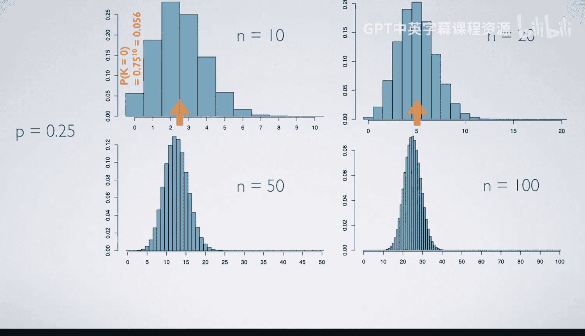
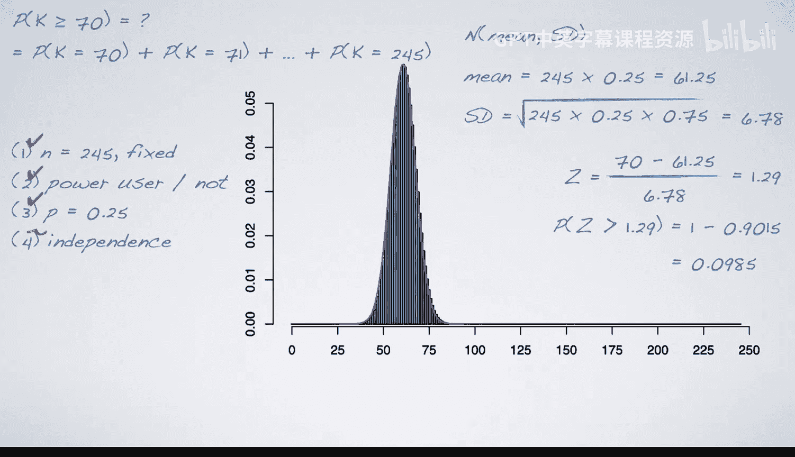
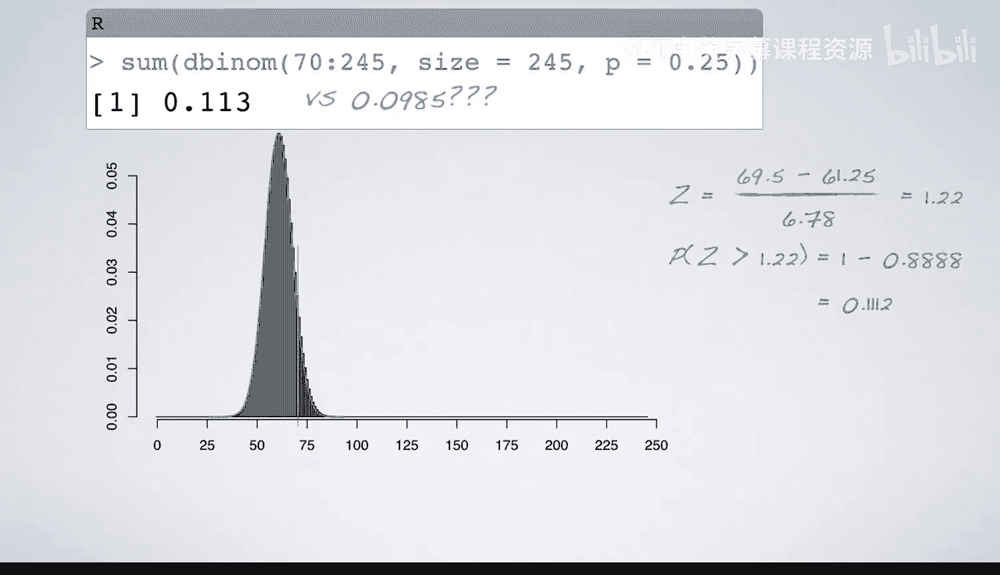
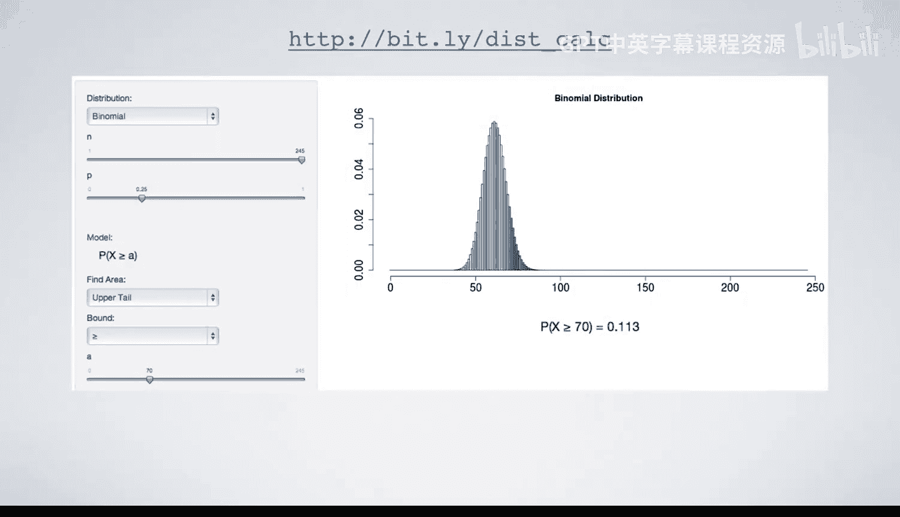
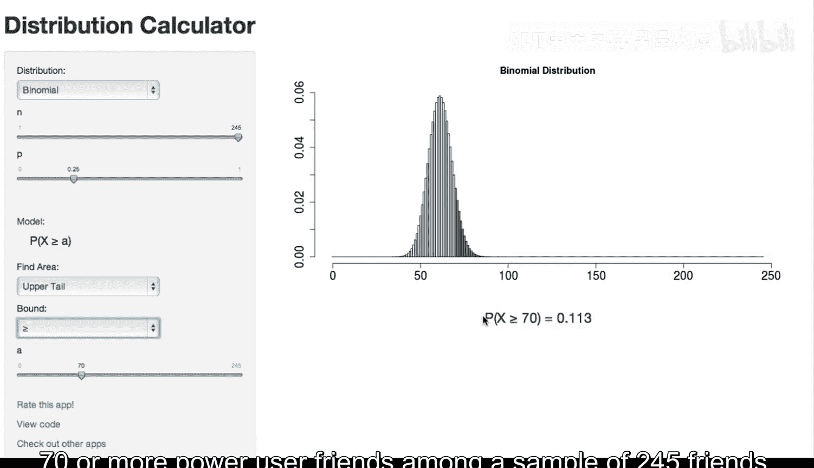
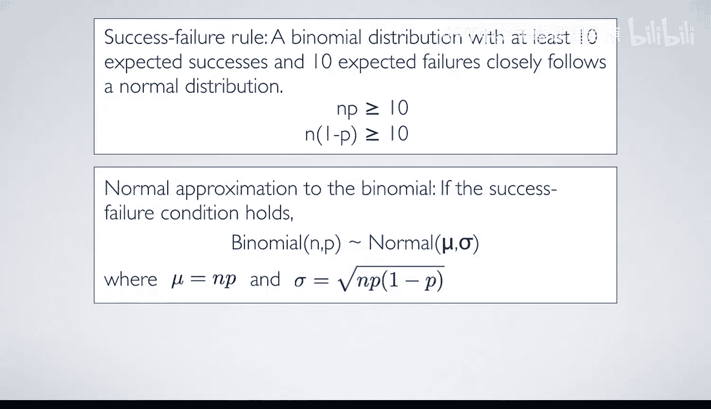

# R语言数据分析：28：二项分布的正态近似 📊

在本节课中，我们将要学习二项分布的形状如何随参数变化，并探讨当试验次数增加时，二项分布如何逐渐接近正态分布。我们将学习利用正态分布的计算方法来近似求解二项分布的概率问题。


## 二项分布的形状变化 🔄

上一节我们介绍了二项分布的基本概念，本节中我们来看看它的形状如何随参数变化。

假设我们有一个二项随机变量，其成功概率 `p = 0.25`。下图展示了当试验次数 `n = 10` 时该分布的形状。


让我们暂停一下，仔细观察这张图。每个条形代表在10次试验中可能出现的成功次数，范围从0到10，因此共有11个条形。条形的高度代表该结果出现的可能性。例如，0次成功的概率计算公式为 `(0.75)^10`，因为0次成功意味着10次失败，计算结果约为0.056，即该条形的高度。

当 `n = 10`， `p = 0.25` 时，期望成功次数为 `2.5`，因此分布围绕这个值中心化。此时，二项分布是右偏的。




让我们保持 `p = 0.25` 不变，将样本量增加到 `n = 20`。我们看到分布的中心发生了变化（因为 `n * p` 不同了），同时形状也发生了变化。分布虽然仍是右偏，但偏斜程度大大降低。

将样本量进一步增加到 `n = 50`，分布看起来更加对称和平滑。当样本量增加到 `n = 100` 时，分布看起来与正态分布几乎没有区别。

## 应用场景：Facebook用户研究案例 📱

接下来，我们通过一个Facebook用户研究的案例，看看为什么这种近似关系很有用。


一项近期研究发现，Facebook用户“得到”的往往多于“付出”。例如，样本中40%的用户曾发出好友请求，但63%的用户至少收到过一个请求。用户平均为好友内容点赞14次，但自己的内容平均被点赞20次。用户平均发送9条私信，但收到12条。12%的用户在照片中标记过朋友，但35%的用户自己被标记过。

这种现象的解释是“超级用户”的存在，即那些贡献内容远多于普通用户的用户。研究还发现，25%的Facebook用户被认为是超级用户，且平均每个用户有245个好友。

我们的问题是：**一个拥有245个好友的平均Facebook用户，其好友中有70个或更多是超级用户的概率是多少？**

以下是问题中的关键信息：
*   成功概率 `p = 0.25`（好友是超级用户）。
*   试验次数 `n = 245`（好友总数）。
*   我们感兴趣的概率是成功次数 `k >= 70`（至少有70个超级用户好友）。

## 正态近似法的应用 🧮

我们有 `n = 245` 次独立试验，每次试验（一个好友）的结果是成功（超级用户）或失败（非超级用户），每次成功的概率固定为 `p = 0.25`。下图是 `n = 245`， `p = 0.25` 的二项分布图，我们感兴趣的是 `k >= 70` 的概率，即从70到245所有可能成功次数的概率之和。


我们可以用二项公式计算从70到245每一个结果的概率然后相加，但这非常繁琐。此时，二项分布与正态分布的相似性就派上用场了。图中蓝色阴影区域的面积，可以用一条平滑的正态曲线下的面积来近似计算，这比计算并累加大量二项概率要简单得多。

要计算正态概率，我们需要知道正态分布的参数，这可以通过原二项分布的均值和标准差来估计。
*   均值 `μ = n * p = 245 * 0.25 = 61.25`
*   标准差 `σ = sqrt(n * p * (1-p)) = sqrt(245 * 0.25 * 0.75) ≈ 6.78`

这意味着，在245个好友中，我们期望有约61.25个超级用户，标准差约为6.78。

给定观测值 `x = 70`、均值 `μ` 和标准差 `σ`，我们可以通过计算Z分数来求曲线下的面积。
*   Z分数公式：`Z = (x - μ) / σ = (70 - 61.25) / 6.78 ≈ 1.29`



由于我们关注的是观测值 `70` 右侧的阴影区域，我们需要计算 `Z > 1.29` 的概率。查标准正态分布表，`Z = 1.29` 对应的左侧面积为 `0.9015`。因此，`Z > 1.29` 的概率为 `1 - 0.9015 = 0.0985`。

所以，一个拥有245个好友的平均Facebook用户，其好友中至少有70个超级用户的概率约为 **9.85%**。

## 精确计算与连续性校正 🔍

我们也可以直接使用R语言的 `dbinom` 函数进行精确计算。

```r
# 计算从70到245所有成功次数的概率之和
sum(dbinom(70:245, size = 245, prob = 0.25))
```

计算结果约为 `0.113` 或 **11.3%**，与我们之前近似得到的 `0.0985` 略有不同。

一方面，这在意料之中，因为“正态近似”本身就是一种近似。另一方面，如果需要精确概率，这个差异可能令人困扰。让我们仔细对比二项分布和它的正态近似。






我们可以看到，红色的正态曲线与代表精确二项概率的条形略有不同。此外，在连续的正态分布下，“恰好70次成功”的概率是未定义的，因此`70`右侧的阴影面积并未完全包含“70次成功”的概率。

一个常见的修正方法是进行 **0.5的连续性校正**。即用 `69.5` 代替 `70` 来计算Z分数。
*   校正后Z分数：`Z = (69.5 - 61.25) / 6.78 ≈ 1.22`
*   查表得 `Z = 1.22` 对应左侧面积 `0.8888`，因此右侧概率为 `1 - 0.8888 = 0.1112`

经过连续性校正后，近似结果 `0.1112` 与精确二项结果 `0.113` 就非常接近了。



## 使用在线工具计算 🛠️

另一种计算二项分布概率的方法是使用在线统计计算器（Applet）。


操作步骤如下：
1.  选择“二项分布”。
2.  将试验次数 `n` 滑动到 `245`。
3.  将成功概率 `p` 滑动到 `0.25`。
4.  将临界值设置为 `70`。
5.  选择计算“上尾”概率（大于或等于）。
计算结果再次确认了 **11.3%** 这个精确概率。

## 成功-失败条件与总结 📝

在刚才的例子中，我们通过绘图直观地确认了二项分布是单峰、对称且近似正态的。但如果我们无法绘图，如何判断样本量是否足够大，可以放心地使用正态近似呢？

经验法则是 **成功-失败条件**：
*   一个二项分布，当期望成功数 **`n * p >= 10`** 且期望失败数 **`n * (1 - p) >= 10`** 时，可以认为它近似服从正态分布。



在这种情况下，我们可以用均值为 `μ = n * p`、标准差为 `σ = sqrt(n * p * (1-p))` 的正态分布来近似它。为了获得更精确的近似概率，可以对观测值进行 `0.5` 的连续性校正。

让我们做一个快速练习：对于成功概率 `p = 0.25` 的二项分布，要使其近似正态分布，所需的最小样本量 `n` 是多少？
*   根据条件一：`n * 0.25 >= 10` => `n >= 40`
*   根据条件二：`n * 0.75 >= 10` => `n >= 13.33`
取两者中较大的值，因此最小需要 **40** 次观测。


**本节课总结：**
本节课中我们一起学习了二项分布的形状如何随参数变化。我们了解到，当试验次数足够大时（满足成功-失败条件），二项分布的形状会非常接近正态分布。这使得我们可以利用更简单的正态概率计算方法来近似求解复杂的二项概率问题。我们还介绍了连续性校正来提高近似的精确度，并通过Facebook的案例演示了整个应用过程。理解二项分布的正态近似，是后续对二分类型变量进行统计推断的重要基础。