# 杜克大学《R语言数据分析（R语言、概率与数据入门，推断统计，线性回归与建模）｜Data Analysis with R》中英字幕 p29 29_08_04_二项分布应用.zh_en -BV1Cf421q7mU_p29-

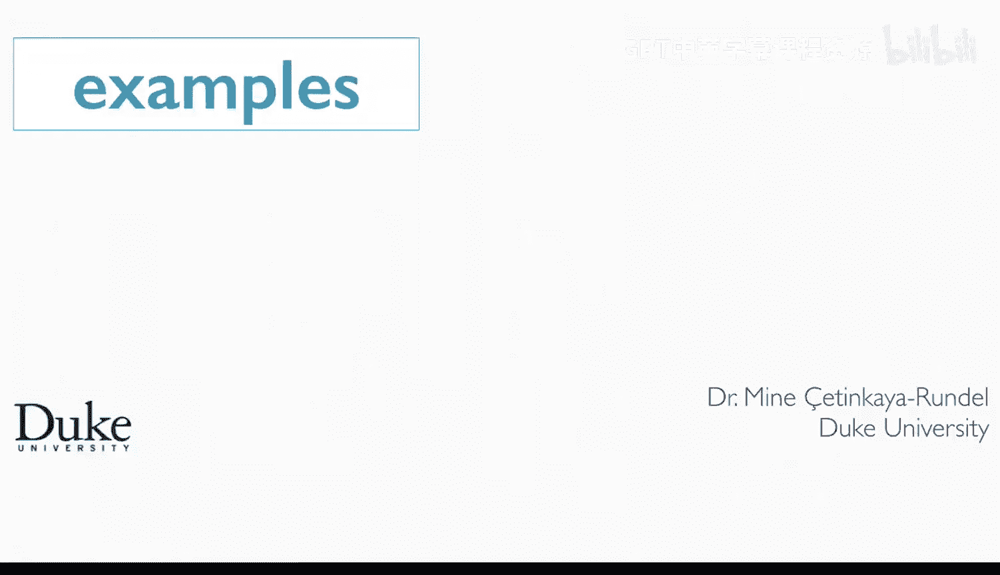

According to a 2014 Gallup poll，56% of uninsured Americans who plan to get health insurance say they will do so through a government health insurance exchange。

 What is the probability that in a random sample of 10 people。

 exactly 6 plan to get health insurance through a government health insurance exchange。

Using the applet， this is going to be pretty simple to calculate。

 So let's take a look at how we can do that。

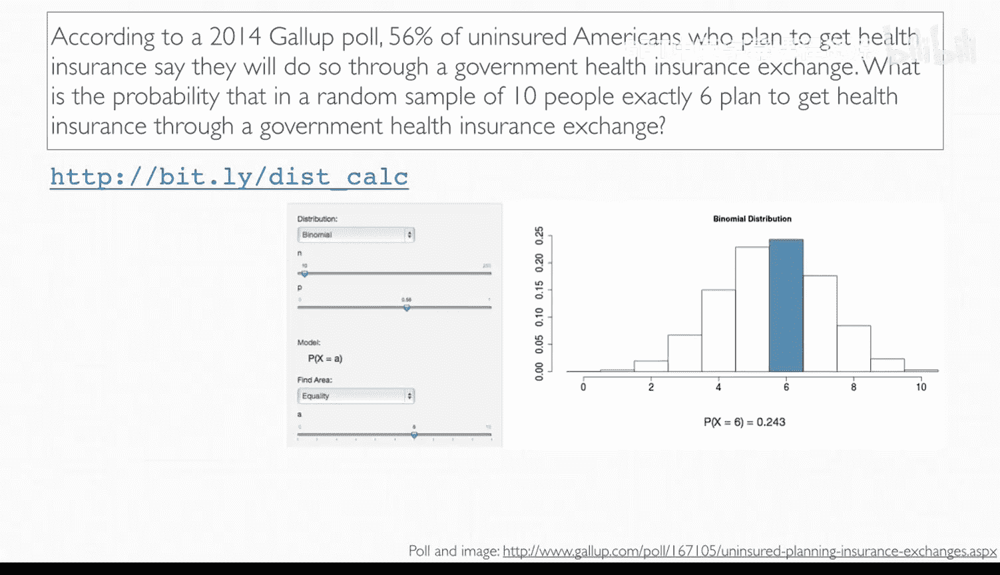

We have a binomial distribution， so we're going to select our distribution to be binomial。

 our sample size is 10 and our probability of success is 0。56。We're looking for an exact probability。

 so we're going to pick equality here of exactly six successes。

So the probability of six successes in 10 trials where the probability of success is 0。

56 comes out to be 0。243 or 24。3% chance that in a random sample of 10 people exactly six plan to get health insurance through a government health insurance exchange。

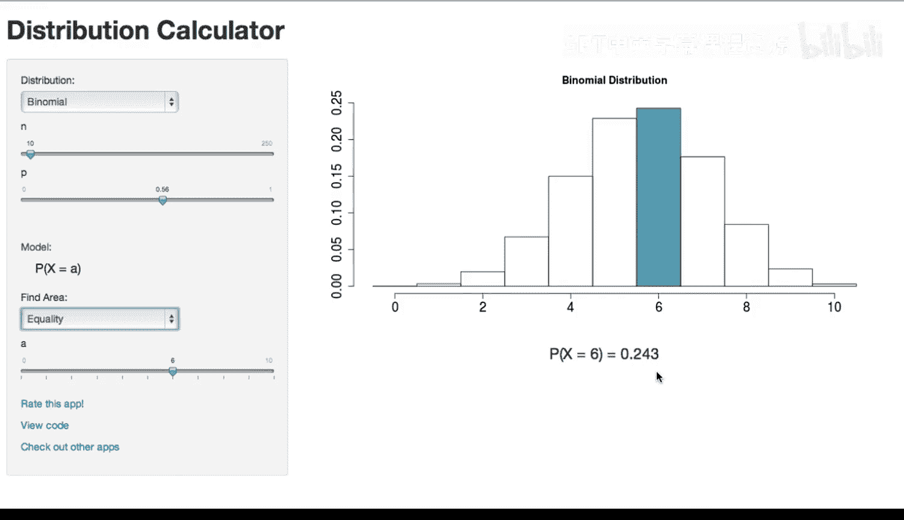

Alternatively， using R in the D byome function， we set the number of successes。

 the first argument to 6， the size to 10 and the probability of success to 0。56。

 and obtain the same answer 24。3%。We also know how to calculate this by hand。

 We're looking for the probability of exactly six successes in 10 trials。

 so we can write this out as 10 choose 60。56 to the  sixth power times 0。44。

 the probability of failure to the fourth power and minus K。

We can expand the choose function to 10 times 9 times 8 times 7 times6 factorial and similarly expand out the denominator a little bit as well。

 but we don't have to do a whole lot since the six factorials are going to cancel。And moreover。

 the four and the two cancel with the eight we can actually simplify three and9 and what we get is 10 times 3 times 7 210 possible scenarios times the probability of one scenario gets us to the same answer 0。

243 if we were to look for that once again in the binomial distribution that's going to be the height of the bar corresponding to exactly six successes This is a pretty likely outcome if we think about it because it's actually pretty close to what we would expect to see in 10 people we would expect to get about 5。

6 to say yes to this and so the probability of exactly six successes is going to be not far off from the mark。

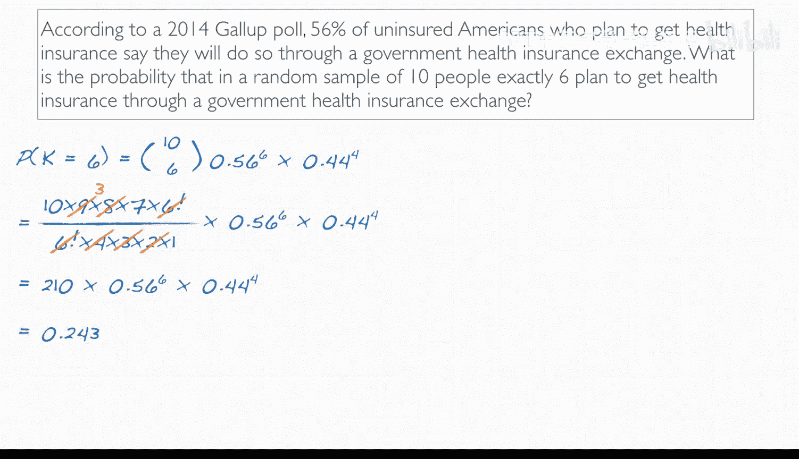

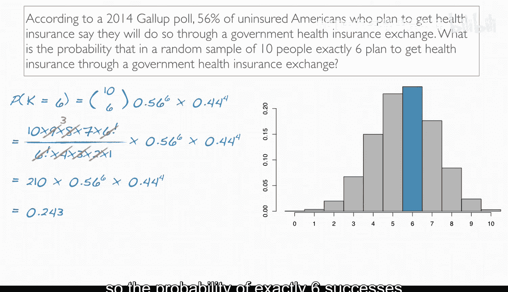

Let's take a look at another question What is the probability that in a random sample of 1。

000 people， exactly 600 plan to get health insurance through a government health insurance exchange？

The options are 0。243。 That's the same as the earlier probability we calculated where K was equal to 6 and n was 10。

 less than 0。243 or more than 0。243。 We want to answer this question without doing any calculations as its' aimed to assess reasoning and conceptual understanding as opposed to just computational ability。

 Once again， the probability of success is 0。56。 In the previous exercise， the sample size was 10。

 So the expected number of successes would be 10 times 0。56，5。6。

The difference between the expected and the desired number of successes then would be 6-5。6。

4 In this exercise， the sample size is 1000。 So the expected number of successes is 1000 times 056560。

 The difference between the expected and the desired number of successes is then 600-56040。Here。

 the desired outcome is much farther than the expected outcome。

 And based on our discussion of law of large numbers earlier， obtaining 600 successes。

 when the expected is 560 should be a much less likely outcome than obtaining 6 successes when the expected is 5。

6。 Therefore， the answer is something less than 0243。

We can actually check our answer quickly using our probability of 600 successes in 1000 trials with probability of success of 0。

56 is roughly 0。00098， much lower than the 243 we calculated earlier。

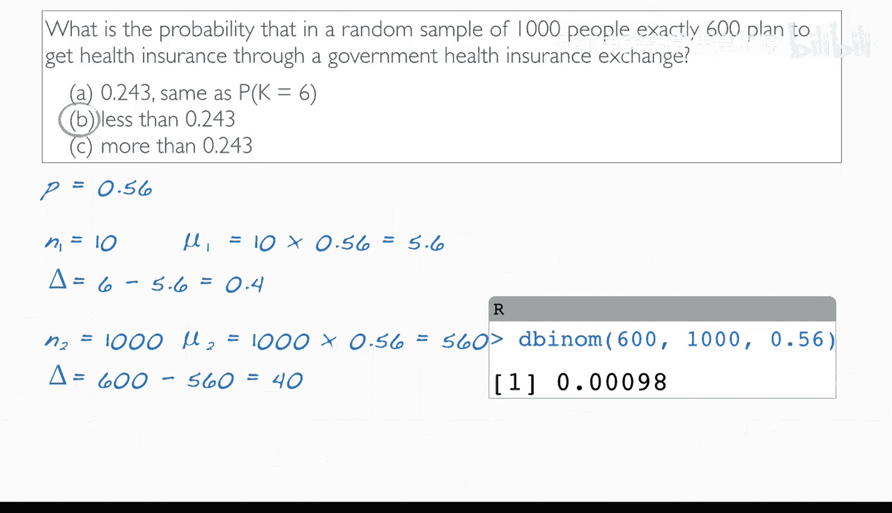

Next， we're asked to describe the probability distribution of number of uninsured Americans who plan to get health insurance through a government health insurance exchange among a random sample of 100。

 Once again， P is 0。56。 This time， N is 100。 This seems like a large sample size。

 So let's see if it's actually large enough to yield a nearly normal distribution。

 The rule was that we need at least 10 expected successes and 10 expected failures。

 Exp number of successes is 100 times 056， which is 56， which is indeed greater than 10。

 and the expected number of failures is 100 times 044， which is equal to 44。

 which is also greater than 10。 So we do know that the shape of the distribution will be nearly normal。

 Nor distributions have two parameters。 mean and standard deviation。

 So to fully describe the distribution， we need to calculate these。

which we know can be estimated by the binomial mean and standard deviation。 mean， In other words。

 the expected number of successes is 56。 We already calculated this。

 and the standard deviation can be calculated as the square root of n times P times 1 minus P。

 So that's the square root of 100 times 0。56 times 0。44， roughly 4。96。

So this binommial distribution shape actually follows a normal distribution with mean 56 and standard deviation 4。

96。

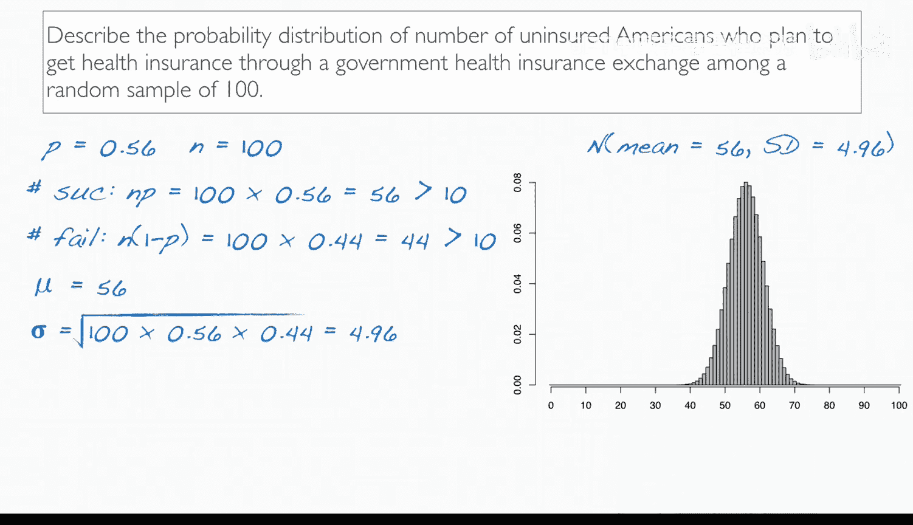

Lastly， let's consider the following question。 What is the probability that at least 60 out of a random sample of 100 uninsured Americans plan to get health insurance through a government health insurance exchange。

 Once again， we'll present a variety of ways of solving this。

 though you can really just pick one and stick with it。 One approach is once again to use the applet。

 So let's take a look at how we could solve this question there。

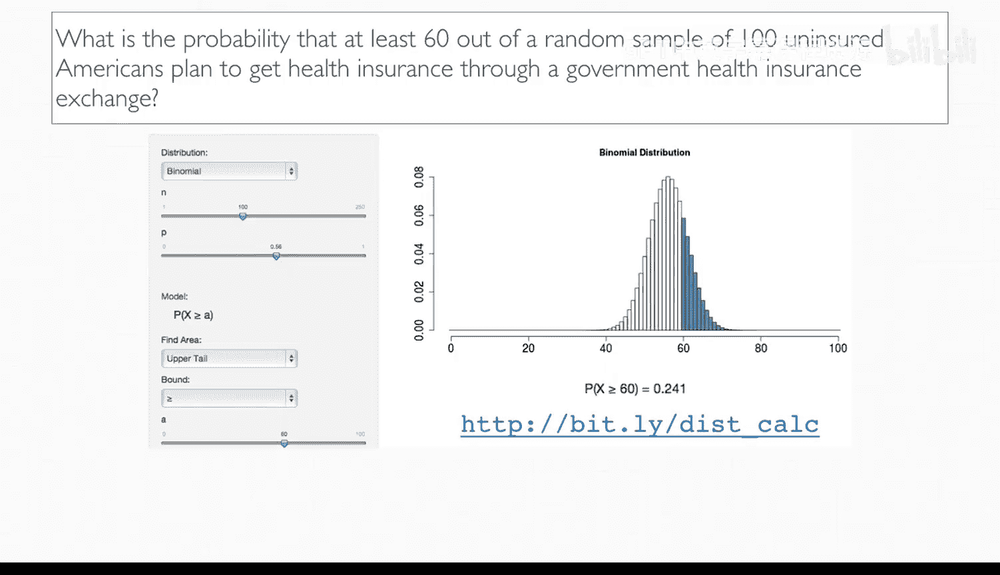

Once again， the distribution is binomial。 This time， our number of trials is 100。

 so we're going to slide over our n to 100。Probability of success is 0。56。

 the observation of interest is 60 successes， so we're going to slide our cutoff value to 60。

And we're looking for not just exactly 60 successes， but 60 or more successes。

 So we want to find the upper tail area and the bound we're interested in is greater than or equal to。

 Here's the shaded area of interest。 The probability comes out to be 24。1% chance。😊。

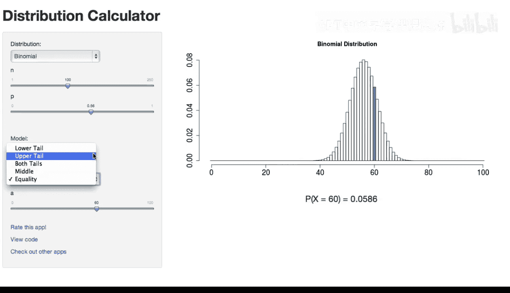

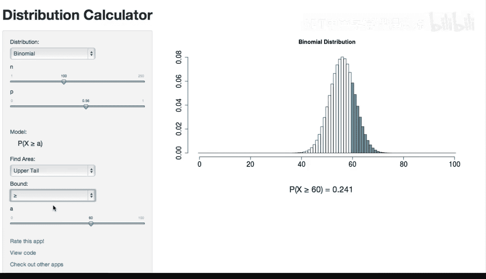

Another approach is to use R。 And once again， we're going to make use of two functions。

 the D binome function that gives us the probabilities and the sum function that allows us to add a bunch of probabilities that we're interested in。

 So in the Dome function， the first argument is all successes from 60 to 100。 Our sample size is 100。

 and our probability of success is 0。56。 Then we wrap this around with the sum function that will basically add up all the individual probabilities and yield a probability of 24。

1%。 just like the one we obtained earlier。Lastly， we can make use of the fact that the distribution is nearly normal with mean 56 and standard deviation 4。

96。

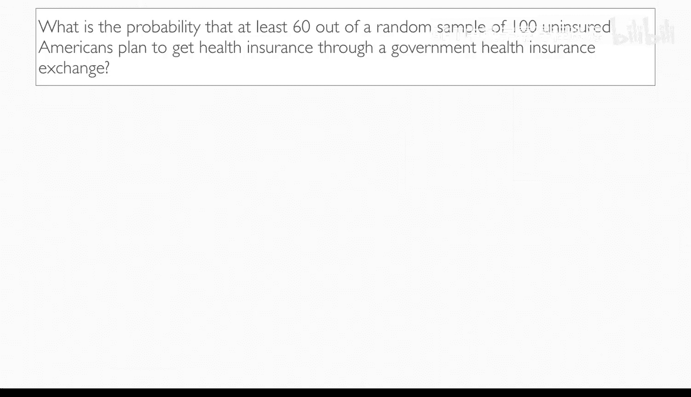

When finding normal probabilities， we calculate the Z score as the observation 60 minus the mean 56 divided by the standard deviation 4。

96。 This comes out to be roughly 0。81。 The next step would be to find 0。81 on a table。

 And if you're not sure how to do that， I recommend that you review earlier lectures working with the normal probability table。

 and we would find the probability to be roughly 0209。 Once again。

 this probability is a little lower than the probabilitybabilities we've calculated using the applet and R。

 Remember that this discrepancy is mostly due to the fact that under the normal distribution。

 probability of exactly 606es is undefined to account for that， we apply a 0。

5 correction to the observation of interest and can work through the probability again。

 calculated an updated Z score and an associated probability we can。

Calculate the updated Z score as 59。5 56 the mean divided by the same standard deviation 4。96。

 which comes out to be 0。71 then the updated probability is going to be 0。239。

 which is much closer to the exact probability that we have calculated using the exact binomial distribution。

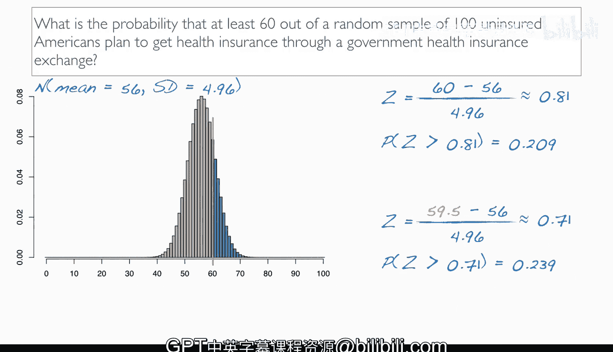