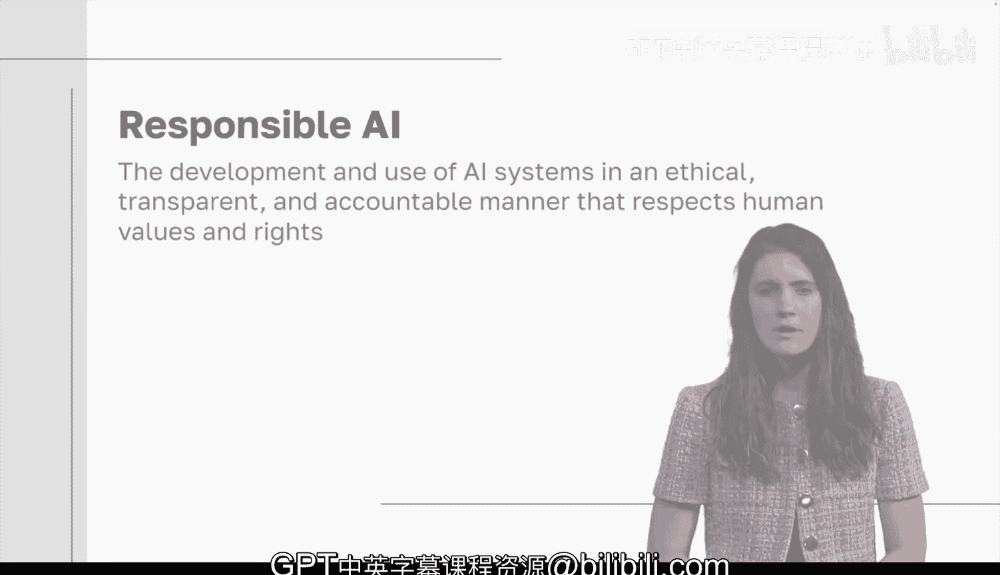
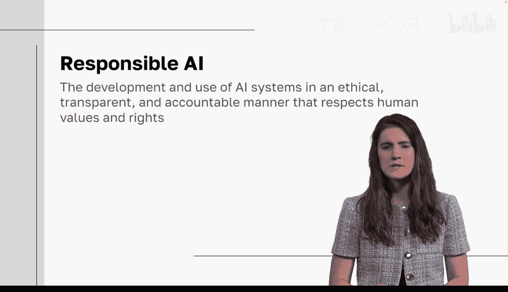
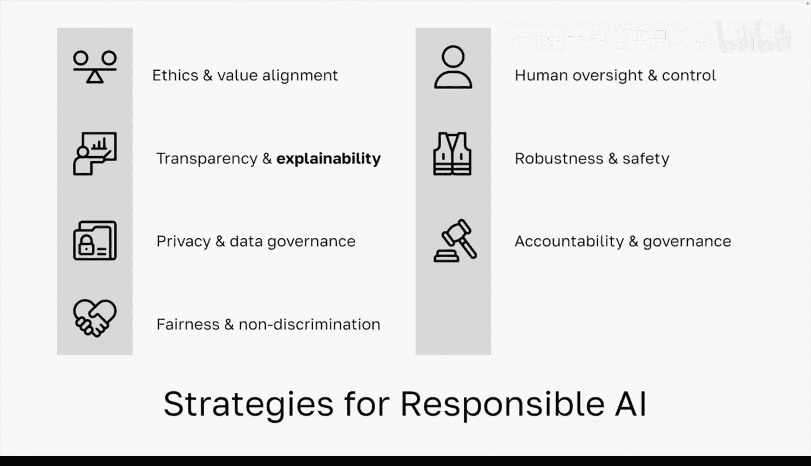

#  004：负责任的人工智能

在本节课中，我们将要学习**负责任的人工智能**这一核心概念。我们将了解其定义、涵盖的策略，并探讨可解释人工智能如何作为其中的关键组成部分，促进人工智能技术的伦理发展。

## 概述：什么是负责任的人工智能？

可解释人工智能是**负责任的人工智能**的一个组成部分。

负责任的人工智能指的是以符合伦理、透明且可问责的方式开发和运用人工智能系统，这种方式尊重人类的价值观和权利。

## 负责任人工智能的策略

负责任的人工智能包含多种策略，旨在开发值得信赖、可靠且有益的系统。其目标是构建在伦理边界内运行的系统，以防止滥用和负面的社会影响。

以下是负责任人工智能的主要策略：

*   **伦理与价值对齐**：确保人工智能系统的设计和部署符合伦理原则、人权以及公平、隐私、安全和福祉等社会价值观。
*   **透明度与可解释性**：这正是我们在第一模块讨论的内容，也是本课程及可解释人工智能专项课程的核心焦点。它旨在使人工智能系统透明化，并向受影响的利益相关者解释其决策过程，从而实现可问责性。
*   **隐私与数据治理**：负责任地管理用于训练人工智能模型的数据，保护隐私，并确保数据的收集和使用符合伦理。
*   **公平性与非歧视**：减轻偏见，确保人工智能模型不会基于种族、性别等敏感属性对个人或群体产生歧视。
*   **人类监督与控制**：纳入人类监督、干预能力以及对人工智能系统关键决策的有效人类控制。
*   **鲁棒性与安全性**：确保人工智能系统具有鲁棒性、可靠性和安全性，并配备充分的测试、监控和风险管理流程。
*   **问责与治理**：为人工智能的开发和使用建立清晰的问责线、审计追踪和治理框架。

## 可解释人工智能与伦理考量

与负责任的人工智能理念一致，讨论这项技术的伦理考量至关重要。需要说明的是，伦理是人工智能领域中一个极其重要的话题，我将在整个专项课程中反复强调。伦理并非仅限于某个单一模块的讨论，而是我们本课程所有讨论的一部分。

可解释人工智能可以成为促进伦理和负责任人工智能的有力工具，但它本身也引发了一系列需要认真对待的伦理考量，这些考量必须通过负责任的可解释人工智能技术的开发、部署和治理来解决。

## 可解释人工智能如何促进伦理实践

上一节我们介绍了可解释人工智能的伦理角色，本节中我们来看看它具体如何促进人工智能技术的伦理实践。

可解释人工智能主要通过以下方式促进人工智能技术的伦理实践：

*   **问责制**：可解释人工智能有助于确保人工智能系统是可问责的，其决策和建议能够得到解释和论证。例如，在医疗领域，如果一个人工智能诊断系统推荐了错误的治疗方案，我们需要能够解释它是如何得出该决策的。训练数据是否存在偏见？算法是否存在缺陷？实施可解释人工智能方法可以帮助我们回答这些问题。这在医疗、金融和刑事司法等领域至关重要，因为人工智能的决策可能对个人和社会产生重大影响。
*   **公平性**：通过揭示模型的决策逻辑，可解释人工智能有助于识别和纠正模型中的偏见，确保其决策对不同群体是公平的。
*   **透明度**：使“黑箱”模型变得可理解，增加了系统的透明度，让用户和监管者能够信任并有效监督人工智能。

## 总结

本节课中，我们一起学习了**负责任的人工智能**这一框架。我们了解到，可解释人工智能是其关键组成部分，旨在通过提高系统的**透明度**、**可解释性**和**可问责性**，来促进符合伦理的人工智能开发与实践。理解这些概念是构建可信、可靠且对社会有益的人工智能系统的基础。