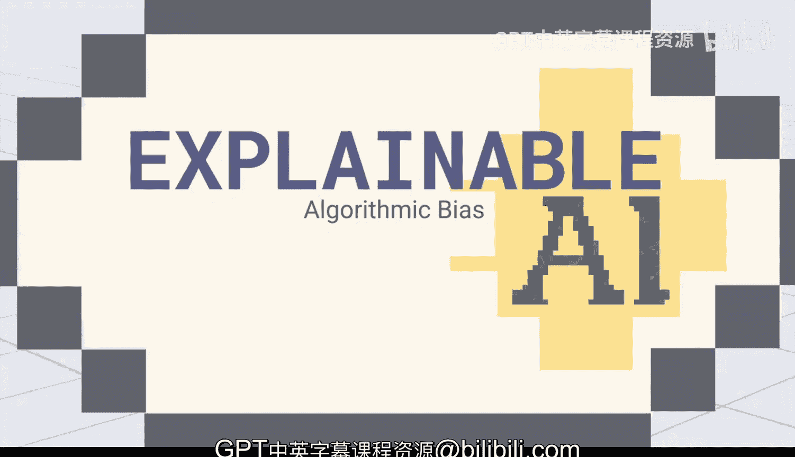
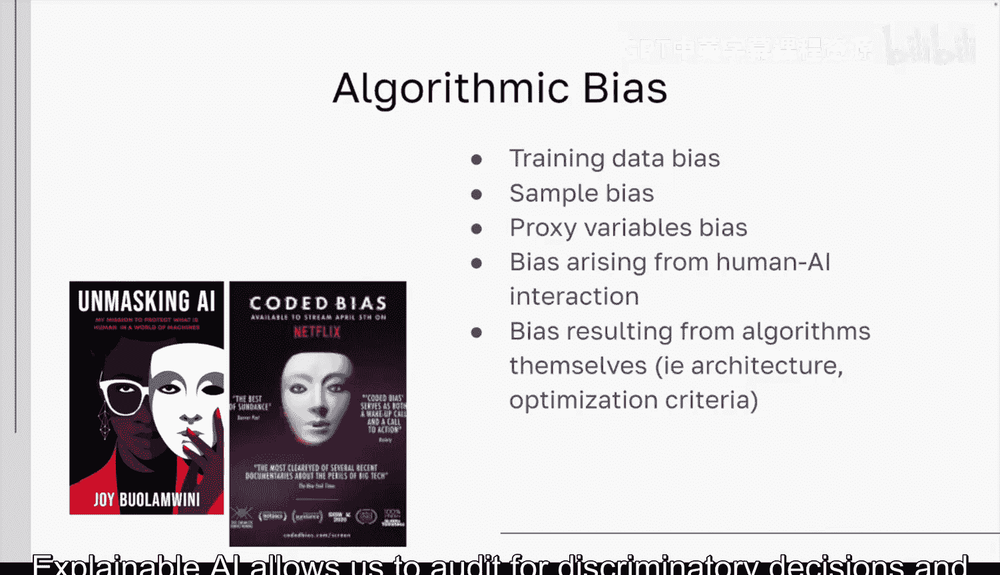
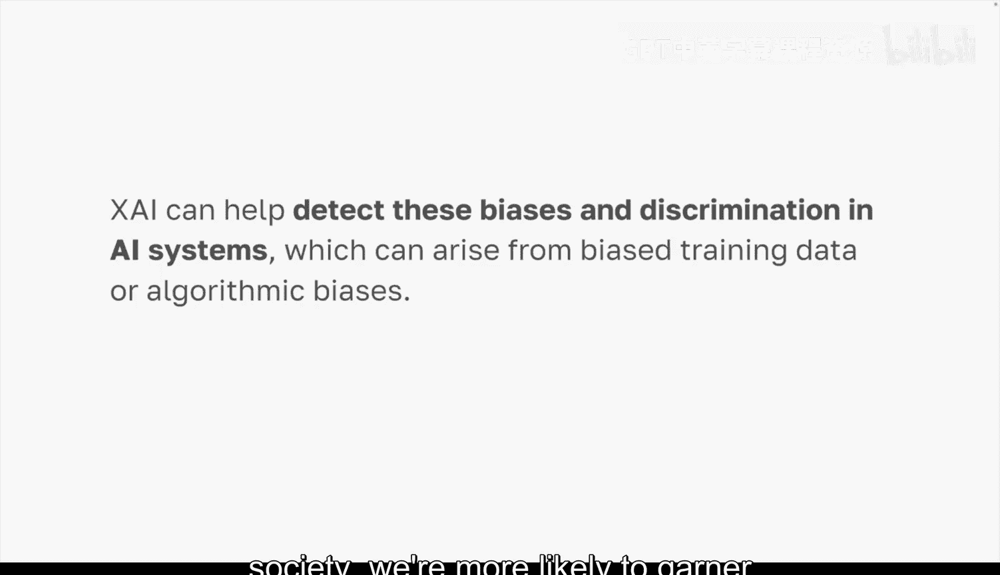

#  005：算法偏见 🧠

在本节课中，我们将要学习人工智能领域中的一个关键议题：算法偏见。我们将探讨偏见如何产生，以及可解释人工智能如何帮助我们检测和纠正这些偏见，以确保AI系统的公平性。

## 算法偏见的重要性与定义

确保人工智能技术的公平性至关重要。然而，当前许多系统都表现出算法偏见。算法偏见是指AI系统因其训练数据、模型架构或实施过程中的各种因素，而表现出不公平、歧视性或倾斜的结果。

上一节我们介绍了算法偏见的基本概念，本节中我们来看看偏见产生的具体途径。

## 算法偏见的来源

偏见可以通过多种方式进入AI系统，例如系统创建者已有的观念、数据收集或模型的设计，以及系统的非预期使用。偏见可以在机器学习流程的任何环节被引入。

以下是偏见产生的主要途径：

1.  **训练数据偏见**：如果用于训练AI模型的数据本身存在偏见，或未能充分代表某些群体，模型就可能学习并延续这些偏见。例如，如果一个人脸识别系统主要使用某一特定种族人群的图像进行训练，它在识别其他种族面孔时可能表现不佳。
2.  **数据收集与处理偏见**：数据收集、抽样或标注的方式可能引入偏见，这被称为样本偏见。例如，如果一个用于简历筛选的数据集主要由来自特定地理区域或行业的简历构成，那么由此训练出的模型可能对其他区域或行业的候选人有偏见。
3.  **代理变量偏见**：算法有时可能依赖与受保护特征（如种族、性别或年龄）相关的代理变量，从而导致对这些群体的间接歧视。
4.  **人机交互偏见**：偏见也可能来自人类与AI系统之间的互动。例如，用户表现出的偏见性语言或行为，会随着时间的推移影响系统的输出。
5.  **算法本身引入的偏见**：即使训练数据是无偏的，算法本身也可能通过其数学公式、优化标准或模型架构引入偏见。

## 可解释人工智能 (XAI) 的作用

正如我们之前讨论的，透明度有助于建立公众信任。如果我们能够打开“黑箱”，向监管机构、受影响的个人和社会解释AI系统的推理过程，就更有可能获得对有益AI应用的认可。

可解释人工智能可以帮助我们检测AI系统中的这些偏见和歧视。通过理解AI系统如何做出决策，我们可以采取措施确保公平性，防止对某些群体或个人造成不公平待遇。可解释人工智能使我们能够审计歧视性决策，并纠正这些不公平的偏见。

## 总结

本节课中我们一起学习了算法偏见。我们了解到，偏见可能源于有偏的训练数据、数据处理过程、代理变量、人机交互，甚至是算法本身。可解释人工智能是识别和解决这些偏见的关键工具，它通过提供透明度，帮助我们构建更公平、更值得信赖的AI系统。