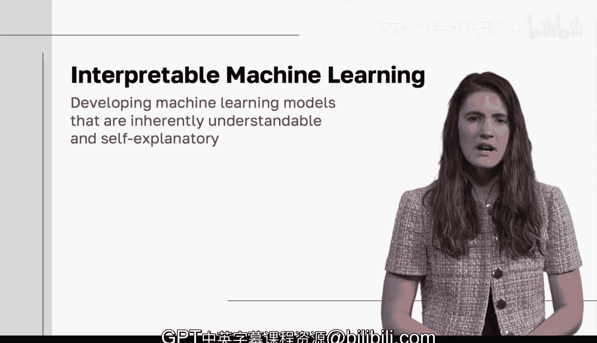
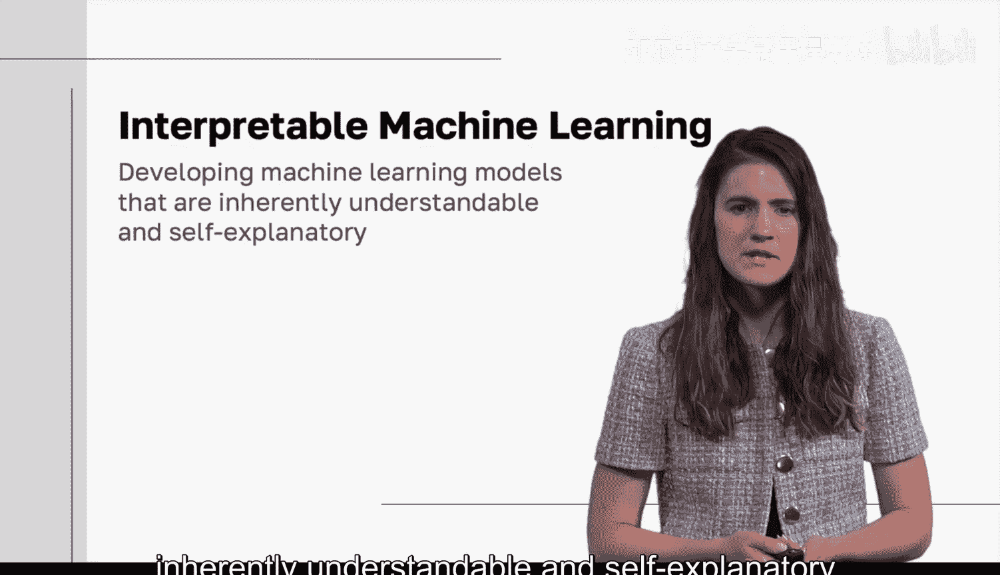
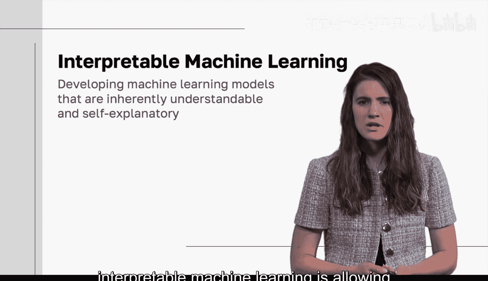
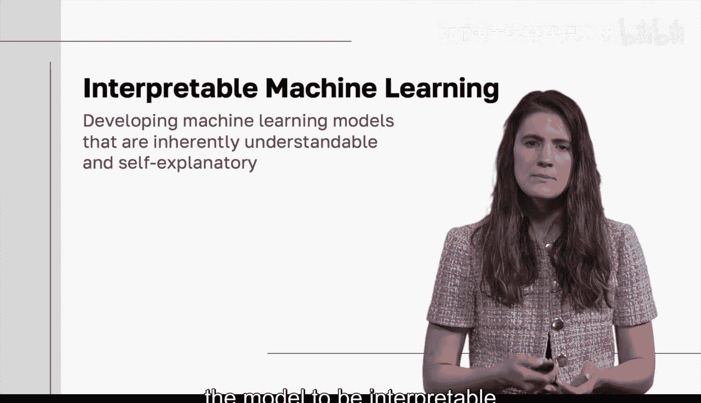
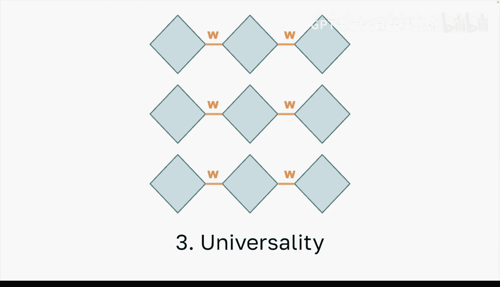
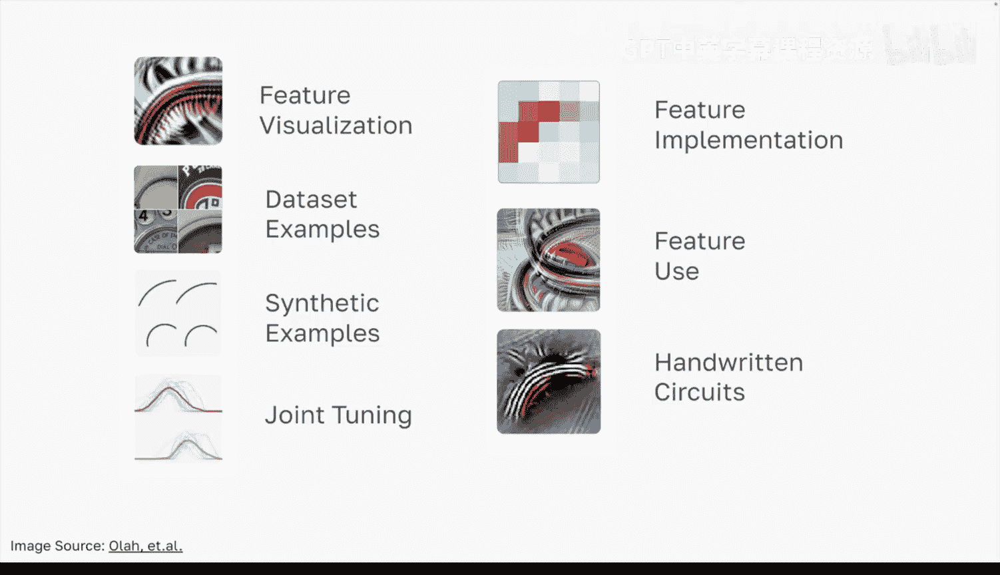
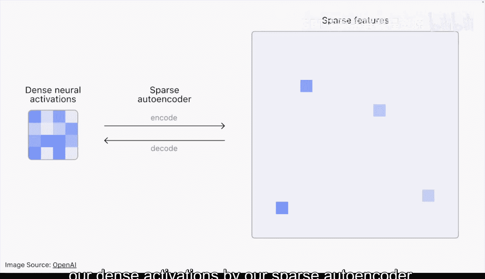
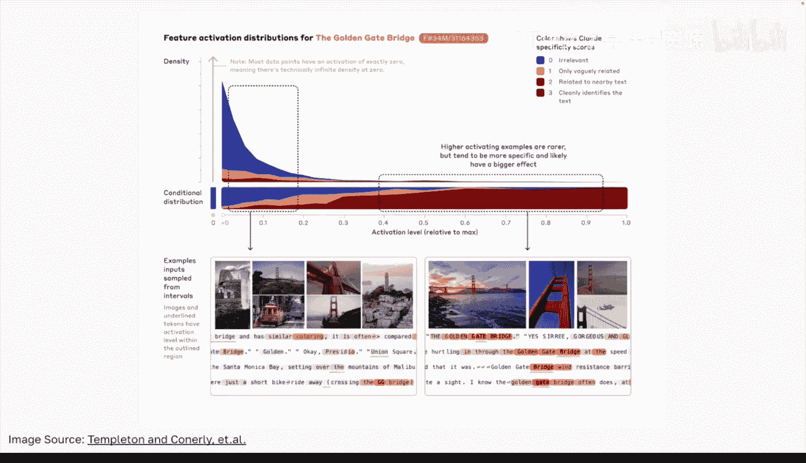

#  007：可解释的机器学习

在本节课中，我们将学习可解释机器学习（Interpretable Machine Learning）的核心概念。我们将探讨什么是可解释模型，了解几种典型的可解释模型及其工作原理，并深入一个前沿研究领域——机械可解释性（Mechanistic Interpretability）。

## 概述：什么是可解释机器学习？

在可解释人工智能（XAI）的背景下，可解释机器学习被定义为开发本质上可理解且能自我解释的机器学习模型。

这通常通过使用透明的建模技术来实现，例如线性回归、决策树或基于规则的模型。可解释机器学习背后的主要思想是，允许模型的内部逻辑和决策过程无需借助额外的解释方法即可被理解。

## 奥卡姆剃刀原则

上一节我们介绍了可解释机器学习的基本定义，本节中我们来看看一个指导模型选择的重要原则。

在当前的生成式人工智能成果令人眼花缭乱的背景下，许多问题实际上可以使用可解释模型来解决。我建议在评估用例的模型时，将可解释模型纳入考虑范围。

我在课堂教授人工智能以及用人工智能构建产品时都遵循一个原则：奥卡姆剃刀原则。奥卡姆剃刀原则指出，如果有两个相互竞争的理论可以解释同一现象，你应该选择更简单的那一个。

例如，你在半夜听到一个声音，并形成两个假设。第一个是你的猫把东西从桌子上碰掉了。第二个是外星人降落在你的屋顶上，现在正在入侵你的房子。根据奥卡姆剃刀原则，你应该选择更简单的假设，即你的猫碰掉了东西。

在人工智能的背景下，如果你有两个在评估标准上表现相似的AI模型，你应该选择更简单、更可解释的那一个。至少，你应该始终考虑最简单的方法，并提供为什么需要更复杂方法的理由。

## 可解释机器学习模型示例

理解了选择原则后，我们来看看一些具体的可解释机器学习模型。

以下是几种典型的可解释模型：

*   **线性模型**：如线性回归和逻辑回归，具有高度可解释性，因为它们的预测基于输入特征的加权和。系数直接表明了每个特征的重要性和方向性。通过例如套索（LASSO）或弹性网络（Elastic Net）正则化来强制稀疏性，可以将不相关特征的系数驱动为零，从而有效地执行特征选择，增强可解释性。
*   **广义可加模型**：试图解决线性回归的一些问题。例如，广义可加模型将线性模型与非线性特征变换相结合，同时保持可加的、可解释的结构，展示每个特征如何影响预测。
*   **决策树**：如CART和GeSDT，也是本质上可解释的模型。它们基于“如果-那么-否则”决策规则的层次化树结构，提供了一种自然的方式来追踪如何根据实例的特征值做出预测。
*   **基于规则的模型**：以人类可读的规则形式编码知识，例如：`如果 年龄 > 65 且 药物 = X，那么 风险 = 高`。

## 决策树与最优决策树

上一节我们列举了几种可解释模型，本节中我们更深入地看看决策树及其优化。

基于树的模型以这种直观的方式工作。基于树的模型根据特征中的某些截止值多次分割数据。通过这种分割，创建了数据集的不同子集，每个实例属于一个子集。

终端节点，也称为叶节点，是最终的子集。为了预测每个叶节点的结果，使用该节点中训练数据的平均结果。

由于其直观性和可解释性，基于决策树的模型可以用于分类或回归，并广泛应用于许多领域。

但我们如何找到最优的决策树呢？搜索空间是巨大的。这就是广义可扩展最优稀疏决策树（GeSDT，也称为GOSDT）的用武之地。其思想是减少所有决策树的搜索空间。论文中提出了分析边界来减少搜索空间。分析边界有助于高效地剪枝搜索空间，从而加速寻找最优决策树的过程。

## 本质可解释的神经网络

当我们想到神经网络时，通常不会联想到可解释性。事实上，神经网络是我们典型的黑盒机器学习模型示例。然而，研究界已经投入了大量精力来提高神经网络的可解释性，并构建本质可解释的模型。

神经网络中改进的可解释性表现为浅层神经网络、稀疏神经网络和模块化神经网络。

*   **浅层神经网络**：是更简单的神经网络架构，具有更少的层和节点，比更深、更复杂的模型更具可解释性。输入和输出之间的关系更容易显现。
*   **稀疏神经网络**：是许多网络连接被剪枝或设置为零的模型。由于剩余的连接代表了最重要的特征，这些模型可能更具可解释性。
*   **模块化神经网络**：是由专门子组件组成的模型，例如用于对象检测、分类或推理的组件。这些模型可能比整体式架构更具可解释性。

本质可解释的神经网络有几种不同的类型：

*   **解耦神经网络**：学习到的表示中，每个神经元或特征图对应一个特定的可解释概念，例如边缘、纹理或对象部件。这可以提供对模型内部推理的可见性。
*   **基于原型的神经网络**：学习每个类别的原型示例，并使用与这些原型的相似性作为预测的基础，这可能比复杂的决策边界更具可解释性。
*   **单调神经网络**：约束神经网络，使其输出相对于输入特征单调递增或递减。这可以使模型的行为更直观、更可预测。

康莫加-阿诺德网络（CANs）由Lu等人在2024年春季最新提出。CANs完全没有线性权重。每个权重参数都被一个单变量函数取代，该函数参数化为样条。CANs可以直观地可视化，并且可以轻松地与人类用户交互。

## 机械可解释性

一个相对较新的研究领域，机械可解释性（MI），是一个从学习到的权重反向工程神经网络到人类可解释算法的过程。

MI领域基于关于神经网络的三个推测性主张：

1.  **特征**：特征是神经网络的基本单位，它们对应于层中神经元的方向或线性组合。
2.  **电路**：特征通过权重连接形成电路。电路是网络的一个计算子图。一个电路由一组特征和它们之间的加权边组成。
3.  **普遍性**：普遍性假设类似的特征和电路在不同的模型和任务中形成。

机械可解释性使用许多方法来为这些推测性主张提供证据。我们将分享一些关于检测特定方向曲线的神经元的论证，我们称之为曲线检测器。

*   **特征可视化**：向我们展示了优化输入以使曲线检测器可靠地触发，会产生曲线。这建立了因果关系，因为结果图像中的所有内容都是为了引起神经元触发而添加的。我们可以在左上角的图像中看到这一点。
*   **数据集示例**：导致这些神经元强烈触发的ImageNet图像是特定方向的曲线图像，如左侧第二张图所示。
*   **合成示例**：也可以使用。曲线检测器对左侧第三张图中显示的合成曲线图像做出预期响应。
*   **联合调谐**：如果我们旋转曲线图像，在某个时刻神经元停止触发，而下一个方向的曲线检测器开始触发，这也可以为曲线检测器和特征的存在提供论证和证据。

最后三种是我们所说的MI特定方法，这些是为了MI研究目的而明确创建的研究方法。

*   **特征实现**：通过观察构建曲线检测器的电路，我们可以从权重中解读出曲线检测算法。这在热图中显示。
*   **特征使用**：曲线检测器的下游“客户”是自然涉及曲线的特征，例如这里右侧第二张图中显示的圆形。这些客户以预期的方式使用曲线检测器。
*   **手写电路**：我们可以手动设置所有权重来重新实现曲线检测。这些权重是一个可理解的曲线检测算法，因此我们反向工程了曲线检测器。

## 叠加假设与稀疏自编码器

现在，在理想情况下，网络中的每个神经元都会映射到我们的一个特征，就像我们在曲线检测器中看到的那样，每个神经元对应一个特定方向的曲线。

然而，神经元并不总是或通常能清晰地映射到可解释的特征。有时会发生，比如曲线检测器。其他时候，我们有多义性，即一个神经元映射到许多看似无关的特征。还有些时候，我们不知道如何将神经元匹配到特定的特征或特征集。

这才是真正发生的情况。这就是叠加假设。

根据叠加假设，我们观察到的神经网络是更大网络的模拟，其中每个神经元都是一个解耦的特征。我们可以在这里暂停一下，因为这非常“元”。我们将一堆信息压缩到一个神经网络中，该网络解压这些数据，学习它，然后将其压缩回观察到的神经网络中。

根据该假设，这些理想化的神经元作为几乎正交的向量投影到实际网络的神经元上。为了实现可解释性，我们需要能够解析叠加。

当前探索解析叠加的研究已转向稀疏自编码器。我们取右侧显示的密集神经激活，并使用稀疏自编码器将这些密集激活编码或映射到稀疏特征空间。然后，这些稀疏特征可以通过我们的稀疏自编码器解码回我们的密集激活。

## 案例：金门大桥特征

这就是当前机械可解释性工作背后的原理。如果你在2024年春季关注人工智能研究甚至只是新闻，你可能听说过“金门大桥特征”的概念。

虽然研究人员识别出许多可解释的特征，但被广泛宣传的一个是学到的特征，称为金门大桥特征——一个似乎专门检测与标志性金门大桥相关的引用和表示的特征。

该图的主图显示了跨输入的激活水平分布，激活范围从左边的可忽略到右边的高激活。颜色编码表示自动评分系统的结果，该系统根据每个激活与金门大桥概念的匹配程度（使用从0“无关”到3“明确识别概念”的评分标准）进行判断。

虽然有许多低水平激活对应于模糊相关的概念，如其他桥梁、旅游景点和纪念碑，但最高的激活绝大多数与金门大桥本身的明确提及或描绘相关，如右侧红色条的高比例所证明。尽管相对罕见，但这些高激活可能在塑造模型行为方面具有更大的重要性。

自动评分显示，该特征的强激活表现出对金门大桥解释的高度特异性，而即使是较弱的激活也倾向于保持某种程度的概念相关性，尽管可能更抽象或更泛化。

## 总结

本节课中，我们一起学习了可解释机器学习。我们从定义和奥卡姆剃刀原则开始，了解了线性模型、决策树等经典可解释模型。然后，我们探讨了如何通过特定架构使神经网络本身更具可解释性，并深入研究了机械可解释性这一前沿领域，了解了其特征、电路等核心概念，以及通过稀疏自编码器解析“叠加”的最新进展。最后，我们通过“金门大桥特征”这一具体案例，看到了机械可解释性在实际研究中的应用。理解这些模型的内在逻辑，对于在医疗、金融等关键领域构建可信赖的AI系统至关重要。